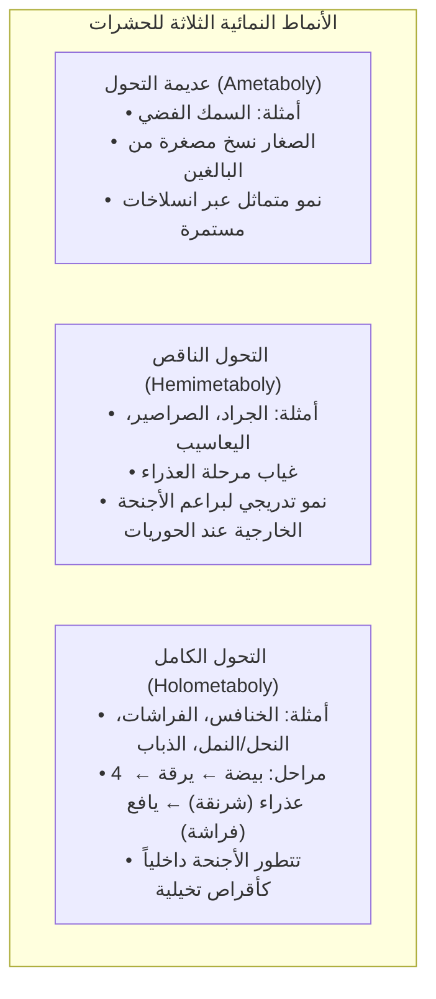
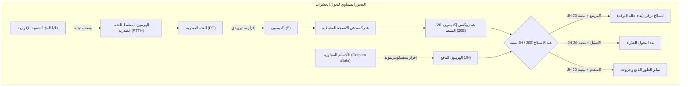
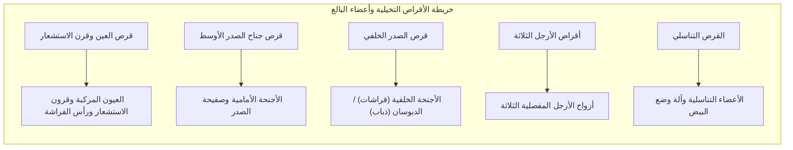

يرقة بدينة تلتهم أوراق النباتات بشراهة، تغلف نفسها بشرنقة صلبة، وتدخل في سكون تام، لتشق غلافها بعد أيام وتفرد أجنحة فراشة مبهجة: يمثل <strong>التحول الكامل (Holometaboly)</strong> إحدى أعظم المعجزات التطورية في تاريخ كوكب الأرض.

شاع في الثقافة العامة اعتقاد بأن جسم اليرقة يذوب تماماً إلى "حساء سائل بلا معالم" داخل الشرنقة، قبل أن يعاد بناء الفراشة من الصفر. إلا أن بيولوجيا التطور الحديثة كشفت عن حقيقة هندسية مذهلة تفوق هذا التصور.

تخضع أنسجة اليرقة بالفعل لـ<strong>انحلال نسيجي (Histolysis)</strong> شامل عبر الموت الخلوي المبرمج (البلعمة الذاتية والاستماتة). غير أن داخل الشرنقة ليس فوضى عارمة؛ فمنذ المراحل الجنينية الأولى، تستقر داخل اليرقة مجموعات خلوية ثنائية الصيغة الصبغية متخصصة ومحفوظة بعناية: <strong>الأقراص التخيلية (Imaginal Discs)</strong>.

وبينما تتفكك أعضاء اليرقة لتطلق فيضاً من الأحماض الأمينية والدهون، تمتص الأقراص التخيلية هذا الوقود الحيوي، وتحت إشراف الهرمونات وتدرجات المورفوجينات، تنقسم خلاياها بسرعة وتنبثق كالتلسكوب لتعيد بناء الأجنحة والأرجل والعيون المركبة وقرون الاستشعار للفراشة البالغة.

---

### 1. تطور أنماط التحول: لماذا ساد التحول الكامل اليابسة؟

تنقسم الحشرات إلى ثلاثة أنماط نمائية رئيسية:

تمثل <strong>الحشرات كاملة التحول (Endopterygota)</strong> أكثر من 60% من الأنواع الحيوانية و85% من الحشرات. يعود هذا النجاح إلى الفصل التام للبيئة والموارد بين اليرقة واليافع:
- <strong>اليرقة</strong>: آلة مخصصة لالتهام النباتات وتخزين الطاقة؛
- <strong>الفراشة البالغة</strong>: آلة مجنحة مخصصة للتكاثر والتلقيح ونشر الجينات.

---

### 2. الشبكة الصماوية: التوازن بين الهرمون اليافع و20-هيدروكسي إكديسون

يخضع توقيت الانسلاخ والتحول لتوازن دقيق بين هرمونين: <strong>الهرمون اليافع (JH)</strong> والستيرويد <strong>20-هيدروكسي إكديسون (20E)</strong>.

يصنع الإكديسون عبر إنزيمات السيتوكروم P450 المعروفة بـ<strong>جينات الهالوين</strong> (*Neverland*, *Spook*, *Phantom*, *Disembodied*, *Shadow*, *Shade*). 

يعمل الهرمون اليافع عبر مستقبل <strong>Met</strong> على تفعيل بروتين <strong>Kr-h1</strong> الذي يثبط جين التحول الرئيسي <strong>Broad-Complex (BR-C)</strong>. وفي الطور الأخير يتوقف إفراز JH، مما يحرر BR-C لتنطلق مرحلة العذراء.

---

### 3. تشريح الأقراص التخيلية: المخططات الخفية

تنشأ أعضاء الفراشة من تجمعات خلوية محددة سلفاً في الجنين: <strong>الأقراص التخيلية (imaginal discs)</strong>.

تتميز خلايا الأقراص بكونها ثنائية الصيغة الصبغية وتنقسم ميتوزياً. وتلتف أنسجة قرص الساق في حلقات متحدة المركز تشبه <strong>التلسكوب القابل للتمدد</strong>. وعند التحول، تنبثق الأنسجة نحو الخارج (Eversion) لتشكل الساق في غضون ساعات.

---

### 4. الإحداثيات المورفوجينية

تسترشد الخلايا بتدرجات تركيز جزيئات التوجيه (المورفوجينات):
- <strong>المحور الأمامي/الخلفي (A/P)</strong>: تعبر خلايا الجزء الخلفي عن *Engrailed* المحفز لـ *Hedgehog*، والذي يطلق تدرج *Decapentaplegic (Dpp)*؛
- <strong>المحور الظهري/البطني (D/V)</strong>: تعبر الخلايا الظهرية عن *Apterous* المحفز لإفراز *Wingless (Wg)* عند حافة الجناح؛
- يحدد تقاطع هذين المحورين طرف الجناح ويوجه تشكل العروق بدقة بالغة.

---

### 5. الانحلال النسيجي في الشرنقة

تخضع أنسجة اليرقة لتدمير منظم (Histolysis):
- يتحلل المعي اليرقي بالاستماتة ويخرج كفضلات أولى (عقي)؛
- تتفكك العضلات اليرقية بفعل إنزيمات الكاثيبسين؛
- تلتهم الخلايا البلعمية الحطام وتعيد ضخ المغذيات في الدم؛
- تنجو خلايا الأقراص التخيلية لأن جينات الاستماتة فيها مثبطة فوق-جينياً.

---

### 6. فرد الأجنحة وتكنولوجيا النانو الضوئية

تتفتح الأجنحة عبر الضخ الهيدروليكي للدم بواسطة تقلصات البطن، ثم يفرز هرمون <strong>البورسيكون</strong> ليدبغ الكيوتيكل ويصلبه.

أما اللون الأزرق الباهر لفراشات *Morpho* فينتج عن <strong>ألوان بنيوية نانوية</strong>: رقائق كيتينية متراكبة بمسافات تبلغ 140 نانومتر تعكس الضوء الأزرق بالتداخل البناء.

---

### 7. الذاكرة عبر التحول

أثبتت دراسات عام 2008 في *PLOS ONE* أن عث الدخان (*Manduca sexta*) الذي دُرّب في مرحلة اليرقة على تجنب رائحة مقترنة بصدمة كهربائية ظل يتجنب تلك الرائحة بعد تحوله إلى فراشة، مما يؤكد بقاء <strong>أجسام المشروم في الدماغ</strong> محتفظة بآثار التعلم.

---

### 8. التطبيقات ومثبطات نمو الحشرات (IGR)

أتاح فهم التحول الكامل إنتاج مبيدات ذكية آمنة للبيئة:
- <strong>محاكيات الهرمون اليافع (بيريبروكسيفين)</strong>: تمنع يرقات البعوض من بلوغ طور الطيران، كابحة الملاريا؛
- <strong>محفزات الإكديسون (تيبوفينوزيد)</strong>: تجبر اليرقات الضارة على انسلاخ مشوه ومميت.

---

### 9. خاتمة

التحول الكامل ليس إذابة عشوائية في حساء ميت، بل هو سيمفونية دقيقة تحافظ فيها الأقراص التخيلية على جوهر الكائن لتعيد نسجه في أبهى حلة طائرة.
