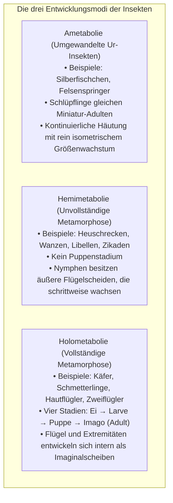
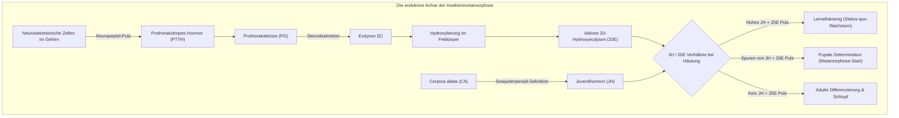
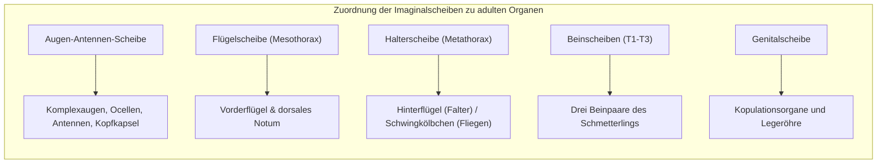
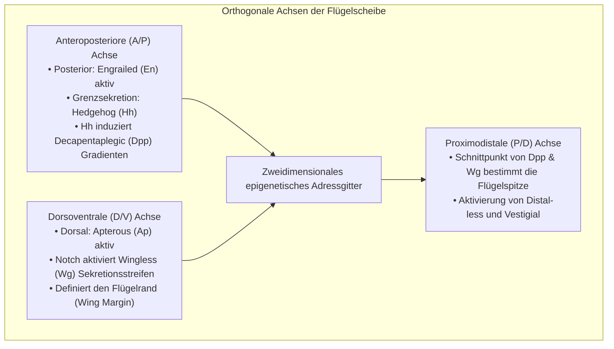
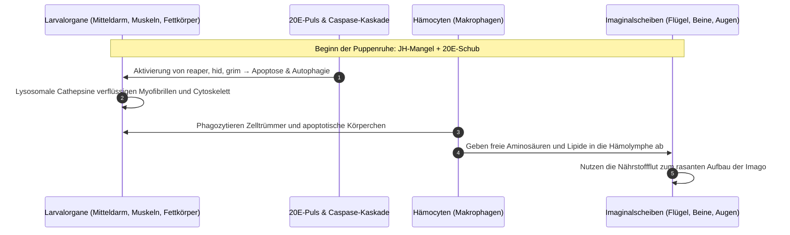
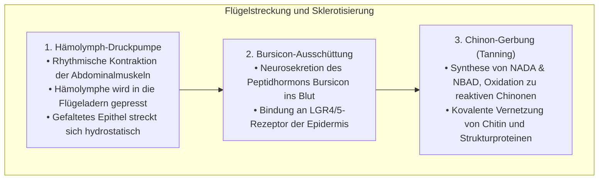
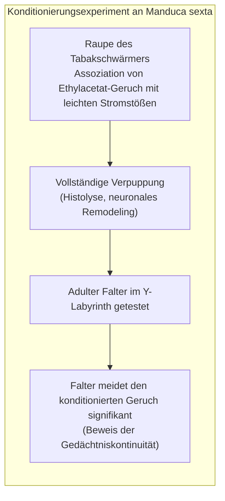

Eine gefräßige Raupe, die sich unermüdlich durch Laubblätter frisst, sich in eine starre Puppenhülle einwebt und nach einer Phase scheinbar absoluter Reglosigkeit als atemberaubender Falter mit schillernden Schwingen entschlüpft: Die <strong>vollständige Metamorphose (Holometabolie)</strong> ist eine der dramatischsten und faszinierendsten biologischen Transformationen im gesamten Tierreich.

Im allgemeinen Volksglauben hält sich hartnäckig der Mythos, dass die Raupe innerhalb der Puppe zu einem völlig formlosen, strukturlosen Brei („Suppe“) zerfließt, aus dem anschließend ein Schmetterling von Grund auf neu zusammengebaut wird. Die moderne Entwicklungsbiologie, Molekulargenetik und mikro-computertomographische Bildgebung zeigen jedoch eine ungleich elegantere, präzisere Wirklichkeit zellulärer Ingenieurskunst.

Zwar unterliegen die larvalen Gewebe tatsächlich einer radikalen <strong>Histolyse</strong> – einem durch Apoptose und Autophagie gesteuerten Selbstverdauungsprozess. Doch das Innere der Puppe ist niemals ein amorphes Chaos. Schon im frühesten embryonalen Stadium wurden in der Raupe hochspezialisierte, diploide Zellnester angelegt und konserviert: die <strong>Imaginalscheiben (Imaginal Discs)</strong>.

Während die larvalen Organe zerfallen und einen Strom aus Aminosäuren, Lipiden und Trehalose freisetzen, nehmen die Imaginalscheiben diesen Nährstoffschub auf. Gesteuert von Hormonpulsen und Morphogengradienten durchlaufen sie eine explosionsartige Mitose, stülpen sich wie ein auseinandergezogenes Teleskop nach außen (Eversion) und formen in erstaunlicher Selbstorganisation Flügel, Beine, Facettenaugen und Fühler des fertigen Insekts.

Dieser wissenschaftliche Leitfaden beleuchtet die hormonelle Steuerung (das antagonistische Wechselspiel von Juvenilhormon und 20-Hydroxyecdyson), die Halloween-Genkaskade, die Musterbildung der Imaginalscheiben, den histolytischen Gewebezerfall, die Nanophotonik der Flügelschuppen, das Fortbestehen von Erinnerungen über die Metamorphose hinweg sowie moderne Anwendungen von Insektenwachstumsregulatoren.

---

### 1. Evolution der Metamorphose: Warum die Holometabolie die Erde eroberte

Die rezenten Insekten (Hexapoda) werden entwicklungsbiologisch in drei fundamentale Gruppen unterteilt:

Über 60 % aller beschriebenen Tierarten und mehr als 85 % aller Insekten gehören zur Gruppe der <strong>holometabolen Insekten (Endopterygota)</strong>. Die vier megadiversen Großordnungen – Coleoptera (Käfer), Lepidoptera (Schmetterlinge), Hymenoptera (Hautflügler) und Diptera (Zweiflügler) – verdanken ihren evolutionären Siegeszug dieser radikalen Entwicklungsstrategie.

#### Vollständige ökologische Nischentrennung
Bei hemimetabolen Insekten wie der Heuschrecke teilen sich Nymphe und adultes Tier dieselben beißend-kauenden Mundwerkzeuge, leben im selben Grasland und fressen dieselben Wirtspflanzen. Dies führt zu intensiver <strong>innerartlicher Konkurrenz zwischen Eltern und Nachkommen</strong>.

Die Holometabolie hingegen trennt Lebensraum und Nahrungsressourcen zu 100 Prozent:
- <strong>Die Larve (Raupe, Made, Engerling)</strong>: Ausgestattet mit kräftigen Mundwerkzeugen und enormer Verdauungskapazität dient sie ausschließlich als <strong>Biomasse-Akkumulationsmaschine</strong>, die ihr Gewicht binnen Wochen um das Tausendfache vervielfacht;
- <strong>Die Imago (Schmetterling, Fliege, Biene)</strong>: Verfügt über Saugrüssel für Blütennektar, hochauflösende Komplexaugen und aerodynamische Flügel. Sie fungiert als hochmobile <strong>Ausbreitungs- und Fortpflanzungsmaschine</strong>.

Durch diese funktionale Arbeitsteilung entfällt die innerartliche Ressourcenkonkurrenz vollständig, was den Holometabolen die weltweite Radiation in sämtliche terrestrische Ökosysteme ermöglichte.

---

### 2. Das endokrine Steuerungsnetzwerk: Die Wippe aus Juvenilhormon und 20-Hydroxyecdyson

Das exakte Timing von Häutung, Verpuppung und Schlupf wird durch das antagonistische Gleichgewicht zweier neuroendokriner Master-Regulatoren bestimmt: <strong>Juvenilhormon (JH)</strong> und das Steroidhormon <strong>20-Hydroxyecdyson (20E)</strong>.

#### Die Halloween-Genkaskade der Steroidbiosynthese
In der Prothorakaldrüse wird Cholesterin über eine Reihe evolutionär konservierter Cytochrom-P450-Enzyme zu Ecdyson umgewandelt. Da Mutationen dieser Gene zu missgebildeten, geisterhaften Embryonen führen, werden sie als <strong>Halloween-Gene</strong> bezeichnet:
1. <strong>Neverland (Nvd)</strong>: Wandelt Cholesterin in 7-Dehydrocholesterin um;
2. <strong>Spook (CYP307A1)</strong>: Katalysiert geschwindigkeitsbestimmende Oxidationsschritte zu Ketodiol-Zwischenstufen;
3. <strong>Phantom (Phm: CYP306A1)</strong>: Führt die C-25-Hydroxylierung durch;
4. <strong>Disembodied (Dib: CYP302A1)</strong>: Vermittelt die C-22-Hydroxylierung;
5. <strong>Shadow (Sad: CYP315A1)</strong>: Vollendet die C-2-Hydroxylierung zu Ecdyson;
6. <strong>Shade (Shd: CYP314A1)</strong>: Hydroxyliert Ecdyson im peripheren Fettkörper zu hochaktivem <strong>20-Hydroxyecdyson (20E)</strong>.

Das 20E bindet an den Heterodimer-Rezeptor aus <strong>EcR (Ecdyson-Rezeptor)</strong> und <strong>USP (Ultraspiracle)</strong>, wodurch die Transkription metamorphose-relevanter Genprogramme entfesselt wird.

#### Juvenilhormon, Kr-h1 und die Broad-Complex-Bremse
Das von den Corpora allata synthetisierte Juvenilhormon (JH) wirkt als molekularer Status-quo-Befehl:
- JH bindet an die intrazellulären Rezeptoren <strong>Met (Methoprene-tolerant)</strong> und <strong>Gce</strong>.
- Der aktivierte Met/Gce-Komplex induziert den Zinkfinger-Transkriptionsfaktor <strong>Krüppel-homolog 1 (Kr-h1)</strong>.
- Kr-h1 bindet direkt an den Promotor des Verpuppungs-Schlüsselgens <strong>Broad-Complex (BR-C)</strong> und blockiert dessen Transkription vollständig.
- Im letzten Larvenstadium stellen die Corpora allata die JH-Synthese ein, während zirkulierende Esterasen verbliebenes JH abbauen. Sinkt der JH-Spiegel auf null, entfällt die Kr-h1-Repression: Ein 20E-Puls führt zur <strong>explosionsartigen Expression von BR-C</strong>, wodurch die Verpuppung unumkehrbar eingeleitet wird.

---

### 3. Anatomie der Imaginalscheiben: Die schlafenden Baupläne

Die adulten Körperteile entstehen in der Puppe aus vordefinierten Zellnestern, die bereits im frühen Insektenembryo angelegt wurden: den <strong>Imaginalscheiben (Imaginal Discs)</strong>.

#### Diploide Reserven versus polyploide Larvenzellen
Während die normalen Larvenzellen (Darm, Haut, Speicheldrüsen) durch wiederholte DNA-Replikation ohne Zellteilung <strong>polyploidisieren (Endoreplikation)</strong>, um gigantische Proteinsyntheseraten zu gewährleisten, bleiben die Imaginalscheibenzellen strikt <strong>diploid</strong>.

Sie teilen sich mitotisch und bilden eingestülpte, einschichtige epitheliale Hohlkörper (Epithelial Discs), die im Hämocoel der Raupe schwimmen.

#### Teleskopartige Faltung
Das Epithel der Beinscheiben ist wie ein zusammengeschobenes <strong>Fernrohr (Teleskop)</strong> in konzentrischen Ringen gefaltet:
- Das innerste Zentrum bildet die spätere Beinspitze (Prätarsus und Klauen);
- Die konzentrischen Außenringe codieren Tarsus, Tibia, Femur, Trochanter und Coxa.
Unter dem Einfluss von 20E stülpen sich diese Falten bei der Metamorphose rasch nach außen um (Eversion) und strecken sich zum fertigen Gliedmaßenabschnitt.

---

### 4. Musterbildung: Das orthogonale Koordinatensystem aus Morphogenen

Woher weiß eine Zelle der Flügelscheibe, ob sie Ader, Schuppe oder Flügelrand werden soll? Sie liest präzise Positionssignale aus <strong>Morphogengradienten</strong> ab.

- <strong>A/P-Achse</strong>: Zellen des posterioren Kompartiments exprimieren *engrailed (en)*, welches das Signalmolekül *Hedgehog (Hh)* induziert. Hh diffundiert über die Kompartimentgrenze und schaltet im anterioren Randbereich das morphogene Signal *Decapentaplegic (Dpp)* an, das einen weitreichenden Gradienten bildet.
- <strong>D/V-Achse</strong>: Dorsale Zellen exprimieren *apterous (ap)*. An der Grenze entsteht ein feiner Streifen des Wnt-Morphogens *Wingless (Wg)*, der die spätere Flügelkante festlegt.
- <strong>Flügelspitze</strong>: Am Kreuzungspunkt der Dpp- und Wg-Maxima wächst die Flügelspreite nach distal aus.

---

### 5. Histolyse in der Puppe: Regulierter Zelltod und Recycling

Der Begriff der „Suppe“ beschreibt bildhaft einen biochemisch hochkontrollierten Prozess: die <strong>Histolyse</strong>.

- <strong>Mitteldarm-Erneuerung</strong>: Das riesige Darmepithel der Raupe geht geschlossen in die Apoptose und wird als dunkle Masse (Mekonium) im Darmlumen gesammelt; Stammzellen errichten den zierlichen Adultdarm.
- <strong>Muskelverflüssigung</strong>: Die mächtige Kriechmuskulatur wird durch Cathepsine und das Ubiquitin-Proteasom-System in freie Aminosäuren zerlegt.
- <strong>Schutz der Imaginalscheiben</strong>: In Imaginalscheiben sind die apoptotischen Promotoren epigenetisch blockiert. Statt Zelltod induziert 20E hier cyclinabhängige Kinasen und Wachstumsfaktoren.

---

### 6. Flügelentfaltung und Nanophotonik

Beim Schlupf sind die Flügel klein und zerknittert. Die Entfaltung erfolgt hydraulisch:

#### Strukturfarben bei Morpho-Faltern
Die schillernden blauen Flügelfarben von *Morpho*-Faltern entstehen nicht durch Farbpigmente, sondern durch <strong>optische Nanostrukturen (Strukturfarben)</strong>:
- Schuppenbildende Zellen (Trichogene) scheiden Chitin ab, das sich zu mikroskopischen Tannenbaum-Lamellen mit einem Abstand von ca. 140 nm anordnet.
- Durch Vielstrahlinterferenz wird blaues Licht ($\lambda \approx 450\,\text{nm}$) reflektiert, während andere Wellenlängen ausgelöscht werden – ein über Jahrmillionen farbstabiles Nanomaterial.

---

### 7. Gedächtnisübertragung über die Metamorphose: Erinnert sich der Schmetterling?

Können in der Raupe erworbene Gedächtnisspuren die Zerstörung des Nervensystems in der Puppe überleben?

2008 erbrachten Douglas Blackiston und Martha Weiss (*PLOS ONE*) den experimentellen Beweis:

Obwohl das Nervensystem umfassend umgebaut wird, überleben die <strong>Kenyon-Zellen der Pilzkörper (Mushroom Bodies)</strong> – das Lern- und Gedächtniszentrum der Insekten – die Verpuppung. Ihre synaptischen Verbindungen werden reorganisiert, doch stabile Engramme bleiben intakt und stehen dem adulten Falter zur Verfügung.

---

### 8. Pro-Nymphen-Hypothese und Insektenwachstumsregulatoren (IGR)

Nach der modernen <strong>Pro-Nymphen-Hypothese</strong> (Truman & Riddiford) entspricht die Raupe phylogenetisch einem vorzeitig geschlüpften, frei lebenden Embryo (Pro-Nymphe), während das einstige Nymphenstadium zur <strong>Puppe</strong> komprimiert wurde.

#### Praktische Anwendung: IGRs
Das Wissen um diese Mechanismen ermöglicht hochselektive Insektizide:
- <strong>JH-Mimetika (Pyriproxyfen, Methoprene)</strong>: Verhindern die Verpuppung von Mückenlarven und stoppen die Ausbreitung von Krankheitsüberträgern, ohne Wirbeltiere zu schädigen;
- <strong>Ecdyson-Agonisten (Tebufenozide)</strong>: Lösen verfrühte, tödliche Fehlhäutungen bei Schadfaltern aus.

---

### 9. Fazit: Meisterwerk der natürlichen Bio-Ingenieurkunst

Die Vorstellung einer „Raupensuppe“ ist zwar eine treffende Metapher für den Zelltod der Larvalorgane, verkennt jedoch die architektonische Genialität der Metamorphose. 

Inmitten des Abbaus bewahren die Imaginalscheiben den Bauplan des künftigen Falters. Durch das Zusammenspiel von Steroidhormonen, Morphogengittern und hydraulischer Mechanik verwandelt die Natur ein plumpes Kriechtier in ein fliegendes Kunstwerk.
