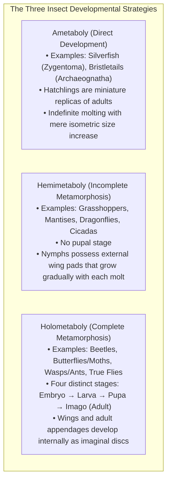
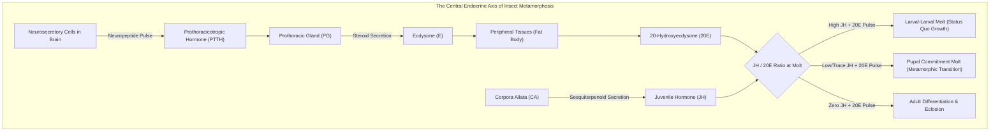
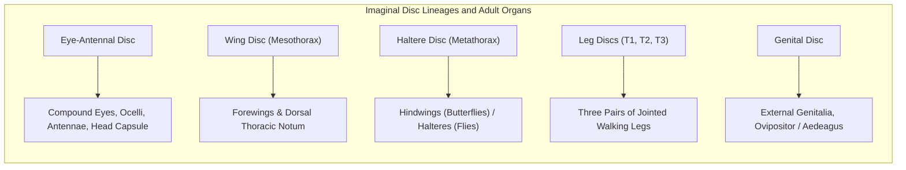
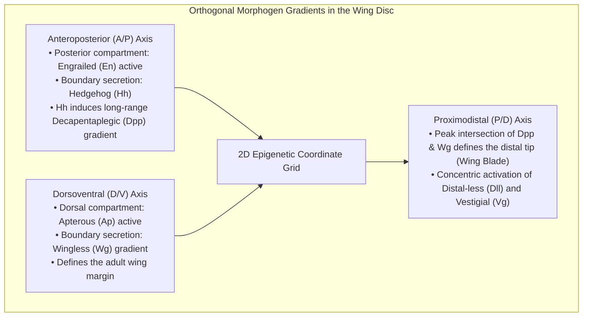
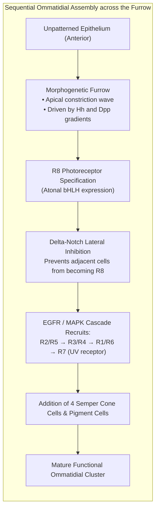
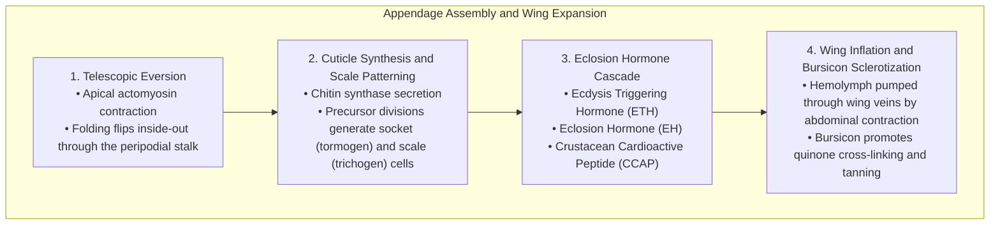
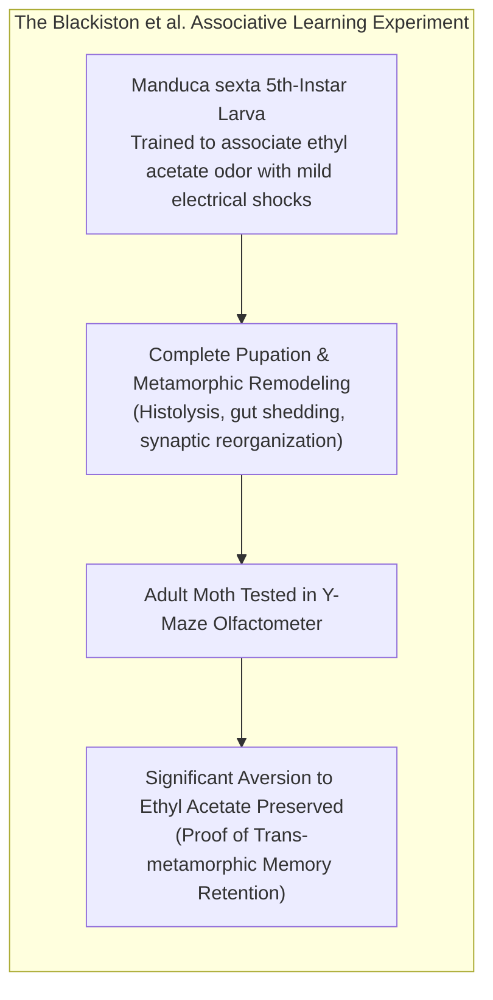
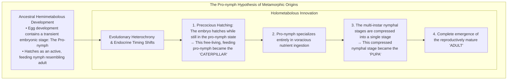
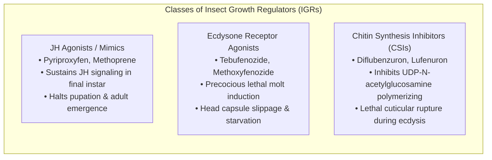

A voracious, stubby caterpillar devouring garden foliage, wrapping itself within a hardened chrysalis, entering a state of complete outward immobility, and finally rupturing its pupal cuticle to unfurl breathtaking, iridescent wings as an airborne butterfly—<strong>complete metamorphosis (holometaboly)</strong> stands as one of the most astonishing transformations in the entire history of terrestrial life.

In popular imagination, a persistent myth holds that the caterpillar completely dissolves into a formless, chaotic soup inside the pupal casing, after which an entirely new organism is reassembled from scratch. Modern developmental biology, molecular genetics, and micro-computed tomography have revealed a reality that is far more sophisticated, elegant, and biologically profound.

The larval tissues do indeed undergo dramatic <strong>histolysis</strong>—a programmed, self-digesting cascade of apoptosis, autophagy, and enzymatic degradation. Yet, this process is far from random chaos. Embedded within the caterpillar since its earliest embryonic development are microscopic clusters of undifferentiated, highly committed diploid progenitor cells: the <strong>imaginal discs (imaginal discs and histoblasts)</strong>.

As the larval organs melt into a nutrient-rich bath of free amino acids, lipids, and carbohydrates, the imaginal discs absorb this biochemical torrent. Governed by precise morphogen gradients and hormonal switches, they undergo explosive mitotic expansion, mechanical three-dimensional eversion, and tissue differentiation to construct the adult insect's anatomy.

This comprehensive scientific guide explores the evolutionary origins, endocrine circuits (the antagonistic seesaw of Juvenile Hormone and 20-hydroxyecdysone), the Halloween gene cascade, morphogen gradient patterning, histolytic tissue liquidation, structural color nanophotonics, trans-metamorphic memory retention, and the modern applications of insect growth regulators.

---

### 1. The Evolutionary Triumph of Holometaboly: Why Complete Metamorphosis Conquered Earth

Living insects (Hexapoda) are phylogenetically categorized into three major developmental modalities:



Holometabolous insects (clade <strong>Endopterygota</strong>) represent more than 60% of all described animal species on Earth and over 85% of all insects. The "Big Four" megadiverse orders—Coleoptera (beetles), Lepidoptera (butterflies and moths), Hymenoptera (ants, bees, wasps), and Diptera (true flies)—all belong to this evolutionary lineage.

#### Complete Ecological Niche Decoupling
In hemimetabolous insects such as grasshoppers, nymphs and adults share identical chewing mouthparts, inhabit the same terrestrial microhabitats, and compete directly for identical plant resources. This creates intense <strong>intraspecific competition between parent and offspring</strong>.

In contrast, complete metamorphosis achieves complete ecological niche partitioning:
- <strong>The Larva (Caterpillar, Grub, Maggot)</strong>: Possesses robust chewing mandibles and low motility. It operates as an optimized <strong>trophic and biomass accumulation engine</strong>, multiplying its body mass thousands of times in a matter of weeks.
- <strong>The Imago (Adult Butterfly, Fly, Beetle)</strong>: Often dispenses with chewing mouthparts entirely (evolving siphoning proboscises for nectar, or not feeding at all). Equipped with large compound eyes, sensory antennae, and compound wings, it operates as a specialized <strong>dispersal and reproductive delivery system</strong>.

By completely severing the ecological niches of larvae and adults, holometabolous insects eradicated parent-offspring resource competition and achieved unmatched macroevolutionary diversification across terrestrial biomes.

---

### 2. The Endocrine Regulatory Network: The Biochemical Seesaw of JH and 20E

The timing of insect molting, metamorphosis, and reproduction is tightly orchestrated by the counterbalancing dynamics of two master endocrine regulators: <strong>Juvenile Hormone (JH)</strong> and the steroid hormone <strong>20-hydroxyecdysone (20E)</strong>.



#### The Halloween Gene Cascade of Steroidogenesis
Ecdysone biosynthesis from dietary sterols (primarily cholesterol or plant phytosterols) occurs in the prothoracic gland via a sequential series of cytochrome P450 monooxygenases. These enzymes were named the <strong>Halloween genes</strong> because their loss-of-function mutant embryos display failure of cuticular head skeleton development, resembling eerie masks:

```mermaid
flowchart LR
    subgraph HalloweenPathway ["The Halloween Steroid Biosynthetic Cascade"]
        Cholesterol["Cholesterol"] -->|Neverland (Nvd)| 7DC["7-Dehydrocholesterol"]
        7DC -->|Black Box (Spook/CYP307A1)| Ketodiol["Ketodiol Intermediates"]
        Ketodiol -->|Phantom (Phm: CYP306A1)| Ketotriol["Ketotriol"]
        Ketotriol -->|Disembodied (Dib: CYP302A1)| DeoxyEcdysone["2-Deoxyecdysone"]
        DeoxyEcdysone -->|Shadow (Sad: CYP315A1)| Ecdysone["Ecdysone"]
        Ecdysone -->|Shade (Shd: CYP314A1: Peripheral)| 20E["20-Hydroxyecdysone (20E)"]
    end
```

Once converted into active 20E in peripheral tissues (especially the fat body), it binds with high affinity to a heterodimeric nuclear receptor complex composed of the <strong>Ecdysone Receptor (EcR)</strong> and <strong>Ultraspiracle (USP)</strong> (the insect homolog of the vertebrate retinoid X receptor, RXR).

#### Juvenile Hormone and the Kr-h1 / Broad-Complex Switch
Juvenile Hormone (a group of acyclic sesquiterpenoids produced by the paired neuroendocrine *corpora allata*) acts as the quintessential "status quo" factor:
1. JH diffuses into target cells and binds to the intracellular bHLH-PAS family nuclear receptors <strong>Methoprene-tolerant (Met)</strong> and <strong>Germ cell-expressed (Gce)</strong>.
2. The activated Met/Gce complex binds to ecdysone-response elements and transcriptionally induces the zinc-finger transcription factor <strong>Krüppel-homolog 1 (Kr-h1)</strong>.
3. Kr-h1 binds directly to the promoter region of the pupal master-specifier gene <strong>Broad-Complex (BR-C)</strong>, completely repressing its transcription.
4. As long as JH titers remain high, 20E pulses merely trigger a larval-to-larval molt.
5. In the final larval instar, neuroendocrine signals silence the corpora allata while hemolymph <strong>JH esterases</strong> and <strong>epoxide hydrolases</strong> clear circulating JH to nearly undetectable levels.
6. The subsequent pulse of 20E in the total absence of JH relieves Kr-h1-mediated repression, driving <strong>explosive activation of BR-C</strong>. BR-C triggers the metamorphic pupal commitment: committing larval tissues to histolysis and imaginal discs to pupal differentiation.
7. During the pupal stage, BR-C levels decline and a second 20E pulse induces the adult-specifier transcription factor <strong>E93</strong>, unlocking terminal imaginal differentiation and adult morphogenesis.

---

### 3. Anatomy of Imaginal Discs: The Dormant Blueprints

How does the adult insect assemble legs, wings, compound eyes, and genital organs from what seems to be a featureless pupa? The structural secret lies in the <strong>imaginal discs</strong>.



#### Embryonic Segregation and Diploid Quiescence
Imaginal discs are not newly generated during pupation. Instead, they are set aside during early embryogenesis as tiny clusters of 20 to 50 ectodermal cells at discrete parasegmental boundaries.

Throughout larval life, while the caterpillar grows exponentially, the caterpillar's own larval body cells (epidermis, gut, salivary glands) grow without mitotic division. They undergo <strong>endoreplication (polyteny)</strong>, replicating their genomic DNA multiple times without karyokinesis or cytokinesis to support massive protein synthesis.

In contrast, the imaginal disc cells remain strictly <strong>diploid</strong>. They undergo continuous mitotic cell divisions, invaginating from the larval epidermis to form flattened, hollow <strong>monolayer epithelial sacs (epithelial discs)</strong> suspended within the larval body cavity, bathed in hemolymph. By the end of the final larval instar, the *Drosophila* wing disc, for example, has multiplied from roughly 40 embryonic founders to an orchestrated sheet of over 50,000 cells.

#### The Telescopic Concentric Folding
The disc epithelium is organized into two distinct faces:
- <strong>The Peripodial Membrane</strong>: A thin, squamous epithelium facing the disc lumen.
- <strong>The Disc Proper</strong>: A columnar epithelium tightly folded into concentric rings and pleats, resembling an inverted collapsible telescope or accordion.

In a leg imaginal disc, the central core corresponds to the most distal structure—the claw and tarsal segments. Successive outer concentric rings specify the tibia, femur, trochanter, and coxa. When metamorphic hormones signal eversion, the concentric folds unfold telescopically outward along the proximodistal axis.

---

### 4. Morphogen Gradients and Molecular Coordinate Systems

How does an individual cell in an imaginal disc "know" whether it should form a wing vein, a sensory bristle, or the wing hinge? The answer lies in the establishment of orthogonal Cartesian-like <strong>morphogen coordinate systems</strong>.



#### The Anteroposterior (A/P) Boundary: Engrailed, Hedgehog, and Dpp
Early in development, the homeodomain selector gene <strong>engrailed (en)</strong> is expressed exclusively in the posterior half of the disc, establishing a strict, non-mixing <strong>compartment boundary</strong>:
1. Engrailed activates the short-range signaling ligand <strong>Hedgehog (Hh)</strong> in posterior cells.
2. Hh diffuses across the boundary into the anterior compartment (posterior cells cannot respond to Hh because they lack the Smoothened signal transduction pathway or repress it).
3. Hh signaling in a stripe of anterior cells immediately bordering the boundary induces the transcription and secretion of <strong>Decapentaplegic (Dpp)</strong>, a member of the BMP/TGF-$\beta$ superfamily.
4. Dpp forms a long-range bidirectional morphogen concentration gradient across both compartments, activating target genes (such as *spalt* and *optomotor-blind*) in concentration-dependent thresholds.

#### The Dorsoventral (D/V) Boundary: Apterous and Wingless
Simultaneously, the disc is partitioned into dorsal and ventral compartments:
1. Dorsal cells selectively express the LIM-homeodomain transcription factor <strong>apterous (ap)</strong>.
2. Notch signaling is activated exclusively at the interface between Ap-expressing and non-expressing cells, generating a thin stripe of <strong>Wingless (Wg)</strong> (a Wnt family morphogen).
3. Wg diffuses perpendicularly to Dpp, instructing cells along the dorsoventral axis and defining the future margin of the adult wing.

The physical intersection of the Dpp stripe and the Wg stripe marks the maximal morphogenetic signal, defining the ultimate distal tip of the wing blade. Through this cellular GPS system, each cell reads its coordinates and activates the appropriate downstream structural gene networks.

---

### 5. Eye-Antennal Disc and the Morphogenetic Furrow

In the eye-antennal disc, the assembly of the compound eye—composed of hundreds to thousands of hexagonal optical units called <strong>ommatidia</strong>—is governed by a remarkable self-propagating kinematic indentation known as the <strong>morphogenetic furrow</strong>.



The morphogenetic furrow initiates at the posterior margin of the eye disc and sweeps linearly across the epithelium toward the anterior edge. Ahead of the furrow, cells divide randomly in an uncommitted state. Within the furrow, cells arrest in the G1 phase and undergo apical constriction.

Behind the advancing furrow:
1. The basic helix-loop-helix (bHLH) transcription factor <strong>Atonal</strong> is expressed in periodic clusters, specifying the founder <strong>R8 photoreceptor cell</strong>.
2. R8 activates <strong>Delta-Notch lateral inhibition</strong> to prevent neighboring cells from adopting the R8 fate, ensuring an impeccably regular, crystalline hexagonal array.
3. The R8 cell secretes the EGF receptor ligand <strong>Spitz</strong>, sequentially recruiting neighboring cells into the cluster: first R2 and R5, followed by R3 and R4, then R1 and R6, and finally the UV-sensitive photoreceptor <strong>R7</strong>.
4. Subsequently, four lens-secreting <strong>cone cells</strong> and surrounding pigment cells wrap the neural cluster, completing each ommatidium with sub-micron precision.

---

### 6. Inside the Chrysalis: Histolysis, Autophagy, and Macrophage Clearance

While the chrysalis appears completely quiescent from the outside, the internal milieu undergoes catastrophic, regulated deconstruction.

"The caterpillar melts into soup" is an informal metaphor, but cellularly, it is an exquisitely regulated program of <strong>systemic histolysis</strong>:

```mermaid
sequenceDiagram
    autonumber
    participant LarvalTissues as Larval Organs (Gut, Muscle, Fat Body)
    participant EcdysoneAxis as 20E Pulse & Caspase Cascade
    participant Hemocytes as Hemocytes (Phagocytes / Macrophages)
    participant ImaginalDiscs as Imaginal Discs (Wings, Legs, Eyes)

    Note over LarvalTissues,ImaginalDiscs: Onset of Pupation: JH Depletion + 20E Surge
    EcdysoneAxis->>LarvalTissues: Induces reaper, hid, grim → Triggers Apoptosis & Autophagy
    LarvalTissues->>LarvalTissues: Lysosomal cathepsins degrade cytoskeleton; myofibrils dissolve
    Hemocytes->>LarvalTissues: Engulf and phagocytose apoptotic bodies and cell fragments
    Hemocytes->>ImaginalDiscs: Release digested amino acids, fatty acids, and sugars into hemolymph
    ImaginalDiscs->>ImaginalDiscs: Absorb molecular building blocks; drive explosive mitotic growth
```

#### Selective Autolysis of Larval Structures
1. <strong>The Larval Alimentary Canal</strong>: The enormous larval midgut, adapted for processing massive quantities of cellulose, is destroyed as its epithelial cells undergo synchronized apoptosis. It shrinks and sloughs off into the gut lumen (forming the *meconium*, the metabolic waste excreted by the adult upon eclosion). A brand-new adult digestive tract, slender and optimized for nectar digestion and fluid transport, is generated from resident adult midgut progenitor cells (*AMPs*).
2. <strong>Larval Skeletal Musculature</strong>: The intersegmental body wall muscles that enabled peristaltic crawling are dismantled through the combined action of the ubiquitin-proteasome system and lysosomal acid proteases (cathepsins B, D, and L). The muscle proteins are cleaved into free amino acids.
3. <strong>The Larval Fat Body</strong>: Rather than dying en masse, the fat body undergoes extensive tissue dissociation and autophagy, releasing vitellogenin, storage hexamerins, and trehalose into the hemolymph.

#### Why Are Imaginal Discs Immune to Histolysis?
The fundamental question arises: why do the digestive enzymes and apoptotic cascades spare the imaginal discs?

The answer lies in <strong>divergent transcriptional rewiring downstream of EcR</strong>:
- In polytene larval cells, 20E pulses directly activate pro-apoptotic effector genes (such as *reaper*, *head involution defective (hid)*, and *grim*), turning on executioner caspases.
- In diploid imaginal disc cells, these cell-death promoters are epigenetically silenced by Polycomb group (PcG) chromatin-modifying complexes. Instead, the identical 20E signal binds EcR to activate cyclin-dependent kinases, growth factors, and morphogenesis programs, converting the apoptotic destruction of the larva into the fuel for imaginal synthesis.

---

### 7. Histogenesis, Mechanical Eversion, and Wing Nanophotonics

During the mid-to-late pupal stage, the imaginal tissues undergo <strong>histogenesis</strong>—the morphogenesis of adult structures.



#### The Biomechanics of Telescopic Eversion
The transition of the flat imaginal disc into an elongated, cylindrical three-dimensional limb is a marvel of cellular biomechanics.
Through localized changes in epithelial cell shape (transition from tall columnar to cuboidal) and polarized actomyosin contractility along the cell apices, the disc undergoes rapid <strong>eversion</strong>. The inner concentric folds pop outward like an unfolding telescope, pushing through the peripodial stalk to form the hollow leg or wing bud on the exterior surface of the pupa.

#### Scale Nanophotonics and Structural Color in Lepidoptera
The scales covering butterfly wings are single-cell masterpieces of photonic engineering:
1. Epidermal scale precursor cells undergo asymmetric division to produce a pair: a <strong>tormogen cell</strong> (which forms the socket) and a <strong>trichogen cell</strong> (which produces the scale blade).
2. The trichogen cell extends an elongated, flattened cytoplasmic projection packed with longitudinal parallel bundles of actin filaments.
3. Cuticular chitin is secreted around this actin scaffolding. As the scale matures, the cell undergoes apoptosis, leaving behind a hollow, rigid chitinous shell.
4. In species such as the *Morpho* butterfly, the ridges of the scales self-assemble into microscopic Christmas-tree-like lamellae spaced at intervals of approximately 140 nanometers. This architectural periodicity causes constructive multi-beam optical interference of blue wavelengths ($\lambda \approx 450\,\text{nm}$) while canceling other frequencies, generating <strong>structural color</strong> that never fades over millions of years.

#### Hydraulic Expansion and Bursicon Sclerotization
Upon emerging from the pupa, the butterfly's wings are limp, damp, and severely crumpled. The insect inflates them through a specialized <strong>hydraulic mechanism</strong>:
1. Rhythmic contractions of abdominal muscles force hemolymph under hydrostatic pressure through the tubular wing veins, hydraulically stretching the folded cuticular sheets until they expand into flat, broad flight surfaces.
2. Once expansion is complete, neurohemal organs release the heterodimeric cystine-knot neuropeptide <strong>Bursicon</strong> into the circulation.
3. Bursicon binds to its G-protein coupled receptor (<strong>rk / LGR4/5-like</strong>) on epidermal cells, stimulating cAMP signaling to activate tyrosine hydroxylase and dopa decarboxylase.
4. This synthesizes <strong>N-acetyldopamine (NADA)</strong> and <strong>N-$\beta$-alanyldopamine (NBAD)</strong>, which are oxidized into reactive quinones. These quinones form covalent cross-links between cuticular proteins and chitin nanofibrils (<strong>tanning and sclerotization</strong>), transforming the soft, fragile wing into a rigid, aerodynamic airfoil.

---

### 8. Trans-Metamorphic Memory: Do Caterpillars Remember What They Learned?

Given the near-total destruction and reorganization of the nervous system during metamorphosis, a central mystery long puzzled neurobiologists: <strong>can memories formed during the larval stage survive the pupal transition into the adult moth or butterfly?</strong>

In 2008, Douglas Blackiston and Martha Weiss published a landmark study in *PLOS ONE* providing unequivocal empirical proof:



The researchers exposed fifth-instar larvae of the tobacco hornworm moth (*Manduca sexta*) to a volatile chemical odor (such as ethyl acetate) coupled with a mild, non-lethal electrical shock, instilling robust conditioned odor avoidance. The larvae then pupated, undergoing complete metamorphosis.

When the adult moths were placed in a two-choice Y-maze olfactometer, individuals trained as late-instar larvae demonstrated statistically significant avoidance of the conditioned odor compared to naive controls.

#### Synaptic Pruning versus Kenyon Cell Survival
Neuroanatomical investigations demonstrated that the brain's associative learning center—the <strong>mushroom bodies (corpora pedunculata)</strong>—does not dissolve during pupation:
- While larval-specific sensory and motor neurons undergo apoptosis or extensive dendritic/axonal <strong>pruning</strong>, the core intrinsic neurons of the mushroom body (<strong>Kenyon cells</strong>) survive.
- Newly born pupal Kenyon cells integrate with surviving larval Kenyon cells, re-wiring synaptic connections to the emerging antennal lobes and central complex.
- Consequently, stable molecular engrams encoded within the surviving neural architecture persist through the metamorphic tempest, enabling the adult insect to retain critical ecological information learned during its larval youth.

---

### 9. Evolutionary Developmental Biology (Evo-Devo): The Pro-nymph Hypothesis

How did complete metamorphosis evolve from incomplete ancestors? The classical view suggested that the pupa was simply an immobilized, compressed nymphal stage. However, modern evolutionary developmental biology (led by James Truman and Lynn Riddiford) supports the <strong>pro-nymph hypothesis</strong>:



Under this paradigm:
1. In basal hemimetabolous insects (such as crickets), embryos pass through an ephemeral embryonic stage called the <strong>pro-nymph</strong>, which possesses embryonic cuticle and unjointed appendages, before shedding it to emerge as a nymph.
2. The ancestors of holometabolous insects experienced an endocrine mutation: they initiated high Juvenile Hormone production early during embryogenesis, allowing the embryo to <strong>hatch precociously as a free-living, feeding pro-nymph</strong>. Thus, the caterpillar is, evolutionarily speaking, a <strong>walking, free-living embryo</strong>.
3. The true nymphal stages of ancestral insects were subsequently condensed into the single, specialized resting stage: the <strong>pupa</strong>.
4. Shifts in the temporal expression of heterochronic microRNAs (<strong>let-7</strong> and <strong>miR-100</strong>) and transcription factor cascades (*Kr-h1* $\rightarrow$ *BR-C* $\rightarrow$ *E93*) provided the molecular regulatory timing to execute this three-tiered life history.

---

### 10. Applied Entomology: Insect Growth Regulators (IGRs) and Biotechnology

Deciphering the molecular pathways of complete metamorphosis has yielded revolutionary applications in sustainable agriculture, epidemiology, and bio-inspired engineering:



#### Environmentally Benign Insect Growth Regulators (IGRs)
Unlike classical broad-spectrum organophosphate or pyrethroid insecticides that poison human and pollinator nervous systems (acetylcholinesterase inhibition or sodium channel disruption), IGRs specifically disrupt insect-exclusive endocrine targets:
- <strong>Pyriproxyfen & Methoprene (JH Mimics)</strong>: Widely deployed in vector control programs against mosquitoes (*Aedes*, *Anopheles*). By saturating the Met receptor, they prevent pupal eclosion, eradicating adult vector populations responsible for spreading malaria, dengue, and Zika without harming aquatic vertebrates.
- <strong>Tebufenozide (MACs / Ecdysone Agonists)</strong>: Binds directly to the insect EcR/USP pocket, inducing premature cuticular detachment in lepidopteran agricultural pests (e.g., armyworms). The larvae are trapped within their un-shed head capsules and swiftly starve.

#### Insights for Regenerative Medicine and Morphogenetic Engineering
Imaginal discs possess unparalleled <strong>compensatory proliferation and regeneration capabilities</strong>. If half of a wing disc is surgically excised or ablated via localized genetic apoptosis in a caterpillar, the remaining disc cells immediately re-enter the cell cycle, sense positional discontinuities, and accurately regenerate the missing compartment via localized JNK and Wnt signaling before allowing the animal to pupate. Understanding how imaginal disc cells retain pluripotency and epigenetic memory serves as a premier blueprint for vertebrate regenerative organoid engineering.

---

### 11. Conclusion: The Masterwork of Evolutionary Engineering

The notion that a caterpillar melts into an undifferentiated puddle of soup inside its chrysalis is half true in substance, but entirely mistaken in spirit.

The breakdown of the larval body is indeed a radical act of self-liquidation, converting caterpillar organs into an elemental chemical reservoir. Yet navigating within that biochemical tempest are the imaginal discs—indestructible islands of embryonic cellular architecture that patiently hold the geometric blueprints of the adult form.

Through the precise interplay of steroid pulses, morphogen coordinate grids, and hydraulic mechanics, nature dismantles one biological machine to fuel the creation of another. Metamorphosis is not chaos; it is one of the most breathtaking syntheses of structural biology, molecular genetics, and evolutionary engineering ever achieved on Earth.
