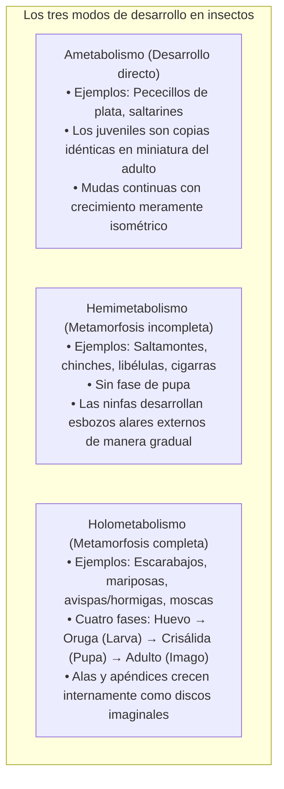
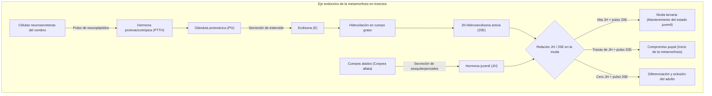
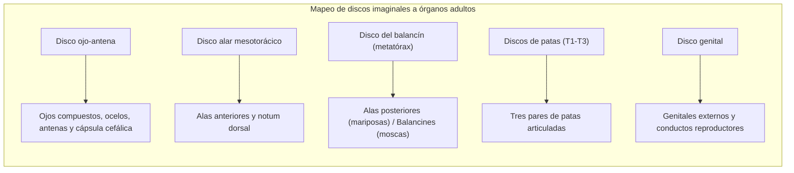
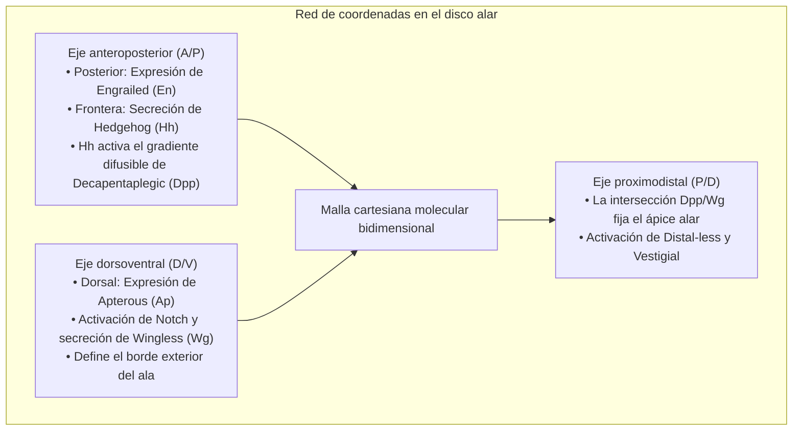
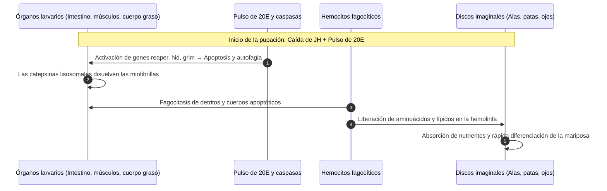
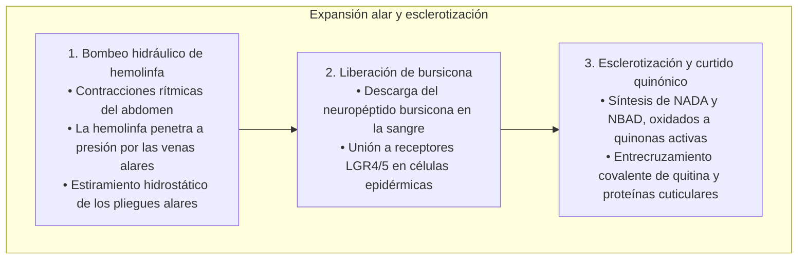
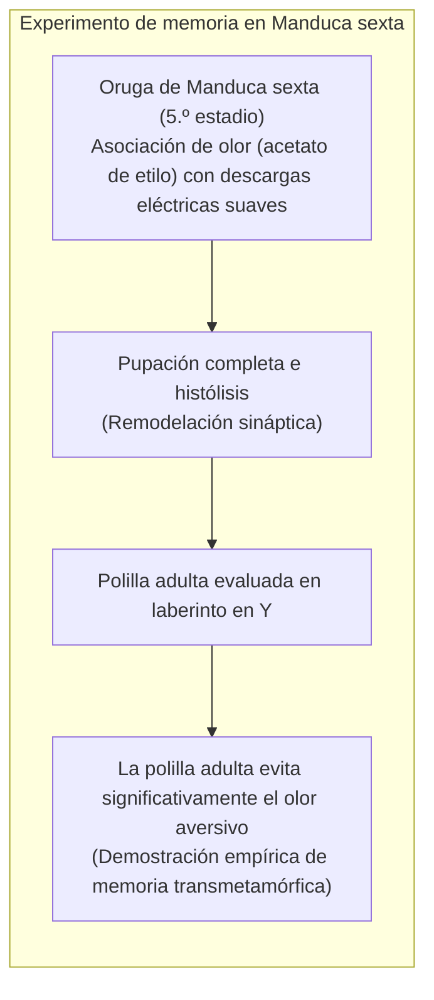

Una oruga regordeta y voraz devorando hojas incansablemente, tejiendo un capullo o endureciéndose en una crisálida inmóvil, para finalmente rasgar su envoltura y desplegar las alas multicolores de una mariposa: la <strong>metamorfosis completa (holometabolismo)</strong> es una de las transformaciones biológicas más fascinantes del reino animal.

Existe la creencia popular de que el cuerpo de la oruga se desintegra por completo en una «sopa» informe y sin estructura dentro de la crisálida, a partir de la cual el insecto adulto se reconstruye desde cero. Sin embargo, la biología del desarrollo moderna demuestra una realidad infinitamente más bella y precisa: un prodigio de ingeniería celular y control genético.

Si bien los tejidos larvarios experimentan una profunda <strong>histólisis</strong> mediante apoptosis y autofagia programadas, el interior de la pupa jamás es un caos desorganizado. Desde las etapas embrionarias más tempranas, en el interior de la oruga se encuentran latentes grupos celulares diploides altamente especializados: los <strong>discos imaginales (imaginal discs)</strong>.

A medida que los órganos de la oruga se disuelven en un caldo rico en aminoácidos y lípidos, los discos imaginales aprovechan estos nutrientes. Coordinados por pulsos hormonales y gradientes morfogenéticos, se dividen rápidamente, se evierten como un telescopio y dan forma a las alas, patas, ojos compuestos y antenas de la mariposa adulta.

En este artículo examinamos los circuitos endocrinos (antagonismo hormona juvenil / 20-hidroxiecdisona), los genes Halloween, la arquitectura tridimensional de los discos imaginales, la nanodinámica de las escamas alares, la retención de la memoria a través de la metamorfosis y el desarrollo de biorreguladores de plagas.

---

### 1. Evolución de los modos de desarrollo: El triunfo del holometabolismo

Los insectos vivos (hexápodos) se dividen en tres grandes modos ontogenéticos:

Más del 60 % de todas las especies animales y más del 85 % de los insectos pertenecen al clado de los <strong>insectos holometábolos (Endopterigotos)</strong>. Los cuatro órdenes más diversos del planeta (Coleoptera, Lepidoptera, Hymenoptera y Diptera) deben su éxito ecológico a esta formidable estrategia.

#### Desacoplamiento total del nicho ecológico
En insectos hemimetábolos como los saltamontes, ninfas y adultos comparten el mismo aparato bucal masticador y consumen las mismas plantas, lo que genera una feroz <strong>competencia intraespecífica entre padres e hijos</strong>.

El holometabolismo suprime de raíz esta competencia mediante una especialización radical:
- <strong>La larva (oruga, gusano, larva)</strong>: Con mandíbulas masticadoras y un intestino voluminoso, es una eficiente <strong>máquina de acumulación de biomasa</strong> que multiplica su peso miles de veces en semanas;
- <strong>El adulto (mariposa, polilla, abeja)</strong>: Desarrolla una espiritrompa para libar néctar, ojos compuestos y grandes alas, funcionando como una <strong>máquina de dispersión y reproducción sexual</strong>.

Esta segregación absoluta de recursos y hábitats permitió a los insectos de metamorfosis completa diversificarse y colonizar todos los ecosistemas terrestres del planeta.

---

### 2. Red de regulación endocrina: El balancín bioquímico entre JH y 20E

El momento exacto de mudar, empupar y emerger está regulado por la proporción entre dos hormonas maestras: la <strong>hormona juvenil (JH)</strong> y la <strong>20-hidroxiecdisona (20E)</strong>.

#### Los genes Halloween y la síntesis de ecdisona
La conversión de colesterol en 20E en la glándula protorácica está catalizada por enzimas citocromo P450 denominadas <strong>genes Halloween</strong> debido a las deformidades que causan sus mutaciones:
1. <strong>Neverland (Nvd)</strong>: Convierte colesterol en 7-deshidrocolesterol;
2. <strong>Spook (CYP307A1)</strong>: Cataliza pasos oxidativos hacia intermediarios de cetodiol;
3. <strong>Phantom (CYP306A1)</strong>: Realiza la C-25 hidroxilación;
4. <strong>Disembodied (CYP302A1)</strong>: Media la C-22 hidroxilación;
5. <strong>Shadow (Sad: CYP315A1)</strong>: Produce ecdisona mediante C-2 hidroxilación;
6. <strong>Shade (Shd: CYP314A1)</strong>: En tejidos periféricos hidroxila la C-20 generando la <strong>20E activa</strong>.

La 20E activa el heterodímero nuclear <strong>EcR / USP</strong>, disparando la cascada transcripcional de la metamorfosis.

#### Freno molecular de la hormona juvenil y Broad-Complex
La JH asegura el mantenimiento del estado larvario:
- La JH se une al receptor nuclear <strong>Met (Methoprene-tolerant)</strong>.
- El complejo Met/JH activa el factor de transcripción <strong>Krüppel-homolog 1 (Kr-h1)</strong>.
- Kr-h1 reprime con firmeza el promotor del gen maestro de la pupación, <strong>Broad-Complex (BR-C)</strong>.
- Al final del último estadio larvario, los cuerpos alados cesan la producción de JH y las esterasas degradan el remanente en sangre. Cuando la JH cae a cero, se elimina el bloqueo de Kr-h1 y el pulso de 20E activa masivamente a <strong>BR-C</strong>, abriendo las puertas a la pupación definitiva.

---

### 3. Anatomía de los discos imaginales: Los planos invisibles del adulto

Los apéndices del insecto adulto provienen de bolsas celulares predeterminadas desde la etapa embrionaria: los <strong>discos imaginales (imaginal discs)</strong>.

#### Células diploides frente a la poliploidía larvaria
Mientras las células de la oruga multiplican su ADN mediante <strong>endorreplicación</strong> sin dividirse, las células de los discos imaginales se mantienen estrictamente <strong>diploides</strong>. Crecen dentro de cavidades epiteliales invaginadas conectadas a la cutícula, alcanzando decenas de miles de células antes de la pupación.

#### Pliegues telescópicos concéntricos
El epitelio de un disco de pata se asemeja a un <strong>telescopio plegado</strong> en anillos concéntricos:
- El centro del disco dará origen a las uñas y segmentos del tarso;
- Los anillos concéntricos exteriores formarán la tibia, el fémur, el trocánter y la coxa.
Con la señalización de la 20E, este epitelio se proyecta bruscamente hacia afuera (eversión), formando la pata tridimensional en cuestión de horas.

---

### 4. Sistemas de coordenadas morfogenéticas

Las células del disco interpretan su posición espacial mediante <strong>gradientes ortogonales de morfógenos</strong>.

- <strong>Eje A/P</strong>: El compartimento posterior expresa *engrailed (en)*, activando *Hedgehog (Hh)*. Hh induce a corta distancia la secreción de *Decapentaplegic (Dpp)*, que genera un gradiente de concentración de largo alcance.
- <strong>Eje D/V</strong>: Las células dorsales expresan *apterous (ap)*. En el límite dorsoventral, la vía Notch estimula un estrecho cordón de secreción de *Wingless (Wg)*, trazando el contorno del ala.
- La intersección de ambos morfógenos fija el ápice del ala, coordinando la diferenciación de venas y cerdas con precisión micrométrica.

---

### 5. Histólisis pupal: Muerte programada y reciclaje celular

La idea de que la oruga se convierte en una «sopa» refleja un fenómeno biológico real: la <strong>histólisis</strong>.

- <strong>Degeneración del intestino larvario</strong>: El intestino de la oruga sufre apoptosis sincrónica y se desprende al lumen, formando el meconio que se expulsa tras la eclosión. Células madre intestinales regeneran un intestino adulto apto para fluidos.
- <strong>Autólisis muscular</strong>: Las catepsinas y el sistema proteasoma desintegran la musculatura larvaria en aminoácidos libres.
- <strong>Protección de los discos imaginales</strong>: En las células de los discos, los promotores apoptóticos están epigenéticamente silenciados. La 20E promueve la proliferación activa utilizando los nutrientes liberados por la oruga.

---

### 6. Expansión alar y nanofotónica

Al emerger, las alas están arrugadas. Su despliegue es un fenómeno puramente hidráulico:

#### Nanofotónica de escamas en mariposas Morpho
El azul metálico iridiscente de las mariposas *Morpho* es un <strong>color estructural</strong> generado por nanoestructuras:
- Células precursoras secretan quitina configurada en láminas microscópicas en forma de abeto con separaciones periódicas de unos 140 nm.
- La interferencia constructiva refleja la luz azul ($\lambda \approx 450\,\text{nm}$) y cancela el resto del espectro, generando un brillo imperecedero a través de milenios.

---

### 7. Memoria transmetamórfica: ¿Recuerda la mariposa su vida de oruga?

En 2008, Douglas Blackiston y Martha Weiss demostraron en *PLOS ONE* que el aprendizaje larvario perdura en el adulto:

Las <strong>células de Kenyon de los cuerpos fúngicos (Mushroom Bodies)</strong>, centros del aprendizaje en insectos, no mueren en la pupa. Sus axones y dendritas son remodelados, preservando las conexiones neuronales que retienen la memoria aprendida en la etapa larvaria.

---

### 8. Hipótesis de la proninfa y biorreguladores de plagas (IGR)

La <strong>hipótesis de la proninfa</strong> sostiene que la oruga equivale a un embrión de eclosión precoz que se alimenta en el exterior, mientras que la <strong>crisálida</strong> es la condensación de los antiguos estadios ninfales ancestrales.

#### Aplicaciones: Biorreguladores de insectos (IGR)
Comprender estas rutas ha revolucionado el control de plagas sin afectar a vertebrados:
- <strong>Análogos de la hormona juvenil (Piriproxifeno, Metopreno)</strong>: Impiden la eclosión de pupas de mosquitos vectores de dengue y malaria;
- <strong>Agonistas de la ecdisona (Tebufenozida)</strong>: Provocan mudas prematuras y letales en orugas de polillas defoliadoras.

---

### 9. Conclusión: La cumbre de la bioingeniería natural

La idea de que la oruga se convierte en una «sopa» informe describe la intensidad del recambio celular, pero subestima el orden subyacente. 

En medio de la histólisis, los discos imaginales actúan como guardianes del plano biológico adulto. Guiados por señales moleculares y mecánica hidráulica, reconstruyen un insecto alado a partir de los restos de la larva, protagonizando el mayor prodigio de metamorfosis de la biosfera.
