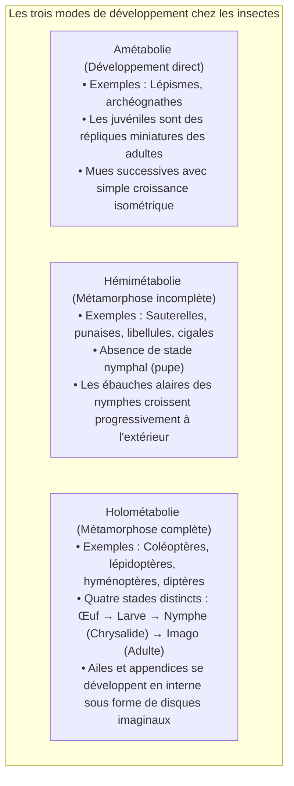
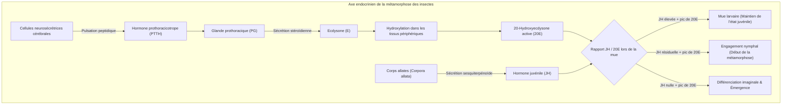
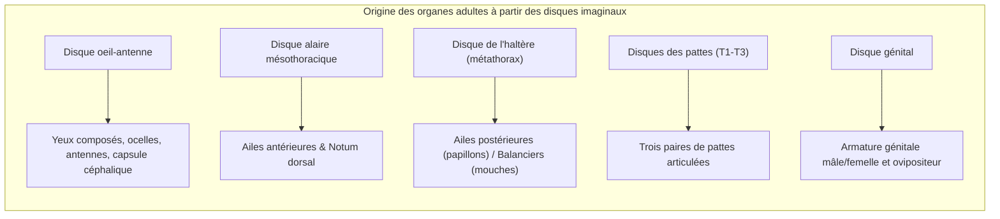
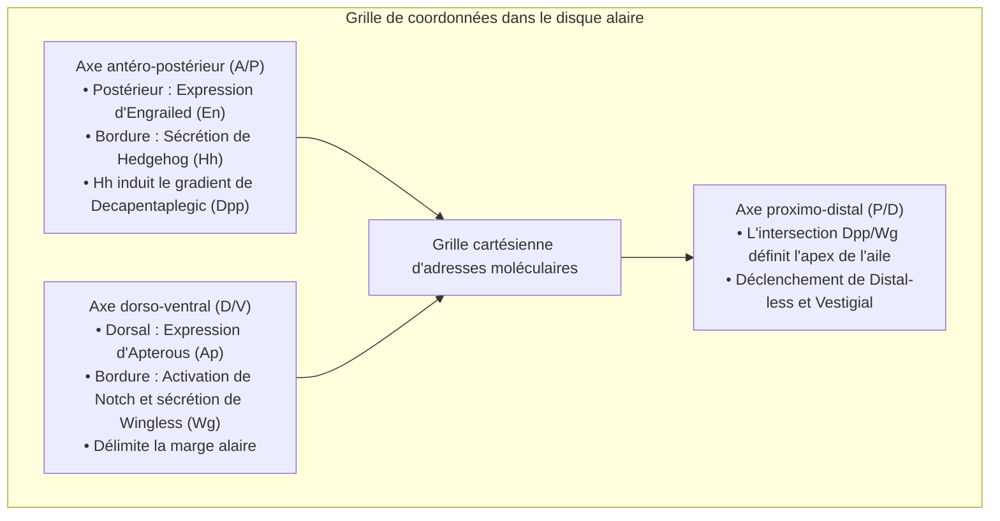
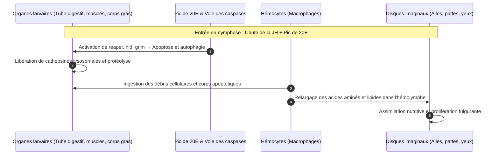
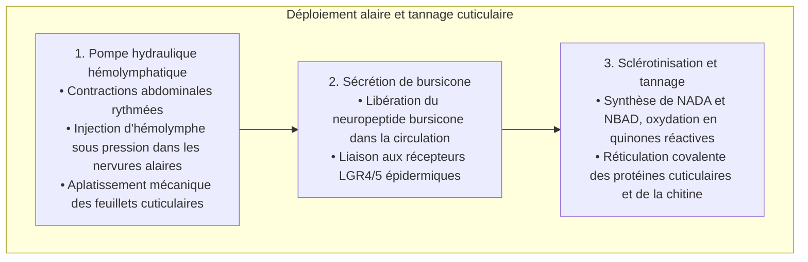
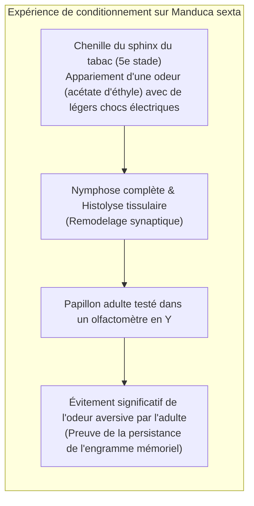

Une chenille vorace dévorant les feuilles d'une plante, s'enfermant dans une chrysalide rigide, sombrant dans une immobilité totale, pour finalement déchirer son enveloppe et déployer les ailes diaphanes et colorées d'un papillon : la <strong>métamorphose complète (holométabolie)</strong> représente l'une des transitions morphogénétiques les plus spectaculaires de l'histoire du vivant.

Dans l'imaginaire collectif, une idée reçue affirme que la chenille se liquéfie en une « soupe » informe et chaotique, à partir de laquelle un papillon serait reconstruit ex nihilo. La biologie du développement moderne démontre une réalité infiniment plus sophistiquée : une merveille d'ingénierie cellulaire et de régulation génétique.

Si les tissus larvaires subissent bel et bien une <strong>histolyse</strong> massive par apoptose et autophagie programmées, l'intérieur de la nymphe n'est nullement désordonné. Dès le stade embryonnaire précoce, des îlots de cellules progénitrices diploïdes sont mis en réserve : les <strong>disques imaginaux (imaginal discs)</strong>.

Tandis que les organes larvaires se dissolvent en un bain d'acides aminés et de lipides, les disques imaginaux captent cette manne nutritive. Sous le contrôle d'hormones stéroïdes et de gradients de morphogènes, ils prolifèrent activement, s'éversent dans l'espace tridimensionnel et édifient les yeux composés, antennes, pattes et ailes du futur papillon.

Ce guide scientifique approfondit les rouages endocriniens (l'antagonisme hormone juvénile / 20-hydroxyecdysone), la cascade des gènes Halloween, la géométrie des disques imaginaux, la nanophotonique des écailles alaires, la conservation de la mémoire larvaire chez l'adulte et les applications des régulateurs de croissance des insectes.

---

### 1. L'évolution des modes de métamorphose : Pourquoi l'holométabolie domine-t-elle la Terre ?

Les insectes (Hexapodes) se répartissent en trois stratégies ontogénétiques fondamentales :

Plus de 60 % de l'ensemble des espèces animales décrites et plus de 85 % des insectes appartiennent aux <strong>insectes holométaboles (Endoptérygotes)</strong>. Les quatre ordres géants – Coléoptères, Lépidoptères, Hyménoptères et Diptères – partagent tous cette stratégie évolutive.

#### La dissociation complète des niches écologiques
Chez un insecte hémimétabole tel que le criquet, larve et adulte partagent le même appareil buccal broyeur, occupent la même strate végétale et consomment les mêmes ressources, provoquant une sévère <strong>compétition intraspécifique parent-progéniture</strong>.

L'holométabolie opère une ségrégation totale des niches écologiques :
- <strong>La larve (chenille, asticot)</strong> : Spécialisée dans la digestion foliaire, elle constitue une pure <strong>machine d'accumulation de biomasse</strong> multipliant son poids par plusieurs milliers en quelques semaines ;
- <strong>L'imago (papillon adulte)</strong> : Dépourvu de pièces broyeuses, muni d'une trompe aspiratrice pour le nectar et d'ailes puissantes, il constitue une <strong>machine de dispersion et de reproduction sexuée</strong>.

Cette partition élimine toute concurrence trophique entre générations, constituant le secret adaptatif majeur de leur radiation écologique planétaire.

---

### 2. Le réseau endocrine : Le balancier biochimique JH / 20-hydroxyecdysone

Le déclenchement des mues, de la nymphose et de l'éclosion imaginale est sous la dépendance stricte de deux hormones maîtresses : l'<strong>hormone juvénile (JH)</strong> et la <strong>20-hydroxyecdysone (20E)</strong>.

#### Les gènes Halloween et la biosynthèse de l'ecdysone
La conversion du cholestérol en 20E active fait intervenir une suite de cytochromes P450 mitochondriaux et microsomaux appelés <strong>gènes Halloween</strong> :
1. <strong>Neverland (Nvd)</strong> : Transforme le cholestérol en 7-déshydrocholestérol ;
2. <strong>Spook (CYP307A1)</strong> : Catalyse des réactions d'oxydation précoces ;
3. <strong>Phantom (CYP306A1)</strong> : Assure la C-25-hydroxylation ;
4. <strong>Disembodied (CYP302A1)</strong> : Assure la C-22-hydroxylation ;
5. <strong>Shadow (CYP315A1)</strong> : Synthétise l'ecdysone par C-2-hydroxylation ;
6. <strong>Shade (CYP314A1)</strong> : Assure dans le corps gras la C-20-hydroxylation terminale vers la <strong>20E active</strong>.

La 20E se lie au récepteur nucléaire hétérodimérique <strong>EcR / USP</strong>, déclenchant la transcription des programmes génétiques de mue.

#### Le frein moléculaire : JH, Kr-h1 et Broad-Complex
L'hormone juvénile (JH) maintient le statu quo larvaire :
- La JH se lie aux récepteurs nucléaires <strong>Met (Methoprene-tolerant)</strong> et <strong>Gce</strong>.
- Le complexe Met/JH stimule l'expression du facteur de transcription à doigts de zinc <strong>Krüppel-homolog 1 (Kr-h1)</strong>.
- Kr-h1 réprime directement le promoteur du régulateur maître de la nymphose, <strong>Broad-Complex (BR-C)</strong>.
- Au dernier stade larvaire, les corps allates cessent toute synthèse de JH, et les estérases circulantes éliminent les traces résiduelles. En l'absence de JH, la répression de Kr-h1 est levée : le pic de 20E induit l'<strong>activation massive de BR-C</strong>, verrouillant l'entrée irréversible en chrysalide.

---

### 3. Anatomie des disques imaginaux : Les plans secrets de l'adulte

Les appendices de l'adulte ne se forment pas au hasard : ils dérivent directement des <strong>disques imaginaux (imaginal discs)</strong> formés dès l'embryogenèse.

#### Maintien de l'état diploïde face à la polyploïdie larvaire
Tandis que les tissus larvaires deviennent polyploïdes par <strong>endoréplication</strong> de l'ADN sans division cellulaire, les cellules des disques imaginaux restent rigoureusement <strong>diploïdes</strong>. Elles forment des sacs épithéliaux unistratifiés invaginés sous la cuticule larvaire, se multipliant activement pour atteindre plusieurs dizaines de milliers de cellules à la fin du stade larvaire.

#### Une structure en télescope concentrique
Un disque imaginal de patte est structuré en replis concentriques compacts, semblable à un <strong>télescope replié</strong> :
- Le centre du disque donnera la griffe terminale et le tarse ;
- Les anneaux périphériques successifs formeront le tibia, le fémur, le trochanter et la coxa.
Lors de la nymphose, l'épithélium s'éverse brutalement vers l'extérieur (éversion), projetant l'appendice tridimensionnel en quelques heures.

---

### 4. Systèmes de coordonnées : Les gradients de morphogènes

L'information spatiale guidant la mise en place des structures au sein du disque est régie par des <strong>gradients de morphogènes orthogonaux</strong>.

- <strong>Axe A/P</strong> : Les cellules postérieures expriment *engrailed (en)*, stimulant la sécrétion locale de *Hedgehog (Hh)*. Hh diffuse sur une courte distance pour activer l'expression du morphogène à longue portée *Decapentaplegic (Dpp)*.
- <strong>Axe D/V</strong> : Les cellules dorsales expriment *apterous (ap)*. La frontière cellulaire active la signalisation Notch, générant une bande étroite de sécrétion de *Wingless (Wg)* qui trace le contour exact de l'aile.
- L'intersection de ces deux gradients marque l'extrémité distale de l'aile, chaque cellule interprétant sa position pour différencier nervures et soies.

---

### 5. Histolyse nymphale : Autophagie et recyclage métabolique

La métaphore de la « chenille qui se dissout en soupe » traduit une réalité biochimique précise : l'<strong>histolyse</strong>.

- <strong>Régression de l'intestin larvaire</strong> : L'épithélium digestif larvaire entre en apoptose massive et s'effondre dans la lumière intestinale, formant le méconium excrété à l'émergence. Un intestin adulte miniature et spécialisé est reconstruit par des cellules souches intestinales.
- <strong>Lyse musculaire</strong> : Les muscles locomoteurs larvaires sont désassemblés par le protéasome et les cathepsines.
- <strong>Immunité des disques imaginaux</strong> : Les gènes d'apoptose sont réprimés épigénétiquement dans les cellules imaginales. Le signal de 20E y stimule au contraire les facteurs de croissance et les cyclines.

---

### 6. Expansion alaire et nanophotonique

À l'émergence, les ailes sont fripées. Leur déploiement résulte d'un mécanisme hydraulique précis :

#### Couleurs structurales chez le papillon Morpho
L'iridescence bleue éclatante des ailes du papillon *Morpho* repose sur une architecture <strong>nanophotonique (couleur structurelle)</strong> :
- Les cellules trichogènes déposent de la chitine formant des lamelles microscopiques étagées en « sapin de Noël » espacées d'environ 140 nm.
- Les interférences lumineuses constructives réfléchissent sélectivement la lumière bleue ($\approx 450\,\text{nm}$) tout en annulant les autres longueurs d'onde, produisant une brillance inaltérable à travers les millénaires.

---

### 7. Mémoire trans-métamorphique : Le papillon se souvient-il de sa vie de chenille ?

En 2008, Douglas Blackiston et Martha Weiss ont publié dans *PLOS ONE* la preuve formelle de la transmission de la mémoire à travers la métamorphose :

Les <strong>cellules de Kenyon des corps pédonculés (Mushroom Bodies)</strong>, centres de la mémoire chez les insectes, survivent à la destruction nymphale. Leurs synapses sont élaguées puis réorganisées, permettant à l'adulte de conserver les acquis critiques de son jeune âge.

---

### 8. L'hypothèse de la pro-nymphe et les régulateurs de croissance (IGR)

L'évo-dévo moderne soutient l'<strong>hypothèse de la pro-nymphe</strong> (Truman & Riddiford) : la chenille est phylogénétiquement un embryon à vie libre prématurément éclos, tandis que la <strong>chrysalide</strong> correspond à la condensation des anciens stades nymphaux successifs.

#### Applications agronomiques et sanitaires : Les IGR
La maîtrise de ces voies a permis la création d'insecticides écologiques ciblés :
- <strong>Mimétiques de l'hormone juvénile (Pyriproxyfène, Méthoprène)</strong> : Bloquent la nymphose des larves de moustiques et éradiquent les vecteurs du paludisme et de la dengue sans toxicité pour les vertébrés ;
- <strong>Agonistes de l'ecdysone (Tébufénozide)</strong> : Provoquent des mues létales prématurées chez les chenilles ravageuses de cultures.

---

### 9. Conclusion : L'apogée du génie biologique

La « soupe de chenille » est une image réductrice qui occulte la prodigieuse chorégraphie du vivant. 

Au cœur de la déconstruction tissulaire, les disques imaginaux préservent l'architecture du futur papillon. La métamorphose complète n'est pas une régression dans le chaos, mais la réorganisation la plus sophistiquée jamais conçue par l'évolution biologique terrestre.
