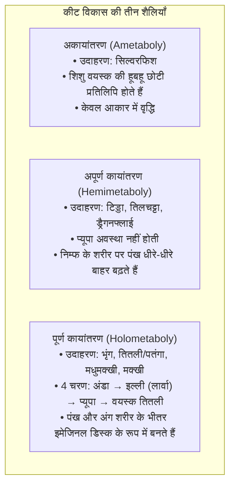
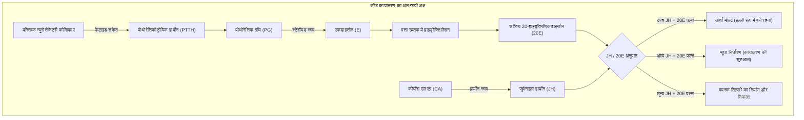
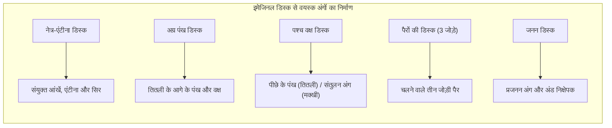

पत्तियों को चबाती एक मोटी इल्ली, अपने चारों ओर कड़ा खोल बनाकर प्यूपा में स्थिर हो जाना, और फिर उस खोल को फाड़कर एक खूबसूरत तितली के रूप में बाहर निकलना—<strong>पूर्ण कायांतरण (Holometaboly)</strong> प्रकृति के सबसे विस्मयकारी चमत्कारों में से एक है।

लोकप्रिय धारणा में यह माना जाता है कि इल्ली प्यूपा के भीतर पूरी तरह एक आकारहीन 'सूप' में घुल जाती है और फिर खरोंच से नई तितली बनती है। लेकिन आधुनिक विकासात्मक जीव विज्ञान दिखाता है कि यह कोई अराजक सूप नहीं, बल्कि अत्यंत परिष्कृत कोशिकीय इंजीनियरिंग है।

यद्यपि इल्ली के ऊतक <strong>हिस्टोलिसिस (ऊतक अपघटन)</strong> और क्रमादेशित कोशिका मृत्यु (एपॉप्टोसिस) द्वारा खुद को पचा लेते हैं, प्यूपा का आंतरिक भाग कभी भी अव्यवस्थित नहीं होता। भ्रूणीय विकास के शुरुआती दौर से ही इल्ली के भीतर विशिष्ट द्विगुणित कोशिकाओं के समूह सुरक्षित रहते हैं: <strong>इमेजिनल डिस्क (Imaginal Discs)</strong>।

जैसे ही इल्ली के अंग घुलकर अमीनो एसिड और वसा का पोषण मुक्त करते हैं, इमेजिनल डिस्क उस ऊर्जा को सोख लेते हैं। हार्मोनल संकेतों और मॉर्फोजेन प्रवणता के नियंत्रण में, ये कोशिकाएं तेजी से विभाजित होकर दूरबीन की तरह बाहर फैलती हैं और तितली के पंख, पैर, आंखें और एंटीना तैयार करती हैं।

---

### 1. कायांतरण का विकास: पूर्ण कायांतरण ने पृथ्वी पर राज क्यों किया?

कीटों के विकास के तीन मुख्य रूप हैं:

पृथ्वी के 60% से अधिक जंतु और 85% कीट <strong>पूर्ण कायांतरण वाले कीटों (Endopterygota)</strong> में आते हैं। इसका सबसे बड़ा कारण पारिस्थितिक विभाजन है:
- <strong>इल्ली</strong>: पत्तियां खाकर शरीर का भार हजारों गुना बढ़ाने वाली पोषण संचय मशीन;
- <strong>तितली</strong>: फूलों का रस पीने और उड़कर अंडे देने वाली प्रजनन और विस्तार मशीन।

माता-पिता और संतान के बीच भोजन की प्रतिस्पर्धा शून्य हो जाने से यह वर्ग धरती पर सबसे सफल साबित हुआ।

---

### 2. अंतःस्रावी नियंत्रण: जुवेनाइल हार्मोन और 20-हाइड्रॉक्सीएकडाइसोन

कायांतरण का समय दो प्रमुख हार्मोनों के संतुलन से तय होता है: <strong>जुवेनाइल हार्मोन (JH)</strong> और स्टेरॉयड हार्मोन <strong>20-हाइड्रॉक्सीएकडाइसोन (20E)</strong>।

एकडाइसोन का निर्माण <strong>हैलोवीन जीन</strong> (*Neverland*, *Spook*, *Phantom*, *Disembodied*, *Shadow*, *Shade*) द्वारा होता है। 

जुवेनाइल हार्मोन <strong>Met</strong> रिसेप्टर के माध्यम से <strong>Kr-h1</strong> को सक्रिय रखता है, जो प्यूपा बनाने वाले मास्टर जीन <strong>Broad-Complex (BR-C)</strong> को दबाए रखता है। अंतिम लार्वा अवस्था में JH समाप्त हो जाता है, जिससे BR-C सक्रिय होकर प्यूपा बनने की प्रक्रिया शुरू करता है।

---

### 3. इमेजिनल डिस्क की शारीरिक रचना: शरीर का गुप्त ब्लूप्रिंट

तितली के अंग इल्ली के शरीर में पहले से मौजूद कोशिकाओं से बनते हैं: <strong>इमेजिनल डिस्क (imaginal discs)</strong>।

इल्ली की सामान्य कोशिकाएं बिना विभाजन के डीएनए बढ़ाती हैं (पॉलीप्लॉइडी), लेकिन इमेजिनल डिस्क की कोशिकाएं सामान्य <strong>द्विगुणित (diploid)</strong> रहती हैं। पैर की डिस्क संकेंद्रित छल्लों में <strong>मुड़ी हुई दूरबीन</strong> की तरह होती है। कायांतरण के समय यह बाहर की ओर पलटकर कुछ ही घंटों में पैर बन जाती है।

---

### 4. मॉर्फोजेन ग्रिड और स्थिति निर्धारण

डिस्क के भीतर अंगों का सटीक नक्शा मॉर्फोजेन प्रवणता से बनता है:
- <strong>A/P अक्ष</strong>: पीछे की कोशिकाएं *Engrailed* और *Hedgehog* के माध्यम से *Decapentaplegic (Dpp)* का फैलाव करती हैं।
- <strong>D/V अक्ष</strong>: ऊपरी कोशिकाएं *Apterous* के जरिए पंख के किनारे पर *Wingless (Wg)* का स्राव करती हैं।
- इन दोनों के मिलन बिंदु से पंख का सिरा और नसें तय होती हैं।

---

### 5. प्यूपा में हिस्टोलिसिस: नियंत्रित विघटन

'सूप' बनने की प्रक्रिया वास्तव में सुव्यवस्थित <strong>हिस्टोलिसिस</strong> है:
- इल्ली की आंत एपॉप्टोसिस द्वारा नष्ट होकर अपशिष्ट (मेकोनियम) बन जाती है;
- चलने वाली मांसपेशियां एंजाइमों द्वारा अमीनो एसिड में घुल जाती हैं;
- रक्त कोशिकाएं मलबे को साफ करके पोषण द्रव में छोड़ती हैं;
- इमेजिनal डिस्क की कोशिकाओं में मृत्यु जीन बंद रहते हैं, जिससे वे इस पोषण से तितली के अंग बनाती हैं।

---

### 6. पंखों का फैलाव और नैनोफोटोनिक्स

प्यूपा से निकलते समय पंख मुड़े होते हैं। पेट की मांसपेशियां रक्त को पंखों की नसों में पंप करती हैं, जिससे पंख फैलते हैं। इसके बाद <strong>बर्सीकॉन</strong> हार्मोन पंखों को कठोर बनाता है।

*Morpho* तितलियों का चमकीला नीला रंग वर्णक से नहीं, बल्कि <strong>संरचनात्मक रंग</strong> से आता है: पंखों की पपड़ियों में 140 नैनोमीटर की दूरी पर चिटिन की परतें होती हैं जो नीले प्रकाश को परावर्तित करती हैं।

---

### 7. क्या तितली को इल्ली के समय की बातें याद रहती हैं?

2008 में *PLOS ONE* के शोध ने सिद्ध किया कि *Manduca sexta* पतंगे जिन्हें इल्ली अवस्था में किसी गंध के साथ हल्का करंट दिया गया था, तितली बनने के बाद भी उस गंध से दूर भागते रहे। मस्तिष्क के <strong>मशरूम बॉडीज</strong> प्यूपा के विघटन से बच जाते हैं और पुरानी यादों को सुरक्षित रखते हैं।

---

### 8. प्रो-निम्फ परिकल्पना और कीट वृद्धि नियामक (IGR)

आधुनिक इवो-डेवो के अनुसार, इल्ली वास्तव में समय से पहले अंडे से बाहर आया भ्रूण है, और प्यूपा संकुचित निम्फ अवस्था है।

इस ज्ञान से पर्यावरण के अनुकूल कीटनाशक (IGR) बने हैं:
- <strong>जुवेनाइल हार्मोन एनालॉग (पायरीप्रॉक्सिफेन)</strong>: मच्छर के लार्वा को वयस्क बनने से रोककर मलेरिया और डेंगू रोकते हैं;
- <strong>एकडाइसोन एगोनिस्ट (टेबुफेनोजाइड)</strong>: हानिकारक इल्लियों में असमय मोल्टिंग कराकर उन्हें नष्ट करते हैं।

---

### 9. निष्कर्ष

पूर्ण कायांतरण कोई अंधाधुंध विनाश नहीं है। प्यूपा के भीतर घुलते ऊतकों के बीच इमेजिनल डिस्क तितली के मूल डिजाइन को सुरक्षित रखती हैं, और प्रकृति की सबसे विस्मयकारी उड़ान को जन्म देती हैं।
