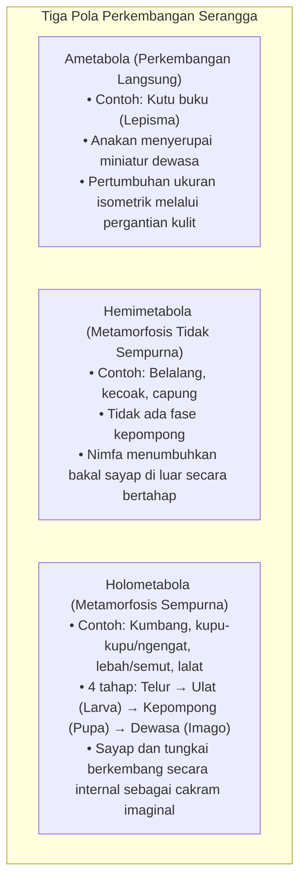
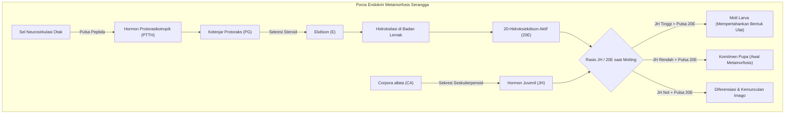
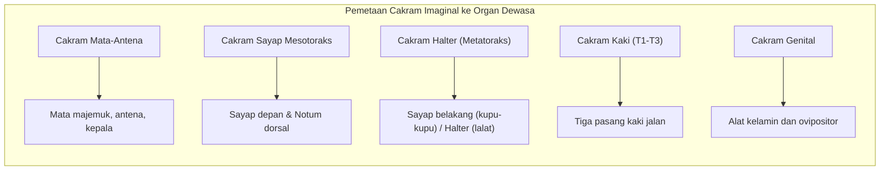

Seekor ulat gemuk yang melahap dedaunan tanpa henti, membungkus diri dalam kepompong kaku, terdiam tanpa gerakan, hingga akhirnya merobek kulit pupa dan membentangkan sayap kupu-kupu yang memukau: <strong>metamorfosis sempurna (holometabola)</strong> adalah salah satu transformasi biologis paling menakjubkan di Bumi.

Dalam pemahaman populer, sering dipercaya mitos bahwa tubuh ulat meleleh total menjadi "sup cair tak berbentuk" di dalam kepompong sebelum dibangun kembali dari nol. Namun, biologi perkembangan modern mengungkap kenyataan yang jauh lebih canggih: sebuah mahakarya rekayasa seluler dan kontrol genetika.

Meskipun jaringan larva memang mengalami <strong>histolisis</strong> masif melalui apoptosis dan autofagi terprogram, bagian dalam kepompong tidak pernah menjadi kekacauan tanpa arah. Sejak tahap embrio paling awal, tubuh ulat telah menyimpan kelompok sel diploid khusus yang tidak terdiferensiasi: <strong>cakram imaginal (imaginal discs)</strong>.

Saat organ larva mencair menjadi aliran asam amino dan lipid, cakram imaginal menyerap nutrisi ini. Di bawah kendali hormon dan gradien morfogen, cakram membelah dengan cepat, menjulur keluar seperti teleskop, dan merekonstruksi sayap, kaki, mata faset, serta antena kupu-kupu dewasa.

---

### 1. Evolusi Metamorfosis: Mengapa Holometabola Menguasai Bumi?

Serangga (Hexapoda) dibagi menjadi tiga strategi perkembangan:

Lebih dari 60% spesies hewan dan 85% serangga termasuk kelompok <strong>holometabola (Endopterygota)</strong>. Keberhasilan evolusioner ini didorong oleh pemisahan total relung ekologis:
- <strong>Larva (ulat)</strong>: Bertugas mengakumulasi biomassa dengan organ pencernaan besar;
- <strong>Imago (kupu-kupu)</strong>: Memiliki belalai pengisap nektar dan sayap untuk terbang, bertugas menyebarkan keturunan dan bereproduksi.

Pemisahan ini meniadakan persaingan sumber daya antara induk dan anak.

---

### 2. Sumbu Endokrin: Keseimbangan Hormon Juvenil dan 20-Hidroksiekdison

Jadwal molting dan metamorfosis dikendalikan oleh perbandingan antara dua hormon utama: <strong>Hormon Juvenil (JH)</strong> dan hormon steroid <strong>20-Hidroksiekdison (20E)</strong>.

Biosintesis ekdison dikatalisis oleh enzim sitokrom P450 yang dikenal sebagai <strong>gen-gen Halloween</strong> (*Neverland*, *Spook*, *Phantom*, *Disembodied*, *Shadow*, *Shade*). 20E mengaktifkan reseptor inti <strong>EcR/USP</strong>.

JH melalui reseptor <strong>Met</strong> mengaktifkan <strong>Krüppel-homolog 1 (Kr-h1)</strong> yang menekan gen kunci kepompong <strong>Broad-Complex (BR-C)</strong>. Pada instar akhir, JH menghilang sehingga penekanan terbuka, memicu lonjakan BR-C yang memulai pembentukan kepompong.

---

### 3. Anatomi Cakram Imaginal: Cetak Biru Tersembunyi

Organ serangga dewasa berasal dari kelompok sel diploid yang disiapkan sejak masa embrio: <strong>cakram imaginal (imaginal discs)</strong>.

Sementara sel tubuh ulat mengalami <strong>endoreplikasi</strong> DNA tanpa pembelahan sel, sel cakram imaginal tetap <strong>diploid</strong> dan membelah secara mitosis. Epitel cakram kaki terlipat konsentris seperti <strong>teleskop yang memendek</strong>. Saat metamorfosis, jaringan menjulur keluar (eversi) membentuk kaki dalam hitungan jam.

---

### 4. Koordinat Morfogen

Posisi sel dipandu oleh gradien morfogen:
- <strong>Sumbu A/P</strong>: Sel posterior mengekspresikan *engrailed (en)* yang memicu *Hedgehog (Hh)* untuk mengaktifkan gradien difusi *Decapentaplegic (Dpp)*.
- <strong>Sumbu D/V</strong>: Sel dorsal mengekspresikan *apterous (ap)* yang memicu pelepasan *Wingless (Wg)* di tepi sayap.
- Titik potong kedua gradien menentukan ujung sayap.

---

### 5. Histolisis: Pelelehan Terprogram dan Daur Ulang

Pelelehan ulat adalah proses biokimia teratur yang disebut <strong>histolisis</strong>:
- Saluran pencernaan ulat mengalami apoptosis serentak dan dibuang sebagai mekonium, digantikan oleh usus dewasa;
- Otot ulat dicerna oleh katepsin menjadi asam amino bebas;
- Sel darah (fagosit) membersihkan serpihan sel dan melepas nutrisi ke hemolimfa;
- Sel cakram imaginal kebal terhadap histolisis karena gen apoptosisnya dibungkam secara epigenetik.

---

### 6. Pembentangan Sayap dan Nanofotonik

Saat keluar dari pupa, sayap mengembang melalui tekanan hidrolik hemolimfa. Hormon <strong>bursicon</strong> kemudian memicu pengerasan kutikula dengan mengikat protein dan kitin.

Warna biru berkilau pada kupu-kupu *Morpho* merupakan <strong>warna struktural</strong>: sisik sayap membentuk susunan kisi kitin nano berjarak 140 nm yang memantulkan cahaya biru ($\approx 450\,\text{nm}$) melalui interferensi gelombang.

---

### 7. Memori Menembus Metamorfosis

Tahun 2008, penelitian di *PLOS ONE* membuktikan bahwa ngengat (*Manduca sexta*) yang dilatih menghindari bau dengan sengatan listrik saat menjadi ulat tetap mempertahankan ingatan tersebut setelah menjadi ngengat dewasa. <strong>Badan jamur (Mushroom Bodies)</strong> di otak serangga bertahan melewati masa kepompong dengan sinapsis yang ditata ulang.

---

### 8. Hipotesis Pro-Nimfa dan Pengatur Tumbuh Serangga (IGR)

Hipotesis pro-nimfa menyatakan bahwa ulat adalah embrio yang menetas lebih awal, sedangkan kepompong adalah pemadatan tahap nimfa purba.

Pengetahuan ini diterapkan dalam insektisida ramah lingkungan (IGR):
- <strong>Mimik JH (Piriproksifen)</strong>: Menggagalkan pembentukan nyamuk dewasa pembawa penyakit;
- <strong>Agonis Ekdison (Tebufenozida)</strong>: Menyebabkan pergantian kulit prematur yang mematikan pada ulat hama.

---

### 9. Kesimpulan

Metamorfosis sempurna adalah puncak keajaiban evolusi. Di tengah pencairan jaringan larva, cakram imaginal menjaga cetak biru kehidupan dan membentuk keindahan kupu-kupu yang sempurna.
