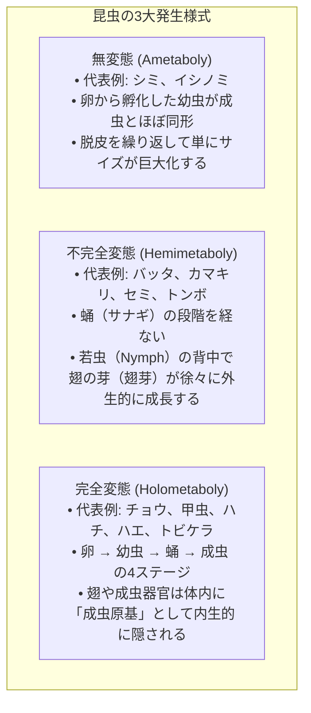
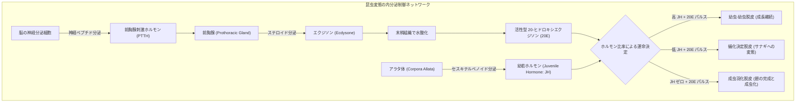
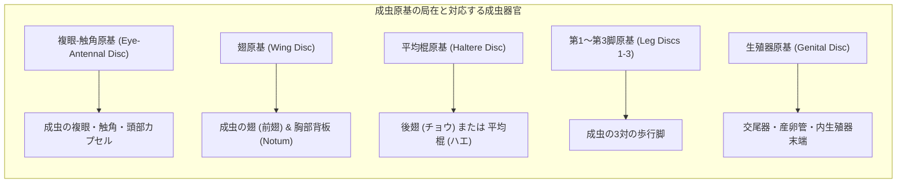
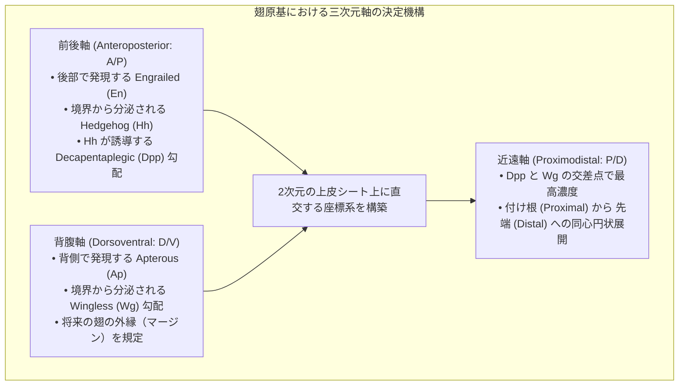
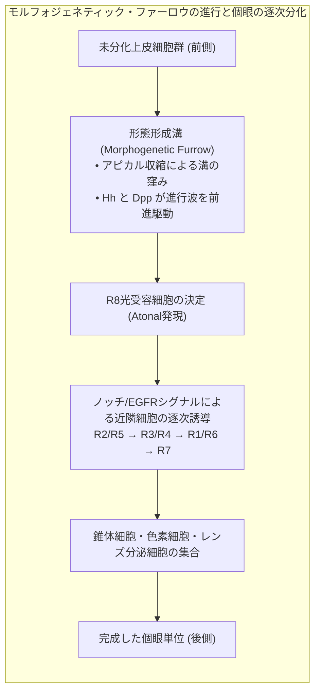
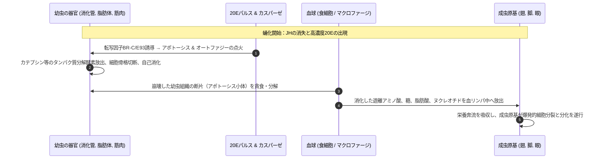
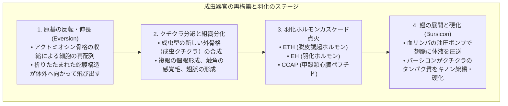
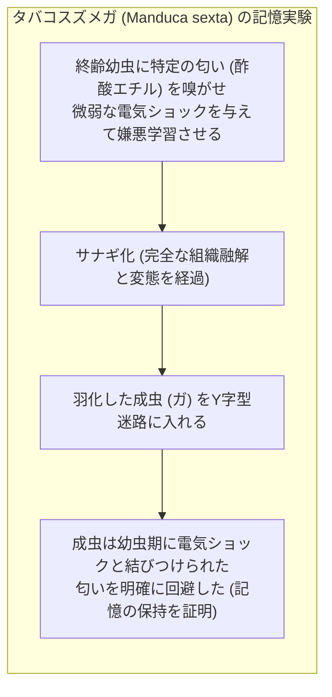
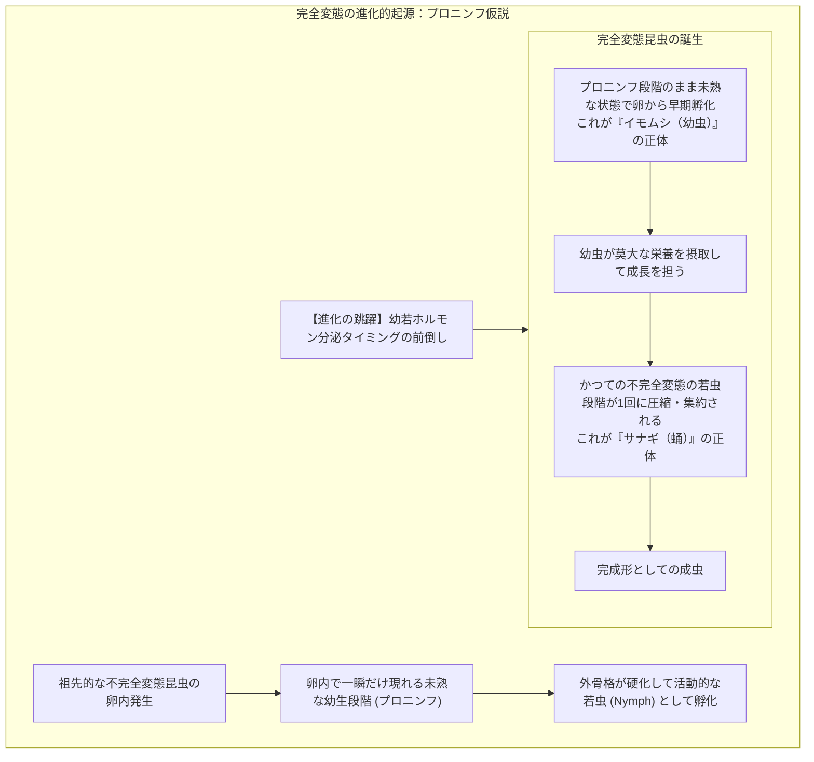
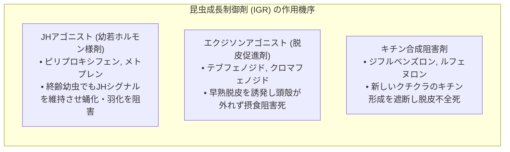

植物の葉を貪欲に喰らい尽くすずんぐりとしたイモムシが、硬いサナギの殻に身を包んで静止し、やがてその背を割って息を呑むほど美麗な翅を持つチョウとして羽化する——「完全変態（Holometaboly）」は、地球上の生命が成し遂げたもっとも劇的で幻想的な生物学的変容のひとつです。

一般には「サナギの中身は一度完全にスープ状に溶けてしまい、そこから全く新しい生き物がゼロから作り直される」という俗説が広く信じられています。しかし、発生生物学と分子遺伝学のメスが明かした真実は、それ以上に驚異的で精緻な生命の工学的勝利でした。

幼虫の身体は確かに<strong>組織崩壊（Histolysis）</strong>とプログラム細胞死（アポトーシスおよびオートファジー）によって大部分が自食的に消化・分解されます。しかし、決して無秩序なスープになるわけではありません。胚発生の極めて初期から幼虫の体内には、将来の成虫の翅、脚、複眼、触角、生殖器になる運命を決定づけられた微小な細胞塊——<strong>成虫原基（Imaginal Discs）</strong>が、眠れる設計図として大切に温存されているのです。

幼虫の器官が崩壊して放出されるアミノ酸や脂質の栄養奔流を受け止め、成虫原基は爆発的な細胞増殖、三次元的な形態反転、そして細胞分化を一気に遂行し、全く異なる生態学的ニッチに適応した成虫の肉体を再構築します。

本稿では、昆虫の完全変態を支配する内分泌カスケード（JHと20Eの拮抗）、ハロウィン遺伝子群によるステロイド生合成、成虫原基の分子パターン形成メカニズム、サナギ内部の壮絶な組織融解と再編成、さらには「イモムシ時代の記憶がサナギを経て成虫へ継承されるか」という神経生物学の最前線まで、完全変態の全貌を徹底的に解き明かします。

---

### 1. 変態様式の進化：なぜ完全変態は地球を制覇したのか？

現生の昆虫類（六脚類）は、その発生様式によって大きく3つのグループに大別されます。



地球上に記載されている全動物種の半数以上、昆虫全体の約85％以上を占めているのが<strong>完全変態昆虫（内生翅類: Endopterygota）</strong>です。甲虫（コウチュウ目）、チョウ・ガ（鱗翅目）、ハチ・アリ（膜翅目）、ハエ・カ（双翅目）というメガダイバースな4大目がすべて完全変態に属しているという事実は、この発生戦略が進化的にどれほど圧倒的なアドバンテージを持っていたかを物語っています。

#### 生態学的ニッチの完全分断（資源競合の根絶）
不完全変態のバッタを例にとると、幼虫（若虫）も成虫も同じ草むらに棲み、同じ植物の葉を同じ咀嚼口器で食べます。これは、<strong>親と子が同一の空間と食物資源を奪い合う強烈な種内競争</strong>を引き起こします。

一方、完全変態を遂げたチョウはどうでしょうか。
- <strong>幼虫（イモムシ・毛虫）</strong>：咀嚼口器を持ち、移動力は極めて低いものの、植物の葉を消化器官の限界まで詰め込んで急速に体重を数千倍に増やす<strong>「摂食と成長の特化マシーン」</strong>です。
- <strong>成虫（チョウ）</strong>：咀嚼口器を捨て去り、花の蜜を吸う長い螺旋状の口吻（吸管）を進化させ、長距離を自在に飛翔する大きな翅と精巧な複眼を備えた<strong>「移動と生殖の特化マシーン」</strong>です。

親と子の間で生息環境（ニッチ）と食物資源が100％分断されているため、種内競合が原理的にゼロになります。さらに、成長期にはエネルギー蓄積に全振りし、成熟期には遺伝子拡散に全振りするという機能的分業が極限まで洗練された結果、完全変態類は地球上のあらゆる陸上生態系を席巻することに成功したのです。

---

### 2. 内分泌制御ネットワーク：幼若ホルモン（JH）とエクジソン（20E）の生化学的シーソー

昆虫が「いつ脱皮し、いつ幼虫を終えてサナギになり、いつ成虫へと羽化するか」という運命の舵取りは、脳と内分泌器官から分泌される極めて精密なホルモン濃度の力学によって支配されています。

その中心にあるのが、<strong>幼若ホルモン（Juvenile Hormone: JH）</strong>と<strong>脱皮ホルモン（20-ヒドロキシエクジソン: 20E）</strong>という、2つのマスターレギュレーターの絶妙な拮抗作用です。



#### ハロウィン遺伝子群によるエクジソン生合成経路
前胸腺（Prothoracic Gland）においてコレステロールからエクジソンが合成される生化学経路は、極めて複雑なチトクロムP450モノオキシゲナーゼ群によって触媒されます。これらをつかさどる遺伝子群は、変異体がクチクラの分化異常により不気味な形態を示すことから<strong>「ハロウィン遺伝子群（Halloween genes）」</strong>と呼ばれています。

```mermaid
flowchart LR
    subgraph HalloweenPathway ["エクジソン生合成カスケード"]
        Cholesterol["コレステロール (Dietary sterol)"] -->|Neverland (Nvd)| 7DC["7-デヒドロコレステロール"]
        7DC -->|Black Box (Spook/Spookier)| Ketodiol["ジケトジオール中間体"]
        Ketodiol -->|Phantom (Phm: CYP306A1)| Ketotriol["ケトトリオール"]
        Ketotriol -->|Disembodied (Dib: CYP302A1)| DeoxyEcdysone["2-デオキシエクジソン"]
        DeoxyEcdysone -->|Shadow (Sad: CYP315A1)| Ecdysone["エクジソン (前胸腺から血中へ放出)"]
        Ecdysone -->|Shade (Shd: CYP314A1: 末梢組織)| 20E["20-ヒドロキシエクジソン (活性型ステロイド)"]
    end
```

活性化された20Eは、核内受容体スーパーファミリーの<strong>EcR（Ecdysone Receptor）</strong>と<strong>USP（Ultraspiracle: 脊椎動物のRXRホモログ）</strong>のヘテロ二量体に結合し、下流の脱皮・形態形成関連遺伝子群の転写を一斉に活性化します。

#### 幼若ホルモン（JH）とKr-h1カスケード
アラタ体（Corpora Allata）から分泌されるセスキテルペノイドであるJHは、一言で言えば<strong>「幼虫であり続けろ（Status Quo）」という命令を発信し続けるシグナル</strong>です。
- JHが細胞内のbHLH-PAS型受容体<strong>Met（Methoprene-tolerant）</strong>および<strong>Gce（Germ cell-expressed）</strong>に結合すると、ジンクフィンガー型転写因子<strong>Krüppel-homolog 1（Kr-h1）</strong>の発現が強力に誘導されます。
- Kr-h1タンパク質は、蛹化に必須のマスター遺伝子である<strong>Broad-Complex（BR-C）</strong>のプロモーター領域に直接結合し、その転写を徹底的に抑制します。
- 終齢幼虫になると、脳からのシグナルによってアラタ体のJH合成が急激に停止し、血中のJH分解酵素（JHエステラーゼやJHエポキシドヒドロラーゼ）が活性化して、体内のJH濃度がほぼゼロまで急落します。
- JHが消失した状態で20Eのパルスが襲来すると、Kr-h1による抑制が解除され、<strong>BR-Cが一挙に発現</strong>します。これにより、幼虫の細胞にはアポトーシスが、成虫原基には分化と蛹型クチクラの合成が命じられ、不可逆的な「蛹化」の扉が開かれます。
- 蛹の段階ではBR-Cが減衰し、成虫決定転写因子<strong>E93</strong>が誘導されることで、最終的な成虫組織の完成（羽化）へと至ります。

---

### 3. 成虫原基（Imaginal Discs）：体内に眠る設計図の解剖学

完全変態の最大の神秘は、サナギの中で成虫の身体が組み立てられるその「種火」がどこにあるのかという点です。その答えこそが、幼虫の体内に潜む<strong>成虫原基（Imaginal Discs）</strong>です。



#### 胚発生期における起源と決定
驚くべきことに、成虫原基は幼虫がサナギになる直前に作られるのではありません。卵の中で胚が発生している極めて初期の段階において、わずか十数個から数十個の外胚葉性細胞の集団としてその位置と運命が決定（Determination）されています。

幼虫が孵化して猛烈に葉を食べている間、幼虫自身の体細胞（表皮細胞や消化管細胞）は脱皮のたびに細胞分裂を行うのではなく、DNAを複製しながら細胞自体が巨大化する<strong>多糸核化（Endoreplication / 多倍数体化）</strong>によって体を大きくしていきます。

しかし、成虫原基の細胞だけは例外です。幼虫の成長中、成虫原基は多倍数体化せず、正常な二倍体（Diploid）のまま有糸分裂を繰り返し、幼虫の体壁の内側に陥入した<strong>扁平なポケット状の単層上皮嚢（Epithelial Sac）</strong>として静かに増殖を続けます。終齢幼虫の体内では、例えばショウジョウバエの翅原基は、初期の数十個の細胞から約5万個の細胞へと増殖しています。

#### 伸縮式望遠鏡のような折りたたみ構造
成虫原基の上皮シートは、極めてコンパクトに同心円状の同心プリーツ（ひだ）として折りたたまれています。これは例えるならば、<strong>縮めて収納された伸縮式の望遠鏡（テレスコープ）や蛇腹</strong>のような構造です。
- 脚原基の中心部分は、将来の脚の最先端（跗節: つめ）になります。
- 外側に向かう同心円状のリングが、それぞれ脛節、腿節、転節、基節へと対応しています。
サナギの中でホルモンシグナルが引き金を引くと、この折りたたまれた上皮シートが外側へ向けてテレスコープのように一気に反転・伸長（Eversion）し、瞬く間に成虫の長い脚や広い翅へと展開するのです。

---

### 4. モルフォゲン勾配と位置情報の暗号解読

折りたたまれた小さな細胞のシートが、どのようにして「自分は翅の先端になるべきか、付け根になるべきか、それとも縁の毛になるべきか」を正確に認識しているのでしょうか。ここには、発生生物学の基本原理である<strong>モルフォゲン勾配（Morphogen Gradient）</strong>と<strong>コンパートメント境界</strong>の精緻な分子メカニズムが存在します。



#### 前後軸（A/P軸）の決定：EngrailedとDpp
翅原基の上皮は、発生の初期に<strong>前部（Anterior）</strong>と<strong>後部（Posterior）</strong>という2つの互いに混ざり合わない細胞集団（コンパートメント）に分割されます。
1. 後部コンパートメントの細胞では、セレクター遺伝子<strong>engrailed（en）</strong>が恒常的に発現しています。
2. Engrailedタンパク質はシグナル分子<strong>Hedgehog（Hh）</strong>の転写を促進します。
3. Hhは前部コンパートメントの細胞に短距離拡散し、境界に隣接する前部細胞において骨形成因子（BMP）ファミリーの長距離モルフォゲン<strong>Decapentaplegic（Dpp）</strong>の発現を点火します。
4. 境界から前後双方向に向けて拡散するDppの濃度勾配が、細胞に前後軸に沿った位置情報を与えます。

#### 背腹軸（D/V軸）の決定：ApterousとWingless
同様に、翅原基は将来の翅の「表側」になる<strong>背側（Dorsal）</strong>と「裏側」になる<strong>腹側（Ventral）</strong>に二分されます。
1. 背側細胞特異的にLIMホメオドメイン転写因子<strong>apterous（ap）</strong>が発現します。
2. 背腹の境界線において、Wntファミリーの強力なモルフォゲン<strong>Wingless（Wg）</strong>が分泌されます。
3. Wg勾配は将来の翅の縁（ウィングマージン）を決定し、翅脈の位置や剛毛の配置をミリミクロン単位の精度で指令します。

Dpp勾配とWg勾配が直交して交差する中心点こそが、将来の翅の最も遠位（先端）となる運命を持ちます。成虫原基は、極小の上皮平面の上に<strong>デカルト座標系のような分子アドレスを書き込む</strong>ことで、成虫の完璧な立体構造を自律的に織り上げているのです。

---

### 5. 複眼原基とモルフォジェネティック・ファーロウ：800個の個眼の幾何学

昆虫の複眼（Compound Eyes）は、数百から数万個もの正六角形の「個眼（Ommatidia）」が寸分の乱れもなくハニカム格子状に並んだ、自然界最高峰の幾何学的感覚器官です。この驚異的な構造は、<strong>複眼-触角原基（Eye-Antennal Disc）</strong>において、<strong>モルフォジェネティック・ファーロウ（Morphogenetic Furrow: 形態形成溝）</strong>と呼ばれる単一のシグナル波が通過することによって生み出されます。



1. <strong>原基の後端から前端へ進む物理的なくびれ</strong>：複眼原基の後端から前方に向かって、上皮シートにくびれ（溝）が生じ、一定の速度で前進します。溝の通過前はランダムに増殖する未分化細胞ですが、溝の通過を合図に細胞周期がG1期で停止し、神経分化が開始されます。
2. <strong>創始者細胞 R8 の決定</strong>：bHLH型転写因子<strong>Atonal</strong>の発現により、一定間隔で「R8光受容細胞」が最初に1個決定されます。R8細胞は側方抑制（Lateral Inhibition）を介してデルタ（Delta）シグナルを放出し、隣接細胞がR8になるのを防ぎます（均等な格子配置の確立）。
3. <strong>カスケード的細胞動員</strong>：決定されたR8細胞がEGFRシグナル（スピッツ: Spitz）を放出し、周囲の未分化細胞を次々にR2/R5、R3/R4、R1/R6、最後に紫外線受容細胞R7へと分化させ、8個の光受容神経細胞と4個のレンズ形成錐体細胞からなる精密な個眼ユニットが次々と組み上げられていきます。

---

### 6. サナギの中の壮絶な解体劇：組織崩壊（Histolysis）と自食

外見上は完全に静止し、死んだようにさえ見えるサナギの殻の内部では、生物学史上もっとも過激な組織の破壊と創造のドラマが繰り広げられています。

「イモムシが溶けてスープになる」という表現は比喩ですが、幼虫の肉体組織に起きている現象は、文字通りの<strong>完全な自己解体（Histolysis: 組織融解）</strong>です。



#### 幼虫組織の選択的プログラム細胞死
サナギ化の引き金が引かれると、幼虫の巨大な体を支えていた組織群に一斉にアポトーシスの死刑宣告が下ります。
- <strong>幼虫型消化管</strong>：植物の葉を消化するための巨大な中腸は、上皮細胞が一斉にアポトーシスを起こして収縮・脱落し、成虫原基由来の小さな成虫型消化管（花の蜜を一時保管する素嚢や細い腸管）へと置き換わります。
- <strong>幼虫型筋肉</strong>：体を波打たせて這うための巨大な体壁縦走筋群は、プロテアソーム系およびリソソーム系酵素（カテプシンLやカテプシンBなど）の爆発的活性化によって筋原線維が自己融解し、完全に液状化します。
- <strong>幼虫型脂肪体</strong>：幼虫が蓄えた莫大な脂質と貯蔵タンパク質（ヘキサメリンなど）を抱える細胞群は、一部が自食作用（オートファジー）を起こしながら分解され、血リンパへと高濃度の栄養素を放出します。

#### 血球（食細胞）による清掃と栄養リサイクル
幼虫組織が崩壊すると、昆虫の免疫系を担う血球細胞（プラマトサイトやマクロファージ様食細胞）が現場へ殺到します。崩壊した筋線維や細胞の残骸（アポトーシス小体）を貪食し、細胞内リソソームでアミノ酸や脂肪酸にまで徹底的に分解して血リンパ中に還元します。

<strong>成虫原基自身はなぜ溶けないのか？</strong>
この疑問に対する答えは極めて明快です。幼虫の体細胞と成虫原基の細胞では、<strong>20Eシグナルを受け取った際に応答する遺伝子ネットワークが正反対に配線されている</strong>からです。
幼虫細胞のEcR受容体はアポトーシス実行遺伝子（*reaper*, *hid*, *grim* など）のプロモーターを活性化してカスパーゼを点火しますが、成虫原基の細胞内ではこれらの細胞死遺伝子が固くエピジェネティックに抑制されており、代わりにサイクリンや細胞増殖因子、形態形成遺伝子の転写が猛烈にドライブされるのです。

---

### 7. 成虫器官の再構築（Histogenesis）と翅のナノフォトニクス

幼虫組織が解体されて生じた栄養の海の中で、成虫原基は一気にその真価を発揮します。



#### 反転伸長（Eversion）の力学
サナギの初期において、折りたたまれていた成虫原基がどのようにして立体的な器官へと飛び出すのかは、細胞力学の最高峰のショーケースです。
細胞が激しく増殖するだけでなく、上皮細胞の形状が立方体から円柱状へと変化し、アピカル面のアクトミオシンネットワークが収縮することで、局所的な張力差が発生します。これにより、テレスコープの内側が外側へと裏返るように反転し、胸部の背板（ノータム）同士が背中の中央線で融合して成虫の胸部カプセルを形成、翅原基は二枚重ねのシートとなって背側へと伸び広がります。

#### 翅の鱗粉（Scales）の細胞分化と構造色ナノフォトニクス
チョウやガの翅の表面を覆う無数の鱗粉（りんぷん）は、単一の表皮前駆細胞が非対称分裂を行って生み出した単細胞の結晶です。
1. 前駆細胞が分裂し、巨大な毛細胞（Trichogen）とソケット細胞（Tormogen）のペアを形成します。
2. 毛細胞が外側に向かって平たい袋状に伸長し、その内部でアクチンフィラメントの束が精密な格子フレームを構築します。
3. キチン質クチクラが分泌された後、アクチン骨格の鋳型に従って、数十ナノメートル単位の周期的な棚状ラメラ（棚構造）が自己組織化されます。
4. モルフォチョウ（*Morpho*）に見られる目も眩むような金属光沢の青色は、色素によるものではなく、このキチン質ラメラの多層膜干渉による<strong>構造色（Structural Color）</strong>です。光の波長（青色光 $\approx 450\,\text{nm}$）とキチン層の光学膜厚が強め合いの干渉条件を満たすことで、1億年色褪せない驚異のナノ光学素子が完成します。

#### 翅の油圧伸長とバーシコン（Bursicon）による硬化
羽化の瞬間、サナギの殻を破って出てきたチョウの翅は、小さく縮んで濡れそぼっています。この状態から数十分で巨大な翅へと美しく張り詰める動力源は、<strong>「血リンパの油圧（Hydraulic Pressure）」</strong>です。

1. チョウは腹部の筋肉を強力にリズミカルに収縮させ、胸部と腹部に溜まった血リンパを翅脈（翅の骨組みとなる管状の脈）の中へと力強く圧送します。
2. 油圧によって押し広げられた二重の上皮シートは風船のように膨らみ、シワが完全に伸びきって平坦な翅の形状へと展開します。
3. 翅が完全に展開したタイミングを見計らい、神経分泌細胞からペプチドホルモン<strong>バーシコン（Bursicon）</strong>が血中に大量放出されます。
4. バーシコンは表皮細胞の受容体（LGR4/5様受容体）に結合し、cAMP経路を介して<strong>N-アセチルドーパミン（NADA）やN-β-アラニルドーパミン（NBAD）</strong>によるクチクラタンパク質とキチン質のキノン架橋（タンニング・硬化）を猛烈に促進します。
5. 翅は硬質で軽量な飛行プレートへと不可逆的に固定され、内部の表皮細胞はアポトーシスを起こして死滅し、透明で強靭な二重のキチン質薄膜と、その表面を覆う数万枚の色彩豊かな鱗粉だけが残されるのです。

---

### 8. イモムシ時代の記憶はチョウに残るのか？ 神経系のリワイヤリング

「幼虫の組織があれほど劇的に溶けて再構築されるなら、脳や神経系も一度完全にリセットされ、記憶も消去されてしまうのではないか？」——これは古くから生物学者や哲学者を魅了してきた究極の問いでした。

しかし2008年、ジョージタウン大学のマサ・ブラキストン（Martha Weiss & Douglas Blackiston）らの研究チームが、学術誌『PLOS ONE』に極めて衝撃的な論文を発表しました。



彼らはタバコスズメガ（*Manduca sexta*）の幼虫に特定の揮発性有機化合物（酢酸エチルなど）の匂いと同時に微弱な電気ショックを与え、その匂いを嫌悪する条件づけ学習を行いました。その後、幼虫はサナギとなり、完全に成虫へと変態しました。

羽化した成虫のガをY字型の嗅覚選択装置に投入したところ、幼虫期に電気ショックを経験したガは、その匂いを統計的に有意に回避し続けたのです。この実験は、<strong>完全変態という破壊的な肉体改造を通過しても、幼虫期の記憶痕跡（エングラム）が成虫の脳へと引き継がれる</strong>ことを決定的に証明しました。

#### キノコ体（Mushroom Bodies）の劇的なシナプス再配線
神経解剖学的研究により、昆虫の記憶・学習の中枢である<strong>キノコ体（Mushroom Body）</strong>のケニヨン細胞（Kenyon cells）は、サナギの中で完全に死滅するわけではないことが判明しています。

幼虫のキノコ体の幼虫型樹状突起や軸索終末は一度刈り込まれ（プルーニング: Pruning）、大規模なシナプスの解体と再接続（リワイヤリング: Rewiring）が行われますが、主要な神経細胞の細胞体と基本的な神経回路の骨格はサナギの期間を通じて生き残り、成虫の脳へと統合されます。幼虫時代の危険な体験の記憶は、過酷な変態の嵐を生き延びて成虫の生存戦略へと継承されるのです。

---

### 9. 進化発生生物学（Evo-Devo）が明かす完全変態の起源：プロニンフ仮説

昆虫はどのようにして、このような一見すると不合理で危険極まりない「サナギ」という段階を発明したのでしょうか。

かつては「サナギは不完全変態の若虫期がギュッと凝縮されたものだ」という単純な説もありましたが、現代の進化発生生物学（Evo-Devo）は<strong>プロニンフ（Pro-nymph: 前若虫）仮説</strong>を支持しています。



#### サナギはかつての「若虫」であり、イモムシは「歩く胚」である
プロニンフ仮説によると：
1. バッタなどの不完全変態昆虫の卵の中では、孵化する直前に胚が一時的に柔らかいクチクラに包まれた未熟な段階（プロニンフ）を経由します。
2. 完全変態昆虫の祖先は、卵黄の栄養に頼るのをやめ、この<strong>プロニンフの未熟な状態のまま外界へとフライング気味に孵化する</strong>という進化を選択しました。これが「イモムシ（幼虫）」の起源です。すなわち、イモムシとは<strong>卵の外に出て自力で餌を食べ始めた「自由生活性の胚」</strong>に他なりません。
3. そして、かつて不完全変態昆虫が外界で何度も脱皮を繰り返しながら翅を外側に伸ばしていた若虫の段階が、凝縮されて1回限りの静止ステージへと再編されたもの——それこそが「サナギ（蛹）」なのです。

マイクロRNA（特に *let-7* や *miR-100*）や前述の *Kr-h1* / *BR-C* / *E93* という転写因子の発現タイミング（ヘテロクロニー: 発生時期の進化的変異）のわずかな調整が、この途方もない形態の二重生活を可能にしました。

---

### 10. 人類への応用：昆虫成長制御剤（IGR）とバイオミメティクス

完全変態の内分泌学と細胞生物学の知見は、現代の農業、公衆衛生、そして先端工学に革命をもたらしています。



#### 標的特異的で安全な昆虫成長制御剤（IGR: Insect Growth Regulators）
従来の有機リン系やネオニコチノイド系殺虫剤は神経毒であり、ハチや人畜への毒性が問題視されてきました。これに対し、完全変態の内分泌機構を標的としたIGRは、哺乳類には存在しない昆虫特有のホルモン経路のみを狙い撃ちします。
- <strong>ピリプロキシフェン（Pyriproxyfen）やメトプレン（Methoprene）</strong>：幼若ホルモン模倣剤（JH mimic）として機能し、カの幼虫（ボウフラ）が成虫になる直前にサナギ化を狂わせ、100％羽化を阻止してデング熱やマラリアの感染拡大を完全に食い止めます。
- <strong>テブフェノジド（Tebufenozide）</strong>：エクジソン受容体EcRに強力に結合する非ステロイド性アゴニストで、チョウ目害虫（ヨトウムシやハマキムシ）に強制的に不完全な脱皮を起こさせ、古い頭殻が口に詰まって餓死させます。

#### 再生医療とバイオファブリケーションへの啓示
成虫原基の上皮細胞は、幼虫の体内で傷つけられても、周囲の細胞が失われた領域を正確に感知して補償増殖（Compensatory Proliferation）を行い、完璧な翅を再生する驚異的な再生能力（Regeneration）を誇ります。この成虫原基のパターン修復メカニズムや、バーシコンによる瞬時硬化バイオ樹脂のナノ架橋システムは、未来の人工臓器形成や自己修復性バイオマテリアルの設計にかけがえのないインスピレーションを与え続けています。

---

### 11. 結び：ドロドロのスープを超えた究極の生命設計

イモムシがサナギの中で一度ドロドロに溶けるという俗説は、半分は真実であり、半分は生命の知性を過小評価した誤解です。

幼虫の肉体は確かに激しい自己融解によって液状化し、アミノ酸のスープとなって還元されます。しかしその混沌のただ中にあって、成虫原基という精緻極まるナノスケールの細胞集団が、胚発生の太古から守り抜いた青写真に従って、寸分の狂いもなく翅を伸ばし、複眼を並べ、筋肉を張り巡らせていきます。

破壊なくして真の創造はあり得ない——完全変態という生物学的奇跡は、宇宙の物理法則と遺伝子の情報科学が織りなす、地球生命の究極の美学そのものなのです。
