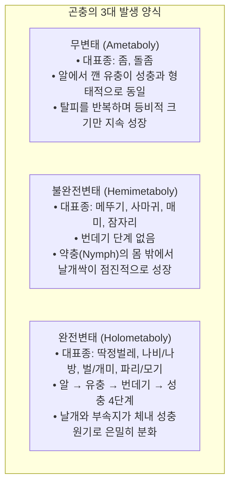
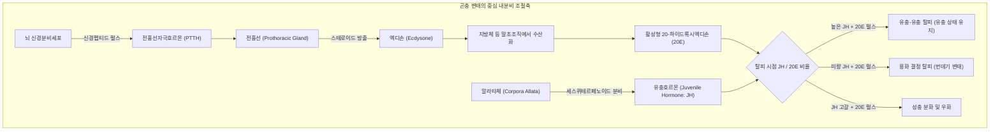
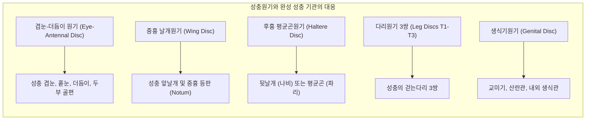
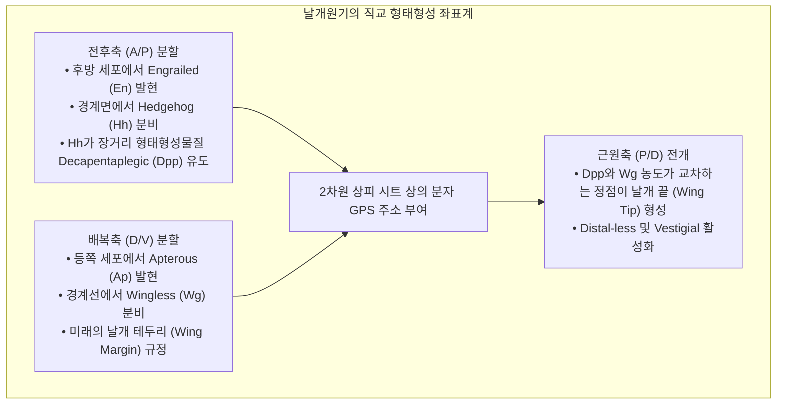
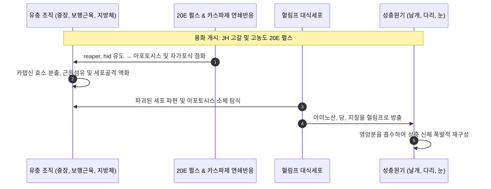
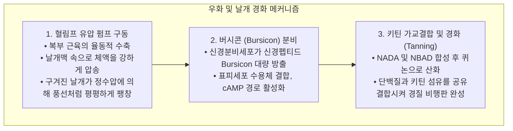
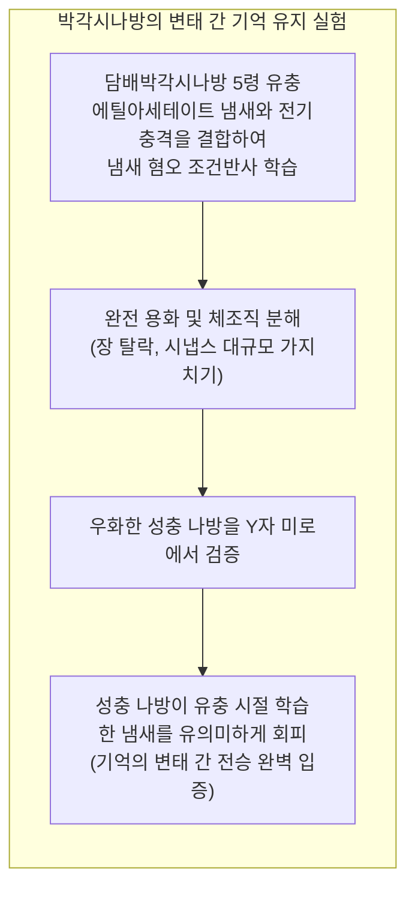

식물의 잎을 맹렬히 갉아먹던 뚱뚱한 애벌레가 단단한 번데기 껍질 속에 갇혀 완벽한 정적에 들어간 뒤, 얼마 지나지 않아 등껍질을 찢고 화려한 날개를 펼친 나비로 우화하는 과정—<strong>완전변태(Holometaboly)</strong>는 지구 생명 진화사에서 가장 극적이고 경이로운 생물학적 변형입니다.

대중 사이에서는 "번데기 속에서 애벌레의 몸이 완전히 액체 수프로 녹아내린 뒤 무(無)에서 새로운 나비가 처음부터 다시 조립된다"는 속설이 널리 퍼져 있습니다. 그러나 현대 발생생물학, 분자유전학, 미세 CT 촬영 기술이 밝혀낸 진실은 그보다 훨씬 더 정교하고 경이로운 생체공학의 승리였습니다.

애벌레의 몸은 실제로 격렬한 <strong>조직용해(Histolysis)</strong>와 프로그램된 세포사멸(아포토시스 및 자가포식)을 거쳐 대부분의 유충 기관을 스스로 소화·분해합니다. 그러나 번데기 내부통은 무질서한 액체 웅덩이가 결코 아닙니다. 배아 발생의 극초기부터 애벌레의 몸속에는 성충의 날개, 다리, 겹눈, 더듬이, 생식기가 될 운명이 이미 각인된 미세한 2배체 전구세포 집단인 <strong>성충원기(Imaginal Discs)</strong>가 정밀하게 보존되어 있습니다.

유충 조직이 해체되면서 쏟아져 나오는 아미노산과 지질 영양분의 격류를 흡수하며, 성충원기는 엑디손과 모폴로겐 농도 구배의 지휘 아래 폭발적인 유사분열과 3차원 입체 반전(Eversion)을 완벽히 수행하여 성충의 신체를 재구성합니다.

본 글에서는 완전변태를 조율하는 내분비 시소 메커니즘, 할로윈 유전자군에 의한 스테로이드 합성, 성충원기의 패턴 형성, 번데기 내부의 세포 분해와 날개 나노광학 구조, 그리고 애벌레 시절의 기억이 나비에게 전승되는 신경생물학의 신비까지 그 전모를 심층 해부합니다.

---

### 1. 변태 양식의 대진화: 왜 완전변태가 지구 육상을 정복했는가?

현생 곤충강(육각아문)은 발생 양식에 따라 크게 3가지 그룹으로 나뉩니다:

지구상에 기록된 모든 동물 종의 60% 이상, 곤충 전체의 85% 이상이 <strong>완전변태 곤충(내생익류: Endopterygota)</strong>에 속합니다. 딱정벌레목, 나비목, 벌목, 파리목이라는 4대 메가다이버스 곤충군이 모두 완전변태를 택하고 있다는 사실은 이 전략이 지닌 진화적 우월성을 명백히 증명합니다.

#### 생태적 지위의 완전한 분리 (세대 간 자원 경쟁의 종식)
불완전변태를 하는 메뚜기를 보면, 약충과 성충이 같은 풀밭에서 동일한 턱으로 동일한 잎을 뜯어먹습니다. 이는 부모와 자식 세대 간에 치열한 <strong>종내 경쟁(Intraspecific Competition)</strong>을 필연적으로 유발합니다.

반면 완전변태를 이룩한 나비는 생태학적 지위를 완벽하게 분할했습니다:
- <strong>유충 (애벌레)</strong>: 저작형 턱과 거대한 소화관을 갖추고 잎을 섭취하여 수주일 만에 체중을 수천 배로 불리는 <strong>'생체량 축적 및 섭식 전담 머신'</strong>;
- <strong>성충 (나비)</strong>: 무거운 턱을 버리고 꿀을 빠는 빨대형 입(흡관)과 광활한 겹눈, 비행 날개를 장착하여 꽃가루를 매개하고 짝을 찾는 <strong>'이동 및 유성생식 전담 머신'</strong>.

부모와 자식 간 서식지와 먹이가 100% 분리됨으로써 종내 자원 경쟁이 원천 차단되었고, 유충기는 에너지 축적에, 성충기는 유전자 확산에 모든 자원을 집중하는 기능적 분업을 달성했습니다.

---

### 2. 내분비 조절 네트워크: 유충호르몬(JH)과 엑디손(20E)의 생화학적 시소

곤충이 언제 탈피하고, 언제 유충기를 끝내며, 언제 번데기가 되어 성충으로 날아오를지는 뇌와 내분비샘이 분비하는 두 핵심 호르몬인 <strong>유충호르몬(Juvenile Hormone: JH)</strong>과 <strong>20-하이드록시엑디손(20-Hydroxyecdysone: 20E)</strong>의 비율에 의해 엄격히 통제됩니다.

#### 할로윈 유전자군(Halloween Genes)과 스테로이드 합성 경로
전흉선에서 콜레스테롤이 활성형 20E로 전환되는 일련의 과정은 사이토크롬 P450 모노옥시게나제 효소군에 의해 매개됩니다. 이들 유전자는 돌연변이 시 큐티클 결함으로 유령 가면 같은 기형을 유발하여 <strong>할로윈 유전자군</strong>이라 불립니다:
1. <strong>Neverland (Nvd)</strong>: 콜레스테롤을 7-디하이드로콜레스테롤로 전환;
2. <strong>Spook (CYP307A1)</strong>: 속도제한 단계 산화 반응을 촉매;
3. <strong>Phantom (CYP306A1)</strong>: C-25 수산화 촉매;
4. <strong>Disembodied (CYP302A1)</strong>: C-22 수산화 촉매;
5. <strong>Shadow (CYP315A1)</strong>: C-2 수산화를 거쳐 엑디손 합성 완료;
6. <strong>Shade (CYP314A1)</strong>: 말초 지방체에서 C-20을 최종 수산화하여 극강의 생체 활성을 지닌 <strong>20E</strong>를 완성합니다.

#### 유충호르몬, Kr-h1 및 Broad-Complex 스위치
알라타체에서 분비되는 JH는 "유충 상태를 유지하라"는 명령을 내립니다:
- JH는 세포 내 핵수용체인 <strong>Met(Methoprene-tolerant)</strong>에 결합합니다.
- 활성화된 Met 복합체는 아연집게 전사인자 <strong>Krüppel-homolog 1(Kr-h1)</strong>을 유도합니다.
- Kr-h1 단백질은 용화의 마스터 유전자인 <strong>Broad-Complex(BR-C)</strong>의 프로모터에 결합하여 그 발현을 억제합니다.
- 종령 유충 말기가 되면 알라타체가 JH 합성을 중단하고 혈림프의 효소가 잔류 JH를 제거합니다. JH가 완전히 소멸된 상태에서 20E 펄스가 닥치면 Kr-h1의 억제가 풀리며 <strong>BR-C가 폭발적으로 발현</strong>하여 번데기화의 막이 오릅니다.

---

### 3. 성충원기(Imaginal Discs): 유충 몸속에 감춰진 설계도

완전변태의 경이로움은 번데기 속에서 성충의 다리와 날개가 조립되는 핵심 씨앗이 어디에 있느냐는 점입니다. 그 정답이 바로 애벌레 내부에 잠들어 있던 <strong>성충원기(Imaginal Discs)</strong>입니다.

#### 2배체 세포의 보존과 유충 세포의 다배수체화
애벌레가 거대하게 성장하는 동안 일반 유충 세포(표피, 내장)는 유사분열 없이 DNA 복제만 거듭하는 <strong>핵내배가(Endoreplication)</strong>를 통해 거대화됩니다.

그러나 <strong>성충원기 세포는 다배수체화를 엄격히 거부</strong>합니다. 순수한 2배체(Diploid)를 유지한 채 체벽 안쪽으로 함입된 주머니 형태의 단층 상피 조직으로 조용히 증식합니다. 초파리의 경우 배아 단계에서 단 수십 개였던 날개원기 세포는 종령 유충 시기에 약 50,000개의 치밀한 상피 시트로 증식합니다.

#### 망원경식 동심원 주름 구조
성충원기는 고도로 접힌 동심원 주름(Pleats) 구조를 취하고 있습니다. 다리원기의 경우 <strong>접이식 안테나나 망원경</strong>과 같습니다:
- 동심원의 가장 중심부는 성충 다리의 최말단인 발톱과 부절이 됩니다;
- 바깥쪽 링들은 차례로 경절, 대퇴절, 전자, 기절로 대응됩니다.
호르몬 신호가 방아쇠를 당기면 이 접힌 시트가 바깥쪽으로 단숨에 뒤집혀 뻗어나오며(Eversion) 긴 다리와 넓은 날개로 변신합니다.

---

### 4. 형태형성물질(Morphogen) 농도 구배와 2차원 좌표계

성충원기 세포는 자신이 날개의 앞쪽이 될지 뒤쪽이 될지 어떻게 알 수 있을까요? 발생생물학은 성충원기를 통해 <strong>형태형성물질(Morphogen) 농도 구배</strong> 원리를 증명했습니다.

1. <strong>전후축(A/P)</strong>: 후방 구획의 <strong>Engrailed(En)</strong>가 <strong>Hedgehog(Hh)</strong>를 분비하고, Hh는 전방 경계면 세포에서 BMP 계열의 장거리 형태형성물질 <strong>Decapentaplegic(Dpp)</strong> 발현을 촉발하여 앞뒤 축의 농도 경사를 세웁니다.
2. <strong>배복축(D/V)</strong>: 등쪽의 <strong>Apterous(Ap)</strong> 발현 세포와 배쪽 세포의 경계면에서 <strong>Wingless(Wg)</strong>가 분비되어 날개 테두리를 결정합니다.
3. <strong>좌표 교차점</strong>: Dpp와 Wg 농도가 만나는 교차점이 날개 최원위부(날개 끝)가 됩니다. 세포들은 이 농도 조합을 읽어 자신의 위치를 파악하고 날개맥과 털을 정확히 배치합니다.

---

### 5. 번데기 속의 대분해: 조직용해(Histolysis)와 영양 재활용

번데기 껍질 속에서 일어나는 유충 기관의 해체는 문자 그대로의 <strong>완전한 자기분해(Histolysis)</strong>입니다.

- <strong>유충 소화관 파괴</strong>: 거대한 유충 중장은 동기화된 세포사멸을 거쳐 찌꺼기로 수축된 후 관강으로 탈락하여 성충 우화 시 최초 배출물인 <strong>태변(Meconium)</strong>이 됩니다.
- <strong>유충 보행근육 액화</strong>: 유충의 기어다니는 근육은 카텝신(Cathepsins) 단백질 분해효소에 의해 완전히 아미노산 수프로 분해됩니다.
- <strong>성충원기는 왜 녹지 않는가?</strong>: 유충 세포의 EcR 수용체는 사멸 유전자를 활성화하는 반면, 성충원기에서는 세포사멸 유전자가 억제되어 있고 대신 세포증식 인자가 점화되어 유충의 분해 산물을 영양분 삼아 성장합니다.

---

### 6. 성충 형태 형성과 날개 나노광학 구조

번데기 후기 성충원기가 밖으로 뒤집혀 전개된 뒤, 나비는 유압 펌프와 단백질 경화 메커니즘을 통해 완벽한 성충으로 태어납니다.

#### 나비 날개 비늘의 구조색(Structural Color) 나노포토닉스
모르포나비의 눈부신 금속성 파란색은 색소가 아니라 <strong>물리적 나노 구조색</strong>입니다.
1. 단일 표피 전구세포가 비대칭 분열하여 비늘세포(Trichogen)를 형성합니다.
2. 액틴 미세섬유를 틀 삼아 키틴질 외골격을 분비합니다.
3. 키틴 박막이 약 140nm 간격의 크리스마스트리형 나노 선반(Lamellae) 구조로 자기조립됩니다.
4. 빛이 입사할 때 다층 박막 간섭에 의해 파란색 파장($\approx 450\,\text{nm}$)만 극대화되고 다른 파장은 상쇄되어 수억 년간 퇴색하지 않는 광학 구조가 완성됩니다.

---

### 7. 변태를 뛰어넘는 기억 전승: 애벌레의 경험을 나비가 기억하는가?

2008년 조지타운 대학교의 더글러스 블랙키스턴(Douglas Blackiston)과 마사 바이스(Martha Weiss) 연구팀은 저명 학술지 《PLOS ONE》에 충격적인 연구를 발표했습니다:

연구진은 유충에게 특정 냄새와 전기충격을 연합 학습시킨 후 번데기를 거쳐 성충으로 우화시켰습니다. Y자형 후각 미로 검사 결과, 성충 나방은 유충 시절 전기충격을 받았던 냄새를 뚜렷하게 기피했습니다.

신경해부학 연구에 따르면 곤충 뇌의 기억 중추인 <strong>버섯체(Mushroom Body)</strong>의 핵심 뉴런인 케년 세포(Kenyon Cells)는 번데기 속에서 소멸하지 않고 살아남아, 유충 시절의 핵심 경험 흔적을 성충 뇌의 회로로 계승시킵니다.

---

### 8. 진화발생생물학(Evo-Devo)과 곤충성장조절제(IGR)

Evo-Devo의 <strong>전약충 가설(Pro-nymph Hypothesis)</strong>에 따르면:
- 불완전변태 조상이 알 속에서 잠시 거치던 연약한 배아 단계(전약충)에서 조기 부화하는 돌연변이가 발생했습니다.
- 따라서 <strong>애벌레는 알 밖으로 뛰쳐나와 자유롭게 먹이를 먹는 '움직이는 배아'</strong>이며, 조상의 다회 탈피 약충 단계가 단 한 번의 정적 단계로 농축된 것이 바로 <strong>번데기</strong>입니다.

#### 현대 농업과 방역에서의 응용: IGR
완전변태의 내분비 메커니즘을 표적화한 <strong>곤충성장조절제(IGR)</strong>는 포유류에 무해하면서 해충만 박멸합니다:
- <strong>유충호르몬 유사제(피리프록시펜, 메토프렌)</strong>: 모기 유충의 체내에서 JH 신호를 인위적으로 유지시켜 번데기에서 성충으로의 우화를 100% 차단, 뎅기열과 말라리아 매개체를 퇴치합니다;
- <strong>엑디손 수용체 작용제(테부페노지드)</strong>: 나방 유충의 조기 기형 탈피를 유도하여 옛 머리껍질이 입에 걸려 굶어 죽게 만듭니다.

---

### 9. 결론: 수프를 초월한 위대한 생명 설계

"애벌레가 번데기 속에서 완전히 녹아내린다"는 말은 옛 몸을 해체하는 격렬한 진실을 담고 있지만, 생명의 정교한 지성을 과소평가한 오해이기도 합니다.

유충의 몸은 자가분해를 통해 생화학 영양의 바다로 돌아가지만, 그 속에서 성충원기는 배아 시절부터 지켜온 설계도를 펼쳐 혼돈을 질서로 바꿉니다. 완전변태는 파괴가 아니라, 자연이 써 내려간 가장 위대한 부활의 서사시입니다.
