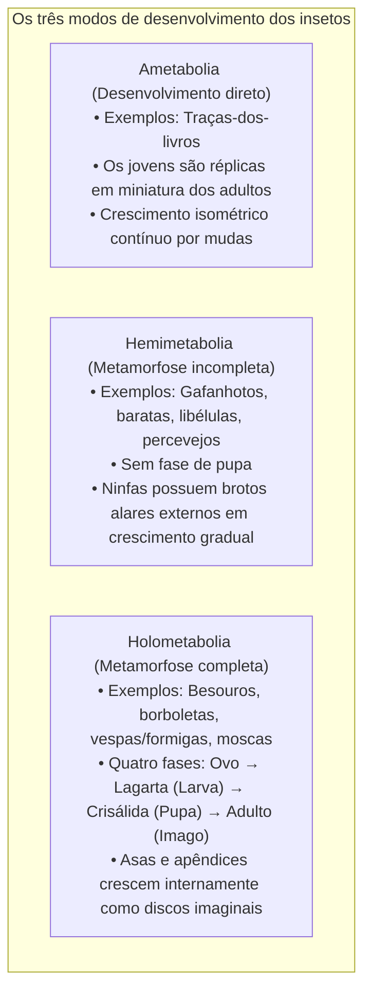
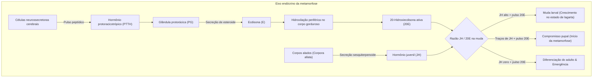
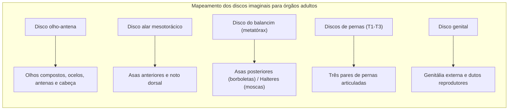

Uma lagarta voraz devorando folhas incessantemente, tecendo um casulo ou se transformando em uma crisálida imóvel, para finalmente romper sua cutícula e desdobrar as asas iridescentes de uma borboleta: a <strong>metamorfose completa (holometabolia)</strong> é uma das transformações biológicas mais espetaculares da Terra.

No imaginário popular, persiste o mito de que a lagarta se dissolve totalmente em uma "sopa" amorfa dentro da crisálida, a partir da qual um novo organismo seria montado do zero. No entanto, a biologia do desenvolvimento moderna revela uma realidade muito mais sofisticada: uma obra-prima de engenharia celular e controle genético.

Embora os tecidos larvais sofram de fato uma intensa <strong>histólise</strong> por apoptose e autofagia programadas, o interior da pupa nunca é um caos desordenado. Desde os estágios embrionários mais precoces, existem no corpo da lagarta aglomerados de células diploides indiferenciadas: os <strong>discos imaginais (imaginal discs)</strong>.

Enquanto os órgãos da lagarta se liquefazem em um banho de aminoácidos e lipídios, os discos imaginais aproveitam esses nutrientes. Sob o comando de pulsos hormonais e gradientes morfogenéticos, eles proliferam rapidamente, evertem-se como um telescópio e constroem as asas, pernas, olhos compostos e antenas da borboleta adulta.

---

### 1. Evolução da metamorfose: Por que a holometabolia domina a Terra?

Os insetos (Hexapoda) dividem-se em três grandes modos de desenvolvimento:

Mais de 60% de todas as espécies animais conhecidas e mais de 85% dos insetos pertencem aos <strong>insetos holometábolos (Endopterygota)</strong>. Besouros, borboletas, formigas/abelhas e moscas devem seu enorme sucesso evolutivo a essa estratégia.

#### Segregação completa de nichos ecológicos
Em insetos hemimetábolos, ninfas e adultos compartilham as mesmas peças bucais mastigadoras e disputam as mesmas plantas, gerando <strong>intensa competição intraespecífica entre pais e filhos</strong>.

A holometabolia elimina esse conflito:
- <strong>A larva (lagarta)</strong>: Especializada em mastigar e digerir biomassa vegetal, multiplica seu peso milhares de vezes em semanas, funcionando como uma <strong>máquina de acúmulo de biomassa</strong>;
- <strong>O adulto (borboleta)</strong>: Possui espirotromba para sugar néctar e asas para voar, funcionando como uma <strong>máquina de dispersão e reprodução</strong>.

Essa partição total de nicho garantiu o domínio ecológico dos holometábolos em todos os continentes.

---

### 2. O eixo endócrino: O balanço entre hormônio juvenil e 20-hidroxiecdisona

O momento exato de cada muda, da pupação e da emergência é controlado pelo equilíbrio antagônico entre dois hormônios mestres: o <strong>hormônio juvenil (JH)</strong> e a <strong>20-hidroxiecdisona (20E)</strong>.

#### Genes Halloween e síntese de ecdisona
A transformação do colesterol alimentar em 20E ativa envolve enzimas do citocromo P450 chamadas <strong>genes Halloween</strong>: *Neverland*, *Spook*, *Phantom*, *Disembodied*, *Shadow* e *Shade*. A 20E liga-se ao receptor nuclear <strong>EcR/USP</strong>, deflagrando os programas genéticos da muda.

#### O freio do hormônio juvenil e o interruptor Broad-Complex
O hormônio juvenil (JH) atua como um sinal para "permanecer lagarta":
- O JH liga-se ao receptor nuclear <strong>Met</strong>.
- O complexo Met/JH induz o fator de transcrição <strong>Krüppel-homolog 1 (Kr-h1)</strong>.
- O Kr-h1 bloqueia diretamente a expressão do gene mestre da pupação, o <strong>Broad-Complex (BR-C)</strong>.
- No último estágio larval, a produção de JH cessa e o hormônio residual é degradado. Na ausência de JH, o bloqueio é desfeito e o novo pulso de 20E induz a <strong>ativação maciça do BR-C</strong>, iniciando irreversivelmente a pupação.

---

### 3. Anatomia dos discos imaginais: Os projetos secretos do adulto

Os órgãos do adulto originam-se de ilhas celulares separadas desde a fase embrionária: os <strong>discos imaginais (imaginal discs)</strong>.

Enquanto os tecidos da lagarta crescem por <strong>endorreplicação</strong> (multiplicação de DNA sem divisão celular), as células dos discos imaginais permanecem estritamente <strong>diploides</strong>, dividindo-se por mitose para formar bolsas epiteliais compactas.

O epitelio de um disco de perna é dobrado em anéis concêntricos como um <strong>telescópio retrátil</strong>. O centro do disco forma o tarso e as garras, enquanto os anéis externos formam tíbia, fêmur e coxa. Durante a pupação, o tecido everte-se bruscamente para fora, formando o apêndice adulto em poucas horas.

---

### 4. Gradients morfogenéticos e sistemas de coordenadas

As células do disco leem sua posição espacial através de <strong>gradientes ortogonais de morfógenos</strong>:
- <strong>Eixo anteroposterior (A/P)</strong>: O compartimento posterior expressa *engrailed (en)*, que estimula *Hedgehog (Hh)*. Este induz a secreção do morfógeno difusível *Decapentaplegic (Dpp)*.
- <strong>Eixo dorsoventral (D/V)</strong>: Células dorsais expressam *apterous (ap)*, induzindo a secreção de *Wingless (Wg)* na margem da asa.
- O cruzamento desses gradientes define a ponta da asa e instrui a formação de veias e cerdas com precisão micrométrica.

---

### 5. Histólise: Morte celular programada e reciclagem

A desintegração dos tecidos larvais constitui uma <strong>histólise</strong> controlada:
- O intestino da lagarta sofre apoptose coordenada e desprende-se na cavidade, formando o mecônio expelido pelo adulto;
- A musculatura larval é dissolvida por catepsinas e pelo proteassoma em aminoácidos livres;
- Os hemócitos (macrófagos) fagocitam restos celulares e liberam os nutrientes na hemolinfa;
- Os discos imaginais são imunes à autólise porque os genes pró-apoptóticos estão silenciados epigeneticamente, permitindo que utilizem os nutrientes para construir o corpo adulto.

---

### 6. Desdobramento alar e nanofotônica

Na eclosão, as asas estão amassadas. A expansão é impulsionada por bombeamento hidráulico de hemolinfa pelas veias alares. Em seguida, a liberação do neuropeptídeo <strong>bursicona</strong> estimula a oxidação de NADA e NBAD em quinonas, promovendo o curtimento e endurecimento da quitina.

As cores azuis brilhantes das borboletas *Morpho* resultam de <strong>estruturas nanofotônicas (cor estrutural)</strong>: cristas microscópicas de quitina em forma de árvore de Natal com espaçamento periódico de 140 nm refletem seletivamente a luz azul por interferência construtiva.

---

### 7. Memória através da metamorfose: A borboleta lembra da lagarta?

Em 2008, Douglas Blackiston e Martha Weiss comprovaram em *PLOS ONE* que lagartas de mariposas (*Manduca sexta*) treinadas para associar odores a choques elétricos retêm a aversão ao odor mesmo após a metamorfose completa. Os <strong>corpos pedunculados (Mushroom Bodies)</strong>, centros neurais de memória, sobrevivem à pupação com suas conexões sinápticas reorganizadas, garantindo a continuidade do aprendizado.

---

### 8. Hipótese da pró-ninfa e reguladores de crescimento (IGR)

A moderna teoria evolutiva (Truman & Riddiford) estabelece que a lagarta é um embrião de eclosão precoce (pró-ninfa), enquanto a crisálida condensa os antigos estágios ninfais.

Na agricultura e saúde pública, inseticidas fisiológicos (IGRs) mimetizam esses processos:
- <strong>Análogos do hormônio juvenil (Piriproxifeno, Metopreno)</strong>: Impedem a emergência de mosquitos vetores de malária e dengue;
- <strong>Agonistas da ecdisona (Tebufenozida)</strong>: Provocam mudas letais precoces em pragas agrícolas.

---

### 9. Conclusão

A metamorfose completa é o triunfo supremo da engenharia biológica. Os discos imaginais garantem que, em meio à dissolução dos tecidos larvais, o plano da borboleta permaneça intacto, transformando o rastejador em uma sublime criatura alada.
