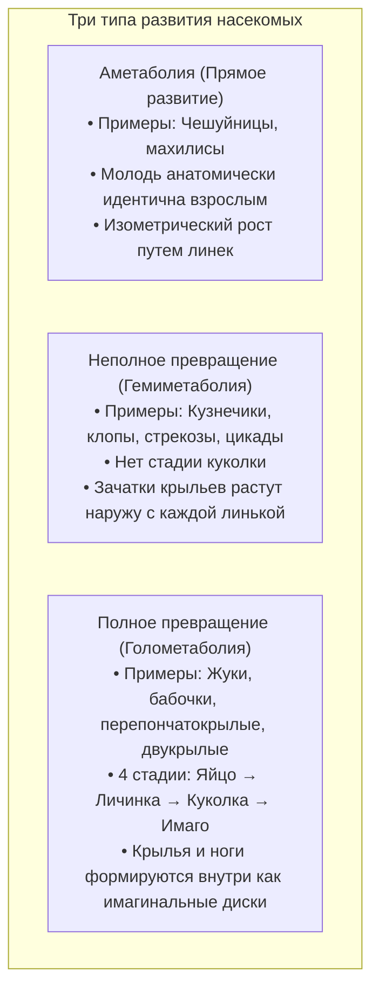
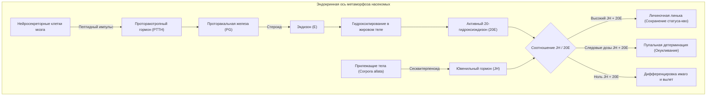
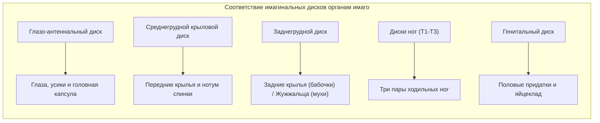

Ненасытная гусеница, безостановочно поглощающая листву, плетущая кокон или застывающая в неподвижной куколке, из которой спустя время появляется великолепная бабочка с сияющими крыльями: <strong>полное превращение (голометаболия)</strong> — одна из самых поразительных биологических метаморфоз на Земле.

В популярной культуре существует устойчивое представление о том, что гусеница внутри куколки полностью превращается в бесформенный суп, из которого затем заново собирается бабочка. Однако современная биология развития показывает куда более изящную картину тончайшей клеточной инженерии.

Личиночные ткани действительно подвергаются масштабному <strong>гистолизу</strong> — запрограммированному саморастворению за счет апоптоза и аутофагии. Но внутри куколки нет хаоса. Еще на стадии раннего эмбрионального развития в теле гусеницы закладываются обособленные островки диплоидных клеток — <strong>имагинальные диски (imaginal discs)</strong>.

Пока органы гусеницы распадаются на аминокислоты и липиды, имагинальные диски утилизируют эти питательные вещества. Под действием гормональных импульсов и градиентов морфогенов они стремительно делятся, выворачиваются подобно подзорной трубе и выстраивают крылья, ноги, фасеточные глаза и усики взрослого насекомого.

---

### 1. Эволюция метаморфоза: Почему голометаболия покорила планету?

Современные насекомые делятся на три группы по типу развития:

Более 60% описанных видов животных и свыше 85% всех насекомых относятся к <strong>насекомым с полным превращением (Endopterygota)</strong>. Жуки, бабочки, осы/муравьи и мухи достигли триумфа благодаря полному разделению экологических ниш:
- <strong>Личинка (гусеница)</strong>: Обладает грызущими челюстями и мощным кишечником, являясь машиной накопления биомассы;
- <strong>Имаго (бабочка)</strong>: Снабжена хоботком для нектара, крыльями и сложными глазами, являясь машиной расселения и размножения.

Разделение ресурсов между поколениями свело к нулю внутривидовую конкуренцию.

---

### 2. Эндокринная регуляция: Качели ювенильного гормона и 20-гидроксиэкдизона

Сроки линек и метаморфоза контролируются балансом двух гормонов: <strong>ювенильного гормона (JH)</strong> и <strong>20-гидроксиэкдизона (20E)</strong>.

Синтез экдизона кодируется цитохромами P450, так называемыми <strong>генами Хэллоуина</strong> (*Neverland*, *Spook*, *Phantom*, *Disembodied*, *Shadow*, *Shade*). 20E активирует ядерный рецептор <strong>EcR/USP</strong>.

Ювенильный гормон через рецептор <strong>Met</strong> включает фактор <strong>Krüppel-homolog 1 (Kr-h1)</strong>, который блокирует мастер-ген окукливания <strong>Broad-Complex (BR-C)</strong>. В конце последнего возраста синтез JH прекращается, блок снимается, и всплеск 20E запускает экспрессию BR-C, открывая путь к метаморфозу.

---

### 3. Анатомия имагинальных дисков: Скрытые чертежи

Органы взрослого насекомого формируются из эмбриональных закладок — <strong>имагинальных дисков (imaginal discs)</strong>.

В то время как клетки гусеницы становятся полиплоидными за счет <strong>эндорепликации</strong>, клетки дисков остаются строго диплоидными. Эпителий диска ноги сложен концентрическими кольцами, как <strong>складная подзорная труба</strong>. В центре заложены коготки и лапка, а по краям — голень, бедро и тазик. При метаморфозе диск выворачивается наружу, вытягиваясь в ногу за считанные часы.

---

### 4. Морфогенные координаты

Позиционная информация внутри диска задается пересекающимися градиентами морфогенов:
- <strong>Ось A/P</strong>: Задние клетки экспрессируют *engrailed (en)*, стимулирующий секрецию *Hedgehog (Hh)*. Hh запускает градиент *Decapentaplegic (Dpp)*.
- <strong>Ось D/V</strong>: Дорсальные клетки экспрессируют *apterous (ap)*, индуцируя полосу секреции *Wingless (Wg)* по краю крыла.
- Пересечение Dpp и Wg определяет вершину крыла, направляя дифференцировку жилок и щетинок.

---

### 5. Гистолиз: Контролируемое разрушение тканей

Термин «растворение в суп» описывает биохимический процесс <strong>гистолиза</strong>:
- Кишечник гусеницы подвергается массовому апоптозу и сбрасывается в виде мекония, а кишечные стволовые клетки строят тонкий кишечник бабочки;
- Мышцы личинки расщепляются катепсинами до аминокислот;
- Фагоциты поглощают апоптотические тельца и отдают питательные вещества в гемолимфу;
- В клетках имагинальных дисков апоптотические гены эпигенетически заблокированы, что позволяет им использовать высвобожденные нутриенты для построения органов имаго.

---

### 6. Расправление крыльев и нанофотоника

После выхода из куколки бабочка накачивает гемолимфу в жилки крыльев гидравлическим давлением. Нейропептид <strong>бурсикон</strong> запускает окисление NADA и NBAD в хиноны, сшивающие кутикулу.

Переливчатый синий цвет бабочек *Morpho* создается <strong>структурным цветом</strong>: чешуйки образуют нанополочки хитина с шагом 140 нм, которые отражают синий свет ($\approx 450\,\text{nm}$) за счет многолучевой интерференции.

---

### 7. Трансметаморфическая память: Помнит ли бабочка гусеницу?

В 2008 году ученые доказали в *PLOS ONE*, что бражники (*Manduca sexta*), обученные избегать запаха этилацетата с помощью электрошока на стадии гусеницы, сохраняют эту память после выхода из куколки. <strong>Клетки Кеньона в грибовидных телах мозга</strong> выживают в куколке, сохраняя следы долговременной памяти.

---

### 8. Пронимфа и регуляторы роста насекомых (IGR)

По современной гипотезе пронимфы (Трумэн и Риддифорд), гусеница — это преждевременно вылупившийся свободный эмбрион, а куколка — сжатая древняя стадия нимфы.

Эти знания легли в основу безопасных регуляторов роста (IGR):
- <strong>Аналоги ювенильного гормона (Пирипроксифен)</strong>: Блокируют окукливание личинок комаров;
- <strong>Агонисты экдизона (Тебуфенозид)</strong>: Вызывают фатальные преждевременные линьки у гусениц-вредителей.

---

### 9. Заключение

Полное превращение — это триумф природной биоинженерии. Имагинальные диски доказывают, что трансформация гусеницы в бабочку — это не слепой распад, а гениально срежиссированное рождение нового крылатого существа.
