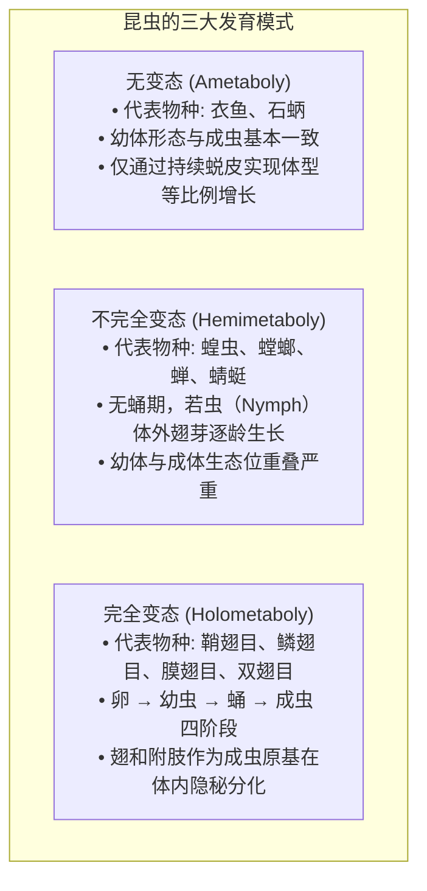
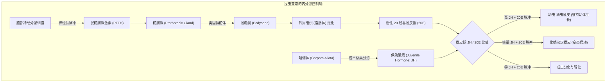
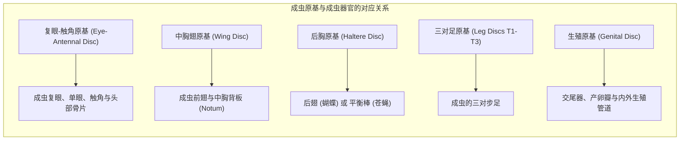
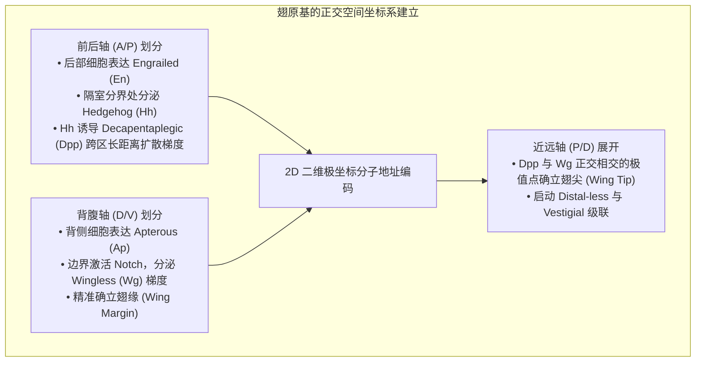
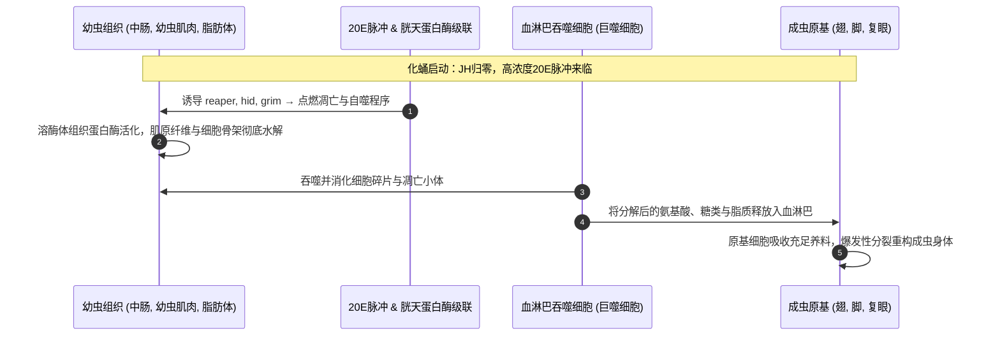
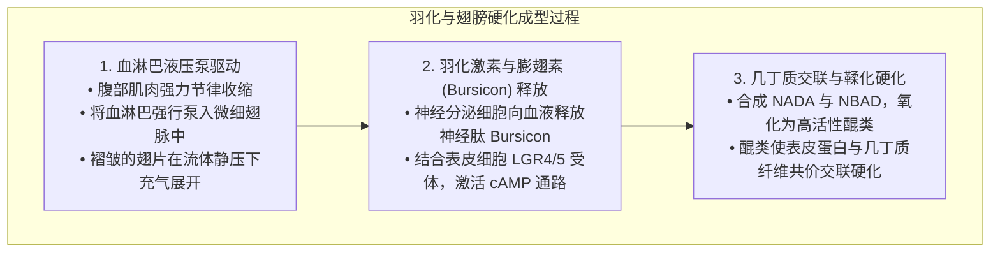
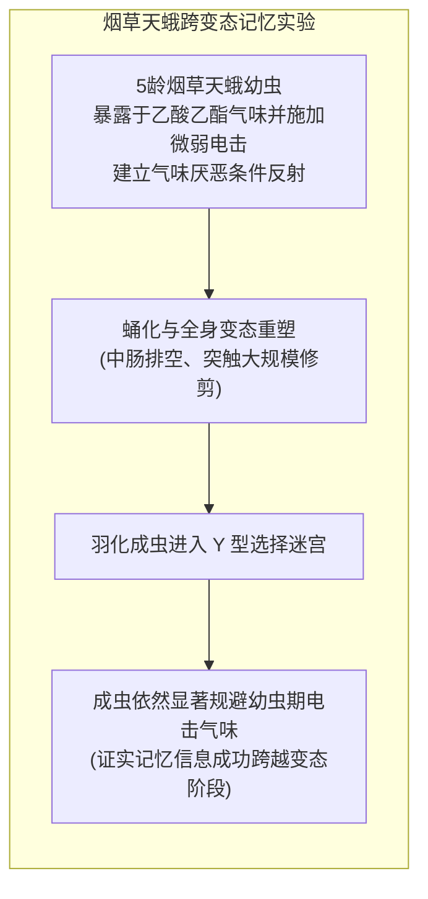

一条在植物叶片上疯狂啃食的肥硕毛毛虫，吐丝作茧或化为静止僵硬的蛹，数日之后，蛹壳破裂，一只拥有绚丽对称双翅的斑斓蝴蝶破茧而出——<strong>完全变态（Holometaboly）</strong>是地球生命演化史上最为震撼而充满诗意的生物学飞跃之一。

在公众的普遍认知中，流传着一个极其著名的说法：“毛毛虫在蛹壳里会彻底融化成一滩没有结构的肉汤，然后再重新从零组装成一只蝴蝶”。然而，现代发育生物学、分子遗传学以及微焦点X射线CT成像技术向我们揭示了一个更加精巧、更具工程美感的生命真相。

毛毛虫的幼虫组织确实经历了剧烈的<strong>组织崩解（Histolysis）</strong>，数以亿计的幼虫细胞通过凋亡（Apoptosis）和自噬（Autophagy）进行程序性自溶。但蛹内绝非毫无秩序的混沌汤液。早在胚胎发育的最早期，毛毛虫体内就已经埋下了数对处于休眠状态的、高度特化的二倍体祖细胞团——<strong>成虫原基（Imaginal Discs）</strong>。

当幼虫器官自溶崩解并释放出海量氨基酸与脂质养分时，成虫原基吸收了这场生化洪流。在蜕皮激素与形态发生素浓度梯度的精密指引下，原基细胞发生爆发性有丝分裂，像折叠望远镜一般向外立体翻转展开，以令人惊叹的自组织能力重建出成虫的翅膀、复眼、触角与足部。

本文将深入分子内核，全方位剖析昆虫完全变态的内分泌跷跷板机制、万圣节基因簇、成虫原基的三维形态发生、记忆在变态过程中的跨阶段保留，以及昆虫生长调节剂在现代生物技术中的前沿应用。

---

### 1. 变态样式的宏观演化：完全变态为何能统治地球陆地？

现生昆虫纲（六足亚门）根据其变态发育模式，清晰地划分为三大类群：

在地球上已知的所有动物物种中，超过60%属于<strong>完全变态昆虫（内生翅类: Endopterygota）</strong>；而在昆虫纲内部，这一比例更高达85%以上。甲虫（鞘翅目）、蝶蛾（鳞翅目）、蜂蚁（膜翅目）与蚊蝇（双翅目）这四大超级多样性目全部属于完全变态类群。

#### 彻底消除亲子世代资源竞争的生态位解耦
在不完全变态昆虫（如蝗虫）中，幼虫（若虫）和成虫长着完全相同的咀嚼式口器，生活在同一片草丛中，争夺完全相同的植物叶片。这种生态位的高度重叠带来了巨大的<strong>种内竞争压力</strong>。

而完全变态则创造性地打破了这一瓶颈，实现了生态学上的极致分工：
- <strong>幼虫（毛毛虫、蛆、蛴螬）</strong>：移动迟缓，专职摄食，体内消化器官极度膨大，在几周内将体重暴增数千倍，是一台纯粹的<strong>“生物量积累与营养储存机器”</strong>；
- <strong>成虫（蝴蝶、蛾、蜜蜂）</strong>：放弃了沉重的幼虫消化道，演化出虹吸式口吻吸食花蜜，拥有广阔的复眼与强悍的飞行翅膀，是一台专职<strong>“基因扩散、迁徙与有性生殖机器”</strong>。

幼虫与成虫在食物来源、生活空间与行为模式上实现了100%的物理隔离，消除了亲子世代之间的资源内耗，从而推动完全变态昆虫征服了陆地生态系统的每一个角落。

---

### 2. 内分泌调控网络：保幼激素（JH）与蜕皮激素（20E）的生化跷跷板

昆虫生命史中的每一次蜕皮、化蛹与羽化，均由两大脑内分泌激素的浓度比率精准驱动：<strong>保幼激素（Juvenile Hormone: JH）</strong>与类固醇激素<strong>20-羟基蜕皮酮（20-Hydroxyecdysone: 20E）</strong>。

#### 万圣节基因簇（Halloween Genes）与蜕皮激素合成
前胸腺将膳食胆固醇转化为活性20E的过程，由一系列高度保守的细胞色素P450单加氧酶严格把控。由于突变体胚胎角质层发育畸形宛如万圣节幽灵面具，这些催化酶基因被形象地命名为<strong>万圣节基因簇</strong>：
1. <strong>Neverland (Nvd)</strong>：在起始端催化胆固醇转化为7-脱氢胆固醇；
2. <strong>Spook (CYP307A1)</strong>：催化未知的“黑匣子”限速氧化步骤生成二酮二醇前体；
3. <strong>Phantom (CYP306A1)</strong>：催化C-25位羟化生成酮三醇；
4. <strong>Disembodied (CYP302A1)</strong>：催化C-22位羟化生成2-脱氧蜕皮酮；
5. <strong>Shadow (CYP315A1)</strong>：在前胸腺内完成C-2位羟化合成蜕皮酮并分泌入血；
6. <strong>Shade (CYP314A1)</strong>：在外周组织（特别是脂肪体）中催化C-20位羟化，最终产生活性极高的<strong>20-羟基蜕皮酮（20E）</strong>。

#### 保幼激素、Kr-h1与Broad-Complex的分子制动
保幼激素（JH）由咽侧体合成，其核心作用是发出“维持幼虫状态”的遗传指令：
- JH分子穿透细胞膜，结合细胞核内的bHLH-PAS家族受体<strong>Met（Methoprene-tolerant）</strong>与<strong>Gce（Germ cell-expressed）</strong>。
- 活化的Met/Gce复合物直接驱动锌指转录因子<strong>Krüppel-homolog 1（Kr-h1）</strong>的高水平表达。
- <strong>Kr-h1是化蛹的主制动阀</strong>：它牢牢结合在化蛹关键主控基因<strong>Broad-Complex（BR-C）</strong>的启动子上，强力阻断其转录。
- 在终龄幼虫末期，咽侧体停产JH，血淋巴中的JH酯酶和环氧化物水解酶迅速清除残留JH。在JH彻底归零后，新一轮20E脉冲来临，解除Kr-h1的抑制，促使<strong>BR-C爆发性表达</strong>，正式敲开化蛹与成虫原基启动的闸门。

---

### 3. 成虫原基（Imaginal Discs）：藏于毛虫体内的隐形蓝图

成虫原基并非幼虫进入蛹期后临时凭空生成的组织，而是在卵内胚胎发生的极早期，由十几个到几十个外胚层细胞预先决定（Determination）而成的独立细胞集团。

#### 二倍体静止与幼虫多倍体化的分野
幼虫在疯狂啃食生长的过程中，其绝大多数体细胞（表皮、中肠、唾液腺）并不通过正常的细胞分裂增殖，而是进行<strong>核内DNA复制（Endoreplication / 多倍体化）</strong>，细胞核体积增大几十甚至上百倍以支撑海量蛋白质合成。

然而，<strong>成虫原基细胞完全拒绝多倍体化</strong>。它们始终保持纯正的二倍体状态（Diploid），通过受控的有丝分裂静静增殖。原基上皮向内凹陷，形成悬挂在体壁内侧、浸泡在血淋巴中的囊袋状单层上皮结构。例如，在果蝇终龄幼虫体内，单个翅原基已从最初的几十个祖细胞分裂壮大至约50,000个细胞。

#### 伸缩望远镜般的同心折叠几何学
成虫原基的上皮层极其致密地折叠成同心褶皱。以足原基为例，它就像一架收拢紧缩的<strong>便携式伸缩望远镜</strong>：
- 原基中心的最深处，决定了未来步足的最末端——跗节和爪；
- 外围一圈圈的同心环，依次对应胫节、股节、转节与基节。
一旦变态信号触发，折叠的上皮层像伞面一般向外翻转伸长（Eversion），短短数小时内就能构建出修长的关节肢体。

---

### 4. 空间坐标体系：形态发生素浓度梯度的笛卡尔编码

微小的上皮平面如何知道何处长出翅脉、何处生出翅缘刚毛？发育生物学通过成虫原基确立了经典的<strong>形态发生素浓度梯度（Morphogen Gradient）</strong>理论。

1. <strong>前后轴（A/P）划分</strong>：后部细胞表达转录因子<strong>Engrailed（En）</strong>，促使细胞分泌短程信号分子<strong>Hedgehog（Hh）</strong>。Hh跨越边界扩散至前部细胞，激活BMP通路长程形态发生素<strong>Decapentaplegic（Dpp）</strong>的合成。Dpp双向扩散形成的坡度赋予细胞前后方向的位置信息。
2. <strong>背腹轴（D/V）划分</strong>：背侧细胞特异表达LIM同源盒转录因子<strong>Apterous（Ap）</strong>。在背腹交界面处，Notch信号被激活并诱导Wnt家族形态发生素<strong>Wingless（Wg）</strong>的线性分泌，精确锁定未来翅的外缘轮廓。
3. <strong>坐标交汇与三维展开</strong>：Dpp与Wg浓度梯度的垂直正交交汇点，就是未来翅膀的最远端（翅尖）。每个细胞读取体内的形态发生素浓度组合，如同读取GPS地理坐标，准确激活对应的结构基因。

---

### 5. 蛹内大解体：组织崩解（Histolysis）与营养循环

在静止不动的蛹壳内部，发生着动物界最剧烈的组织大清洗。

“毛毛虫化成一滩烂泥”在细胞层面上是千真万确的事实——这就是<strong>组织崩解（Histolysis）</strong>。

#### 幼虫器官的程序性自我毁灭
- <strong>巨大中肠的脱落</strong>：幼虫用于消化粗纤维的大型中肠上皮发生同步凋亡，整体缩拢脱落并排入消化道管腔，形成成虫羽化后排出的第一团代谢废物——<strong>胎粪（Meconium）</strong>；由成虫肠祖细胞重建全新轻便的成虫肠道。
- <strong>纵走爬行肌肉的液化</strong>：负责毛毛虫蠕动爬行的粗壮肌肉群，在泛素-蛋白酶体系统和组织蛋白酶（Cathepsins）的疯狂切割下解体液化，释放出巨量游离氨基酸。
- <strong>成虫原基为何能免遭融化？</strong>：幼虫细胞与原基细胞在面对同样的20E刺激时，其基因线路呈现相反的逻辑。幼虫细胞内的EcR受体直接打开凋亡基因（*reaper*, *hid*, *grim*）的启动子；而在成虫原基细胞中，多梳家族蛋白（PcG）严密沉默了凋亡位点，20E转而激活细胞周期素与生长因子，使成虫原基在营养的狂潮中疯狂生长。

---

### 6. 成虫形态发生与翅膀纳米光学工程

当成虫器官完成翻转展开后，最终的羽化过程展示了生物物理学令人惊叹的力学与光学控制。

#### 蝶翅鳞片的微纳光子晶体架构
蝴蝶翅膀上的斑斓色彩，特别是大蓝闪蝶（*Morpho*）那种永不褪色的金属光泽，并非源于化学色素，而是极致的<strong>物理结构色（Structural Color）</strong>：
1. 单个表皮前体细胞经不对称分裂，分化出插座细胞（Tormogen）与产鳞细胞（Trichogen）；
2. 产鳞细胞向外伸出充满肌动蛋白微丝骨架的扁平突起，在其表面沉积几丁质外骨骼；
3. 几丁质薄层自组织排列成高度精密的“圣诞树”状微观棚架结构，层间距精确维持在约 140 纳米；
4. 当白光射入时，周期性纳米薄层发生多光束干涉，波长约 450 nm 的蓝光产生极强的相长干涉反射，其他波长的光则相互抵消，造就了生物光学史上最璀璨的杰作。

---

### 7. 跨越变态的记忆保留：毛毛虫的经历蝶会记得吗？

在经历如此彻底的神经系统重塑之后，毛毛虫幼年时期学到的记忆，能否在蛹期大融化中幸存并带到成虫大脑中？

2008年，乔治城大学的生物学家道格拉斯·布莱キストン（Douglas Blackiston）与玛莎·韦斯（Martha Weiss）在国际权威期刊《PLOS ONE》上发表了里程碑式的实证研究：

研究人员训练烟草天蛾（*Manduca sexta*）的高龄幼虫，使其在闻到乙酸乙酯气体时遭受温和电击，从而建立对该气味的强迫性恐惧厌恶。经过完全化蛹和组织解体，羽化成蛾后，在Y型嗅觉选择迷宫中，受训个体依然表现出极其显著的气味逃避行为。

神经解剖学证实：昆虫大脑的学习记忆中枢——<strong>蕈形体（Mushroom Bodies）</strong>的核心内生神经元<strong>肯扬细胞（Kenyon Cells）</strong>并没有在蛹中死亡。虽然幼虫期的轴突分支和树突棘经历了大规模的修剪与重布线，但储存关键记忆痕迹的神经元支架完好保留并整合进了成虫大脑，使成虫获得了继承幼年生存经验的演化优势。

---

### 8. 演化发育生物学启示：原若虫假说与昆虫生长调节剂

昆虫是如何演化出如此复杂的变态机制的？现代 Evo-Devo 研究广泛支持<strong>原若虫假说（Pro-nymph Hypothesis）</strong>：
- 祖先不完全变态昆虫在卵内胚胎期经历一段短暂的、表皮柔软的原若虫阶段；
- 完全变态昆虫的祖先突变使保幼激素提前分泌，导致胚胎在该阶段提前孵化出壳——<strong>毛毛虫本质上就是一只在卵外自由活动、疯狂吃喝的“游走型胚胎”</strong>；
- 原本多次蜕皮生长的若虫期被高度浓缩整合为一个单一的静止阶段——这就是<strong>蛹</strong>的真正起源。

#### 现代应用：高选择性昆虫生长调节剂（IGR）
人类破解完全变态分子机制后，成功研制出针对害虫内分泌系统的绿色农药：
- <strong>保幼激素拟似剂（如吡丙醚 Pyriproxyfen、灭幼宝 Methoprene）</strong>：在孑孓或跳蚤幼虫末期维持JH信号，彻底摧毁其化蛹羽化能力，高效灭蚊且对哺乳动物完全无毒；
- <strong>蜕皮激素受体激动剂（如虫酰肼 Tebufenozide）</strong>：强制诱发农林害虫幼虫进行畸形蜕皮，使幼虫口器卡死在旧头壳中无法进食而饿死。

---

### 9. 结语：超越泥汤的生命工程学奇迹

“毛毛虫在蛹中彻底化成一滩泥”，既揭示了旧躯体自我牺牲的壮烈，又严重低估了生命设计的高超智慧。

幼虫的肉体确实在程序性自溶中化为生化养分的海洋，但悬浮在这片海洋之中的成虫原基，从未陷入无序。它们手握胚胎期就已写好的宏伟蓝图，在激素信号的交响乐中，精准地将混沌转化为秩序，将笨重的爬虫重塑为翱翔于晴空的精灵。完全变态绝非毁灭，而是生命在演化长河中写下的最壮丽的重生诗篇。
