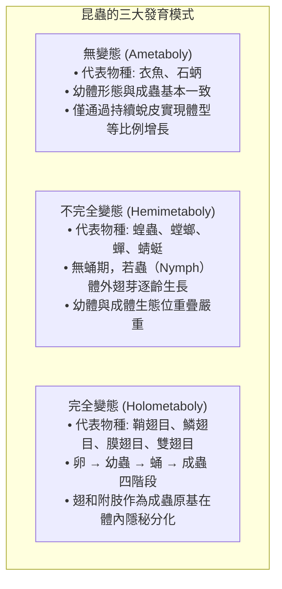
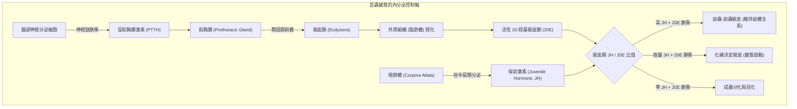
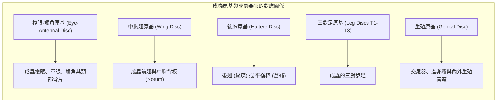
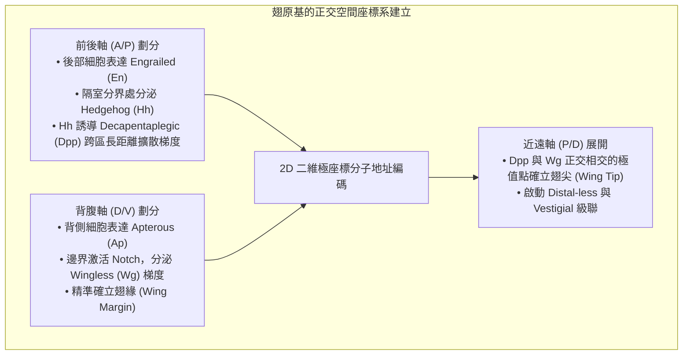
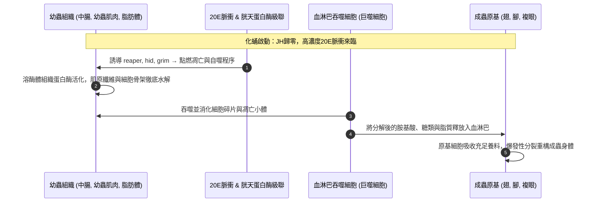
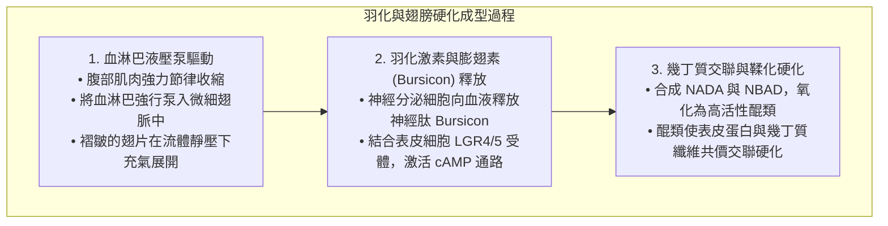
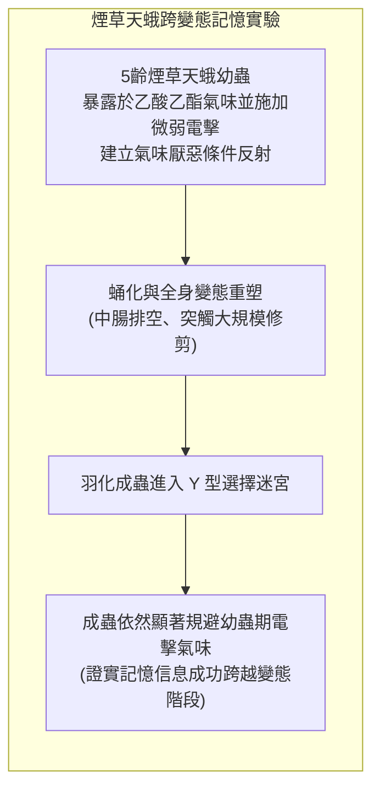

一條在植物葉片上瘋狂啃食的肥碩毛毛蟲，吐絲作繭或化為靜止僵硬的蛹，數日之後，蛹殼破裂，一隻擁有絢麗對稱雙翅的斑斕蝴蝶破繭而出——<strong>完全變態（Holometaboly）</strong>是地球生命演化史上最為震撼而充滿詩意的生物學飛躍之一。

在公眾的普遍認知中，流傳著一個極其著名的說法：「毛毛蟲在蛹殼裡會徹底融化成一灘沒有結構的肉湯，然後再重新從零組裝成一隻蝴蝶」。然而，現代發育生物學、分子遺傳學以及微焦點X射線CT成像技術向我們揭示了一個更加精巧、更具工程美感的生命真相。

毛毛蟲的幼蟲組織確實經歷了劇烈的<strong>組織崩解（Histolysis）</strong>，數以億計的幼蟲細胞通過凋亡（Apoptosis）和自噬（Autophagy）進行程序性自溶。但蛹內絕非毫無秩序的混沌湯液。早在胚胎發育的最早期，毛毛蟲體內就已經埋下了數對處於休眠狀態的、高度特化的二倍體祖細胞團——<strong>成蟲原基（Imaginal Discs）</strong>。

當幼蟲器官自溶崩解並釋放出海量胺基酸與脂質養分時，成蟲原基吸收了這場生化洪流。在蛻皮激素與形態發生素濃度梯度的精密指引下，原基細胞發生爆發性有絲分裂，像折疊望遠鏡一般向外立體翻轉展開，以令人驚嘆的自組織能力重建出成蟲的翅膀、複眼、觸角與足部。

本文將深入分子內核，全方位剖析昆蟲完全變態的內分泌蹺蹺板機制、萬聖節基因簇、成蟲原基的三維形態發生、記憶在變態過程中的跨階段保留，以及昆蟲生長調節劑在現代生物技術中的前沿應用。

---

### 1. 變態樣式的宏觀演化：完全變態為何能統治地球陸地？

現生昆蟲綱（六足亞門）根據其變態發育模式，清晰地劃分為三大類群：

在地球上已知的所有動物物種中，超過60%屬於<strong>完全變態昆蟲（內生翅類: Endopterygota）</strong>；而在昆蟲綱內部，這一比例更高達85%以上。甲蟲（鞘翅目）、蝶蛾（鱗翅目）、蜂蟻（膜翅目）與蚊蠅（雙翅目）這四大超級多樣性目全部屬於完全變態類群。

#### 徹底消除親子世代資源競爭的生態位解耦
在不完全變態昆蟲（如蝗蟲）中，幼蟲（若蟲）和成蟲長著完全相同的咀嚼式口器，生活在同一片草叢中，爭奪完全相同的植物葉片。這種生態位的高度重疊帶來了巨大的<strong>種內競爭壓力</strong>。

而完全變態則創造性地打破了這一瓶頸，實現了生態學上的極致分工：
- <strong>幼蟲（毛毛蟲、蛆、蛴螬）</strong>：移動遲緩，專職攝食，體內消化器官極度膨大，在幾週內將體重暴增數千倍，是一台純粹的<strong>「生物量積累與營養儲存機器」</strong>；
- <strong>成蟲（蝴蝶、蛾、蜜蜂）</strong>：放棄了沉重的幼蟲消化道，演化出虹吸式口吻吸食花蜜，擁有廣闊的複眼與強悍的飛行翅膀，是一台專職<strong>「基因擴散、遷徙與有性生殖機器」</strong>。

幼蟲與成蟲在食物來源、生活空間與行為模式上實現了100%的物理隔離，消除了親子世代之間的資源內耗，從而推動完全變態昆蟲征服了陸地生態系統的每一個角落。

---

### 2. 內分泌調控網絡：保幼激素（JH）與蛻皮激素（20E）的生化蹺蹺板

昆蟲生命史中的每一次蛻皮、化蛹與羽化，均由兩大腦內分泌激素的濃度比率精準驅動：<strong>保幼激素（Juvenile Hormone: JH）</strong>與類固醇激素<strong>20-羥基蛻皮酮（20-Hydroxyecdysone: 20E）</strong>。

#### 萬聖節基因簇（Halloween Genes）與蛻皮激素合成
前胸腺將膳食膽固醇轉化為活性20E的過程，由一系列高度保守的細胞色素P450單加氧酶嚴格把控。由於突變體胚胎角質層發育畸形宛如萬聖節幽靈面具，這些催化酶基因被形象地命名為<strong>萬聖節基因簇</strong>：
1. <strong>Neverland (Nvd)</strong>：在起始端催化膽固醇轉化為7-脫氫膽固醇；
2. <strong>Spook (CYP307A1)</strong>：催化未知的「黑匣子」限速氧化步驟生成二酮二醇前體；
3. <strong>Phantom (CYP306A1)</strong>：催化C-25位羥化生成酮三醇；
4. <strong>Disembodied (CYP302A1)</strong>：催化C-22位羥化生成2-脫氧蛻皮酮；
5. <strong>Shadow (CYP315A1)</strong>：在前胸腺內完成C-2位羥化合成蛻皮酮並分泌入血；
6. <strong>Shade (CYP314A1)</strong>：在外周組織（特別是脂肪體）中催化C-20位羥化，最終產生活性極高的<strong>20-羥基蛻皮酮（20E）</strong>。

#### 保幼激素、Kr-h1與Broad-Complex的分子制動
保幼激素（JH）由咽側體合成，其核心作用是發出「維持幼蟲狀態」的遺傳指令：
- JH分子穿透細胞膜，結合細胞核內的bHLH-PAS家族受體<strong>Met（Methoprene-tolerant）</strong>與<strong>Gce（Germ cell-expressed）</strong>。
- 活化的Met/Gce複合物直接驅動鋅指轉錄因子<strong>Krüppel-homolog 1（Kr-h1）</strong>的高水平表達。
- <strong>Kr-h1是化蛹的主制動閥</strong>：它牢牢結合在化蛹關鍵主控基因<strong>Broad-Complex（BR-C）</strong>的啟動子上，強力阻斷其轉錄。
- 在終齡幼蟲末期，咽側體停產JH，血淋巴中的JH酯酶和環氧化物水解酶迅速清除殘留JH。在JH徹底歸零後，新一輪20E脈衝來臨，解除Kr-h1的抑制，促使<strong>BR-C爆發性表達</strong>，正式敲開化蛹與成蟲原基啟動的閘門。

---

### 3. 成蟲原基（Imaginal Discs）：藏於毛蟲體內的隱形藍圖

成蟲原基並非幼蟲進入蛹期後臨時憑空生成的組織，而是在卵內胚胎發生的極早期，由十幾個到幾十個外胚層細胞預先決定（Determination）而成的獨立細胞集團。

#### 二倍體靜止與幼蟲多倍體化的分野
幼蟲在瘋狂啃食生長的過程中，其絕大多數體細胞（表皮、中腸、唾液腺）並不通過正常的細胞分裂增殖，而是進行<strong>核內DNA複製（Endoreplication / 多倍體化）</strong>，細胞核體積增大幾十甚至上百倍以支撐海量蛋白質合成。

然而，<strong>成蟲原基細胞完全拒絕多倍體化</strong>。它們始終保持純正的二倍體狀態（Diploid），通過受控的有絲分裂靜靜增殖。原基上皮向內凹陷，形成懸掛在體壁內側、浸泡在血淋巴中的囊袋狀單層上皮結構。例如，在果蠅終齡幼蟲體內，單個翅原基已從最初的幾十個祖細胞分裂壯大至約50,000個細胞。

#### 伸縮望遠鏡般的同心折疊幾何學
成蟲原基的上皮層極其緻密地折疊成同心褶皺。以足原基為例，它就像一架收攏緊縮的<strong>便攜式伸縮望遠鏡</strong>：
- 原基中心的最深處，決定了未來步足的最末端——跗節和爪；
- 外圍一圈圈的同心環，依次對應脛節、股節、轉節與基節。
一旦變態信號觸發，折疊的上皮層像傘面一般向外翻轉伸長（Eversion），短短數小時內就能構建出修長的關節肢體。

---

### 4. 空間座標體系：形態發生素濃度梯度的笛卡爾編碼

微小的上皮平面如何知道何處長出翅脈、何處生出翅緣剛毛？發育生物學通過成蟲原基確立了經典的<strong>形態發生素濃度梯度（Morphogen Gradient）</strong>理論。

1. <strong>前後軸（A/P）劃分</strong>：後部細胞表達轉錄因子<strong>Engrailed（En）</strong>，促使細胞分泌短程信號分子<strong>Hedgehog（Hh）</strong>。Hh跨越邊界擴散至前部細胞，激活BMP通路長程形態發生素<strong>Decapentaplegic（Dpp）</strong>的合成。Dpp雙向擴散形成的坡度賦予細胞前後方向的位置信息。
2. <strong>背腹軸（D/V）劃分</strong>：背側細胞特異表達LIM同源盒轉錄因子<strong>Apterous（Ap）</strong>。在背腹交界面處，Notch信號被激活並誘導Wnt家族形態發生素<strong>Wingless（Wg）</strong>的線性分泌，精確鎖定未來翅的外緣輪廓。
3. <strong>座標交匯與三維展開</strong>：Dpp與Wg濃度梯度的垂直正交交匯點，就是未來翅膀的最遠端（翅尖）。每個細胞讀取體內的形態發生素濃度組合，如同讀取GPS地理座標，準確激活對應的結構基因。

---

### 5. 蛹內大解體：組織崩解（Histolysis）與營養循環

在靜止不動的蛹殼內部，發生著動物界最劇烈的組織大清洗。

「毛毛蟲化成一灘爛泥」在細胞層面上是千真萬確的事實——這就是<strong>組織崩解（Histolysis）</strong>。

#### 幼蟲器官的程序性自我毀滅
- <strong>巨大中腸的脫落</strong>：幼蟲用於消化粗纖維的大型中腸上皮發生同步凋亡，整體縮攏脫落並排入消化道管腔，形成成蟲羽化後排出的第一團代謝廢物——<strong>胎糞（Meconium）</strong>；由成蟲腸祖細胞重建全新輕便的成蟲腸道。
- <strong>縱走爬行肌肉的液化</strong>：負責毛毛蟲蠕動爬行的粗壯肌肉群，在泛素-蛋白酶體系統和組織蛋白酶（Cathepsins）的瘋狂切割下解體液化，釋放出巨量游離胺基酸。
- <strong>成蟲原基為何能免遭融化？</strong>：幼蟲細胞與原基細胞在面對同樣的20E刺激時，其基因線路呈現相反的邏輯。幼蟲細胞內的EcR受體直接打開凋亡基因（*reaper*, *hid*, *grim*）的啟動子；而在成蟲原基細胞中，多梳家族蛋白（PcG）嚴密沉默了凋亡位點，20E轉而激活細胞週期素與生長因子，使成蟲原基在營養的狂潮中瘋狂生長。

---

### 6. 成蟲形態發生與翅膀奈米光學工程

當成蟲器官完成翻轉展開後，最終的羽化過程展示了生物物理學令人驚嘆的力學與光學控制。

#### 蝶翅鱗片的微納光子晶體架構
蝴蝶翅膀上的斑斕色彩，特別是大藍閃蝶（*Morpho*）那種永不褪色的金屬光澤，並非源於化學色素，而是極致的<strong>物理結構色（Structural Color）</strong>：
1. 單個表皮前體細胞經不對稱分裂，分化出插座細胞（Tormogen）與產鱗細胞（Trichogen）；
2. 產鱗細胞向外伸出充滿肌動蛋白微絲骨架的扁平突起，在其表面沉積幾丁質外骨骼；
3. 幾丁質薄層自組織排列成高度精密的「聖誕樹」狀微觀棚架結構，層間距精確維持在約 140 奈米；
4. 當白光射入時，週期性奈米薄層發生多光束干涉，波長約 450 nm 的藍光產生極強的相長干涉反射，其他波長的光則相互抵消，造就了生物光學史上最璀璨的傑作。

---

### 7. 跨越變態的記憶保留：毛毛蟲的經歷蝶會記得嗎？

在經歷如此徹底的神經系統重塑之後，毛毛蟲幼年時期學到的記憶，能否在蛹期大融化中倖存並帶到成蟲大腦中？

2008年，喬治城大學的生物學家道格拉斯·布萊キストン（Douglas Blackiston）與瑪莎·韋斯（Martha Weiss）在國際權威期刊《PLOS ONE》上發表了里程碑式的實證研究：

研究人員訓練煙草天蛾（*Manduca sexta*）的高齡幼蟲，使其在聞到乙酸乙酯氣體時遭受溫和電擊，從而建立對該氣味的強迫性恐懼厭惡。經過完全化蛹和組織解體，羽化成蛾後，在Y型嗅覺選擇迷宮中，受訓個體依然表現出極其顯著的氣味逃避行為。

神經解剖學證實：昆蟲大腦的學習記憶中樞——<strong>蕈形體（Mushroom Bodies）</strong>的核心內生神經元<strong>肯揚細胞（Kenyon Cells）</strong>並沒有在蛹中死亡。雖然幼蟲期的軸突分支和樹突棘經歷了大規模的修剪與重布線，但儲存關鍵記憶痕跡的神經元支架完好保留並整合進了成蟲大腦，使成蟲獲得了繼承幼年生存經驗的演化優勢。

---

### 8. 演化發育生物學啟示：原若蟲假說與昆蟲生長調節劑

昆蟲是如何演化出如此複雜的變態機制的？現代 Evo-Devo 研究廣泛支持<strong>原若蟲假說（Pro-nymph Hypothesis）</strong>：
- 祖先不完全變態昆蟲在卵內胚胎期經歷一段短暫的、表皮柔軟的原若蟲階段；
- 完全變態昆蟲的祖先突變使保幼激素提前分泌，導致胚胎在該階段提前孵化出殼——<strong>毛毛蟲本質上就是一隻在卵外自由活動、瘋狂吃喝的「遊走型胚胎」</strong>；
- 原本多次蛻皮生長的若蟲期被高度濃縮整合為一個單一的靜止階段——這就是<strong>蛹</strong>的真正起源。

#### 現代應用：高選擇性昆蟲生長調節劑（IGR）
人類破解完全變態分子機制後，成功研製出針對害蟲內分泌系統的綠色農藥：
- <strong>保幼激素擬似劑（如吡丙醚 Pyriproxyfen、滅幼寶 Methoprene）</strong>：在孑孓或跳蚤幼蟲末期維持JH信號，徹底摧毀其化蛹羽化能力，高效滅蚊且對哺乳動物完全無毒；
- <strong>蛻皮激素受體激動劑（如蟲酰肼 Tebufenozide）</strong>：強制誘發農林害蟲幼蟲進行畸形蛻皮，使幼蟲口器卡死在舊頭殼中無法進食而餓死。

---

### 9. 結語：超越泥湯的生命工程學奇蹟

「毛毛蟲在蛹中徹底化成一灘泥」，既揭示了舊軀體自我犧牲的壯烈，又嚴重低估了生命設計的高超智慧。

幼蟲的肉體確實在程序性自溶中化為生化養分的海洋，但懸浮在這片海洋之中的成蟲原基，從未陷入無序。它們手握胚胎期就已寫好的宏偉藍圖，在激素信號的交響樂中，精準地將混沌轉化為秩序，將笨重的爬蟲重塑為翱翔於晴空的精靈。完全變態絕非毀滅，而是生命在演化長河中寫下的最壯麗的重生詩篇。
