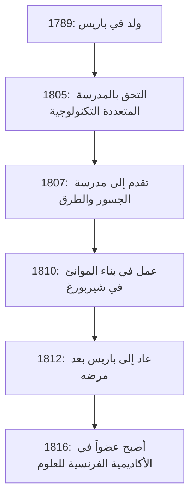

## مقدمة

في تاريخ الرياضيات، يُعرف القرن التاسع عشر باسم "عصر الدقة". عالم الرياضيات الفرنسي **أوغوستان-لوي كوشي** (1789-1857) هو من وضع أساسًا منطقيًا قويًا لحساب التفاضل والتكامل، والذي كان يُعالج سابقًا بشكل حدسي. يكلل اسمه الكثير من المبرهنات والمفاهيم بحيث لا بد لأي شخص يدرس الرياضيات الحديثة أن يواجهه.

يستكشف هذا المقال الحياة المضطربة لكوشي، عملاق عالم الرياضيات، والإنجازات الرياضية الرائعة التي تركها وراءه.

## حياة مضطربة: العيش في فرنسا المضطربة

ولد كوشي في باريس عام 1789، بعد اندلاع الثورة الفرنسية مباشرة. كانت حياته متشابكة باستمرار مع الاضطرابات السياسية في فرنسا.

### الطفولة والتعليم

انتقلت عائلة كوشي إلى أركوي قرب باريس في طفولته هرباً من الاضطرابات الثورية. شارك والده بفاعلية في تعليمه، وأبدى زوار مثل لابلاس ولاغرانج اهتماماً بكوشي الشاب.

### المهنة والمعتقدات السياسية

تخرج كوشي من المدرسة المتعددة التكنولوجية عام 1807 والتحق بمدرسة الجسور والطرق. عمل في منشآت ميناء شيربورغ منذ 1810، ثم عاد إلى باريس عام 1812 بعد مرضه. بدأ تدريس التحليل في المدرسة المتعددة التكنولوجية عام 1815. وفي 1816 شغل أحد مقعدي أكاديمية العلوم اللذين شغرا بعد استبعاد مونج وكارنو لأسباب سياسية.

كان كوشي كاثوليكياً ومؤيداً للملكية. غادر باريس عام 1830 بعد ثورة يوليو، ثم فقد مناصبه في فرنسا لعدم أدائه يمين الولاء التي فرضها النظام الجديد. أقام في سويسرا وتورينو وبراغ قبل أن يعود إلى باريس عام 1838، وأثر رفضه للقسم أيضاً في عودته إلى التدريس.

تسببت أيديولوجيته المحافظة وشخصيته التي لا هوادة فيها في بعض الأحيان في احتكاك مع زملائه وعلماء الرياضيات الأصغر سنًا (مثل أبيل وجالوا)، ولكن تفانيه في الرياضيات وإنتاجيته الساحقة لا يمكن لأحد أن ينكره.

## ثورة في الرياضيات: السعي وراء الدقة

أسهم كوشي كثيراً في المعالجة الصارمة للنهايات والاتصال والاشتقاق والتكامل وتقارب المتسلسلات. وكان كتابه Cours d’analyse الصادر عام 1821 جزءاً مهماً من هذا العمل. لا تتطابق تعريفاته ببساطة مع الصياغة الحديثة المكتملة بإبسيلون ودلتا؛ فقد واصل رياضيون لاحقون تنقيح هذه الأسس.

فيما يلي بعض الإنجازات المهمة التي تحمل اسمه.

### 1. متتالية كوشي

مفهوم **متتالية كوشي** أساسي لدراسة اكتمال الأعداد الحقيقية. تكون المتتالية $(a_n)$ متتالية كوشي إذا أمكن جعل الفرق المطلق بين $a_n$ و$a_m$ أصغر من أي حد موجب، لجميع المؤشرات $n,m$ الكبيرة بما يكفي.

يُعبر عنها رياضيًا، لأي $ \epsilon > 0 $، يوجد عدد طبيعي $ N $ بحيث يكون لجميع $ n, m > N $،
$$ |a_n - a_m| < \epsilon $$
صحيحًا دائمًا.

في فضاء الأعداد الحقيقية، تشير الخاصية التي تنص على أن "متتالية كوشي تتقارب دائمًا" إلى أن الفضاء "كامل". مفهوم الاكتمال هذا هو أساس الطوبولوجيا الحديثة والتحليل الدالي.

### 2. مبرهنة تكامل كوشي

أدى كوشي دوراً محورياً في تطوير التحليل المركب. ومن نتائجه البارزة [مبرهنة تكامل كوشي](/ar/p/cauchys-integral-theorem/). وأسهم رياضيون كثيرون آخرون في التطوير اللاحق لهذا المجال.

إذا كانت $f$ دالة هولومورفية في مجال بسيط الاتصال $D$، وكان $C$ منحنى مغلقاً أملس على أجزاء داخل $D$، فإن التكامل التالي يساوي صفراً. في المجالات ذات الثقوب، تلزم شروط إضافية، مثل التحقق من التفاف المنحنى حول ثقب.

$$ \oint_C f(z) \, dz = 0 $$

كذلك، إذا كان $C$ منحنى بسيطاً مغلقاً، أملس على أجزاء وموجهاً إيجابياً (عكس عقارب الساعة)، وكانت $f$ هولومورفية على مجموعة مفتوحة تحتوي المنحنى وداخله، وكانت $a$ نقطة داخل $C$، فإن صيغة تكامل كوشي هي:

$$ f(a) = \frac{1}{2\pi i} \oint_C \frac{f(z)}{z - a} \, dz $$

تدل الصيغة على أن الدالة الهولومورفية قابلة للاشتقاق مرات غير محدودة، ولها [توسيع تايلور](/ar/p/taylor-and-maclaurin-series/) محلي قرب كل نقطة. الفروض مهمة: $f(z)=1/z$ هولومورفية خارج نقطة الأصل، لكن تكاملها على دائرة الوحدة عكس عقارب الساعة يساوي $2\pi i$.

### 3. متراجحة كوشي-شفارتز

متراجحة كوشي–شفارتز من المتراجحات الشائعة في الجبر الخطي والتحليل. لأي متجهين $\mathbf{u},\mathbf{v}$ في فضاء ذي ضرب داخلي حقيقي أو مركب، تتحقق العلاقة التالية:

$$ |\langle \mathbf{u}, \mathbf{v} \rangle|^2 \leq \langle \mathbf{u}, \mathbf{u} \rangle \cdot \langle \mathbf{v}, \mathbf{v} \rangle $$

للدالتين الحقيقيتين $f,g$ القابلتين للتكامل التربيعي على فترة محدودة $[a,b]$ مع $a<b$، تكون الصيغة التكاملية كما يلي. وللدوال المركبة، يستخدم الضرب الداخلي المرافق المركب، ويلزم مربع القيمة المطلقة.

$$ \left( \int_a^b f(x)g(x) \, dx \right)^2 \leq \left( \int_a^b f(x)^2 \, dx \right) \left( \int_a^b g(x)^2 \, dx \right) $$

تشكل هذه المتراجحة الأساس لتوسيع مفاهيم الزوايا والمسافات بين المتجهات إلى مساحات مجردة.

## غزارة إنتاج كوشي وإرثه

كان كوشي باحثاً غزير الإنتاج، ترك نحو 800 بحث رياضي. تحصي سيرة MacTutor منها 789، وتقع أعماله الكاملة في 27 مجلداً.

امتدت أبحاثه من التحليل إلى مجالات متعددة في الرياضيات والفيزياء، منها الجبر ودراسة التباديل في نظرية الزمر، والفيزياء الرياضية مثل نظرية المرونة والبصريات.

## استنتاج

صاغ أوغوستان-لوي كوشي الرياضيات، التي اعتمدت على الحدس، في تخصص أكاديمي صارم من خلال قوة المنطق. المفاهيم والمبرهنات التي ابتكرها متجذرة بعمق في كل مكان في الرياضيات الحديثة.

رغم الاضطرابات السياسية والسنوات التي قضاها خارج بلاده، أنتج كوشي أعمالاً رياضية كثيرة. ولا تزال كتاباته ومبرهناته تؤثر في دارسي الرياضيات اليوم.

## المراجع

- [MacTutor: Augustin-Louis Cauchy](https://mathshistory.st-andrews.ac.uk/Biographies/Cauchy/)
- [MIT 18.112: The General Cauchy Theorem](https://ocw.mit.edu/courses/18-112-functions-of-a-complex-variable-fall-2008/8793d412fa0da2a4183539f5d8f7e3fd_lecture13.pdf)
- [NIST DLMF: Calculus of a Complex Variable](https://dlmf.nist.gov/1.9)
