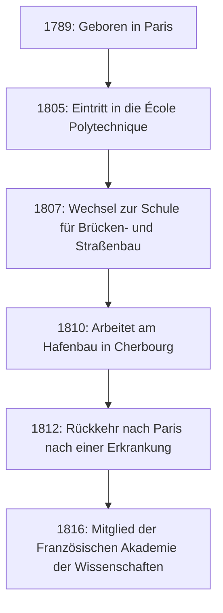

## Einleitung

In der Geschichte der Mathematik ist das 19. Jahrhundert als "Ära der Strenge" bekannt. Der französische Mathematiker **Augustin-Louis Cauchy** (1789-1857) war es, der der Infinitesimalrechnung, die zuvor intuitiv behandelt wurde, ein festes logisches Fundament gab. Sein Name krönt so viele Theoreme und Konzepte, dass jeder, der moderne Mathematik studiert, zwangsläufig auf ihn stößt.

Dieser Artikel beleuchtet das turbulente Leben von Cauchy, einem Giganten der mathematischen Welt, und die brillanten mathematischen Errungenschaften, die er hinterlassen hat.

## Ein turbulentes Leben: Leben in einem unruhigen Frankreich

Cauchy wurde 1789, kurz nach dem Ausbruch der Französischen Revolution, in Paris geboren. Sein Leben war ständig mit den politischen Umwälzungen Frankreichs verflochten.

### Kindheit und Ausbildung

Die Familie zog während Cauchys Kindheit nach Arcueil bei Paris, um den revolutionären Unruhen zu entgehen. Sein Vater beteiligte sich aktiv an seiner Ausbildung; auch Besucher wie Laplace und Lagrange interessierten sich für den jungen Cauchy.

### Karriere und politische Überzeugungen

Cauchy schloss 1807 die École Polytechnique ab und trat in die École des Ponts et Chaussées ein. Ab 1810 arbeitete er an Hafenanlagen in Cherbourg; nach einer Erkrankung kehrte er 1812 nach Paris zurück. 1815 begann er, an der École Polytechnique Analysis zu unterrichten. 1816 erhielt er einen der Akademiesitze, die durch den politisch begründeten Ausschluss von Monge und Carnot frei geworden waren.

Cauchy war Katholik und Royalist. Nach der Julirevolution verließ er 1830 Paris und verlor später seine französischen Stellen, weil er den vom neuen Regime verlangten Treueid nicht leistete. Er hielt sich in der Schweiz, in Turin und in Prag auf und kehrte 1838 nach Paris zurück. Die Eidverweigerung beeinträchtigte auch seine Rückkehr in die Lehre.

Seine konservative Ideologie und seine kompromisslose Persönlichkeit verursachten manchmal Reibungen mit Kollegen und jüngeren Mathematikern (wie [Abel](https://kenji.blog/de/p/abel/) und [Galois](https://kenji.blog/de/p/galois/)), aber seine Hingabe zur Mathematik und seine überwältigende Produktivität konnten von niemandem geleugnet werden.

## Revolution in der Mathematik: Das Streben nach Strenge

Cauchy trug wesentlich zur strengen Behandlung von Grenzwerten, Stetigkeit, Differentiation, Integration und Reihenkonvergenz bei. Sein Cours d’analyse von 1821 war ein wichtiger Teil dieser Arbeit. Seine Definitionen sind nicht einfach mit der vollständig entwickelten modernen Epsilon-Delta-Formulierung gleichzusetzen; spätere Mathematiker präzisierten diese Grundlagen weiter.

Hier sind einige der wichtigsten Errungenschaften, die seinen Namen tragen.

### 1. Cauchy-Folge

Das Konzept einer **Cauchy-Folge** ist wesentlich, wenn es um die Vollständigkeit der reellen Zahlen geht. Eine Folge $ (a_n) $ ist eine Cauchy-Folge, wenn die Differenz zwischen $ a_n $ und $ a_m $ beliebig klein wird, wenn die Indizes $ n $ und $ m $ ausreichend groß sind.

Mathematisch ausgedrückt: Für jedes $ \epsilon > 0 $ existiert eine natürliche Zahl $ N $, so dass für alle $ n, m > N $
$$ |a_n - a_m| < \epsilon $$
immer gilt.

Im Raum der reellen Zahlen zeigt die Eigenschaft, dass "eine Cauchy-Folge immer konvergiert", an, dass der Raum "vollständig" ist. Dieses Konzept der Vollständigkeit ist die Grundlage der modernen Topologie und Funktionalanalysis.

### 2. Cauchyscher Integralsatz

Cauchy spielte eine zentrale Rolle bei der Entwicklung der komplexen Analysis. Zu seinen repräsentativen Ergebnissen gehört der [Cauchysche Integralsatz](/de/p/cauchys-integral-theorem/). Viele weitere Mathematiker trugen zur späteren Entwicklung des Gebiets bei.

Ist $f$ auf einem einfach zusammenhängenden Gebiet $D$ holomorph und $C$ eine stückweise glatte geschlossene Kurve in $D$, so ist das folgende Integral null. Bei Gebieten mit Löchern sind zusätzliche Prüfungen nötig, etwa ob die Kurve ein Loch umläuft.

$$ \oint_C f(z) \, dz = 0 $$

Ist außerdem $C$ eine positiv orientierte (gegen den Uhrzeigersinn durchlaufene), stückweise glatte einfache geschlossene Kurve, $f$ auf einer offenen Menge holomorph, die die Kurve samt Innerem enthält, und liegt $a$ im Inneren von $C$, dann gilt die Cauchysche Integralformel:

$$ f(a) = \frac{1}{2\pi i} \oint_C \frac{f(z)}{z - a} \, dz $$

Die Formel zeigt, dass holomorphe Funktionen beliebig oft differenzierbar sind und nahe jedem Punkt eine lokale [Taylorentwicklung](/de/p/taylor-and-maclaurin-series/) besitzen. Die Voraussetzungen sind wichtig: $f(z)=1/z$ ist außerhalb des Ursprungs holomorph, doch das Integral über den gegen den Uhrzeigersinn durchlaufenen Einheitskreis beträgt $2\pi i$.

### 3. Cauchy-Schwarzsche Ungleichung

Dies ist eine der am häufigsten verwendeten Ungleichungen in der linearen Algebra und Analysis. Für alle Vektoren $ \mathbf{u} $ und $ \mathbf{v} $ reeller oder komplexer Zahlen in einem Prähilbertraum gilt die folgende Beziehung:

$$ |\langle \mathbf{u}, \mathbf{v} \rangle|^2 \leq \langle \mathbf{u}, \mathbf{u} \rangle \cdot \langle \mathbf{v}, \mathbf{v} \rangle $$

Für reellwertige, quadratintegrierbare Funktionen $f,g$ auf einem endlichen Intervall $[a,b]$ mit $a<b$ lautet die Integralform wie folgt. Bei komplexwertigen Funktionen sind im inneren Produkt komplexe Konjugation und der quadrierte Betrag erforderlich.

$$ \left( \int_a^b f(x)g(x) \, dx \right)^2 \leq \left( \int_a^b f(x)^2 \, dx \right) \left( \int_a^b g(x)^2 \, dx \right) $$

Diese Ungleichung bildet die Grundlage für die Ausweitung der Konzepte von Winkeln und Abständen zwischen Vektoren auf abstrakte Räume.

## Cauchys Produktivität und Erbe

Cauchy war ein produktiver Forscher, der etwa 800 mathematische Arbeiten hinterließ. Die MacTutor-Biografie zählt 789; seine gesammelten Werke umfassen 27 Bände.

Seine Forschungsthemen beschränkten sich nicht auf die Analysis, sondern erstreckten sich auf ein breites Spektrum von Bereichen in Mathematik und Physik, einschließlich Algebra (die Untersuchung von Permutationen in der Gruppentheorie) und mathematischer Physik (Elastizitätstheorie und Optik).

## Fazit

Augustin-Louis Cauchy schmiedete die Mathematik, die sich auf Intuition verlassen hatte, durch die Kraft der Logik zu einer strengen akademischen Disziplin. Die Konzepte und Theoreme, die er geschaffen hat, sind überall in der modernen Mathematik tief verwurzelt.

Trotz politischer Umbrüche und der Jahre im Ausland schuf Cauchy ein umfangreiches mathematisches Werk. Seine Schriften und Sätze beeinflussen bis heute Menschen, die sich mit Mathematik beschäftigen.

## Quellen

- [MacTutor: Augustin-Louis Cauchy](https://mathshistory.st-andrews.ac.uk/Biographies/Cauchy/)
- [MIT 18.112: The General Cauchy Theorem](https://ocw.mit.edu/courses/18-112-functions-of-a-complex-variable-fall-2008/8793d412fa0da2a4183539f5d8f7e3fd_lecture13.pdf)
- [NIST DLMF: Calculus of a Complex Variable](https://dlmf.nist.gov/1.9)
