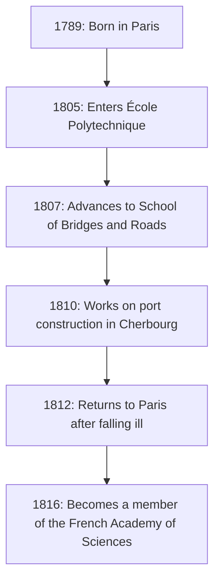

## Introduction

In the history of mathematics, the 19th century is known as the "Era of Rigor." The French mathematician **Augustin-Louis Cauchy** (1789-1857) is the one who provided a firm logical foundation for calculus, which had previously been treated intuitively. His name crowns so many theorems and concepts that anyone studying modern mathematics is bound to encounter it.

This article explores the turbulent life of Cauchy, a giant in the mathematical world, and the brilliant mathematical achievements he left behind.

## A Turbulent Life: Living in a Tumultuous France

Cauchy was born in Paris in 1789, just after the outbreak of the French Revolution. His life was constantly intertwined with the political upheavals of France.

### Childhood and Education

The family moved to Arcueil outside Paris while Cauchy was young to escape revolutionary unrest. His father took an active role in his education, and visitors such as Laplace and Lagrange took an interest in the young Cauchy.

### Career and Political Beliefs

Cauchy graduated from the École Polytechnique in 1807 and entered the engineering school École des Ponts et Chaussées. He worked on port facilities in Cherbourg from 1810 and returned to Paris in 1812 after becoming ill. He began teaching analysis at the École Polytechnique in 1815. In 1816, he obtained one of the Academy of Sciences seats vacated when Monge and Carnot were removed for political reasons.

Cauchy was Catholic and a royalist. He left Paris in 1830 after the July Revolution and subsequently lost his positions in France after failing to take the oath of allegiance required by the new regime. He spent time in Switzerland, Turin, and Prague before returning to Paris in 1838; his refusal to take the oath also affected his return to teaching.

His conservative ideology and uncompromising personality sometimes caused friction with colleagues and younger mathematicians (such as [Abel](https://kenji.blog/en/p/abel/) and [Galois](https://kenji.blog/en/p/galois/)), but his dedication to mathematics and overwhelming productivity could be denied by no one.

## Revolution in Mathematics: The Pursuit of Rigor

Cauchy contributed substantially to the rigorous treatment of limits, continuity, differentiation, integration, and series convergence. His 1821 Cours d’analyse was an important part of this work. His definitions should not simply be equated with the fully developed modern epsilon–delta formulation; later mathematicians refined these foundations.

Here are a few of the important achievements that bear his name.

### 1. Cauchy Sequence

The concept of a **Cauchy sequence** is essential when discussing the completeness of the real numbers. A sequence $ (a_n) $ is a Cauchy sequence if the difference between $ a_n $ and $ a_m $ becomes arbitrarily small when the indices $ n $ and $ m $ are sufficiently large.

Expressed mathematically, for any $ \epsilon > 0 $, there exists a natural number $ N $ such that for all $ n, m > N $,
$$ |a_n - a_m| < \epsilon $$
always holds.

In the space of real numbers, the property that "a Cauchy sequence always converges" indicates that the space is "complete." This concept of completeness is the foundation of modern topology and functional analysis.

### 2. Cauchy's Integral Theorem

Cauchy played a central role in the development of complex analysis. One of his representative results is [Cauchy’s integral theorem](/en/p/cauchys-integral-theorem/). Many other mathematicians contributed to the subsequent development of the subject.

If $f$ is holomorphic on a simply connected domain $D$ and $C$ is a piecewise smooth closed curve in $D$, the following integral is zero. For a domain with holes, additional checks are needed, such as whether the curve winds around a hole.

$$ \oint_C f(z) \, dz = 0 $$

Further, if $C$ is a positively oriented (counterclockwise), piecewise smooth simple closed curve, $f$ is holomorphic on an open set containing the curve and its interior, and $a$ lies inside $C$, Cauchy’s integral formula is:

$$ f(a) = \frac{1}{2\pi i} \oint_C \frac{f(z)}{z - a} \, dz $$

The formula implies that a holomorphic function is infinitely differentiable and has a local [Taylor expansion](/en/p/taylor-and-maclaurin-series/) near each point. The hypotheses matter: $f(z)=1/z$ is holomorphic away from the origin, but its integral around the counterclockwise unit circle is $2\pi i$.

### 3. Cauchy-Schwarz Inequality

This is one of the most frequently used inequalities in linear algebra and analysis. For any vectors $ \mathbf{u} $ and $ \mathbf{v} $ of real or complex numbers in an inner product space, the following relationship holds:

$$ |\langle \mathbf{u}, \mathbf{v} \rangle|^2 \leq \langle \mathbf{u}, \mathbf{u} \rangle \cdot \langle \mathbf{v}, \mathbf{v} \rangle $$

For real-valued square-integrable functions $f,g$ on a finite interval $[a,b]$ with $a<b$, the integral form is as follows. For complex-valued functions, the inner product uses complex conjugation and the squared modulus is required.

$$ \left( \int_a^b f(x)g(x) \, dx \right)^2 \leq \left( \int_a^b f(x)^2 \, dx \right) \left( \int_a^b g(x)^2 \, dx \right) $$

This inequality forms the foundation for extending the concepts of angles and distances between vectors to abstract spaces.

## Cauchy's Prolificacy and Legacy

Cauchy was a prolific researcher who left about 800 mathematics papers. The MacTutor biography counts 789, and his collected works span 27 volumes.

His research subjects were not limited to analysis but extended to a wide range of fields in mathematics and physics, including algebra (the study of permutations in group theory) and mathematical physics (elasticity theory and optics).

## Conclusion

Augustin-Louis Cauchy forged mathematics, which had relied on intuition, into a rigorous academic discipline through the power of logic. The concepts and theorems he created are deeply rooted everywhere in modern mathematics.

Despite political upheaval and years abroad, Cauchy produced a substantial body of mathematics. His writings and theorems continue to influence people studying the subject today.

## References

- [MacTutor: Augustin-Louis Cauchy](https://mathshistory.st-andrews.ac.uk/Biographies/Cauchy/)
- [MIT 18.112: The General Cauchy Theorem](https://ocw.mit.edu/courses/18-112-functions-of-a-complex-variable-fall-2008/8793d412fa0da2a4183539f5d8f7e3fd_lecture13.pdf)
- [NIST DLMF: Calculus of a Complex Variable](https://dlmf.nist.gov/1.9)
