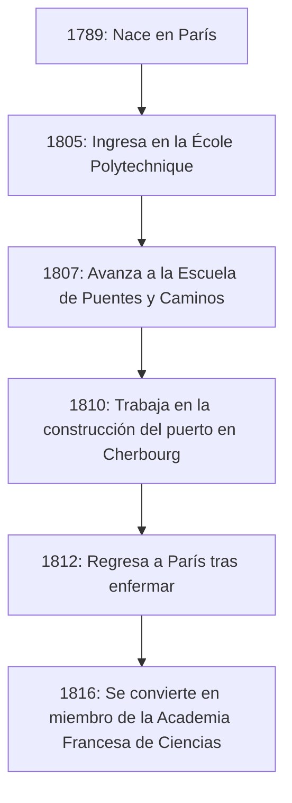

## Introducción

En la historia de las matemáticas, el siglo XIX es conocido como la "Era del Rigor". El matemático francés **Augustin-Louis Cauchy** (1789-1857) es quien proporcionó un fundamento lógico firme para el cálculo, que anteriormente se había tratado de forma intuitiva. Su nombre corona tantos teoremas y conceptos que cualquiera que estudie matemáticas modernas está destinado a encontrarlo.

Este artículo explora la vida turbulenta de Cauchy, un gigante del mundo matemático, y los brillantes logros matemáticos que dejó.

## Una vida turbulenta: Viviendo en una Francia agitada

Cauchy nació en París en 1789, poco después del estallido de la Revolución Francesa. Su vida estuvo constantemente entrelazada con las convulsiones políticas de Francia.

### Infancia y educación

La familia se trasladó a Arcueil, cerca de París, durante la infancia de Cauchy para escapar de la agitación revolucionaria. Su padre participó activamente en su educación, y visitantes como Laplace y Lagrange se interesaron por el joven Cauchy.

### Carrera y creencias políticas

Cauchy se graduó en la École Polytechnique en 1807 e ingresó en la École des Ponts et Chaussées. Desde 1810 trabajó en instalaciones portuarias en Cherbourg y regresó a París en 1812 tras enfermar. Comenzó a enseñar análisis en la École Polytechnique en 1815. En 1816 ocupó una de las plazas de la Academia de Ciencias que quedaron vacantes al ser destituidos Monge y Carnot por motivos políticos.

Cauchy era católico y monárquico. Salió de París en 1830 después de la Revolución de Julio y posteriormente perdió sus puestos en Francia al no prestar el juramento de lealtad exigido por el nuevo régimen. Pasó por Suiza, Turín y Praga antes de regresar a París en 1838; su negativa a jurar también afectó a su vuelta a la enseñanza.

Su ideología conservadora y su personalidad intransigente a veces causaron fricciones con colegas y matemáticos más jóvenes (como [Abel](https://kenji.blog/es/p/abel/) y [Galois](https://kenji.blog/es/p/galois/)), pero su dedicación a las matemáticas y su productividad abrumadora no podían ser negadas por nadie.

## Revolución en matemáticas: La búsqueda del rigor

Cauchy contribuyó considerablemente al tratamiento riguroso de límites, continuidad, diferenciación, integración y convergencia de series. Su Cours d’analyse de 1821 fue una parte importante de este trabajo. Sus definiciones no deben identificarse sin más con la formulación moderna completa de épsilon–delta; matemáticos posteriores refinaron estos fundamentos.

A continuación, se presentan algunos de los logros importantes que llevan su nombre.

### 1. Sucesión de Cauchy

El concepto de **sucesión de Cauchy** es esencial cuando se discute la completitud de los números reales. Una sucesión $ (a_n) $ es una sucesión de Cauchy si la diferencia entre $ a_n $ y $ a_m $ se vuelve arbitrariamente pequeña cuando los índices $ n $ y $ m $ son suficientemente grandes.

Expresado matemáticamente, para cualquier $ \epsilon > 0 $, existe un número natural $ N $ tal que para todos los $ n, m > N $,
$$ |a_n - a_m| < \epsilon $$
siempre se cumple.

En el espacio de los números reales, la propiedad de que "una sucesión de Cauchy siempre converge" indica que el espacio es "completo". Este concepto de completitud es la base de la topología moderna y del análisis funcional.

### 2. Teorema integral de Cauchy

Cauchy desempeñó un papel central en el desarrollo del análisis complejo. Uno de sus resultados representativos es el [teorema integral de Cauchy](/es/p/cauchys-integral-theorem/). Otros muchos matemáticos contribuyeron al desarrollo posterior de la materia.

Si $f$ es holomorfa en un dominio simplemente conexo $D$ y $C$ es una curva cerrada, suave a trozos, contenida en $D$, la integral siguiente es cero. En dominios con agujeros se necesitan comprobaciones adicionales, por ejemplo, si la curva rodea un agujero.

$$ \oint_C f(z) \, dz = 0 $$

Además, si $C$ es una curva simple cerrada, suave a trozos y orientada positivamente (en sentido antihorario), $f$ es holomorfa en un abierto que contiene la curva y su interior, y $a$ está dentro de $C$, se cumple la fórmula integral de Cauchy. Los valores sobre el contorno determinan así el valor interior:

$$ f(a) = \frac{1}{2\pi i} \oint_C \frac{f(z)}{z - a} \, dz $$

La fórmula implica que una función holomorfa es infinitamente diferenciable y tiene un [desarrollo de Taylor](/es/p/taylor-and-maclaurin-series/) local cerca de cada punto. Las hipótesis importan: $f(z)=1/z$ es holomorfa fuera del origen, pero su integral por la circunferencia unidad en sentido antihorario es $2\pi i$.

### 3. Desigualdad de Cauchy-Schwarz

Esta es una de las desigualdades que se utilizan con más frecuencia en el álgebra lineal y el análisis. Para cualquier vector $ \mathbf{u} $ y $ \mathbf{v} $ de números reales o complejos en un espacio con producto interno, se cumple la siguiente relación:

$$ |\langle \mathbf{u}, \mathbf{v} \rangle|^2 \leq \langle \mathbf{u}, \mathbf{u} \rangle \cdot \langle \mathbf{v}, \mathbf{v} \rangle $$

Para funciones reales $f,g$ de cuadrado integrable en un intervalo finito $[a,b]$, con $a<b$, la forma integral es la siguiente. Para funciones complejas, el producto interno utiliza conjugación compleja y se requiere el módulo al cuadrado.

$$ \left( \int_a^b f(x)g(x) \, dx \right)^2 \leq \left( \int_a^b f(x)^2 \, dx \right) \left( \int_a^b g(x)^2 \, dx \right) $$

Esta desigualdad forma la base para extender los conceptos de ángulos y distancias entre vectores a espacios abstractos.

## La prolificidad y el legado de Cauchy

Cauchy fue un investigador prolífico que dejó unos 800 artículos matemáticos. La biografía de MacTutor contabiliza 789, y sus obras completas abarcan 27 volúmenes.

Sus temas de investigación no se limitaron al análisis, sino que se extendieron a una amplia gama de campos en matemáticas y física, incluyendo el álgebra (el estudio de las permutaciones en la teoría de grupos) y la física matemática (teoría de la elasticidad y óptica).

## Conclusión

Augustin-Louis Cauchy forjó las matemáticas, que se habían basado en la intuición, en una disciplina académica rigurosa a través del poder de la lógica. Los conceptos y teoremas que creó están profundamente arraigados en todas partes de las matemáticas modernas.

A pesar de la agitación política y de los años en el extranjero, Cauchy produjo una extensa obra matemática. Sus escritos y teoremas siguen influyendo en quienes estudian la materia.

## Referencias

- [MacTutor: Augustin-Louis Cauchy](https://mathshistory.st-andrews.ac.uk/Biographies/Cauchy/)
- [MIT 18.112: The General Cauchy Theorem](https://ocw.mit.edu/courses/18-112-functions-of-a-complex-variable-fall-2008/8793d412fa0da2a4183539f5d8f7e3fd_lecture13.pdf)
- [NIST DLMF: Calculus of a Complex Variable](https://dlmf.nist.gov/1.9)
