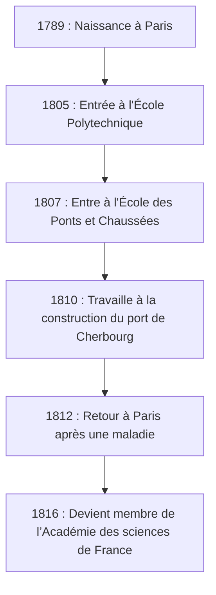

## Introduction

Le XIXe siècle est souvent associé à la recherche de rigueur en mathématiques. Le mathématicien français **Augustin-Louis Cauchy** (1789–1857) a joué un rôle majeur dans la consolidation des fondements du calcul infinitésimal. Son nom figure dans de nombreux théorèmes et concepts rencontrés au cours des études de mathématiques.

Cet article explore la vie tumultueuse de Cauchy, un géant du monde mathématique, et les brillantes réalisations mathématiques qu'il a laissées derrière lui.

## Une Vie Tumultueuse : Vivre dans une France Agitée

Cauchy est né à Paris en 1789, juste après le déclenchement de la Révolution française. Sa vie fut constamment liée aux bouleversements politiques de la France.

### Enfance et Éducation

La famille s’installa à Arcueil, près de Paris, pendant l’enfance de Cauchy pour échapper aux troubles révolutionnaires. Son père participa activement à son éducation, et des visiteurs comme Laplace et Lagrange s’intéressèrent au jeune Cauchy.

### Carrière et Convictions Politiques

Cauchy obtint son diplôme de l’École polytechnique en 1807 et entra à l’École des ponts et chaussées. Il travailla aux installations portuaires de Cherbourg à partir de 1810 et revint à Paris en 1812 après être tombé malade. Il commença à enseigner l’analyse à l’École polytechnique en 1815. En 1816, il obtint l’un des sièges de l’Académie des sciences devenus vacants après l’exclusion de Monge et Carnot pour raisons politiques.

Cauchy était catholique et royaliste. Il quitta Paris en 1830 après la révolution de Juillet et perdit ensuite ses postes en France faute d’avoir prêté le serment exigé par le nouveau régime. Il séjourna en Suisse, à Turin et à Prague avant de revenir à Paris en 1838 ; son refus du serment affecta aussi son retour à l’enseignement.

Son idéologie conservatrice et sa personnalité intransigeante ont parfois causé des frictions avec des collègues et de jeunes mathématiciens (tels qu'[Abel](https://kenji.blog/fr/p/abel/) et [Galois](https://kenji.blog/fr/p/galois/)), mais son dévouement aux mathématiques et sa productivité écrasante ne pouvaient être niés par personne.

## Révolution dans les Mathématiques : La Quête de la Rigueur

Cauchy contribua largement au traitement rigoureux des limites, de la continuité, de la dérivation, de l’intégration et de la convergence des séries. Son Cours d’analyse de 1821 fut une étape importante de ce travail. Ses définitions ne se confondent pas avec la formulation moderne complète en epsilon–delta : d’autres mathématiciens affinèrent ensuite ces fondements.

Voici quelques-unes des réalisations importantes qui portent son nom.

### 1. Suite de Cauchy

Le concept de **suite de Cauchy** est essentiel lors de la discussion de la complétude des nombres réels. Une suite $ (a_n) $ est une suite de Cauchy si la différence entre $ a_n $ et $ a_m $ devient arbitrairement petite lorsque les indices $ n $ et $ m $ sont suffisamment grands.

Exprimé mathématiquement, pour tout $ \epsilon > 0 $, il existe un entier naturel $ N $ tel que pour tous $ n, m > N $,
$$ |a_n - a_m| < \epsilon $$
est toujours vrai.

Dans l'espace des nombres réels, la propriété selon laquelle "une suite de Cauchy converge toujours" indique que l'espace est "complet". Ce concept de complétude est le fondement de la topologie moderne et de l'analyse fonctionnelle.

### 2. Théorème Intégral de Cauchy

Cauchy joua un rôle central dans le développement de l’analyse complexe. L’un de ses résultats représentatifs est le [théorème intégral de Cauchy](/fr/p/cauchys-integral-theorem/). De nombreux autres mathématiciens contribuèrent aux développements ultérieurs du domaine.

Si $f$ est holomorphe dans un domaine simplement connexe $D$ et si $C$ est une courbe fermée, lisse par morceaux, contenue dans $D$, l’intégrale suivante est nulle. Dans un domaine présentant des trous, des vérifications supplémentaires sont nécessaires, par exemple pour savoir si la courbe entoure un trou.

$$ \oint_C f(z) \, dz = 0 $$

De plus, si $C$ est une courbe simple fermée, lisse par morceaux et orientée positivement (dans le sens inverse des aiguilles d’une montre), si $f$ est holomorphe dans un ouvert contenant la courbe et son intérieur, et si $a$ est à l’intérieur de $C$, la formule intégrale de Cauchy s’écrit :

$$ f(a) = \frac{1}{2\pi i} \oint_C \frac{f(z)}{z - a} \, dz $$

Cette formule implique qu’une fonction holomorphe est indéfiniment dérivable et admet un [développement de Taylor](/fr/p/taylor-and-maclaurin-series/) local au voisinage de chaque point. Les hypothèses comptent : $f(z)=1/z$ est holomorphe hors de l’origine, mais son intégrale sur le cercle unité parcouru dans le sens positif vaut $2\pi i$.

### 3. Inégalité de Cauchy-Schwarz

C'est l'une des inégalités les plus fréquemment utilisées en algèbre linéaire et en analyse. Pour tous vecteurs $ \mathbf{u} $ et $ \mathbf{v} $ de nombres réels ou complexes dans un espace préhilbertien, la relation suivante est vraie :

$$ |\langle \mathbf{u}, \mathbf{v} \rangle|^2 \leq \langle \mathbf{u}, \mathbf{u} \rangle \cdot \langle \mathbf{v}, \mathbf{v} \rangle $$

Pour des fonctions réelles $f,g$ de carré intégrable sur un intervalle fini $[a,b]$, avec $a<b$, la forme intégrale est la suivante. Pour des fonctions complexes, le produit scalaire utilise la conjugaison complexe et le carré du module est nécessaire.

$$ \left( \int_a^b f(x)g(x) \, dx \right)^2 \leq \left( \int_a^b f(x)^2 \, dx \right) \left( \int_a^b g(x)^2 \, dx \right) $$

Cette inégalité constitue le fondement de l'extension des concepts d'angles et de distances entre les vecteurs à des espaces abstraits.

## La Prolificité et l'Héritage de Cauchy

Cauchy fut un chercheur prolifique, auteur d’environ 800 articles mathématiques. La biographie MacTutor en dénombre 789, et ses œuvres complètes occupent 27 volumes.

Ses sujets de recherche ne se limitaient pas à l'analyse mais s'étendaient à un large éventail de domaines en mathématiques et en physique, y compris l'algèbre (l'étude des permutations dans la théorie des groupes) et la physique mathématique (la théorie de l'élasticité et l'optique).

## Conclusion

Augustin-Louis Cauchy a forgé les mathématiques, qui s'étaient appuyées sur l'intuition, en une discipline académique rigoureuse grâce au pouvoir de la logique. Les concepts et les théorèmes qu'il a créés sont profondément enracinés partout dans les mathématiques modernes.

Malgré les bouleversements politiques et les années passées à l’étranger, Cauchy produisit une œuvre mathématique considérable. Ses écrits et ses théorèmes continuent d’influencer ceux qui étudient le sujet.

## Références

- [MacTutor: Augustin-Louis Cauchy](https://mathshistory.st-andrews.ac.uk/Biographies/Cauchy/)
- [MIT 18.112: The General Cauchy Theorem](https://ocw.mit.edu/courses/18-112-functions-of-a-complex-variable-fall-2008/8793d412fa0da2a4183539f5d8f7e3fd_lecture13.pdf)
- [NIST DLMF: Calculus of a Complex Variable](https://dlmf.nist.gov/1.9)
