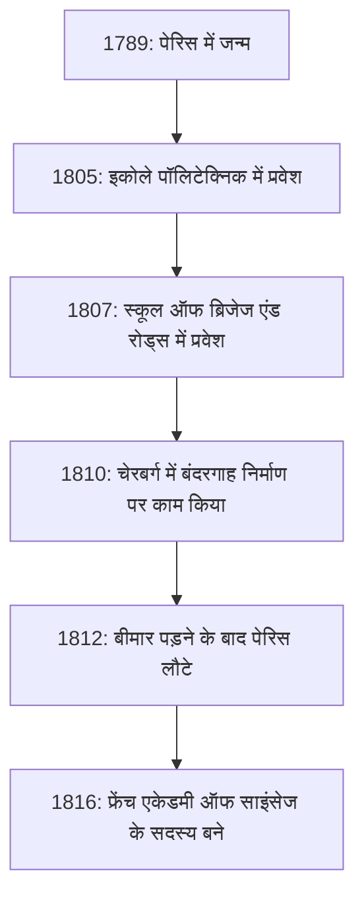

## प्रस्तावना

गणित के इतिहास में 19वीं सदी को कठोर तार्किक आधारों की खोज का दौर माना जाता है। फ्रांसीसी गणितज्ञ **ऑगस्टिन-लुई कॉशी** (1789–1857) ने कलन की नींव को सुदृढ़ बनाने में महत्वपूर्ण भूमिका निभाई। आधुनिक गणित पढ़ते समय अनेक प्रमेयों और अवधारणाओं में उनका नाम मिलता है।

यह लेख गणितीय दुनिया के एक दिग्गज कॉशी के अशांत जीवन और उनके द्वारा छोड़ी गई शानदार गणितीय उपलब्धियों की पड़ताल करता है।

## एक अशांत जीवन: एक अशांत फ्रांस में रहना

कॉशी का जन्म 1789 में पेरिस में हुआ था, फ्रांसीसी क्रांति के फैलने के ठीक बाद। उनका जीवन फ्रांस की राजनीतिक उथल-पुथल से लगातार जुड़ा रहा।

### बचपन और शिक्षा

क्रांति की उथल-पुथल से बचने के लिए कॉशी का परिवार उनके बचपन में पेरिस के पास आर्क्यूइल चला गया। पिता उनकी शिक्षा में सक्रिय थे, और घर आने वाले लाप्लास तथा लैग्रेंज जैसे वैज्ञानिकों ने भी युवा कॉशी में रुचि ली।

### करियर और राजनीतिक मान्यताएं

कॉशी 1807 में इकोले पॉलिटेक्निक से स्नातक हुए और पुलों व सड़कों के अभियांत्रिकी विद्यालय में गए। 1810 से चेरबर्ग के बंदरगाह पर काम किया और बीमार पड़ने के बाद 1812 में पेरिस लौटे। 1815 में इकोले पॉलिटेक्निक में विश्लेषण पढ़ाना शुरू किया। 1816 में राजनीतिक कारणों से मोंगे और कार्नोट को हटाए जाने पर विज्ञान अकादमी में खाली हुए दो स्थानों में से एक उन्हें मिला।

कॉशी कैथोलिक और राजतंत्र के समर्थक थे। जुलाई क्रांति के बाद 1830 में वे पेरिस से चले गए और बाद में नए शासन की अनिवार्य निष्ठा-शपथ न लेने के कारण फ्रांस के अपने पद खो दिए। वे स्विट्जरलैंड, ट्यूरिन और प्राग में रहे, फिर 1838 में पेरिस लौटे। शपथ से इनकार का असर उनकी अध्यापन में वापसी पर भी पड़ा।

उनकी रूढ़िवादी विचारधारा और अडिग व्यक्तित्व के कारण कभी-कभी सहयोगियों और युवा गणितज्ञों (जैसे आबेल (Abel) और गाल्वा (Galois)) के साथ घर्षण पैदा हुआ, लेकिन गणित के प्रति उनके समर्पण और अत्यधिक उत्पादकता से कोई भी इनकार नहीं कर सकता था।

## गणित में क्रांति: कठोरता की खोज

कॉशी ने सीमा, सततता, अवकलन, समाकलन और श्रेणियों के अभिसरण को कठोरता से समझने में बड़ा योगदान दिया। 1821 की उनकी Cours d’analyse इस कार्य का महत्वपूर्ण भाग थी। उनकी परिभाषाओं को पूरी तरह विकसित आधुनिक एप्सिलॉन–डेल्टा निरूपण के समान नहीं मानना चाहिए; बाद के गणितज्ञों ने इन आधारों को और परिष्कृत किया।

यहां कुछ महत्वपूर्ण उपलब्धियां दी गई हैं जो उनका नाम रखती हैं।

### 1. कॉशी अनुक्रम

वास्तविक संख्याओं की पूर्णता समझने में **कॉशी अनुक्रम** की अवधारणा महत्वपूर्ण है। अनुक्रम $(a_n)$ कॉशी अनुक्रम है यदि पर्याप्त बड़े सभी सूचकांकों $n,m$ के लिए $a_n$ और $a_m$ के अंतर का निरपेक्ष मान किसी भी दिए गए धनात्मक मान से छोटा किया जा सके।

गणितीय रूप से व्यक्त किया गया, किसी भी $ \epsilon > 0 $ के लिए, एक प्राकृतिक संख्या $ N $ मौजूद है जैसे कि सभी $ n, m > N $ के लिए,
$$ |a_n - a_m| < \epsilon $$
हमेशा सच होता है।

वास्तविक संख्याओं के स्थान में, यह गुण कि "एक कॉशी अनुक्रम हमेशा अभिसरण करता है" इंगित करता है कि स्थान "पूर्ण" है। पूर्णता की यह अवधारणा आधुनिक टोपोलॉजी और कार्यात्मक विश्लेषण की नींव है।

### 2. कॉशी का समाकलन प्रमेय

कॉशी ने सम्मिश्र विश्लेषण के विकास में केंद्रीय भूमिका निभाई। उनकी प्रमुख उपलब्धियों में [कॉशी का समाकलन प्रमेय](/hi/p/cauchys-integral-theorem/) है। बाद में अनेक अन्य गणितज्ञों ने भी इस क्षेत्र को आगे बढ़ाया।

यदि $f$ किसी सरल संबद्ध (simply connected) क्षेत्र $D$ में होलोमॉर्फिक है और $C$, $D$ के भीतर खंडशः चिकना बंद वक्र है, तो निम्न समाकल शून्य है। छिद्रयुक्त क्षेत्र में अतिरिक्त शर्तें जाँचनी होती हैं, जैसे वक्र किसी छिद्र को घेरता है या नहीं।

$$ \oint_C f(z) \, dz = 0 $$

इसके अतिरिक्त, यदि $C$ धनात्मक दिशा (वामावर्त) में खंडशः चिकना सरल बंद वक्र है, $f$ वक्र और उसके भीतर के भाग को समाहित करने वाले खुले समुच्चय में होलोमॉर्फिक है, और $a$, $C$ के भीतर है, तो कॉशी का समाकलन सूत्र निम्न है।

$$ f(a) = \frac{1}{2\pi i} \oint_C \frac{f(z)}{z - a} \, dz $$

यह सूत्र बताता है कि होलोमॉर्फिक फलन हर बिंदु के आसपास अनंत बार अवकलनीय होता है और उसका स्थानीय [टेलर प्रसार](/hi/p/taylor-and-maclaurin-series/) होता है। शर्तें महत्वपूर्ण हैं: $f(z)=1/z$ मूलबिंदु के बाहर होलोमॉर्फिक है, लेकिन वामावर्त इकाई वृत्त पर उसका समाकल $2\pi i$ है।

### 3. कॉशी-श्वार्ज़ असमानता

यह रैखिक बीजगणित और विश्लेषण में प्रायः उपयोग की जाने वाली असमानता है। वास्तविक या सम्मिश्र आंतरिक गुणनफल समष्टि के किन्हीं सदिशों $\mathbf{u},\mathbf{v}$ के लिए निम्न संबंध सत्य है:

$$ |\langle \mathbf{u}, \mathbf{v} \rangle|^2 \leq \langle \mathbf{u}, \mathbf{u} \rangle \cdot \langle \mathbf{v}, \mathbf{v} \rangle $$

परिमित अंतराल $[a,b]$ में, जहाँ $a<b$, वर्ग-समाकलनीय वास्तविक मान वाले फलनों $f,g$ के लिए समाकलन रूप निम्न है। सम्मिश्र फलनों में आंतरिक गुणनफल के लिए सम्मिश्र संयुग्म और मापांक का वर्ग आवश्यक है।

$$ \left( \int_a^b f(x)g(x) \, dx \right)^2 \leq \left( \int_a^b f(x)^2 \, dx \right) \left( \int_a^b g(x)^2 \, dx \right) $$

यह असमानता सदिशों के बीच कोणों और दूरियों की अवधारणाओं को अमूर्त स्थानों तक विस्तारित करने का आधार बनाती है।

## कॉशी की उत्पादकता और विरासत

कॉशी ने लगभग 800 गणितीय शोधपत्र छोड़े। MacTutor की जीवनी में 789 शोधपत्र गिने गए हैं, और उनकी संकलित रचनाएँ 27 खंडों में हैं।

उनके शोध विषय विश्लेषण तक सीमित नहीं थे, बल्कि गणित और भौतिकी के क्षेत्रों की एक विस्तृत श्रृंखला में विस्तारित थे, जिसमें बीजगणित (समूह सिद्धांत में क्रमपरिवर्तन का अध्ययन) और गणितीय भौतिकी (लोच सिद्धांत और प्रकाशिकी) शामिल हैं।

## निष्कर्ष

ऑगस्टिन-लुई कॉशी ने गणित को, जो अंतर्ज्ञान पर निर्भर था, तर्क की शक्ति के माध्यम से एक कठोर शैक्षणिक अनुशासन में बदल दिया। उनके द्वारा बनाई गई अवधारणाएं और प्रमेय आधुनिक गणित में हर जगह गहराई से निहित हैं।

राजनीतिक उथल-पुथल और विदेश में बिताए वर्षों के बावजूद कॉशी ने अनेक गणितीय उपलब्धियाँ हासिल कीं। उनकी रचनाएँ और प्रमेय आज भी गणित पढ़ने वालों को प्रभावित करते हैं।

## संदर्भ

- [MacTutor: Augustin-Louis Cauchy](https://mathshistory.st-andrews.ac.uk/Biographies/Cauchy/)
- [MIT 18.112: The General Cauchy Theorem](https://ocw.mit.edu/courses/18-112-functions-of-a-complex-variable-fall-2008/8793d412fa0da2a4183539f5d8f7e3fd_lecture13.pdf)
- [NIST DLMF: Calculus of a Complex Variable](https://dlmf.nist.gov/1.9)
