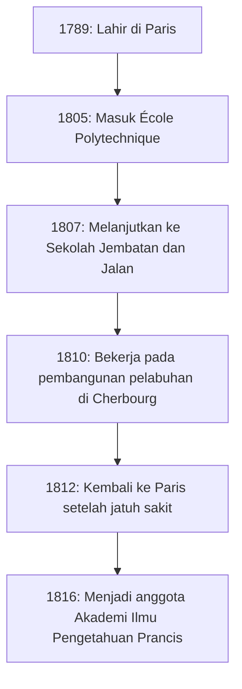

## Pengantar

Dalam sejarah matematika, abad ke-19 dikenal sebagai "Era Ketelitian". Matematikawan Prancis **Augustin-Louis Cauchy** (1789-1857) adalah orang yang memberikan landasan logis yang kuat untuk kalkulus, yang sebelumnya telah diperlakukan secara intuitif. Namanya memahkotai begitu banyak teorema dan konsep sehingga siapa pun yang mempelajari matematika modern pasti akan menemukannya.

Artikel ini mengeksplorasi kehidupan Cauchy yang penuh gejolak, seorang raksasa dalam dunia matematika, dan pencapaian matematika brilian yang ia tinggalkan.

## Kehidupan yang Penuh Gejolak: Hidup di Prancis yang Penuh Gejolak

Cauchy lahir di Paris pada tahun 1789, tepat setelah pecahnya Revolusi Prancis. Kehidupannya selalu terkait dengan pergolakan politik di Prancis.

### Masa Kecil dan Pendidikan

Keluarga Cauchy pindah ke Arcueil di dekat Paris ketika ia masih kecil untuk menghindari pergolakan revolusi. Ayahnya aktif dalam pendidikannya, dan tamu seperti Laplace serta Lagrange juga menaruh perhatian pada Cauchy muda.

### Karir dan Keyakinan Politik

Cauchy lulus dari École Polytechnique pada 1807 lalu masuk École des Ponts et Chaussées. Ia bekerja pada fasilitas pelabuhan Cherbourg sejak 1810 dan kembali ke Paris pada 1812 setelah jatuh sakit. Ia mulai mengajar analisis di École Polytechnique pada 1815. Pada 1816 ia mendapat salah satu kursi Akademi Ilmu Pengetahuan yang kosong setelah Monge dan Carnot dikeluarkan karena alasan politik.

Cauchy beragama Katolik dan mendukung monarki. Ia meninggalkan Paris pada 1830 setelah Revolusi Juli, kemudian kehilangan jabatan di Prancis karena tidak mengucapkan sumpah setia yang diwajibkan rezim baru. Ia tinggal di Swiss, Turin, dan Praha sebelum kembali ke Paris pada 1838; penolakan sumpah itu juga memengaruhi kembalinya ia mengajar.

Ideologi konservatifnya dan kepribadiannya yang tanpa kompromi terkadang menyebabkan gesekan dengan rekan-rekan dan matematikawan yang lebih muda (seperti [Abel](https://kenji.blog/id/p/abel/) dan [Galois](https://kenji.blog/id/p/galois/)), tetapi dedikasinya pada matematika dan produktivitasnya yang luar biasa tidak dapat disangkal oleh siapa pun.

## Revolusi dalam Matematika: Pengejaran Ketelitian

Cauchy berkontribusi besar pada pembahasan yang ketat secara matematis tentang limit, kontinuitas, diferensiasi, integrasi, dan konvergensi deret. Cours d’analyse terbitan 1821 merupakan bagian penting dari pekerjaan itu. Definisinya tidak dapat begitu saja disamakan dengan formulasi epsilon–delta modern yang lengkap; matematikawan berikutnya menyempurnakan dasar-dasar tersebut.

Berikut adalah beberapa pencapaian penting yang menyandang namanya.

### 1. Barisan Cauchy

Konsep **barisan Cauchy** penting untuk membahas kelengkapan bilangan real. Suatu barisan $(a_n)$ disebut barisan Cauchy jika selisih mutlak antara $a_n$ dan $a_m$ dapat dibuat lebih kecil dari setiap batas positif, untuk semua indeks $n,m$ yang cukup besar.

Dinyatakan secara matematis, untuk sembarang $ \epsilon > 0 $, terdapat bilangan asli $ N $ sehingga untuk semua $ n, m > N $,
$$ |a_n - a_m| < \epsilon $$
selalu berlaku.

Dalam ruang bilangan real, sifat bahwa "barisan Cauchy selalu konvergen" menunjukkan bahwa ruang tersebut "lengkap". Konsep kelengkapan ini adalah dasar topologi modern dan analisis fungsional.

### 2. Teorema Integral Cauchy

Cauchy berperan sentral dalam perkembangan analisis kompleks. Salah satu hasilnya yang penting adalah [teorema integral Cauchy](/id/p/cauchys-integral-theorem/). Banyak matematikawan lain turut mengembangkan bidang ini setelahnya.

Jika $f$ holomorfik pada domain terhubung sederhana (simply connected) $D$ dan $C$ merupakan kurva tertutup mulus sepotong-sepotong di dalam $D$, integral berikut bernilai nol. Pada domain berlubang, perlu pemeriksaan tambahan, misalnya apakah kurva mengelilingi lubang.

$$ \oint_C f(z) \, dz = 0 $$

Selanjutnya, jika $C$ merupakan kurva sederhana tertutup, mulus sepotong-sepotong, berorientasi positif (berlawanan arah jarum jam), $f$ holomorfik pada himpunan terbuka yang memuat kurva beserta bagian dalamnya, dan $a$ berada di dalam $C$, berlaku rumus integral Cauchy berikut.

$$ f(a) = \frac{1}{2\pi i} \oint_C \frac{f(z)}{z - a} \, dz $$

Rumus ini menyiratkan bahwa fungsi holomorfik dapat diturunkan tak berhingga kali dan memiliki [pengembangan deret Taylor](/id/p/taylor-and-maclaurin-series/) lokal di sekitar setiap titik. Asumsinya penting: $f(z)=1/z$ holomorfik di luar titik asal, tetapi integralnya pada lingkaran satuan yang dilalui berlawanan arah jarum jam adalah $2\pi i$.

### 3. Ketaksamaan Cauchy-Schwarz

Ini adalah salah satu ketaksamaan yang paling sering digunakan dalam aljabar linear dan analisis. Untuk sembarang vektor $ \mathbf{u} $ dan $ \mathbf{v} $ dari bilangan real atau kompleks dalam ruang hasil kali dalam, hubungan berikut berlaku:

$$ |\langle \mathbf{u}, \mathbf{v} \rangle|^2 \leq \langle \mathbf{u}, \mathbf{u} \rangle \cdot \langle \mathbf{v}, \mathbf{v} \rangle $$

Untuk fungsi bernilai real $f,g$ yang kuadratnya terintegralkan pada interval berhingga $[a,b]$ dengan $a<b$, bentuk integralnya adalah sebagai berikut. Untuk fungsi kompleks, hasil kali dalam menggunakan konjugat kompleks dan diperlukan kuadrat modulus.

$$ \left( \int_a^b f(x)g(x) \, dx \right)^2 \leq \left( \int_a^b f(x)^2 \, dx \right) \left( \int_a^b g(x)^2 \, dx \right) $$

Ketaksamaan ini membentuk dasar untuk memperluas konsep sudut dan jarak antara vektor ke ruang abstrak.

## Produktivitas dan Warisan Cauchy

Cauchy adalah peneliti produktif yang meninggalkan sekitar 800 makalah matematika. Biografi MacTutor menghitung 789 makalah, dan karya-karya lengkapnya mencakup 27 jilid.

Subjek penelitiannya tidak terbatas pada analisis tetapi diperluas ke berbagai bidang dalam matematika dan fisika, termasuk aljabar (studi permutasi dalam teori grup) dan fisika matematika (teori elastisitas dan optik).

## Kesimpulan

Augustin-Louis Cauchy menempa matematika, yang sebelumnya mengandalkan intuisi, menjadi disiplin akademis yang ketat melalui kekuatan logika. Konsep dan teorema yang ia ciptakan berakar dalam di mana-mana dalam matematika modern.

Meskipun menghadapi pergolakan politik dan bertahun-tahun tinggal di luar negeri, Cauchy menghasilkan banyak karya matematika. Tulisan dan teoremanya terus memengaruhi orang yang mempelajari bidang ini.

## Referensi

- [MacTutor: Augustin-Louis Cauchy](https://mathshistory.st-andrews.ac.uk/Biographies/Cauchy/)
- [MIT 18.112: The General Cauchy Theorem](https://ocw.mit.edu/courses/18-112-functions-of-a-complex-variable-fall-2008/8793d412fa0da2a4183539f5d8f7e3fd_lecture13.pdf)
- [NIST DLMF: Calculus of a Complex Variable](https://dlmf.nist.gov/1.9)
