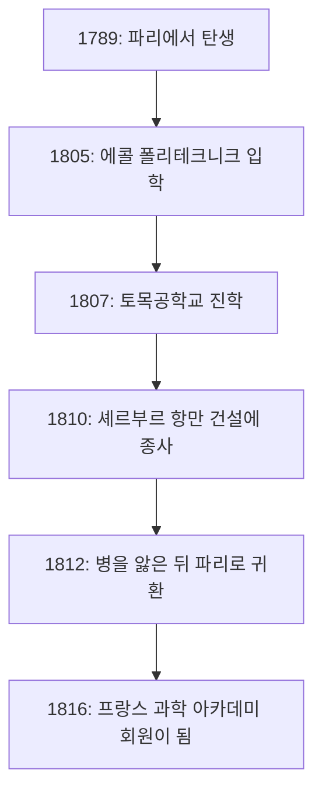

## 머리말

수학의 역사에서 19세기는 '엄밀화의 시대'라고 불립니다. 그때까지 직관적으로 다루어졌던 미적분학에 확고한 논리적 기초를 제공한 사람이 바로 프랑스의 수학자 **오귀스탱 루이 코시** (Augustin-Louis Cauchy, 1789-1857)입니다. 그의 이름은 현대 수학을 배우는 사람이라면 반드시 접하게 될 정도로 수많은 정리와 개념에 붙어 있습니다.

이 글에서는 수학계의 거장 코시의 파란만장한 생애와 그가 남긴 눈부신 수학적 업적에 대해 탐구합니다.

## 파란만장한 생애: 격동의 프랑스를 살다

코시는 프랑스 대혁명이 발발한 직후인 1789년 파리에서 태어났습니다. 그의 생애는 항상 프랑스의 정치적 격동과 밀접하게 연결되어 있었습니다.

### 유년기와 교육

혁명기의 혼란을 피하기 위해 코시의 가족은 그가 어릴 때 파리 교외의 아르쾨유로 이주했습니다. 아버지는 교육에 적극적으로 참여했고, 집을 방문하던 라플라스와 라그랑주 등도 어린 코시에게 관심을 보였습니다.

### 경력과 정치적 신념

코시는 1807년 에콜 폴리테크니크를 졸업하고 토목공학교인 에콜 데 퐁 에 쇼세에 진학했습니다. 1810년부터 셰르부르 항만 공사에 참여했으며, 병을 앓은 뒤 1812년 파리로 돌아왔습니다. 1815년 에콜 폴리테크니크에서 해석학을 가르치기 시작했습니다. 1816년에는 몽주와 카르노가 정치적 이유로 배제되어 생긴 프랑스 과학 아카데미의 두 공석 중 하나를 차지했습니다.

코시는 가톨릭 신자이자 왕당파였습니다. 7월 혁명 뒤인 1830년 파리를 떠났고, 이후 신체제가 요구한 충성 서약을 하지 않아 프랑스의 직책을 잃었습니다. 스위스, 토리노, 프라하 등에서 지내다가 1838년 파리로 돌아왔지만, 서약 거부는 교직 복귀에도 영향을 주었습니다.

그의 보수적인 사상과 타협을 모르는 성격은 동료나 젊은 수학자(아벨이나 갈루아 등)와 마찰을 빚기도 했지만, 그의 수학에 대한 헌신과 압도적인 생산력은 누구도 부정할 수 없는 것이었습니다.

## 수학의 혁명: 엄밀성의 추구

코시는 극한, 연속성, 미분, 적분 및 급수의 수렴을 엄밀하게 다루는 데 크게 기여했습니다. 1821년의 『해석학 강의』도 중요한 업적입니다. 그의 정의를 완성된 현대 입실론–델타 형식과 그대로 동일시할 수는 없으며, 후대 수학자들이 이 기초를 더욱 정교하게 다듬었습니다.

여기에서는 그의 이름이 붙은 중요한 업적 몇 가지를 소개합니다.

### 1. 코시 수열 (Cauchy Sequence)

실수의 완비성을 논할 때 빼놓을 수 없는 것이 **코시 수열** 의 개념입니다. 수열 $ (a_n) $이 코시 수열이라는 것은, 번호 $ n, m $이 충분히 클 때 $ a_n $과 $ a_m $의 차이가 얼마든지 작아진다는 것을 의미합니다.

수식으로 표현하면, 임의의 $ \epsilon > 0 $에 대하여 어떤 자연수 $ N $이 존재하여, $ n, m > N $이면 항상
$$ |a_n - a_m| < \epsilon $$
이 성립한다는 것입니다.

실수 공간에서 "코시 수열은 반드시 수렴한다"는 성질은 공간이 "완비적"임을 나타냅니다. 이 완비성의 개념은 현대 위상수학이나 함수해석학의 기반이 됩니다.

### 2. 코시의 적분 정리 (Cauchy's Integral Theorem)

코시는 복소해석학의 발전에서 중심적 역할을 했습니다. 대표적 성과 중 하나가 [코시의 적분 정리](/ko/p/cauchys-integral-theorem/)입니다. 이후에도 여러 수학자가 이 분야를 발전시켰습니다.

함수 $f$가 단일연결(simply connected) 영역 $D$에서 정칙이고, $C$가 $D$ 안의 구간별로 매끄러운 폐곡선이면 다음 적분은 0입니다. 구멍이 있는 영역에서는 곡선이 구멍을 감싸는지 등의 추가 조건을 확인해야 합니다.

$$ \oint_C f(z) \, dz = 0 $$

또한 $C$가 양의 방향(반시계 방향)으로 도는 구간별로 매끄러운 단순 폐곡선이고, $f$가 곡선과 그 내부를 포함하는 열린집합에서 정칙이며, $a$가 $C$ 내부의 점이면 다음 코시의 적분 공식이 성립합니다.

$$ f(a) = \frac{1}{2\pi i} \oint_C \frac{f(z)}{z - a} \, dz $$

이 공식에서 정칙 함수가 각 점 근방에서 무한번 미분 가능하며 국소적인 [테일러 전개](/ko/p/taylor-and-maclaurin-series/)를 갖는다는 사실을 알 수 있습니다. 가정은 중요합니다. $f(z)=1/z$는 원점 밖에서 정칙이지만, 반시계 방향 단위원에서의 적분은 $2\pi i$입니다.

### 3. 코시-슈바르츠 부등식 (Cauchy-Schwarz Inequality)

코시–슈바르츠 부등식은 선형대수학과 해석학에서 자주 쓰이는 부등식입니다. 실수 또는 복소수 내적공간의 임의의 벡터 $\mathbf{u},\mathbf{v}$에 대해 다음 관계가 성립합니다.

$$ |\langle \mathbf{u}, \mathbf{v} \rangle|^2 \leq \langle \mathbf{u}, \mathbf{u} \rangle \cdot \langle \mathbf{v}, \mathbf{v} \rangle $$

유한구간 $[a,b]$($a<b$)에서 제곱적분 가능한 실숫값 함수 $f,g$에 대해서는 다음 적분 형태가 성립합니다. 복소숫값 함수에서는 내적에 켤레복소수를 사용하고 절댓값의 제곱을 취해야 합니다.

$$ \left( \int_a^b f(x)g(x) \, dx \right)^2 \leq \left( \int_a^b f(x)^2 \, dx \right) \left( \int_a^b g(x)^2 \, dx \right) $$

이 부등식은 벡터가 이루는 각이나 거리의 개념을 추상적인 공간으로 확장하기 위한 기초가 됩니다.

## 코시의 다작과 유산

코시는 약 800편의 수학 논문을 남긴 다작의 연구자였습니다. MacTutor 전기는 789편으로 집계하며, 그의 전집은 27권으로 구성되어 있습니다.

그의 연구 대상은 해석학에 그치지 않고, 대수학(군론의 치환 연구), 수리물리학(탄성 이론 및 광학) 등 수학과 물리학의 광범위한 분야에 걸쳐 있었습니다.

## 결론

오귀스탱 루이 코시는 직관에 의존하던 수학을 논리의 힘으로 엄밀한 학문으로 다시 단련했습니다. 그가 만들어낸 개념과 정리들은 현대 수학의 모든 곳에 깊이 뿌리내리고 있습니다.

정치적 격변과 해외 생활을 거치면서도 코시는 많은 수학적 성과를 남겼습니다. 그의 저작과 정리는 오늘날에도 수학을 공부하는 사람들에게 영향을 미치고 있습니다.

## 참고 자료

- [MacTutor: Augustin-Louis Cauchy](https://mathshistory.st-andrews.ac.uk/Biographies/Cauchy/)
- [MIT 18.112: The General Cauchy Theorem](https://ocw.mit.edu/courses/18-112-functions-of-a-complex-variable-fall-2008/8793d412fa0da2a4183539f5d8f7e3fd_lecture13.pdf)
- [NIST DLMF: Calculus of a Complex Variable](https://dlmf.nist.gov/1.9)
