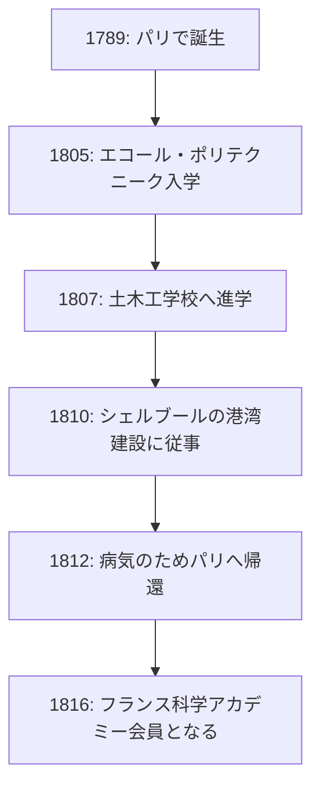

## はじめに

数学の歴史において、19世紀は「厳密化の時代」と呼ばれています。それまで直感的に扱われていた微積分学に対して、確固たる論理的基礎を与えたのが、フランスの数学者 **オーギュスタン＝ルイ・コーシー** (Augustin-Louis Cauchy, 1789-1857) です。彼の名前は、現代の数学を学ぶ者であれば必ず目にするほど、数多くの定理や概念に冠されています。

本記事では、数学界における巨人コーシーの波乱に満ちた生涯と、彼が残した輝かしい数学的業績について探求します。

## 波乱万丈な生涯：激動のフランスを生きる

コーシーは1789年、フランス革命の勃発直後にパリで生まれました。彼の生涯は、常にフランスの政治的激動と密接に結びついていました。

### 幼少期と教育

一家は革命期の混乱を避けるため、コーシーが幼い頃にパリ郊外のアルクイユへ移りました。父は教育に関わり、家を訪れたラプラスやラグランジュも若いコーシーの成長に関心を寄せました。

### キャリアと政治的信条

1807年にエコール・ポリテクニークを卒業し、土木工学校へ進みました。1810年からシェルブールの港湾事業に従事し、体調を崩した1812年にパリへ戻りました。1815年にはエコール・ポリテクニークで解析学を教え始め、1816年、政治的理由でモンジュとカルノーが排除された科学アカデミーの空席の一つを得ました。

コーシーはカトリック教徒で王党派でした。七月革命後の1830年にパリを離れ、その後、新体制への忠誠宣誓を行わなかったため、フランスの職を失いました。スイス、トリノ、プラハなどを経て1838年にパリへ戻りましたが、宣誓拒否は教職への復帰にも影響しました。

彼の保守的な思想と妥協を許さない性格は、同僚や若い数学者（[アーベル](https://kenji.blog/p/abel/)や[ガロア](https://kenji.blog/p/galois/)など）との間に軋轢を生むこともありましたが、その数学への献身と圧倒的な生産力は誰にも否定できるものではありませんでした。

## 数学における革命：厳密性の追求

コーシーは極限、連続性、微分、積分、級数の収束を厳密に扱う解析学の発展に大きく貢献しました。1821年の『解析教程』もその重要な仕事です。ただし、現代のイプシロン・デルタ定義がそのまま完成していたと捉えるのではなく、その後の数学者による定式化との違いも考える必要があります。

ここでは、彼の名が冠された重要な業績をいくつか紹介します。

### 1. コーシー列 (Cauchy Sequence)

実数の完備性を議論する上で欠かせないのが **コーシー列** の概念です。数列 $ (a_n) $ がコーシー列であるとは、番号 $ n, m $ が十分に大きいとき、$ a_n $ と $ a_m $ の差がいくらでも小さくなることを意味します。

数式で表すと、任意の $ \epsilon > 0 $ に対して、ある自然数 $ N $ が存在し、$ n, m > N $ ならば常に
$$ |a_n - a_m| < \epsilon $$
が成り立つというものです。

実数の空間において、「コーシー列は必ず収束する」という性質は、空間が「完備」であることを示しています。この完備性の概念は、現代の位相空間論や関数解析学の基盤となっています。

### 2. [コーシーの積分定理](https://kenji.blog/p/cauchys-integral-theorem/) (Cauchy's Integral Theorem)

コーシーは複素解析の発展に中心的な役割を果たしました。代表的な成果の一つが [コーシーの積分定理](/p/cauchys-integral-theorem/) です。その後も多くの数学者が理論を発展させました。

単連結な領域 $D$ 上で正則な関数 $f$ と、$D$ 内の区分的に滑らかな閉曲線 $C$ について、次の積分はゼロになります。領域に穴がある場合には、曲線がその穴を囲むかどうかなど、追加の確認が必要です。

$$ \oint_C f(z) \, dz = 0 $$

さらに、$C$ が正向き（反時計回り）の区分的に滑らかな単純閉曲線で、$f$ が曲線とその内部を含む開集合で正則、$a$ が内部の点であるとき、次のコーシーの積分公式が成り立ちます。

$$ f(a) = \frac{1}{2\pi i} \oint_C \frac{f(z)}{z - a} \, dz $$

この公式から、正則関数は各点の近傍で無限回微分可能であり、[テイラー展開](/p/taylor-and-maclaurin-series/)できることが分かります。条件の重要性は、原点を除く領域で正則な $f(z)=1/z$ を、原点を反時計回りに一周する単位円上で積分すると $2\pi i$ になる例からも確認できます。

### 3. コーシー＝シュワルツの不等式 (Cauchy-Schwarz Inequality)

線形代数学や解析学において最も頻繁に用いられる不等式の一つです。任意の実数または複素数のベクトル $ \mathbf{u}, \mathbf{v} $ 内積空間において、以下の関係が成り立ちます。

$$ |\langle \mathbf{u}, \mathbf{v} \rangle|^2 \leq \langle \mathbf{u}, \mathbf{u} \rangle \cdot \langle \mathbf{v}, \mathbf{v} \rangle $$

積分の形では、有限区間 $[a,b]$（$a<b$）上の実数値関数 $f,g$ が平方可積分であるとき、次の不等式が成り立ちます。複素数値関数では、内積に複素共役を使い、絶対値の二乗を取る形にする必要があります。

$$ \left( \int_a^b f(x)g(x) \, dx \right)^2 \leq \left( \int_a^b f(x)^2 \, dx \right) \left( \int_a^b g(x)^2 \, dx \right) $$

この不等式は、ベクトルのなす角や距離の概念を抽象的な空間へと拡張するための基礎となります。

## コーシーの多産さと遺産

コーシーは約800編の数学論文を残した多産な研究者でした。MacTutorの伝記では789編と数えられ、全集は27巻にまとめられています。

彼の研究対象は解析学にとどまらず、代数学（群論における置換の研究）、数理物理学（弾性理論や光学）など、数学と物理学の広範な分野に及びました。

## まとめ

オーギュスタン＝ルイ・コーシーは、直感に頼っていた数学を論理の力で厳密な学問へと鍛え直しました。彼の生み出した概念や定理は、現代数学のあらゆる場所に深く根付いています。

政治的な混乱や国外生活の時期を経ながら、コーシーは多くの数学的成果を残しました。その著作と定理は、今日も数学を学ぶ人々に影響を与えています。

## 参考資料

- [MacTutor: Augustin-Louis Cauchy](https://mathshistory.st-andrews.ac.uk/Biographies/Cauchy/)
- [MIT 18.112: The General Cauchy Theorem](https://ocw.mit.edu/courses/18-112-functions-of-a-complex-variable-fall-2008/8793d412fa0da2a4183539f5d8f7e3fd_lecture13.pdf)
- [NIST DLMF: Calculus of a Complex Variable](https://dlmf.nist.gov/1.9)
