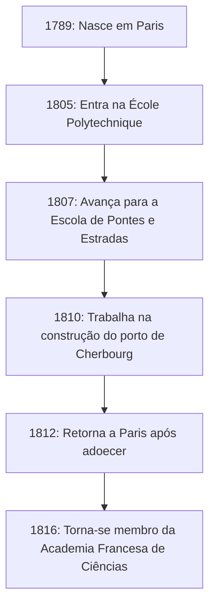

## Introdução

Na história da matemática, o século XIX é conhecido como a "Era do Rigor". O matemático francês **Augustin-Louis Cauchy** (1789-1857) foi quem forneceu uma base lógica firme para o cálculo, que anteriormente havia sido tratado de forma intuitiva. Seu nome coroa tantos teoremas e conceitos que qualquer pessoa que estude matemática moderna está fadada a encontrá-lo.

Este artigo explora a vida turbulenta de Cauchy, um gigante no mundo matemático, e as brilhantes realizações matemáticas que ele deixou para trás.

## Uma Vida Turbulenta: Vivendo em uma França Tumultuada

Cauchy nasceu em Paris em 1789, logo após o início da Revolução Francesa. Sua vida esteve constantemente entrelaçada com as convulsões políticas da França.

### Infância e Educação

A família mudou-se para Arcueil, perto de Paris, durante a infância de Cauchy para fugir da agitação revolucionária. Seu pai participou ativamente de sua educação, e visitantes como Laplace e Lagrange demonstraram interesse pelo jovem Cauchy.

### Carreira e Crenças Políticas

Cauchy formou-se na École Polytechnique em 1807 e ingressou na École des Ponts et Chaussées. Trabalhou nas instalações portuárias de Cherbourg a partir de 1810 e voltou a Paris em 1812 após adoecer. Começou a ensinar análise na École Polytechnique em 1815. Em 1816 ocupou uma das vagas da Academia de Ciências abertas quando Monge e Carnot foram afastados por motivos políticos.

Cauchy era católico e monarquista. Deixou Paris em 1830 após a Revolução de Julho e depois perdeu seus cargos na França por não prestar o juramento de lealdade exigido pelo novo regime. Passou pela Suíça, por Turim e por Praga antes de retornar a Paris em 1838; a recusa ao juramento também afetou sua volta ao ensino.

Sua ideologia conservadora e personalidade intransigente às vezes causavam atritos com colegas e matemáticos mais jovens (como [Abel](https://kenji.blog/pt/p/abel/) e [Galois](https://kenji.blog/pt/p/galois/)), mas sua dedicação à matemática e sua produtividade esmagadora não podiam ser negadas por ninguém.

## Revolução na Matemática: A Busca pelo Rigor

Cauchy contribuiu de forma importante para o tratamento rigoroso de limites, continuidade, diferenciação, integração e convergência de séries. Seu Cours d’analyse de 1821 foi parte importante desse trabalho. Suas definições não devem ser simplesmente equiparadas à formulação moderna completa de épsilon–delta; matemáticos posteriores aperfeiçoaram esses fundamentos.

Aqui estão algumas das realizações importantes que levam seu nome.

### 1. Sequência de Cauchy

O conceito de **sequência de Cauchy** é essencial quando se discute a completude dos números reais. Uma sequência $ (a_n) $ é uma sequência de Cauchy se a diferença entre $ a_n $ e $ a_m $ se torna arbitrariamente pequena quando os índices $ n $ e $ m $ são suficientemente grandes.

Expresso matematicamente, para qualquer $ \epsilon > 0 $, existe um número natural $ N $ tal que para todos $ n, m > N $,
$$ |a_n - a_m| < \epsilon $$
sempre vale.

No espaço dos números reais, a propriedade de que "uma sequência de Cauchy sempre converge" indica que o espaço é "completo". Esse conceito de completude é o alicerce da topologia moderna e da análise funcional.

### 2. Teorema Integral de Cauchy

Cauchy teve papel central no desenvolvimento da análise complexa. Um de seus resultados representativos é o [teorema integral de Cauchy](/pt/p/cauchys-integral-theorem/). Muitos outros matemáticos contribuíram para o desenvolvimento posterior da área.

Se $f$ é holomorfa em um domínio simplesmente conexo $D$ e $C$ é uma curva fechada, suave por partes, contida em $D$, a integral a seguir é zero. Em domínios com buracos são necessárias verificações adicionais, como saber se a curva contorna um buraco.

$$ \oint_C f(z) \, dz = 0 $$

Além disso, se $C$ é uma curva simples fechada, suave por partes e orientada positivamente (no sentido anti-horário), $f$ é holomorfa em um aberto que contém a curva e seu interior, e $a$ está dentro de $C$, vale a fórmula integral de Cauchy. Os valores no contorno determinam o valor interior:

$$ f(a) = \frac{1}{2\pi i} \oint_C \frac{f(z)}{z - a} \, dz $$

A fórmula implica que uma função holomorfa é infinitamente diferenciável e possui uma [expansão de Taylor](/pt/p/taylor-and-maclaurin-series/) local perto de cada ponto. As hipóteses importam: $f(z)=1/z$ é holomorfa fora da origem, mas sua integral na circunferência unitária no sentido anti-horário é $2\pi i$.

### 3. Desigualdade de Cauchy-Schwarz

Esta é uma das desigualdades usadas com mais frequência em álgebra linear e análise. Para quaisquer vetores $ \mathbf{u} $ e $ \mathbf{v} $ de números reais ou complexos em um espaço de produto interno, a seguinte relação é válida:

$$ |\langle \mathbf{u}, \mathbf{v} \rangle|^2 \leq \langle \mathbf{u}, \mathbf{u} \rangle \cdot \langle \mathbf{v}, \mathbf{v} \rangle $$

Para funções reais $f,g$ de quadrado integrável em um intervalo finito $[a,b]$, com $a<b$, a forma integral é a seguinte. Para funções complexas, o produto interno usa conjugação complexa e exige o módulo ao quadrado.

$$ \left( \int_a^b f(x)g(x) \, dx \right)^2 \leq \left( \int_a^b f(x)^2 \, dx \right) \left( \int_a^b g(x)^2 \, dx \right) $$

Esta desigualdade forma a base para estender os conceitos de ângulos e distâncias entre vetores a espaços abstratos.

## A Prolificidade e o Legado de Cauchy

Cauchy foi um pesquisador prolífico que deixou cerca de 800 artigos matemáticos. A biografia do MacTutor contabiliza 789, e suas obras completas abrangem 27 volumes.

Seus temas de pesquisa não se limitaram à análise, mas se estenderam a uma ampla gama de campos em matemática e física, incluindo álgebra (o estudo de permutações na teoria dos grupos) e física matemática (teoria da elasticidade e óptica).

## Conclusão

Augustin-Louis Cauchy forjou a matemática, que dependia da intuição, em uma disciplina acadêmica rigorosa através do poder da lógica. Os conceitos e teoremas que ele criou estão profundamente enraizados em todos os lugares da matemática moderna.

Apesar da agitação política e dos anos no exterior, Cauchy produziu uma extensa obra matemática. Seus escritos e teoremas continuam a influenciar quem estuda a área.

## Referências

- [MacTutor: Augustin-Louis Cauchy](https://mathshistory.st-andrews.ac.uk/Biographies/Cauchy/)
- [MIT 18.112: The General Cauchy Theorem](https://ocw.mit.edu/courses/18-112-functions-of-a-complex-variable-fall-2008/8793d412fa0da2a4183539f5d8f7e3fd_lecture13.pdf)
- [NIST DLMF: Calculus of a Complex Variable](https://dlmf.nist.gov/1.9)
