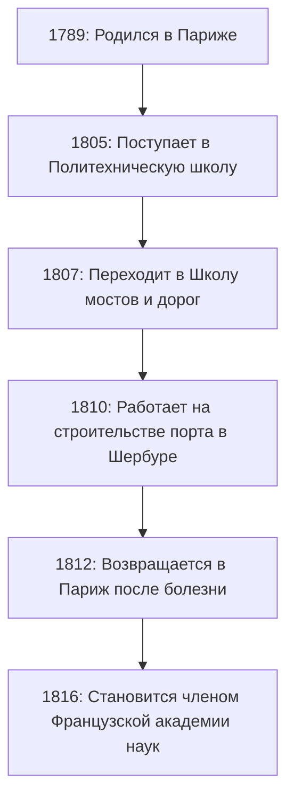

## Введение

В истории математики 19 век известен как «Эпоха строгости». Французский математик **Огюстен Луи Коши** (1789-1857) — это тот, кто заложил прочный логический фундамент для математического анализа, к которому ранее подходили интуитивно. Его имя носят так много теорем и понятий, что любой, кто изучает современную математику, обязательно столкнется с ним.

В этой статье исследуется бурная жизнь Коши, гиганта математического мира, и блестящие математические достижения, которые он оставил после себя.

## Бурная жизнь: Жизнь в неспокойной Франции

Коши родился в Париже в 1789 году, сразу после начала Великой французской революции. Его жизнь была постоянно переплетена с политическими потрясениями во Франции.

### Детство и образование

Когда Коши был ребёнком, его семья переехала в Аркёй под Парижем, спасаясь от революционных потрясений. Отец активно участвовал в его образовании, а бывавшие в доме Лаплас и Лагранж также интересовались юным Коши.

### Карьера и политические убеждения

Коши окончил Политехническую школу в 1807 году и поступил в Школу мостов и дорог. С 1810 года он работал над портовыми сооружениями в Шербуре, а в 1812 году после болезни вернулся в Париж. В 1815 году он начал преподавать анализ в Политехнической школе. В 1816 году получил одно из мест в Академии наук, освободившихся после исключения Монжа и Карно по политическим причинам.

Коши был католиком и роялистом. Он покинул Париж в 1830 году после Июльской революции, а затем потерял должности во Франции, не принеся требуемую новым режимом присягу. Он жил в Швейцарии, Турине и Праге и вернулся в Париж в 1838 году; отказ от присяги повлиял и на возвращение к преподаванию.

Его консервативная идеология и бескомпромиссная личность иногда вызывали трения с коллегами и молодыми математиками (такими как Абель и Галуа), но его преданность математике и ошеломляющую продуктивность не мог отрицать никто.

## Революция в математике: Стремление к строгости

Коши внёс большой вклад в строгое изучение пределов, непрерывности, дифференцирования, интегрирования и сходимости рядов. Его Cours d’analyse 1821 года был важной частью этой работы. Его определения нельзя просто отождествлять с полностью сформировавшимся современным эпсилон-дельта-подходом: последующие математики уточняли эти основания.

Вот несколько важных достижений, носящих его имя.

### 1. Последовательность Коши

Понятие **последовательности Коши** имеет важное значение при обсуждении полноты действительных чисел. Последовательность $ (a_n) $ является последовательностью Коши, если разница между $ a_n $ и $ a_m $ становится сколь угодно малой, когда индексы $ n $ и $ m $ достаточно велики.

Математически это выражается так: для любого $ \epsilon > 0 $ существует натуральное число $ N $ такое, что для всех $ n, m > N $,
$$ |a_n - a_m| < \epsilon $$
всегда выполняется.

В пространстве действительных чисел свойство, согласно которому «последовательность Коши всегда сходится», указывает на то, что пространство является «полным». Эта концепция полноты является основой современной топологии и функционального анализа.

### 2. Интегральная теорема Коши

Коши сыграл центральную роль в развитии комплексного анализа. Один из его важных результатов — [интегральная теорема Коши](/ru/p/cauchys-integral-theorem/). Многие другие математики участвовали в дальнейшем развитии этой области.

Если $f$ голоморфна в односвязной области $D$, а $C$ — кусочно-гладкая замкнутая кривая в $D$, следующий интеграл равен нулю. Для областей с отверстиями требуются дополнительные проверки, например, охватывает ли кривая отверстие.

$$ \oint_C f(z) \, dz = 0 $$

Кроме того, если $C$ — положительно ориентированная (против часовой стрелки), кусочно-гладкая простая замкнутая кривая, $f$ голоморфна в открытом множестве, содержащем кривую и её внутренность, а $a$ находится внутри $C$, справедлива интегральная формула Коши:

$$ f(a) = \frac{1}{2\pi i} \oint_C \frac{f(z)}{z - a} \, dz $$

Из формулы следует, что голоморфная функция бесконечно дифференцируема и имеет локальное [разложение в ряд Тейлора](/ru/p/taylor-and-maclaurin-series/) в окрестности каждой точки. Условия существенны: $f(z)=1/z$ голоморфна вне начала координат, но её интеграл по единичной окружности против часовой стрелки равен $2\pi i$.

### 3. Неравенство Коши-Шварца

Это одно из наиболее часто используемых неравенств в линейной алгебре и анализе. Для любых векторов $ \mathbf{u} $ и $ \mathbf{v} $ действительных или комплексных чисел в пространстве со скалярным произведением выполняется следующее соотношение:

$$ |\langle \mathbf{u}, \mathbf{v} \rangle|^2 \leq \langle \mathbf{u}, \mathbf{u} \rangle \cdot \langle \mathbf{v}, \mathbf{v} \rangle $$

Для вещественнозначных функций $f,g$, интегрируемых с квадратом на конечном интервале $[a,b]$ при $a<b$, интегральная форма имеет следующий вид. Для комплекснозначных функций скалярное произведение использует комплексное сопряжение, и необходим квадрат модуля.

$$ \left( \int_a^b f(x)g(x) \, dx \right)^2 \leq \left( \int_a^b f(x)^2 \, dx \right) \left( \int_a^b g(x)^2 \, dx \right) $$

Это неравенство образует основу для распространения понятий углов и расстояний между векторами на абстрактные пространства.

## Плодовитость и наследие Коши

Коши был плодовитым исследователем, оставившим около 800 математических работ. Биография MacTutor насчитывает 789, а собрание его сочинений занимает 27 томов.

Его объекты исследований не ограничивались анализом, а распространялись на широкий спектр областей математики и физики, включая алгебру (изучение перестановок в теории групп) и математическую физику (теорию упругости и оптику).

## Заключение

Огюстен Луи Коши превратил математику, которая опиралась на интуицию, в строгую академическую дисциплину благодаря силе логики. Созданные им концепции и теоремы глубоко укоренились везде в современной математике.

Несмотря на политические потрясения и годы за границей, Коши создал обширное математическое наследие. Его труды и теоремы продолжают влиять на тех, кто изучает математику.

## Источники

- [MacTutor: Augustin-Louis Cauchy](https://mathshistory.st-andrews.ac.uk/Biographies/Cauchy/)
- [MIT 18.112: The General Cauchy Theorem](https://ocw.mit.edu/courses/18-112-functions-of-a-complex-variable-fall-2008/8793d412fa0da2a4183539f5d8f7e3fd_lecture13.pdf)
- [NIST DLMF: Calculus of a Complex Variable](https://dlmf.nist.gov/1.9)
