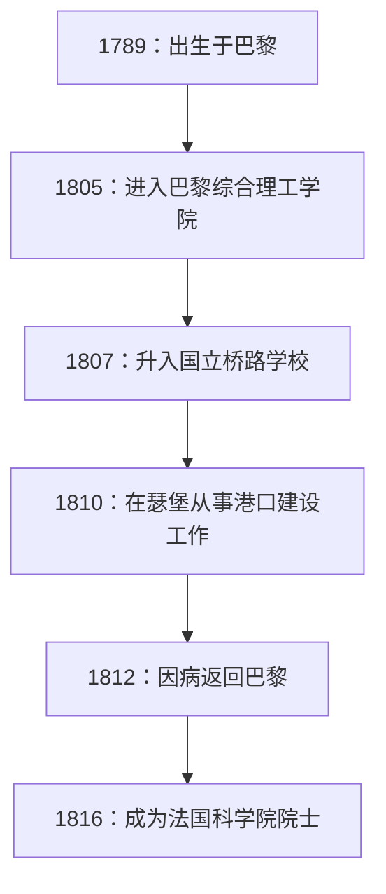

## 引言

在数学史上，19世纪被称为“严密化时代”。为之前一直凭借直觉处理的微积分学奠定坚实逻辑基础的，正是法国数学家 **奥古斯丁-路易·柯西** (Augustin-Louis Cauchy, 1789-1857)。他的名字冠于如此多的定理和概念之上，以至于任何学习现代数学的人都必然会遇到他。

本文将探讨这位数学界巨匠柯西波澜壮阔的一生，以及他留下的辉煌数学成就。

## 波澜壮阔的一生：生活在动荡的法国

1789年，就在法国大革命爆发后不久，柯西出生于巴黎。他的一生始终与法国的政治动荡紧密相连。

### 童年与教育

为躲避革命时期的动荡，柯西幼年时全家迁往巴黎郊外的阿克伊。父亲积极参与他的教育，拉普拉斯和拉格朗日等来访者也关心年轻柯西的成长。

### 职业生涯与政治信仰

柯西于1807年从巴黎综合理工学院毕业，进入国立桥路学校。1810年起在瑟堡从事港口工程，1812年因病返回巴黎。1815年开始在巴黎综合理工学院教授分析学。1816年，蒙日和卡诺因政治原因被法国科学院除名后，他获得了其中一个空缺席位。

柯西信奉天主教，支持王室。1830年七月革命后他离开巴黎，随后因未向新政权宣誓效忠而失去在法国的职位。他辗转瑞士、都灵和布拉格，于1838年返回巴黎；拒绝宣誓也影响了他恢复教职。

他保守的意识形态和不妥协的性格有时会导致他与同事和年轻数学家（如阿贝尔和伽罗瓦）产生摩擦，但他对数学的奉献精神和惊人的生产力是任何人都无法否认的。

## 数学革命：对严密性的追求

柯西为严格处理极限、连续性、微分、积分和级数收敛作出了重要贡献。1821年的《分析教程》是其中一项重要工作。他的定义与完整发展的现代ε–δ表述并不完全相同，后来的数学家继续完善了这些基础。

以下是一些以他名字命名的重要成就。

### 1. 柯西序列

在讨论实数的完备性时，**柯西序列** 的概念是必不可少的。如果序列 $ (a_n) $ 在索引 $ n $ 和 $ m $ 足够大时，$ a_n $ 和 $ a_m $ 之间的差变得任意小，那么它就是一个柯西序列。

用数学公式表示，对于任意 $ \epsilon > 0 $，存在一个自然数 $ N $，使得对于所有 $ n, m > N $，
$$ |a_n - a_m| < \epsilon $$
始终成立。

在实数空间中，“柯西序列必定收敛”这一性质表明该空间是“完备的”。这种完备性的概念是现代拓扑学和泛函分析的基础。

### 2. 柯西积分定理

柯西在复分析的发展中发挥了核心作用，代表性成果之一是 [柯西积分定理](/zh-cn/p/cauchys-integral-theorem/)。后来许多数学家也推动了这一领域的发展。

若函数 $f$ 在单连通域 $D$ 上全纯，$C$ 是 $D$ 内分段光滑的闭曲线，则下式中的积分为零。对于有孔的区域，还需检查曲线是否环绕孔等附加条件。

$$ \oint_C f(z) \, dz = 0 $$

进一步，若 $C$ 是正向（逆时针）的分段光滑简单闭曲线，$f$ 在包含曲线及其内部的开集上全纯，且 $a$ 位于 $C$ 内部，则柯西积分公式为：

$$ f(a) = \frac{1}{2\pi i} \oint_C \frac{f(z)}{z - a} \, dz $$

此公式说明全纯函数在各点附近无限次可导，且具有局部 [泰勒展开](/zh-cn/p/taylor-and-maclaurin-series/)。条件十分重要：$f(z)=1/z$ 在原点以外全纯，但沿逆时针单位圆的积分为 $2\pi i$。

### 3. 柯西-施瓦茨不等式

这是线性代数和分析中最常用的不等式之一。对于内积空间中实数或复数的任意向量 $ \mathbf{u} $ 和 $ \mathbf{v} $，以下关系成立：

$$ |\langle \mathbf{u}, \mathbf{v} \rangle|^2 \leq \langle \mathbf{u}, \mathbf{u} \rangle \cdot \langle \mathbf{v}, \mathbf{v} \rangle $$

对于有限区间 $[a,b]$（$a<b$）上平方可积的实值函数 $f,g$，积分形式如下。复值函数的内积需要使用复共轭，并取模的平方。

$$ \left( \int_a^b f(x)g(x) \, dx \right)^2 \leq \left( \int_a^b f(x)^2 \, dx \right) \left( \int_a^b g(x)^2 \, dx \right) $$

该不等式为将向量之间角度和距离的概念扩展到抽象空间奠定了基础。

## 柯西的多产与遗产

柯西是一位多产的研究者，留下了约800篇数学论文。MacTutor的传记统计为789篇，其全集共有27卷。

他的研究课题并不局限于分析，而是扩展到了数学和物理学领域的广泛范畴，包括代数（群论中置换的研究）和数学物理（弹性理论和光学）。

## 结语

奥古斯丁-路易·柯西通过逻辑的力量，将依赖于直觉的数学锻造成了一门严密的学术学科。他创造的概念和定理在现代数学的各个角落都根深蒂固。

经历政治动荡和旅居国外的岁月，柯西仍留下了大量数学成果。他的著作与定理至今影响着学习数学的人们。

## 参考资料

- [MacTutor: Augustin-Louis Cauchy](https://mathshistory.st-andrews.ac.uk/Biographies/Cauchy/)
- [MIT 18.112: The General Cauchy Theorem](https://ocw.mit.edu/courses/18-112-functions-of-a-complex-variable-fall-2008/8793d412fa0da2a4183539f5d8f7e3fd_lecture13.pdf)
- [NIST DLMF: Calculus of a Complex Variable](https://dlmf.nist.gov/1.9)
