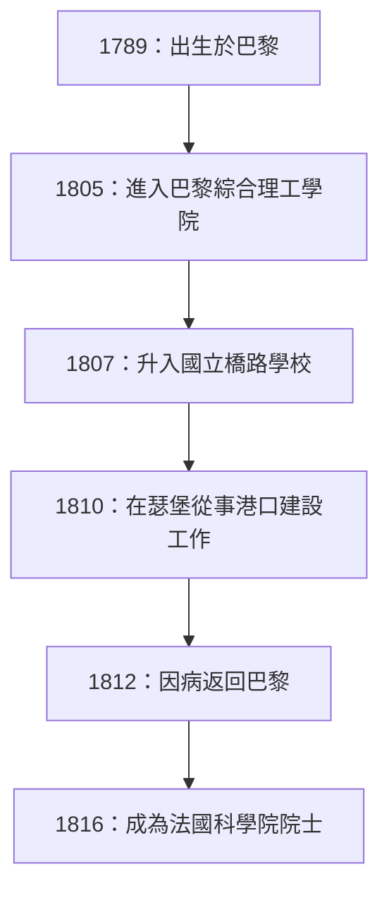

## 引言

在數學史上，19世紀被稱為「嚴密化時代」。為之前一直憑藉直覺處理的微積分學奠定堅實邏輯基礎的，正是法國數學家 **奧古斯丁-路易·柯西** (Augustin-Louis Cauchy, 1789-1857)。他的名字冠於如此多的定理和概念之上，以至於任何學習現代數學的人都必然會遇到他。

本文將探討這位數學界巨匠柯西波瀾壯闊的一生，以及他留下的輝煌數學成就。

## 波瀾壯闊的一生：生活在動盪的法國

1789年，就在法國大革命爆發後不久，柯西出生於巴黎。他的一生始終與法國的政治動盪緊密相連。

### 童年與教育

為躲避革命時期的動盪，柯西幼年時全家遷往巴黎郊外的阿克伊。父親積極參與他的教育，拉普拉斯和拉格朗日等訪客也關心年輕柯西的成長。

### 職業生涯與政治信仰

柯西於1807年從巴黎綜合理工學院畢業，進入國立橋路學校。1810年起在瑟堡從事港口工程，1812年因病返回巴黎。1815年開始在巴黎綜合理工學院教授分析學。1816年，蒙日和卡諾因政治原因被法國科學院除名後，他取得其中一個空缺席位。

柯西信奉天主教，支持王室。1830年七月革命後他離開巴黎，隨後因未向新政權宣誓效忠而失去在法國的職位。他輾轉瑞士、杜林與布拉格，於1838年返回巴黎；拒絕宣誓也影響了他恢復教職。

他保守的意識形態和不妥協的性格有時會導致他與同事和年輕數學家（如阿貝爾和伽羅瓦）產生摩擦，但他對數學的奉獻精神和驚人的生產力是任何人都無法否認的。

## 數學革命：對嚴密性的追求

柯西對嚴格處理極限、連續性、微分、積分及級數收斂有重要貢獻。1821年的《分析教程》是其中一項重要工作。他的定義與完整發展的現代ε–δ表述並不完全相同，後來的數學家持續完善這些基礎。

以下是一些以他名字命名的重要成就。

### 1. 柯西序列

在討論實數的完備性時，**柯西序列** 的概念是必不可少的。如果序列 $ (a_n) $ 在索引 $ n $ 和 $ m $ 足夠大時，$ a_n $ 和 $ a_m $ 之間的差變得任意小，那麼它就是一個柯西序列。

用數學公式表示，對於任意 $ \epsilon > 0 $，存在一個自然數 $ N $，使得對於所有 $ n, m > N $，
$$ |a_n - a_m| < \epsilon $$
始終成立。

在實數空間中，「柯西序列必定收斂」這一性質表明該空間是「完備的」。這種完備性的概念是現代拓撲學和泛函分析的基礎。

### 2. 柯西積分定理

柯西在複分析的發展中扮演核心角色，代表性成果之一是 [柯西積分定理](/zh-tw/p/cauchys-integral-theorem/)。後來也有許多數學家繼續推進此領域。

若函數 $f$ 在單連通域 $D$ 上全純，$C$ 是 $D$ 內分段光滑的閉曲線，則下式中的積分為零。對於有孔洞的區域，仍須檢查曲線是否環繞孔洞等附加條件。

$$ \oint_C f(z) \, dz = 0 $$

進一步，若 $C$ 是正向（逆時針）的分段光滑簡單閉曲線，$f$ 在包含曲線及其內部的開集合上全純，且 $a$ 位於 $C$ 內部，則柯西積分公式為：

$$ f(a) = \frac{1}{2\pi i} \oint_C \frac{f(z)}{z - a} \, dz $$

此公式說明全純函數在各點附近無限次可微，且具有局部 [泰勒展開](/zh-tw/p/taylor-and-maclaurin-series/)。條件很重要：$f(z)=1/z$ 在原點以外全純，但沿逆時針單位圓的積分為 $2\pi i$。

### 3. 柯西-施瓦茨不等式

這是線性代數和分析中最常用的不等式之一。對於內積空間中實數或複數的任意向量 $ \mathbf{u} $ 和 $ \mathbf{v} $，以下關係成立：

$$ |\langle \mathbf{u}, \mathbf{v} \rangle|^2 \leq \langle \mathbf{u}, \mathbf{u} \rangle \cdot \langle \mathbf{v}, \mathbf{v} \rangle $$

對有限區間 $[a,b]$（$a<b$）上平方可積分的實值函數 $f,g$，積分形式如下。複值函數的內積須使用複共軛，並取模的平方。

$$ \left( \int_a^b f(x)g(x) \, dx \right)^2 \leq \left( \int_a^b f(x)^2 \, dx \right) \left( \int_a^b g(x)^2 \, dx \right) $$

該不等式為將向量之間角度和距離的概念擴展到抽象空間奠定了基礎。

## 柯西的多產與遺產

柯西是一位多產的研究者，留下約800篇數學論文。MacTutor的傳記統計為789篇，其全集共有27卷。

他的研究課題並不侷限於分析，而是擴展到了數學和物理學領域的廣泛範疇，包括代數（群論中置換的研究）和數學物理（彈性理論和光學）。

## 結語

奧古斯丁-路易·柯西通過邏輯的力量，將依賴於直覺的數學鍛造成了一門嚴密的學術學科。他創造的概念和定理在現代數學的各個角落都根深蒂固。

經歷政治動盪與旅居國外的歲月，柯西仍留下大量數學成果。他的著作與定理至今影響著學習數學的人們。

## 參考資料

- [MacTutor: Augustin-Louis Cauchy](https://mathshistory.st-andrews.ac.uk/Biographies/Cauchy/)
- [MIT 18.112: The General Cauchy Theorem](https://ocw.mit.edu/courses/18-112-functions-of-a-complex-variable-fall-2008/8793d412fa0da2a4183539f5d8f7e3fd_lecture13.pdf)
- [NIST DLMF: Calculus of a Complex Variable](https://dlmf.nist.gov/1.9)
