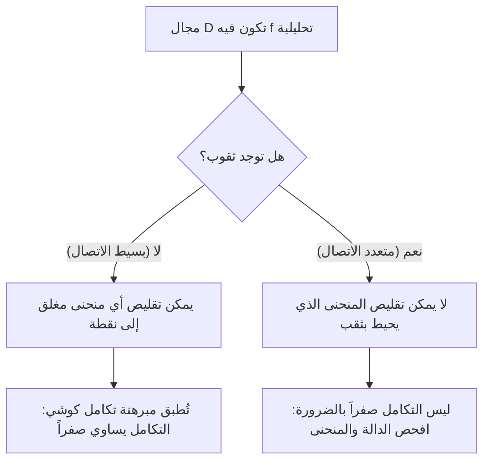

## 1. مقدمة

في التحليل المركب، تُعد **مبرهنة تكامل كوشي** من المبرهنات الأساسية: إذا استوفت الدالة والمنحنى شروطاً مناسبة، فإن تكامل الدالة على المنحنى المغلق يساوي صفراً. سنوضح هذه الشروط، لا سيما التحليلية والاتصال البسيط للمجال.

قد يعبّر تكامل دالة حقيقية عن مساحة ذات إشارة أو تراكم على طول مسار. في التحليل المركب، تمتلك الدوال التحليلية خاصية قوية لتلاشي المساهمات المتقابلة: إذا كانت الدالة تحليلية في مجال بسيط الاتصال، فإن تكاملها على المسارات الملساء قطعياً داخله يعتمد فقط على نقطتي البداية والنهاية. التحليلية وحدها لا تضمن هذا الاستقلال العالمي عن المسار في مجال ذي ثقوب.

نبدأ بتعريفات المستوى المركب والدوال التحليلية، ثم نعرض تفسير المبرهنة الحدسي والفيزيائي وبرهاناً باستخدام مبرهنة غرين. ونوضح كذلك صلتها بصيغة تكامل كوشي و[مبرهنة البواقي](https://kenji.blog/ar/p/residue-theorem/).

## 2. أسس المستوى المركب والدوال التحليلية

لفهم مبرهنة تكامل كوشي بعمق، يجب علينا أولاً ترسيخ فهمنا لأساسيات المستوى المركب واشتقاق الدوال المركبة. يشكل الفهم هنا أساساً مهماً للبراهين والتفسيرات للمبرهنات التي تلي.

### الدوال في المستوى المركب

الدالة المركبة $f(z)$ هي دالة تعين عدداً مركباً $z = x + iy$ إلى عدد مركب آخر $w = u + iv$. هنا، $x, y$ أرقام حقيقية، و $i$ هي الوحدة التخيلية ($i^2 = -1$)، و $u, v$ عبارة عن دوال ذات قيم حقيقية تعتمد على $x, y$ على التوالي. لذلك، يمكن تمثيل الدالة المركبة كمزيج من دالتين ذات قيم حقيقية لمتغيرين حقيقيين على النحو التالي:

$$
f(z) = u(x, y) + i v(x, y)
$$

على سبيل المثال، بالنسبة للدالة $f(z) = z^2$، بالتعويض بـ $z = x + iy$ ونشرها نحصل على $z^2 = (x + iy)^2 = x^2 - y^2 + 2ixy$. وبالتالي، في هذه الحالة، يمكننا أن نرى أنها تتكون من الدوال ذات القيم الحقيقية $u(x, y) = x^2 - y^2$ و $v(x, y) = 2xy$.

### الاشتقاق المركب ومعادلتي كوشي-ريمان

يُقال إن الدالة المركبة $f(z)$ **قابلة للاشتقاق** عند النقطة $z_0$ إذا كانت النهاية التالية موجودة:

$$
f'(z_0) = \lim_{\Delta z \to 0} \frac{f(z_0 + \Delta z) - f(z_0)}{\Delta z}
$$

الشرط الأساسي هو أن تكون النهاية واحدة مهما كانت طريقة اقتراب $\Delta z$ من الصفر في المستوى المركب. يشمل ذلك الاقتراب على منحنيات، لا الاتجاهات المستقيمة فقط. بهذا المعنى، يكون الاشتقاق المركب شرطاً أقوى من الاشتقاق الحقيقي.

تسمى الدالة $f(z)$ **هولومورفية** (holomorphic)، أو تحليلية في السياق المركب، في مجال إذا كانت قابلة للاشتقاق المركب عند كل نقطة منه. والمجال هنا مجموعة مفتوحة متصلة. تترتب على ذلك الشروط اللازمة التالية للجزء الحقيقي $u$ والجزء التخيلي $v$، وهي **معادلتا كوشي–ريمان**:

$$
\frac{\partial u}{\partial x} = \frac{\partial v}{\partial y}, \quad \frac{\partial u}{\partial y} = -\frac{\partial v}{\partial x}
$$

وبالعكس، إذا كانت لـ $u,v$ مشتقات جزئية أولى متصلة في المجال وتحققت المعادلتان في كل نقطة، فإن $f=u+iv$ تحليلية. لا يجوز اعتبار المعادلتين وحدهما شرطاً كافياً بلا قيد من دون افتراض مناسب للانتظام.

## 3. تعريف وخصائص التكامل المركب

بعد ذلك، نُعرّف التكامل الخطي في المستوى المركب. نظراً لأن مبرهنة تكامل كوشي هي مبرهنة حول التكامل على طول "منحنى" في المستوى المركب، فمن الضروري توضيح تعريف هذا التكامل.

ليكن $C$ منحنى أملس قطعياً في المستوى المركب، ممثلاً بارامترياً بالعلاقة $z(t)=x(t)+iy(t)$ حيث $t\in[a,b]$. لدالة $f$ متصلة على المنحنى، يعرّف التكامل الخطي بالصيغة التالية؛ وإذا كان المنحنى مؤلفاً من عدة قطع، نجمع تكاملاتها:

$$
\int_C f(z) dz = \int_a^b f(z(t)) z'(t) dt
$$

هنا، $z'(t) = \frac{dx}{dt} + i \frac{dy}{dt}$، ومن خلال إجراء التعويض الشكلي $dz = dx + i dy$، يمكن في النهاية اختزال الحساب إلى تكامل المتغيرات الحقيقية.

يمتلك التكامل المركب خصائص أساسية مشابهة للتكامل الخطي للدوال الحقيقية، مثل:

1. **الخطية** : لأي ثوابت مركبة $\alpha, \beta$، ينطبق أن $\int_C (\alpha f(z) + \beta g(z)) dz = \alpha \int_C f(z) dz + \beta \int_C g(z) dz$.
2. **عكس المسار** : إذا تم عكس اتجاه المنحنى $C$ (اتجاه التقدم من نقطة البداية إلى نقطة النهاية) وتم الإشارة إليه كـ $-C$، فإن $\int_{-C} f(z) dz = -\int_C f(z) dz$. يؤدي تشغيل مسار التكامل في الاتجاه العكسي إلى قلب الإشارة.
3. **تقسيم المسارات ودمجها** : عندما يمكن تقسيم المنحنى $C$ عند نقطة وسيطة إلى $C_1$ و $C_2$، يتم التعبير عن التكامل الإجمالي كمجموع للتكاملات الجزئية. أي، $\int_C f(z) dz = \int_{C_1} f(z) dz + \int_{C_2} f(z) dz$.

هذه الخصائص، رغم أنها تبدو واضحة، تصبح أدوات قوية للغاية عندما نطور حججنا لاحقاً عن طريق تشويه المسارات بأشكال مختلفة.

## 4. صياغة مبرهنة تكامل كوشي

الآن بعد أن اكتملت تحضيراتنا، نذكر أخيراً الصياغة الدقيقة للموضوع الرئيسي، مبرهنة تكامل كوشي.

**المبرهنة (مبرهنة تكامل كوشي)**
ليكن $D$ مجالاً بسيط الاتصال، ولتكن $f$ تحليلية فيه. عندئذ تتحقق المساواة التالية لكل منحنى مغلق أملس قطعياً $C$ داخل $D$، حتى لو تقاطع المنحنى مع نفسه.

$$
\oint_C f(z) dz = 0
$$

دعونا نكمل هذا ببعض المصطلحات المهمة التي تظهر كشروط مسبقة للمبرهنة.

- **المجال البسيط الاتصال** (Simply connected domain): هو، حدسياً، مجال بلا ثقوب. وبصورة أدق، يمكن تقليص أي منحنى مغلق داخله باستمرار إلى نقطة واحدة من دون مغادرة المجال.
- **المنحنى المغلق الأملس قطعياً**: تتطابق نقطتا بدايته ونهايته ويتكون من عدد منته من القطع الملساء. لا تشترط المبرهنة أعلاه أن يكون بسيطاً. أما المنحنى المغلق البسيط فلا يتقاطع مع نفسه ويفصل المستوى إلى داخل وخارج؛ وهذا هو النوع المستخدم في برهان غرين أدناه.

يوضح الرسم البياني أدناه بصرياً الفرق في سلوك المنحنيات المغلقة في المجالات البسيطة الاتصال مقابل المجالات متعددة الاتصال (المجالات ذات الثقوب).

## 5. الفهم البديهي والتفسير الفيزيائي للمبرهنة

لماذا ينعدم التكامل تحت فرضيات المبرهنة؟ لفهم ذلك حدسياً، نفصله إلى جزأين حقيقي وتخيلي. في هذا التفسير نفترض أن $u,v$ من الصنف $C^1$ وأن المنحنى داخل مجال بسيط الاتصال.

لتكن $f(z) = u + iv$ و $dz = dx + i dy$. يمكن حينئذٍ توسيع التكامل على النحو التالي:

$$
\oint_C f(z) dz = \oint_C (u + iv)(dx + idy) = \oint_C (u dx - v dy) + i \oint_C (v dx + u dy)
$$

لاحظ الجانب الأيمن من هذه المعادلة. لقد ظهر تكاملان حقيقيان، ولهما نفس الشكل تماماً مثل التكاملات الخطية للمجالات المتجهة على مستوى ثنائي الأبعاد. وبشكل محدد، يمكن تفسير الجزء الحقيقي على أنه التكامل الخطي لحقل متجهي $\vec{F}_1 = (u, -v)$، والجزء التخيلي على أنه التكامل الخطي لحقل متجهي $\vec{F}_2 = (v, u)$.

في التفسير الفيزيائي، يمثل التكامل الخطي لحقل متجهي على منحنى مغلق دورانه حول المسار (circulation). إذا كان الحقل من الصنف $C^1$ في مجال بسيط الاتصال وكان دورانه الموضعي (curl) صفراً، انعدم التكامل حول كل منحنى مغلق أملس قطعياً. في مجال ذي ثقوب، لا يكفي انعدام curl محلياً لاستنتاج ذلك عالمياً.

الدورانان القياسيان (curl) للحقلين $\vec{F}_1=(u,-v)$ و$\vec{F}_2=(v,u)$ هما، على الترتيب، $-v_x-u_y$ و$u_x-v_y$. تجعل معادلة كوشي–ريمان $u_y=-v_x$ الأول صفراً، وتجعل $u_x=v_y$ الثاني صفراً. وتعطي المعادلتان أيضاً تباعداً (divergence) معدوماً: $\operatorname{div}\vec{F}_1=u_x-v_y=0$ و$\operatorname{div}\vec{F}_2=v_x+u_y=0$.

إذن تنتج التحليلية حقلين عديمي الدوران الموضعي والتباعد. في الحجة المتعلقة بالتكامل حول المسار، الأساس هو انعدام curl مع شرط المجال البسيط الاتصال؛ أما انعدام التباعد فهو خاصية منفصلة. يوضح هذا التمييز كيف تتلاشى مساهمات التكامل المركب.

## 6. رسم تخطيطي لبرهان صارم باستخدام مبرهنة غرين

في هذا البرهان الكلاسيكي نفترض إضافياً أن لـ $u,v$ مشتقات جزئية أولى متصلة على مجموعة مفتوحة تحتوي المنحنى $C$ وداخله $D'$. وليكن $C$ منحنى مغلقاً بسيطاً أملس قطعياً، موجهاً إيجابياً، أي عكس اتجاه عقارب الساعة. يثبت الحساب التالي هذه الحالة؛ أما الانتقال إلى المنحنيات المغلقة العامة فيحتاج إلى خطوة أخرى.

تحول مبرهنة غرين التكامل الخطي على $C=\partial D'$ إلى تكامل مزدوج على الداخل $D'$. في الصيغة التالية، لـ $P,Q$ مشتقات جزئية أولى متصلة على جوار مفتوح لإغلاق $D'$، والحد موجه إيجابياً.

**مبرهنة غرين**
$$
\oint_{\partial D'} (P dx + Q dy) = \iint_{D'} \left( \frac{\partial Q}{\partial x} - \frac{\partial P}{\partial y} \right) dx dy
$$

دعونا نطبق مبرهنة غرين هذه على الجزء الحقيقي من التكامل المركب المفكك من قبل. هنا نجعل $P = u, Q = -v$.

$$
\oint_C (u dx - v dy) = \iint_{D'} \left( \frac{\partial (-v)}{\partial x} - \frac{\partial u}{\partial y} \right) dx dy
$$

الآن، نستبدل معادلة كوشي-ريمان $\frac{\partial u}{\partial y} = -\frac{\partial v}{\partial x}$، وهي خاصية للدوال التحليلية. بعد ذلك، يصبح المكامل (integrand) على النحو التالي:

$$
-\frac{\partial v}{\partial x} - \left( -\frac{\partial v}{\partial x} \right) = 0
$$

نظراً لأن المكامل يصبح $0$ في جميع النقاط داخل المجال، فإن التكامل المزدوج بأكمله يصبح صفراً، مما يثبت أن التكامل الخطي للجزء الحقيقي هو صفر.

من خلال نفس الإجراء تماماً، نطبق مبرهنة غرين على الجزء التخيلي $i \oint_C (v dx + u dy)$. هنا $P = v, Q = u$.

$$
\oint_C (v dx + u dy) = \iint_{D'} \left( \frac{\partial u}{\partial x} - \frac{\partial v}{\partial y} \right) dx dy
$$

مرة أخرى، بالتعويض بمعادلة كوشي-ريمان الأخرى $\frac{\partial u}{\partial x} = \frac{\partial v}{\partial y}$، يصبح المكامل $\frac{\partial v}{\partial y} - \frac{\partial v}{\partial y} = 0$، ويصبح تكامل الجزء التخيلي أيضاً صفراً.

في الختام، نظراً لأن كلاً من الجزء الحقيقي والتخيلي يصبحان صفراً، ينطبق ما يلي:

$$
\oint_C f(z) dz = 0 + i0 = 0
$$

هذا هو الهيكل الأساسي لبرهان مبرهنة تكامل كوشي. يمكننا أن نرى أنه من خلال تداخل معادلتي كوشي-ريمان ومبرهنة غرين معاً بشكل جميل، يمكن إنجاز البرهان ببساطة مدهشة.

## 7. مبرهنة غورسا: حذف فرض الاستمرارية الإضافي

يفترض البرهان السابق صراحةً استمرارية المشتقات الجزئية الأولى لـ $u,v$ حتى يمكن تطبيق مبرهنة غرين. تبين مبرهنة غورسا (Édouard Goursat) أنه لا حاجة إلى افتراض هذه الاستمرارية بصورة مستقلة.

الفرض الأساسي هو أن تكون $f$ قابلة للاشتقاق المركب عند كل نقطة في مجال مفتوح. لا يلزم افتراض إضافي لاستمرارية $f'$. ومع الشروط المناسبة على المجال والمنحنى، نحصل على النتيجة المعروفة بمبرهنة كوشي–غورسا.

من طرق البرهان الحديثة تقسيم المثلثات مراراً وتقدير التكاملات على حدود المثلثات الأصغر. القابلية للاشتقاق المركب عند كل نقطة في مجال تعني الهولومورفية وتؤدي إلى وجود مشتقات من جميع الرتب. ولا تكفي القابلية للاشتقاق عند نقطة واحدة فقط. مثلاً، $f(z)=|z|^2$ قابلة للاشتقاق المركب عند $0$، لكنها ليست تحليلية في أي جوار لـ $0$.

## 8. تشويه المسار واستقلالية المسار

من النتائج المهمة للغاية لمبرهنة تكامل كوشي هي **استقلالية التكاملات عن المسار**.

لتكن $A,B$ نقطتين في مجال بسيط الاتصال $D$، وليكن $C_1,C_2$ مسارين أملسين قطعياً داخل $D$ من $A$ إلى $B$. إذا كانت $f$ تحليلية في $D$، فإن:

$$
\int_{C_1} f(z) dz = \int_{C_2} f(z) dz
$$

البرهان بسيط للغاية. لنأخذ في الاعتبار مساراً يذهب إلى $B$ عبر $C_1$، ويعود إلى $A$ عبر المسار العكسي $-C_2$. يشكل هذا منحنى مغلقاً واحداً $C = C_1 + (-C_2)$. بموجب مبرهنة تكامل كوشي، فإن التكامل على طول هذا المنحنى المغلق هو صفر.

$$
\oint_C f(z) dz = \int_{C_1} f(z) dz + \int_{-C_2} f(z) dz = \int_{C_1} f(z) dz - \int_{C_2} f(z) dz = 0
$$

بنقل هذا، نحصل على $\int_{C_1} f(z) dz = \int_{C_2} f(z) dz$.

تحت هذه الفرضيات، يعتمد التكامل على نقطتي البداية والنهاية فقط. باختيار نقطة أساس ثابتة، نعرّف دالة أصلية $F$ على $D$ تحقق $F'=f$ وتكون وحيدة حتى إضافة ثابت. وهذه هي النسخة المركبة من المبرهنة الأساسية لحساب التفاضل والتكامل.

## 9. التطبيق: صيغة تكامل كوشي والامتداد إلى المجالات متعددة الاتصال

مبرهنة تكامل كوشي هي مبرهنة جميلة بحد ذاتها، ولكنها تعمل كأساس قوي لاشتقاق مبرهنات مهمة أخرى تباعاً في التحليل المركب.

### صيغة تكامل كوشي

من النتائج المهمة **صيغة تكامل كوشي**. ليكن $C$ منحنى مغلقاً بسيطاً أملس قطعياً، موجهاً إيجابياً (عكس عقارب الساعة). إذا كانت $f$ تحليلية على مجموعة مفتوحة تحتوي $C$ وداخله، وكانت $a$ داخل $C$، فإن:

$$
f(a) = \frac{1}{2\pi i} \oint_C \frac{f(z)}{z - a} dz
$$

تبين الصيغة قوة تحديد قيم الدوال التحليلية: معرفة قيم $f$ على المنحنى $C$ تحدد قيمها عند كل نقطة داخله. لا تحدد الصيغة وحدها، مباشرةً، القيم خارج ذلك المنحنى.

### المجالات متعددة الاتصال ومبرهنة البواقي

في مجال ذي ثقوب، لا يمكن تطبيق نسخة المبرهنة الخاصة بالمجالات البسيطة الاتصال مباشرةً؛ بل يجب فحص الدالة والمنحنى. فالدالة $f(z)=1/z$ تحليلية خارج $0$، لكن تكاملها على دائرة الوحدة ذات المركز عند الأصل، عكس عقارب الساعة، يساوي $2\pi i$. بالمقابل، تكامل $1/z^2$ على الدائرة نفسها يساوي $0$. وجود ثقب لا يفرض تكاملاً غير صفري.

يتيح تشويه المسارات ومبرهنة تكامل كوشي بناء طرق منهجية لحساب التكاملات حول الثقوب. يؤدي ذلك إلى **[مبرهنة البواقي](https://kenji.blog/ar/p/residue-theorem/)**، وهي أداة أساسية في التحليل المركب. وتحت الفرضيات المناسبة، يمكن بها حساب بعض التكاملات المحددة والمعتلة لدوال حقيقية باستخدام البواقي في المستوى المركب.

## 10. خاتمة

للوهلة الأولى، قد تبدو مبرهنة تكامل كوشي وكأنها مبرهنة متواضعة تقول ببساطة "التكامل يصبح صفراً". ومع ذلك، يختبئ وراءها تناظر عميق وجميل ناتج عن الشرط الذي يبدو بسيطاً لـ "تحليلية" الدوال المركبة.

تستند إلى مبرهنة تكامل كوشي صيغة التكامل، ووجود مشتقات من جميع الرتب، ومتسلسلات تايلور المحلية، ومتسلسلات لوران في مجالات حلقية مناسبة، ومبرهنة البواقي. وتشكل هذه النتائج معاً أساساً للتحليل المركب.

نحن نشجع القراء على إحضار ورقة وقلم وتتبع البرهان باستخدام مبرهنة غرين بأيديكم. من المفترض أن تتمكنوا بالتأكيد من الشعور بالعالم المتناغم بشكل جميل للمستوى المركب والذي يمتد خلف الصيغ الرياضية.

## المراجع

- [MIT 18.04: Complex integration and Cauchy theory](https://ocw.mit.edu/courses/18-04-complex-variables-with-applications-spring-2018/1968cab6de7c96ead1c83001459a007b_MIT18_04S18_topic3.pdf)
- [MIT 18.112: Cauchy theorem and integral formula](https://ocw.mit.edu/courses/18-112-functions-of-a-complex-variable-fall-2008/8793d412fa0da2a4183539f5d8f7e3fd_lecture13.pdf)
- [NIST DLMF §1.9: Calculus of a Complex Variable](https://dlmf.nist.gov/1.9)
