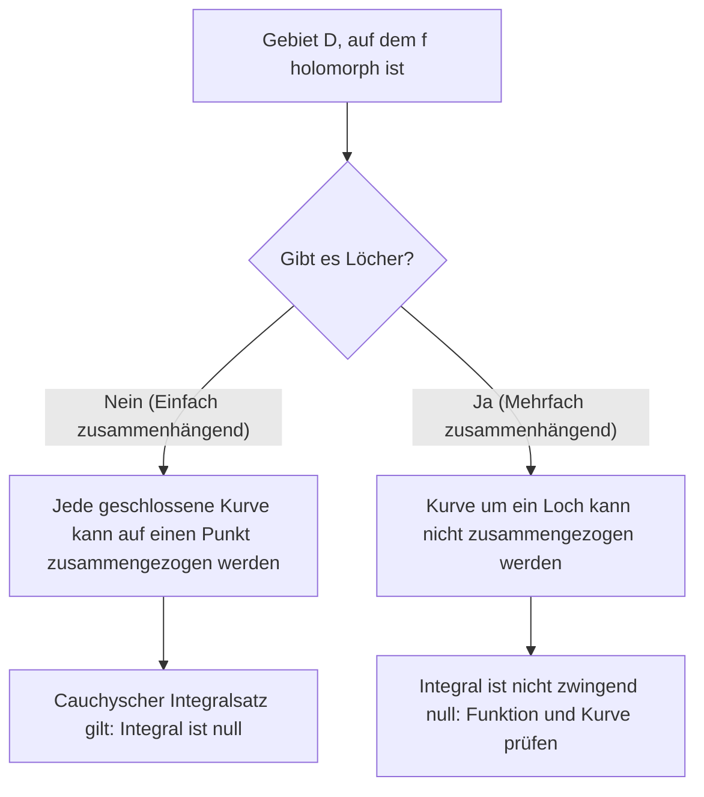

## 1. Einleitung

In dem Teilgebiet der Mathematik, das als Funktionentheorie (komplexe Analysis) bekannt ist, ist einer der schönsten und mächtigsten Sätze der **[Cauchy](https://kenji.blog/de/p/cauchy/)sche Integralsatz**. Dieser Satz behauptet eine auf den ersten Blick höchst überraschende Tatsache: "Die Integration einer komplexen Funktion, die bestimmte Bedingungen erfüllt, entlang einer geschlossenen Kurve liefert immer genau null."

Die Integration reeller Funktionen kann einen orientierten Flächeninhalt oder eine Akkumulation entlang eines Weges beschreiben. In der Funktionentheorie besitzen holomorphe Funktionen eine starke Auslöschungseigenschaft: Ist eine Funktion auf einem einfach zusammenhängenden Gebiet holomorph, so hängen ihre Integrale entlang stückweise stetig differenzierbarer Wege in diesem Gebiet nur von den Endpunkten ab. Auf einem Gebiet mit Löchern gewährleistet Holomorphie allein diese globale Wegunabhängigkeit nicht.

In diesem Artikel werden wir den [Cauchy](https://kenji.blog/de/p/cauchy/)schen Integralsatz sehr detailliert erklären, angefangen bei den grundlegenden Definitionen der komplexen Ebene und holomorpher Funktionen über die intuitive Bedeutung des Satzes, seine physikalische Interpretation bis hin zu einer Skizze seines klassischen Beweises mit dem Satz von Green. Darüber hinaus werden wir ansprechen, wie dieser Satz mit fortgeschritteneren Themen der Funktionentheorie, wie der Cauchyschen Integralformel und dem [Residuensatz](https://kenji.blog/de/p/residue-theorem/), zusammenhängt. Lassen Sie uns die tiefe Bedeutung dieses Satzes sowohl aus der Perspektive mathematischer Strenge als auch intuitiver Vorstellungskraft würdigen.

## 2. Grundlagen der komplexen Ebene und holomorpher Funktionen

Um den [Cauchy](https://kenji.blog/de/p/cauchy/)schen Integralsatz tiefgreifend zu verstehen, müssen wir zunächst unser Verständnis der Grundlagen der komplexen Ebene und der Differentiation komplexer Funktionen festigen. Das Verständnis hier bildet eine wichtige Grundlage für die Beweise und Interpretationen der folgenden Sätze.

### Funktionen in der komplexen Ebene

Eine komplexe Funktion $f(z)$ ist eine Funktion, die eine komplexe Zahl $z = x + iy$ auf eine andere komplexe Zahl $w = u + iv$ abbildet. Hierbei sind $x, y$ reelle Zahlen, $i$ ist die imaginäre Einheit ($i^2 = -1$), und $u, v$ sind reellwertige Funktionen, die jeweils von $x, y$ abhängen. Daher kann eine komplexe Funktion als Kombination aus zwei reellwertigen Funktionen zweier reeller Variablen wie folgt dargestellt werden:

$$
f(z) = u(x, y) + i v(x, y)
$$

Zum Beispiel ergibt sich für die Funktion $f(z) = z^2$ durch Einsetzen von $z = x + iy$ und Ausmultiplizieren $z^2 = (x + iy)^2 = x^2 - y^2 + 2ixy$. Somit können wir in diesem Fall sehen, dass sie aus den reellwertigen Funktionen $u(x, y) = x^2 - y^2$ und $v(x, y) = 2xy$ zusammengesetzt ist.

### Komplexe Differentiation und die [Cauchy](https://kenji.blog/de/p/cauchy/)-[Riemann](https://kenji.blog/de/p/riemann/)schen Differentialgleichungen

Eine komplexe Funktion $f(z)$ heißt an einem Punkt $z_0$ **differenzierbar**, wenn der folgende Grenzwert existiert:

$$
f'(z_0) = \lim_{\Delta z \to 0} \frac{f(z_0 + \Delta z) - f(z_0)}{\Delta z}
$$

Entscheidend ist, dass der Grenzwert für jede Art der Annäherung von $\Delta z$ an null in der komplexen Ebene derselbe ist. Dazu gehören auch gekrümmte Annäherungswege, nicht nur geradlinige Richtungen. Komplexe Differenzierbarkeit ist daher eine stärkere Bedingung als reelle Differenzierbarkeit.

Eine Funktion $f(z)$ heißt auf einem Gebiet, also einer zusammenhängenden offenen Menge, **holomorph**, wenn sie dort in jedem Punkt komplex differenzierbar ist. Daraus folgen die folgenden notwendigen Bedingungen für Realteil $u$ und Imaginärteil $v$, die **Cauchy–Riemannschen Differentialgleichungen**:

$$
\frac{\partial u}{\partial x} = \frac{\partial v}{\partial y}, \quad \frac{\partial u}{\partial y} = -\frac{\partial v}{\partial x}
$$

Umgekehrt gilt: Besitzen $u,v$ auf einem Gebiet stetige partielle Ableitungen erster Ordnung und erfüllen sie dort diese Gleichungen, so ist $f=u+iv$ holomorph. Ohne eine geeignete Regularitätsannahme sind die Gleichungen allein kein uneingeschränkt hinreichendes Kriterium für Holomorphie.

## 3. Definition und Eigenschaften der komplexen Integration

Als nächstes definieren wir das Wegintegral in der komplexen Ebene. Da der [Cauchy](https://kenji.blog/de/p/cauchy/)sche Integralsatz ein Satz über die Integration entlang einer "Kurve" in der komplexen Ebene ist, ist es unerlässlich, die Definition dieser Integration zu klären.

Sei $C$ eine stückweise stetig differenzierbare Kurve in der komplexen Ebene mit Parametrisierung $z(t)=x(t)+iy(t)$ für $t\in[a,b]$. Für eine entlang der Kurve stetige Funktion $f$ ist das Wegintegral durch die folgende Formel definiert; bei mehreren Teilstücken werden deren Integrale addiert.

$$
\int_C f(z) dz = \int_a^b f(z(t)) z'(t) dt
$$

Hierbei ist $z'(t) = \frac{dx}{dt} + i \frac{dy}{dt}$, und durch die formale Substitution $dz = dx + i dy$ kann die Berechnung letztendlich auf die Integration reeller Variablen zurückgeführt werden.

Die komplexe Integration besitzt grundlegende Eigenschaften, die denen der Wegintegration reeller Funktionen ähnlich sind, wie zum Beispiel:

1. **Linearität** : Für beliebige komplexe Konstanten $\alpha, \beta$ gilt $\int_C (\alpha f(z) + \beta g(z)) dz = \alpha \int_C f(z) dz + \beta \int_C g(z) dz$.
2. **Wegumkehr** : Wenn die Richtung der Kurve $C$ (die Fortschrittsrichtung vom Anfangspunkt zum Endpunkt) umgekehrt und als $-C$ bezeichnet wird, dann ist $\int_{-C} f(z) dz = -\int_C f(z) dz$. Das Durchlaufen des Integrationsweges in umgekehrter Richtung kehrt das Vorzeichen um.
3. **Aufteilen und Verbinden von Wegen** : Wenn eine Kurve $C$ an einem Zwischenpunkt in $C_1$ und $C_2$ aufgeteilt werden kann, drückt sich das Gesamtintegral als Summe der Teilintegrale aus. Das heißt, $\int_C f(z) dz = \int_{C_1} f(z) dz + \int_{C_2} f(z) dz$.

Diese Eigenschaften, die scheinbar offensichtlich sind, werden später zu sehr mächtigen Werkzeugen, wenn wir unsere Argumentationen vorantreiben, indem wir die Wege auf verschiedene Weise verformen.

## 4. Formulierung des [Cauchy](https://kenji.blog/de/p/cauchy/)schen Integralsatzes

Nachdem unsere Vorbereitungen abgeschlossen sind, formulieren wir schließlich die exakte Aussage des Hauptthemas, des [Cauchy](https://kenji.blog/de/p/cauchy/)schen Integralsatzes.

**Satz ([Cauchy](https://kenji.blog/de/p/cauchy/)scher Integralsatz)**
Sei $D$ ein einfach zusammenhängendes Gebiet und $f$ auf $D$ holomorph. Für jede geschlossene, stückweise stetig differenzierbare Kurve $C$ in $D$ gilt die folgende Gleichung. Die Kurve darf sich selbst schneiden.

$$
\oint_C f(z) dz = 0
$$

Lassen Sie uns dies mit einigen wichtigen Begriffen ergänzen, die als Voraussetzung für den Satz erscheinen.

- **Einfach zusammenhängendes Gebiet** : Intuitiv gesprochen bezieht sich dies auf ein Gebiet "ohne Löcher". Mathematisch streng ausgedrückt bezeichnet es ein Gebiet, in dem jede geschlossene Kurve innerhalb des Gebiets kontinuierlich verformt und auf einen einzigen Punkt zusammengezogen werden kann, ohne jemals das Gebiet zu verlassen.
- **Geschlossene, stückweise stetig differenzierbare Kurve**: Anfangs- und Endpunkt stimmen überein, und die Kurve besteht aus endlich vielen stetig differenzierbaren Teilstücken. Im obigen Satz muss sie nicht einfach sein. Eine einfache geschlossene Kurve hat keine Selbstschnitte und trennt die Ebene in ein Inneres und ein Äußeres; solche Kurven verwenden wir unten beim Beweis mit dem Satz von Green.

Das folgende Diagramm zeigt visuell den Unterschied im Verhalten geschlossener Kurven in einfach zusammenhängenden Gebieten im Vergleich zu mehrfach zusammenhängenden Gebieten (Gebieten mit Löchern).

## 5. Intuitives Verständnis und physikalische Interpretation des Satzes

Warum verschwindet das Integral unter den Voraussetzungen des Satzes? Zur Anschauung zerlegen wir es in Real- und Imaginärteil. Dabei nehmen wir $u,v$ als $C^1$-Funktionen an und betrachten Kurven in einem einfach zusammenhängenden Gebiet.

Sei $f(z) = u + iv$ und $dz = dx + i dy$. Das Integral kann dann wie folgt entwickelt werden:

$$
\oint_C f(z) dz = \oint_C (u + iv)(dx + idy) = \oint_C (u dx - v dy) + i \oint_C (v dx + u dy)
$$

Beachten Sie die rechte Seite dieser Gleichung. Es sind zwei reelle Integrale aufgetreten, und sie haben exakt die gleiche Form wie die Wegintegrale von Vektorfeldern auf einer 2D-Ebene. Speziell kann der Realteil als Wegintegral eines Vektorfeldes $\vec{F}_1 = (u, -v)$ und der Imaginärteil als Wegintegral eines Vektorfeldes $\vec{F}_2 = (v, u)$ interpretiert werden.

In der Physik beschreibt das Wegintegral eines Vektorfeldes entlang einer geschlossenen Kurve dessen Zirkulation. Für ein stetig differenzierbares Feld auf einem einfach zusammenhängenden Gebiet folgt aus verschwindender Rotation, dass die Zirkulation entlang jeder geschlossenen, stückweise stetig differenzierbaren Kurve null ist. Bei einem Gebiet mit Löchern genügt die lokale Bedingung verschwindender Rotation dafür nicht.

Die skalaren Rotationen der Felder $\vec{F}_1=(u,-v)$ und $\vec{F}_2=(v,u)$ sind $-v_x-u_y$ beziehungsweise $u_x-v_y$. Die Cauchy–Riemannsche Gleichung $u_y=-v_x$ lässt die erste verschwinden, die Gleichung $u_x=v_y$ die zweite. Dieselben Gleichungen liefern außerdem verschwindende Divergenzen: $\operatorname{div}\vec{F}_1=u_x-v_y=0$ und $\operatorname{div}\vec{F}_2=v_x+u_y=0$.

Holomorphie erzeugt somit zwei wirbelfreie und quellenfreie Felder. Für die Aussage über die Zirkulation sind die verschwindende Rotation und die Voraussetzung an das Gebiet entscheidend; die verschwindende Divergenz ist eine davon zu unterscheidende Eigenschaft. So lässt sich die Auslöschung im Cauchyschen Integralsatz anschaulich verstehen.

## 6. Skizze eines strengen Beweises mit dem Satz von Green

Für diesen klassischen Beweis nehmen wir zusätzlich an, dass $u,v$ auf einer offenen Menge, die die Kurve $C$ und ihr Inneres $D'$ enthält, stetige partielle Ableitungen erster Ordnung besitzen. Dabei sei $C$ einfach, geschlossen, stückweise stetig differenzierbar und positiv orientiert, also gegen den Uhrzeigersinn durchlaufen. Die folgende Rechnung beweist diesen Fall; die Erweiterung auf allgemeine geschlossene Kurven erfordert einen weiteren Schritt.

Der Satz von Green wandelt das Wegintegral über $C=\partial D'$ in ein Doppelintegral über das Innere $D'$ um. In der folgenden Aussage besitzen $P,Q$ auf einer offenen Umgebung des Abschlusses von $D'$ stetige partielle Ableitungen erster Ordnung, und der Rand ist positiv orientiert.

**Satz von Green**
$$
\oint_{\partial D'} (P dx + Q dy) = \iint_{D'} \left( \frac{\partial Q}{\partial x} - \frac{\partial P}{\partial y} \right) dx dy
$$

Wenden wir diesen Satz von Green auf den Realteil des zuvor zerlegten komplexen Integrals an. Hier setzen wir $P = u, Q = -v$.

$$
\oint_C (u dx - v dy) = \iint_{D'} \left( \frac{\partial (-v)}{\partial x} - \frac{\partial u}{\partial y} \right) dx dy
$$

Nun setzen wir die [Cauchy](https://kenji.blog/de/p/cauchy/)-[Riemann](https://kenji.blog/de/p/riemann/)sche Differentialgleichung $\frac{\partial u}{\partial y} = -\frac{\partial v}{\partial x}$ ein, was eine Eigenschaft holomorpher Funktionen ist. Dann wird der Integrand wie folgt:

$$
-\frac{\partial v}{\partial x} - \left( -\frac{\partial v}{\partial x} \right) = 0
$$

Da der Integrand in allen Punkten innerhalb des Gebiets zu $0$ wird, wird das gesamte Doppelintegral null, womit bewiesen ist, dass das Wegintegral des Realteils null ist.

Nach exakt demselben Verfahren wenden wir den Satz von Green auf den Imaginärteil $i \oint_C (v dx + u dy)$ an. Hier ist $P = v, Q = u$.

$$
\oint_C (v dx + u dy) = \iint_{D'} \left( \frac{\partial u}{\partial x} - \frac{\partial v}{\partial y} \right) dx dy
$$

Erneut durch Einsetzen der anderen [Cauchy](https://kenji.blog/de/p/cauchy/)-[Riemann](https://kenji.blog/de/p/riemann/)schen Differentialgleichung $\frac{\partial u}{\partial x} = \frac{\partial v}{\partial y}$ wird der Integrand zu $\frac{\partial v}{\partial y} - \frac{\partial v}{\partial y} = 0$, und das Integral des Imaginärteils wird ebenfalls null.

Zusammenfassend gilt, da sowohl der Real- als auch der Imaginärteil null werden:

$$
\oint_C f(z) dz = 0 + i0 = 0
$$

Dies ist das Gerüst des Beweises für den [Cauchy](https://kenji.blog/de/p/cauchy/)schen Integralsatz. Wir können sehen, dass durch das wunderbare Ineinandergreifen der Cauchy-[Riemann](https://kenji.blog/de/p/riemann/)schen Differentialgleichungen und des Satzes von Green der Beweis erstaunlich einfach durchgeführt werden kann.

## 7. Der Satz von Goursat: Aufhebung der Annahme der stetigen Differenzierbarkeit

Der obige Beweis setzt die Stetigkeit der partiellen Ableitungen erster Ordnung von $u,v$ ausdrücklich voraus, um den Satz von Green anzuwenden. Der Satz von Goursat zeigt, dass diese Stetigkeit nicht gesondert angenommen werden muss.

Die wesentliche Voraussetzung ist, dass $f$ in jedem Punkt eines Gebiets komplex differenzierbar ist. Eine zusätzliche Stetigkeitsannahme für $f'$ ist nicht erforderlich. Zusammen mit den passenden Voraussetzungen an Gebiet und Kurve ergibt dies den Satz von Cauchy–Goursat.

Eine moderne Beweismethode unterteilt Dreiecke wiederholt in kleinere Dreiecke und schätzt die Integrale über deren Ränder ab. Komplexe Differenzierbarkeit in jedem Punkt eines Gebiets bedeutet Holomorphie und führt zur Existenz von Ableitungen jeder Ordnung. Differenzierbarkeit an nur einem Punkt reicht nicht aus. So ist $f(z)=|z|^2$ bei $0$ komplex differenzierbar, aber auf keiner Umgebung von $0$ holomorph.

## 8. Wegverformung und Wegunabhängigkeit

Eine der äußerst wichtigen Konsequenzen des [Cauchy](https://kenji.blog/de/p/cauchy/)schen Integralsatzes ist die **Wegunabhängigkeit von Integralen**.

Seien $A,B$ zwei Punkte eines einfach zusammenhängenden Gebiets $D$ und $C_1,C_2$ zwei stückweise stetig differenzierbare Wege in $D$ von $A$ nach $B$. Ist $f$ auf $D$ holomorph, so gilt:

$$
\int_{C_1} f(z) dz = \int_{C_2} f(z) dz
$$

Der Beweis ist sehr einfach. Betrachten Sie einen Weg, der über $C_1$ nach $B$ führt und über den umgekehrten Weg $-C_2$ nach $A$ zurückkehrt. Dies bildet eine einzige geschlossene Kurve $C = C_1 + (-C_2)$. Nach dem [Cauchy](https://kenji.blog/de/p/cauchy/)schen Integralsatz ist das Integral entlang dieser geschlossenen Kurve null.

$$
\oint_C f(z) dz = \int_{C_1} f(z) dz + \int_{-C_2} f(z) dz = \int_{C_1} f(z) dz - \int_{C_2} f(z) dz = 0
$$

Durch Umstellen erhalten wir $\int_{C_1} f(z) dz = \int_{C_2} f(z) dz$.

Unter diesen Voraussetzungen hängt das Integral nur von den Endpunkten ab. Mit einem festen Ausgangspunkt lässt sich eine Stammfunktion $F$ auf $D$ definieren, die bis auf eine additive Konstante eindeutig ist und $F'=f$ erfüllt. Dies ist die komplexe Fassung des Hauptsatzes der Differential- und Integralrechnung.

## 9. Anwendung: [Cauchy](https://kenji.blog/de/p/cauchy/)sche Integralformel und Erweiterung auf mehrfach zusammenhängende Gebiete

Der [Cauchy](https://kenji.blog/de/p/cauchy/)sche Integralsatz ist für sich genommen ein schöner Satz, aber er dient als mächtiges Fundament für die sukzessive Herleitung weiterer wichtiger Sätze in der Funktionentheorie.

### [Cauchy](https://kenji.blog/de/p/cauchy/)sche Integralformel

Eine wichtige Folgerung ist die **Cauchysche Integralformel**. Sei $C$ eine einfache geschlossene, stückweise stetig differenzierbare Kurve mit positiver Orientierung (gegen den Uhrzeigersinn). Ist $f$ auf einer offenen Menge holomorph, die $C$ und ihr Inneres enthält, und liegt $a$ im Inneren von $C$, so gilt:

$$
f(a) = \frac{1}{2\pi i} \oint_C \frac{f(z)}{z - a} dz
$$

Die Formel zeigt die Starrheit holomorpher Funktionen: Die Werte von $f$ auf der Kurve $C$ bestimmen die Werte an jedem Punkt im Inneren von $C$. Allein aus dieser Formel ergeben sich nicht unmittelbar die Werte außerhalb der Kurve.

### Mehrfach zusammenhängende Gebiete und der [Residuensatz](https://kenji.blog/de/p/residue-theorem/)

Auf einem Gebiet mit Löchern lässt sich die Fassung des Satzes für einfach zusammenhängende Gebiete nicht direkt anwenden; Funktion und Kurve müssen untersucht werden. Zum Beispiel ist $f(z)=1/z$ außerhalb von $0$ holomorph, doch das Integral über den gegen den Uhrzeigersinn durchlaufenen Einheitskreis ist $2\pi i$. Dagegen ist das Integral von $1/z^2$ über dieselbe Kurve $0$. Ein Loch erzwingt also kein von null verschiedenes Integral.

Wegverformungen und der Cauchysche Integralsatz ermöglichen systematische Verfahren zur Berechnung von Integralen um Löcher. Daraus ergibt sich der **[Residuensatz](https://kenji.blog/de/p/residue-theorem/)**, ein zentrales Werkzeug der Funktionentheorie. Unter geeigneten Voraussetzungen lassen sich damit manche bestimmten und uneigentlichen Integrale reeller Funktionen mithilfe von Residuen in der komplexen Ebene berechnen.

## 10. Fazit

Auf den ersten Blick mag der [Cauchy](https://kenji.blog/de/p/cauchy/)sche Integralsatz wie ein bescheidener Satz aussehen, der einfach besagt, dass "das Integral null wird". Dahinter verbirgt sich jedoch eine tiefe und schöne Symmetrie, die durch die scheinbar einfache Bedingung der "Holomorphie" komplexer Funktionen hervorgerufen wird.

Der Cauchysche Integralsatz trägt die Integralformel, die Existenz von Ableitungen jeder Ordnung, lokale Taylor-Entwicklungen, Laurent-Entwicklungen auf geeigneten Kreisringen und den Residuensatz. Gemeinsam bilden diese Ergebnisse eine Grundlage der Funktionentheorie.

Wir ermutigen die Leser, Papier und Stift zur Hand zu nehmen und den Beweis mit dem Satz von Green mit eigenen Händen nachzuvollziehen. Sie sollten dann sicherlich die wunderbar harmonische Welt der komplexen Ebene spüren können, die sich hinter den mathematischen Formeln ausbreitet.

## Literatur

- [MIT 18.04: Complex integration and Cauchy theory](https://ocw.mit.edu/courses/18-04-complex-variables-with-applications-spring-2018/1968cab6de7c96ead1c83001459a007b_MIT18_04S18_topic3.pdf)
- [MIT 18.112: Cauchy theorem and integral formula](https://ocw.mit.edu/courses/18-112-functions-of-a-complex-variable-fall-2008/8793d412fa0da2a4183539f5d8f7e3fd_lecture13.pdf)
- [NIST DLMF §1.9: Calculus of a Complex Variable](https://dlmf.nist.gov/1.9)
