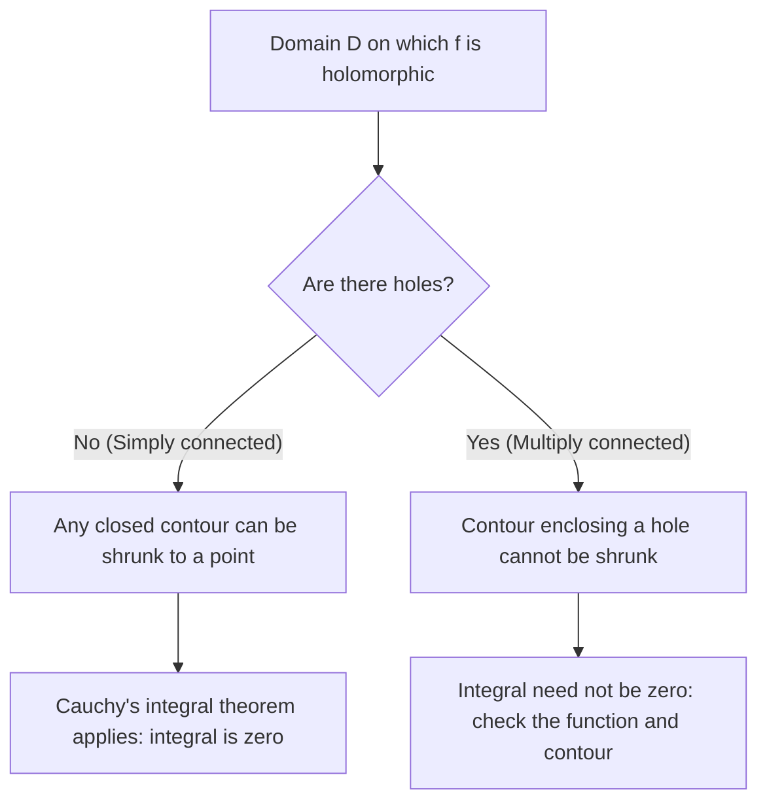

## 1. Introduction

In the field of mathematics known as complex analysis, one of the most beautiful and powerful theorems is **[Cauchy](https://kenji.blog/en/p/cauchy/)'s integral theorem**. This theorem asserts what at first glance seems to be a highly surprising fact: "Integrating a complex function that satisfies certain conditions along a closed contour will always yield exactly zero."

For real functions, integration can represent signed area or accumulation along a path. In complex analysis, holomorphic functions have a strong cancellation property. If the function is holomorphic on a simply connected domain, its integrals along piecewise smooth paths in that domain depend only on their endpoints. Holomorphy alone does not guarantee this global path independence on a domain with holes.

In this article, we will explain [Cauchy](https://kenji.blog/en/p/cauchy/)'s integral theorem in great detail, starting from the foundational definitions of the complex plane and holomorphic functions, moving through the intuitive meaning of the theorem, its physical interpretation, and a sketch of its classical proof using Green's theorem. Furthermore, we will touch upon how this theorem connects to more advanced topics in complex analysis, such as Cauchy's integral formula and the [Residue Theorem](https://kenji.blog/en/p/residue-theorem/). Let us appreciate the profound depth of this theorem from both a mathematical rigor and intuitive imagery perspective.

## 2. Foundations of the Complex Plane and Holomorphic Functions

To deeply understand [Cauchy](https://kenji.blog/en/p/cauchy/)'s integral theorem, we must first solidify our understanding of the basics of the complex plane and the differentiation of complex functions. The understanding here forms an important foundation for the proofs and interpretations of the theorems that follow.

### Functions on the Complex Plane

A complex function $f(z)$ is a function that maps a complex number $z = x + iy$ to another complex number $w = u + iv$. Here, $x, y$ are real numbers, $i$ is the imaginary unit ($i^2 = -1$), and $u, v$ are real-valued functions depending on $x, y$ respectively. Therefore, a complex function can be represented as a combination of two real-valued functions of two real variables as follows:

$$
f(z) = u(x, y) + i v(x, y)
$$

For example, for the function $f(z) = z^2$, substituting $z = x + iy$ and expanding gives $z^2 = (x + iy)^2 = x^2 - y^2 + 2ixy$. Thus, in this case, we can see that it is composed of the real-valued functions $u(x, y) = x^2 - y^2$ and $v(x, y) = 2xy$.

### Complex Differentiation and the [Cauchy](https://kenji.blog/en/p/cauchy/)-[Riemann](https://kenji.blog/en/p/riemann/) Equations

A complex function $f(z)$ is said to be **differentiable** at a point $z_0$ if the following limit exists:

$$
f'(z_0) = \lim_{\Delta z \to 0} \frac{f(z_0 + \Delta z) - f(z_0)}{\Delta z}
$$

The crucial requirement is that the limit must have the same value for every way in which $\Delta z$ approaches zero in the complex plane, including curved paths, not just straight-line directions. This is more restrictive than real differentiability.

A function $f(z)$ is **holomorphic** on an open domain if it is complex differentiable at every point of that domain. Holomorphy implies that the real and imaginary parts satisfy the following necessary conditions, called the **Cauchy–Riemann equations**:

$$
\frac{\partial u}{\partial x} = \frac{\partial v}{\partial y}, \quad \frac{\partial u}{\partial y} = -\frac{\partial v}{\partial x}
$$

Conversely, if $u$ and $v$ have continuous first partial derivatives on an open domain and satisfy these equations there, then $f=u+iv$ is holomorphic. Without a suitable regularity hypothesis, the equations alone are not an unconditional test for holomorphy.

## 3. Definition and Properties of Complex Integration

Next, we define line integration on the complex plane. Since [Cauchy](https://kenji.blog/en/p/cauchy/)'s integral theorem is a theorem about integration along a "curve" on the complex plane, it is essential to clarify the definition of this integration.

Suppose a piecewise smooth curve $C$ in the complex plane is parameterized by $z(t)=x(t)+iy(t)$ for $t\in[a,b]$. For a continuous function $f$ along the curve, its line integral is defined by the following expression, evaluated piece by piece when needed:

$$
\int_C f(z) dz = \int_a^b f(z(t)) z'(t) dt
$$

Here, $z'(t) = \frac{dx}{dt} + i \frac{dy}{dt}$, and by performing the formal substitution $dz = dx + i dy$, the calculation can ultimately be reduced to the integration of real variables.

Complex integration possesses fundamental properties similar to the line integration of real functions, such as:

1. **Linearity** : For any complex constants $\alpha, \beta$, it holds that $\int_C (\alpha f(z) + \beta g(z)) dz = \alpha \int_C f(z) dz + \beta \int_C g(z) dz$.
2. **Path Reversal** : If the direction of the curve $C$ (the direction of progress from start point to end point) is reversed and denoted as $-C$, then $\int_{-C} f(z) dz = -\int_C f(z) dz$. Running the integration path in reverse flips the sign.
3. **Splitting and Combining Paths** : When a curve $C$ can be split at an intermediate point into $C_1$ and $C_2$, the overall integral is expressed as the sum of the partial integrals. That is, $\int_C f(z) dz = \int_{C_1} f(z) dz + \int_{C_2} f(z) dz$.

These properties, while seemingly obvious, become very powerful tools when we later advance our arguments by variously deforming the paths.

## 4. Formulation of [Cauchy](https://kenji.blog/en/p/cauchy/)'s Integral Theorem

Now that our preparations are complete, we finally state the exact formulation of the main subject, [Cauchy](https://kenji.blog/en/p/cauchy/)'s integral theorem.

**Theorem ([Cauchy](https://kenji.blog/en/p/cauchy/)'s Integral Theorem)**
Let $D$ be a simply connected open domain and let $f$ be holomorphic on $D$. For every piecewise smooth closed contour $C$ contained in $D$, including contours that intersect themselves, the following holds.

$$
\oint_C f(z) dz = 0
$$

Let us supplement this with some important terminology that appears as prerequisite conditions of the theorem.

- **Simply connected domain** : Intuitively speaking, this refers to a domain "without holes." Expressed with mathematical rigor, it refers to a domain where any closed curve within it can be continuously deformed and shrunk to a single point without ever leaving the domain.
- **Piecewise smooth closed contour**: A curve with the same start and end point, consisting of finitely many smooth pieces. The theorem above does not require it to be simple. A simple closed contour has no self-intersections and separates the plane into an interior and an exterior; we use such contours in the Green's theorem proof below.

The diagram below visually shows the difference in the behavior of closed curves in simply connected domains versus multiply connected domains (domains with holes).

## 5. Intuitive Understanding and Physical Interpretation of the Theorem

Why does the integral vanish under the hypotheses of the theorem? To build intuition, let us separate the complex integral into real and imaginary parts.

Let $f(z) = u + iv$ and $dz = dx + i dy$. The integral can then be expanded as follows:

$$
\oint_C f(z) dz = \oint_C (u + iv)(dx + idy) = \oint_C (u dx - v dy) + i \oint_C (v dx + u dy)
$$

Notice the right side of this equation. Two real integrals have appeared, and they have exactly the same form as the line integrals of vector fields on a 2D plane. Specifically, the real part can be interpreted as the line integral of a vector field $\vec{F}_1 = (u, -v)$, and the imaginary part as the line integral of a vector field $\vec{F}_2 = (v, u)$.

In physics, a vector field's line integral along a closed contour represents its circulation. For a continuously differentiable field on a simply connected domain, zero curl implies zero circulation around every piecewise smooth closed contour. A domain with holes requires further care: local zero curl alone does not imply global zero circulation.

The scalar curls of $\vec{F}_1=(u,-v)$ and $\vec{F}_2=(v,u)$ are respectively $-v_x-u_y$ and $u_x-v_y$. The Cauchy–Riemann equation $u_y=-v_x$ makes the first zero, and $u_x=v_y$ makes the second zero. The same equations also give zero divergences: $\operatorname{div}\vec{F}_1=u_x-v_y=0$ and $\operatorname{div}\vec{F}_2=v_x+u_y=0$.

Thus holomorphy yields both curl-free and divergence-free fields. For the circulation argument, zero curl together with the domain hypothesis is the relevant condition; zero divergence is a separate property. This interpretation helps explain the cancellation in Cauchy's integral theorem.

## 6. Sketch of a Rigorous Proof Using Green's Theorem

For this classical proof, assume in addition that $u$ and $v$ have continuous first partial derivatives on an open set containing a positively oriented (counterclockwise), piecewise smooth simple closed contour $C$ and its interior $D'$. The proof below establishes the result for such a contour; extension to general closed contours is a further step.

Green's theorem converts the line integral around $C=\partial D'$ into a double integral over its interior $D'$. In the following statement, $P$ and $Q$ have continuous first partial derivatives on an open neighborhood of the closure of $D'$, and the boundary is positively oriented.

**Green's Theorem**
$$
\oint_{\partial D'} (P dx + Q dy) = \iint_{D'} \left( \frac{\partial Q}{\partial x} - \frac{\partial P}{\partial y} \right) dx dy
$$

Let's apply this Green's theorem to the real part of the decomposed complex integral from earlier. Here we let $P = u, Q = -v$.

$$
\oint_C (u dx - v dy) = \iint_{D'} \left( \frac{\partial (-v)}{\partial x} - \frac{\partial u}{\partial y} \right) dx dy
$$

Now, we substitute the [Cauchy](https://kenji.blog/en/p/cauchy/)-[Riemann](https://kenji.blog/en/p/riemann/) equation $\frac{\partial u}{\partial y} = -\frac{\partial v}{\partial x}$, which is a property of holomorphic functions. Then, the integrand becomes as follows:

$$
-\frac{\partial v}{\partial x} - \left( -\frac{\partial v}{\partial x} \right) = 0
$$

Since the integrand becomes $0$ at all points within the domain, the entire double integral becomes zero, proving that the real part's line integral is zero.

Through completely the same procedure, we apply Green's theorem to the imaginary part $i \oint_C (v dx + u dy)$. Here $P = v, Q = u$.

$$
\oint_C (v dx + u dy) = \iint_{D'} \left( \frac{\partial u}{\partial x} - \frac{\partial v}{\partial y} \right) dx dy
$$

Again, substituting the other [Cauchy](https://kenji.blog/en/p/cauchy/)-[Riemann](https://kenji.blog/en/p/riemann/) equation $\frac{\partial u}{\partial x} = \frac{\partial v}{\partial y}$, the integrand becomes $\frac{\partial v}{\partial y} - \frac{\partial v}{\partial y} = 0$, and the imaginary part's integral also becomes zero.

In conclusion, since both the real and imaginary parts become zero, the following holds:

$$
\oint_C f(z) dz = 0 + i0 = 0
$$

This is the skeleton of the proof for [Cauchy](https://kenji.blog/en/p/cauchy/)'s integral theorem. We can see that by the Cauchy-[Riemann](https://kenji.blog/en/p/riemann/) equations and Green's theorem beautifully meshing together, the proof can be accomplished surprisingly simply.

## 7. Goursat's Theorem: Removing the Assumption of Continuous Differentiability

The proof above explicitly assumes continuous first partial derivatives of $u$ and $v$ so that Green's theorem applies. Goursat's theorem removes the need to assume this continuity separately.

The essential hypothesis is that $f$ is complex differentiable at every point of an open domain. No additional continuity assumption on $f'$ is needed. Together with the appropriate domain and contour conditions, this yields Cauchy's integral theorem, often called the Cauchy–Goursat theorem.

One modern proof proceeds by repeatedly subdividing triangles and estimating integrals on the resulting smaller triangles. Complex differentiability throughout an open domain is a strong condition: it implies holomorphy and subsequently derivatives of every order. Differentiability at just one point is insufficient. For example, $f(z)=|z|^2$ is complex differentiable at $0$ but is not holomorphic on any neighborhood of $0$.

## 8. Path Deformation and Path Independence

One of the extremely important consequences of [Cauchy](https://kenji.blog/en/p/cauchy/)'s integral theorem is the **path independence of integrals**.

Let $A$ and $B$ lie in a simply connected open domain $D$, and let $C_1$ and $C_2$ be piecewise smooth paths in $D$ from $A$ to $B$. If $f$ is holomorphic on $D$, then:

$$
\int_{C_1} f(z) dz = \int_{C_2} f(z) dz
$$

The proof is very simple. Consider a path that goes to $B$ via $C_1$, and returns to $A$ via the reverse path $-C_2$. This forms a single closed curve $C = C_1 + (-C_2)$. By [Cauchy](https://kenji.blog/en/p/cauchy/)'s integral theorem, the integral along this closed curve is zero.

$$
\oint_C f(z) dz = \int_{C_1} f(z) dz + \int_{-C_2} f(z) dz = \int_{C_1} f(z) dz - \int_{C_2} f(z) dz = 0
$$

By transposing this, we obtain $\int_{C_1} f(z) dz = \int_{C_2} f(z) dz$.

Under these hypotheses, the integral depends only on the start and end points. Fixing a base point defines an antiderivative $F$ on $D$, unique up to an additive constant. Its derivative is $f$, giving the complex counterpart of the fundamental theorem of calculus.

## 9. Application: [Cauchy](https://kenji.blog/en/p/cauchy/)'s Integral Formula and Extension to Multiply Connected Domains

[Cauchy](https://kenji.blog/en/p/cauchy/)'s integral theorem is a beautiful theorem on its own, but it serves as a powerful foundation for successively deriving other important theorems in complex analysis.

### [Cauchy](https://kenji.blog/en/p/cauchy/)'s Integral Formula

A major consequence is **Cauchy's integral formula**. Let $C$ be a positively oriented (counterclockwise), piecewise smooth simple closed contour, let $f$ be holomorphic on an open set containing $C$ and its interior, and let $a$ lie inside $C$. Then:

$$
f(a) = \frac{1}{2\pi i} \oint_C \frac{f(z)}{z - a} dz
$$

The formula shows the rigidity of holomorphic functions: knowing the values on $C$ determines the value at every point inside $C$. It does not, by itself, determine values outside that contour.

### Multiply Connected Domains and the [Residue Theorem](https://kenji.blog/en/p/residue-theorem/)

For a domain with holes, the simply connected version of the theorem does not apply directly, and the integral depends on the function and contour. For example, $f(z)=1/z$ is holomorphic away from $0$, but its integral around the counterclockwise unit circle is $2\pi i$. In contrast, the integral of $1/z^2$ around the same circle is $0$. A hole does not force a nonzero integral.

However, by ingeniously applying [Cauchy](https://kenji.blog/en/p/cauchy/)'s integral theorem and deforming the integration path, a systematic method for evaluating integrals around holes was established. This leads to the **Residue Theorem**, one of the most practical tools in modern complex analysis. By using the [Residue Theorem](https://kenji.blog/en/p/residue-theorem/), complex definite integrals and infinite integrals of real functions can be brilliantly replaced with algebraic calculations on the complex plane and solved.

## 10. Conclusion

At first glance, [Cauchy](https://kenji.blog/en/p/cauchy/)'s integral theorem might look like a modest theorem that simply says "the integral becomes zero." However, hidden behind it is a profound and beautiful symmetry brought about by the seemingly simple condition of the "holomorphy" of complex functions.

Cauchy's integral theorem supports the integral formula, derivatives of all orders, local Taylor expansions, Laurent expansions on suitable annuli, and the residue theorem. Together, these results form a foundation for complex analysis.

We encourage readers to pick up a paper and pen and trace the proof using Green's theorem with your own hands. You should be able to surely feel the beautifully harmonious world of the complex plane spreading out behind the mathematical formulas.

## References

- [MIT 18.04: Complex integration, Cauchy's theorem and integral formula](https://ocw.mit.edu/courses/18-04-complex-variables-with-applications-spring-2018/1968cab6de7c96ead1c83001459a007b_MIT18_04S18_topic3.pdf)
- [MIT 18.112: Cauchy's theorem and integral formula](https://ocw.mit.edu/courses/18-112-functions-of-a-complex-variable-fall-2008/8793d412fa0da2a4183539f5d8f7e3fd_lecture13.pdf)
- [NIST DLMF §1.9: Calculus of a Complex Variable](https://dlmf.nist.gov/1.9)
