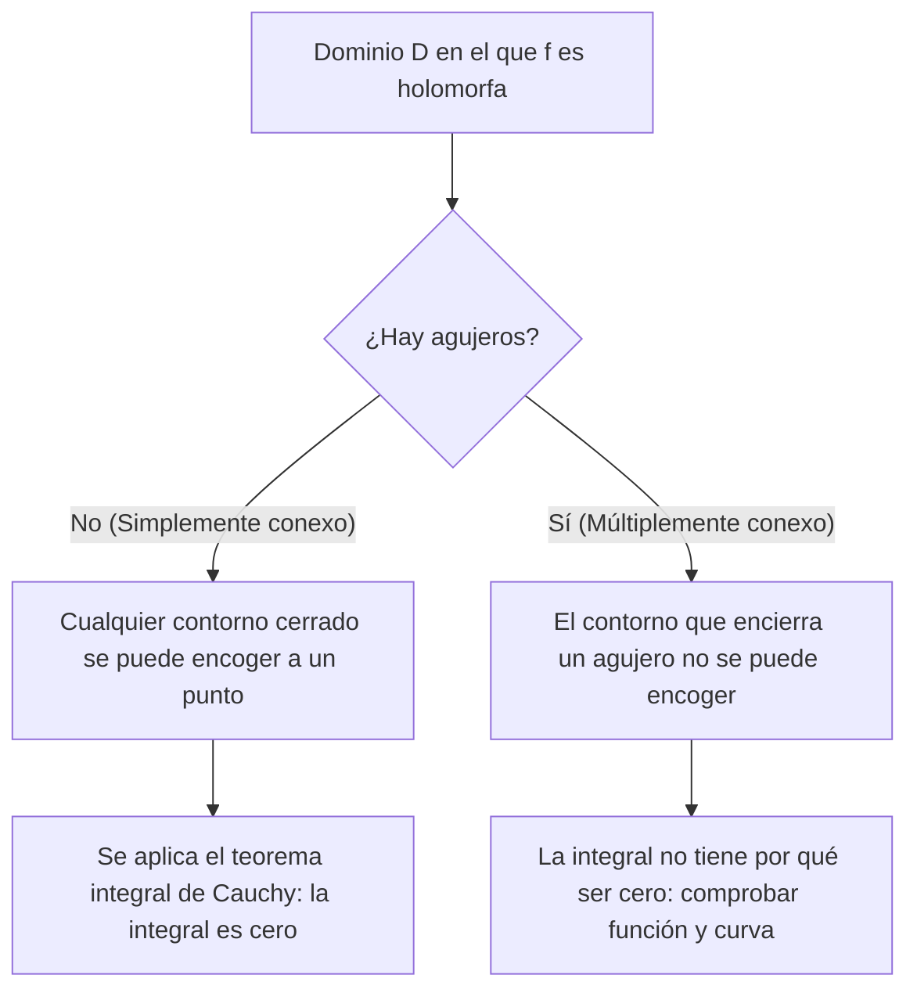

## 1. Introducción

En el campo de las matemáticas conocido como análisis complejo, uno de los teoremas más hermosos y poderosos es el **Teorema integral de [Cauchy](https://kenji.blog/es/p/cauchy/)**. Este teorema afirma lo que a primera vista parece ser un hecho sumamente sorprendente: "Integrar una función compleja que satisface ciertas condiciones a lo largo de un contorno cerrado siempre dará exactamente cero."

La integración de funciones reales puede representar un área con signo o una acumulación a lo largo de un camino. En análisis complejo, las funciones holomorfas tienen una fuerte propiedad de cancelación: si una función es holomorfa en un dominio simplemente conexo, sus integrales a lo largo de caminos suaves a trozos dentro de ese dominio solo dependen de los extremos. La holomorfía por sí sola no garantiza esta independencia global del camino en un dominio con agujeros.

En este artículo, explicaremos el teorema integral de [Cauchy](https://kenji.blog/es/p/cauchy/) con gran detalle, comenzando por las definiciones fundamentales del plano complejo y las funciones holomorfas, pasando por el significado intuitivo del teorema, su interpretación física y un esbozo de su prueba clásica utilizando el teorema de Green. Además, mencionaremos cómo este teorema se conecta con temas más avanzados del análisis complejo, como la fórmula integral de [Cauchy](https://kenji.blog/es/p/cauchy/) y el teorema de los residuos. Apreciemos la profunda belleza de este teorema tanto desde la perspectiva del rigor matemático como desde una imaginería intuitiva.

## 2. Fundamentos del Plano Complejo y las Funciones Holomorfas

Para comprender profundamente el teorema integral de [Cauchy](https://kenji.blog/es/p/cauchy/), primero debemos consolidar nuestra comprensión de los conceptos básicos del plano complejo y la diferenciación de funciones complejas. La comprensión aquí forma una base importante para las pruebas e interpretaciones de los teoremas que siguen.

### Funciones en el Plano Complejo

Una función compleja $f(z)$ es una función que mapea un número complejo $z = x + iy$ a otro número complejo $w = u + iv$. Aquí, $x, y$ son números reales, $i$ es la unidad imaginaria ($i^2 = -1$), y $u, v$ son funciones de valor real que dependen de $x, y$ respectivamente. Por lo tanto, una función compleja puede representarse como una combinación de dos funciones de valor real de dos variables reales de la siguiente manera:

$$
f(z) = u(x, y) + i v(x, y)
$$

Por ejemplo, para la función $f(z) = z^2$, sustituyendo $z = x + iy$ y expandiendo obtenemos $z^2 = (x + iy)^2 = x^2 - y^2 + 2ixy$. Así, en este caso, podemos ver que está compuesta por las funciones de valor real $u(x, y) = x^2 - y^2$ y $v(x, y) = 2xy$.

### Diferenciación Compleja y las Ecuaciones de [Cauchy](https://kenji.blog/es/p/cauchy/)-[Riemann](https://kenji.blog/es/p/riemann/)

Se dice que una función compleja $f(z)$ es **diferenciable** en un punto $z_0$ si el siguiente límite existe:

$$
f'(z_0) = \lim_{\Delta z \to 0} \frac{f(z_0 + \Delta z) - f(z_0)}{\Delta z}
$$

El requisito fundamental es que el límite tenga el mismo valor para cualquier forma en que $\Delta z$ tienda a cero en el plano complejo, incluidas las trayectorias curvas, y no solo las direcciones rectilíneas. Esta condición es más restrictiva que la diferenciabilidad real.

Una función $f(z)$ es **holomorfa** en un dominio abierto si es diferenciable en sentido complejo en cada punto de ese dominio. La holomorfía implica que las partes real $u$ e imaginaria $v$ satisfacen las siguientes condiciones necesarias, llamadas **ecuaciones de Cauchy–Riemann**:

$$
\frac{\partial u}{\partial x} = \frac{\partial v}{\partial y}, \quad \frac{\partial u}{\partial y} = -\frac{\partial v}{\partial x}
$$

Recíprocamente, si $u$ y $v$ tienen derivadas parciales de primer orden continuas en un dominio abierto y satisfacen allí estas ecuaciones, entonces $f=u+iv$ es holomorfa. Sin una hipótesis adecuada de regularidad, las ecuaciones por sí solas no constituyen un criterio incondicional de holomorfía.

## 3. Definición y Propiedades de la Integración Compleja

A continuación, definimos la integración de línea en el plano complejo. Dado que el teorema integral de [Cauchy](https://kenji.blog/es/p/cauchy/) es un teorema sobre la integración a lo largo de una "curva" en el plano complejo, es esencial aclarar la definición de esta integración.

Sea $C$ una curva suave a trozos del plano complejo, parametrizada por $z(t)=x(t)+iy(t)$, con $t\in[a,b]$. Para una función $f$ continua a lo largo de la curva, su integral de línea se define como sigue; si hay varios tramos, se integran por separado y se suman:

$$
\int_C f(z) dz = \int_a^b f(z(t)) z'(t) dt
$$

Aquí, $z'(t) = \frac{dx}{dt} + i \frac{dy}{dt}$, y al realizar la sustitución formal $dz = dx + i dy$, el cálculo finalmente puede reducirse a la integración de variables reales.

La integración compleja posee propiedades fundamentales similares a la integración de línea de funciones reales, tales como:

1. **Linealidad** : Para cualesquiera constantes complejas $\alpha, \beta$, se cumple que $\int_C (\alpha f(z) + \beta g(z)) dz = \alpha \int_C f(z) dz + \beta \int_C g(z) dz$.
2. **Inversión de Trayectoria** : Si se invierte la dirección de la curva $C$ (la dirección de avance desde el punto de inicio hasta el punto final) y se denota como $-C$, entonces $\int_{-C} f(z) dz = -\int_C f(z) dz$. Recorrer la ruta de integración a la inversa cambia el signo.
3. **División y Combinación de Trayectorias** : Cuando una curva $C$ se puede dividir en un punto intermedio en $C_1$ y $C_2$, la integral general se expresa como la suma de las integrales parciales. Es decir, $\int_C f(z) dz = \int_{C_1} f(z) dz + \int_{C_2} f(z) dz$.

Estas propiedades, aunque parezcan obvias, se convierten en herramientas muy poderosas cuando más tarde avanzamos en nuestros argumentos deformando de diversas maneras las trayectorias.

## 4. Formulación del Teorema Integral de [Cauchy](https://kenji.blog/es/p/cauchy/)

Una vez completados los preparativos, finalmente establecemos la formulación exacta del tema principal, el teorema integral de [Cauchy](https://kenji.blog/es/p/cauchy/).

**Teorema (Teorema Integral de [Cauchy](https://kenji.blog/es/p/cauchy/))**
Sea $D$ un dominio abierto simplemente conexo y sea $f$ holomorfa en $D$. Para cualquier curva cerrada $C$ suave a trozos y contenida en $D$, incluso si tiene autointersecciones, se cumple:

$$
\oint_C f(z) dz = 0
$$

Complementemos esto con algunos términos importantes que aparecen como condiciones previas del teorema.

- **Dominio simplemente conexo** : Intuitivamente hablando, esto se refiere a un dominio "sin agujeros". Expresado con rigor matemático, se refiere a un dominio donde cualquier curva cerrada dentro de él puede deformarse de forma continua y encogerse hasta un solo punto sin abandonar nunca el dominio.
- **Curva cerrada suave a trozos**: Sus puntos inicial y final coinciden y está formada por un número finito de tramos suaves. El teorema anterior no exige que sea simple. Una curva cerrada simple no tiene autointersecciones y separa el plano en un interior y un exterior; usaremos este tipo de curva en la demostración mediante el teorema de Green.

El siguiente diagrama muestra visualmente la diferencia en el comportamiento de las curvas cerradas en dominios simplemente conexos frente a dominios múltiplemente conexos (dominios con agujeros).

## 5. Comprensión Intuitiva e Interpretación Física del Teorema

¿Por qué se anula la integral bajo las hipótesis del teorema? Para desarrollar la intuición, descompongamos la integral compleja en sus partes real e imaginaria.

Sea $f(z) = u + iv$ y $dz = dx + i dy$. La integral entonces puede expandirse de la siguiente manera:

$$
\oint_C f(z) dz = \oint_C (u + iv)(dx + idy) = \oint_C (u dx - v dy) + i \oint_C (v dx + u dy)
$$

Note el lado derecho de esta ecuación. Han aparecido dos integrales reales, y tienen exactamente la misma forma que las integrales de línea de campos vectoriales en un plano 2D. Específicamente, la parte real puede interpretarse como la integral de línea de un campo vectorial $\vec{F}_1 = (u, -v)$, y la parte imaginaria como la integral de línea de un campo vectorial $\vec{F}_2 = (v, u)$.

En física, la integral de línea de un campo vectorial a lo largo de una curva cerrada representa su circulación. Si un campo es continuamente diferenciable en un dominio simplemente conexo y su rotacional es cero, su circulación sobre cualquier curva cerrada suave a trozos es cero. En un dominio con agujeros, la anulación local del rotacional no basta para concluir que toda circulación es cero.

Los rotacionales escalares de $\vec{F}_1=(u,-v)$ y $\vec{F}_2=(v,u)$ son, respectivamente, $-v_x-u_y$ y $u_x-v_y$. La ecuación de Cauchy–Riemann $u_y=-v_x$ anula el primero y $u_x=v_y$ anula el segundo. Las mismas ecuaciones también dan divergencia nula: $\operatorname{div}\vec{F}_1=u_x-v_y=0$ y $\operatorname{div}\vec{F}_2=v_x+u_y=0$.

Así, la holomorfía produce dos campos irrotacionales y de divergencia nula. Para el argumento sobre la circulación, lo relevante es la anulación del rotacional junto con la hipótesis sobre el dominio; la divergencia nula es una propiedad distinta. Esta distinción ayuda a entender la cancelación en el teorema integral de Cauchy.

## 6. Esbozo de una Prueba Rigurosa Usando el Teorema de Green

Para esta demostración clásica, supongamos además que $u$ y $v$ tienen derivadas parciales de primer orden continuas en un abierto que contiene una curva cerrada simple $C$, suave a trozos y orientada positivamente (en sentido antihorario), junto con su interior $D'$. El cálculo siguiente demuestra el resultado para este tipo de curva; la extensión a curvas cerradas generales requiere un paso adicional.

El teorema de Green transforma la integral de línea sobre $C=\partial D'$ en una integral doble sobre el interior $D'$. En el siguiente enunciado, $P$ y $Q$ tienen derivadas parciales de primer orden continuas en un entorno abierto de la clausura de $D'$ y la frontera está orientada positivamente.

**Teorema de Green**
$$
\oint_{\partial D'} (P dx + Q dy) = \iint_{D'} \left( \frac{\partial Q}{\partial x} - \frac{\partial P}{\partial y} \right) dx dy
$$

Apliquemos este teorema de Green a la parte real de la integral compleja descompuesta de antes. Aquí dejamos que $P = u, Q = -v$.

$$
\oint_C (u dx - v dy) = \iint_{D'} \left( \frac{\partial (-v)}{\partial x} - \frac{\partial u}{\partial y} \right) dx dy
$$

Ahora, sustituimos la ecuación de [Cauchy](https://kenji.blog/es/p/cauchy/)-[Riemann](https://kenji.blog/es/p/riemann/) $\frac{\partial u}{\partial y} = -\frac{\partial v}{\partial x}$, que es una propiedad de las funciones holomorfas. Entonces, el integrando se vuelve el siguiente:

$$
-\frac{\partial v}{\partial x} - \left( -\frac{\partial v}{\partial x} \right) = 0
$$

Dado que el integrando se vuelve $0$ en todos los puntos dentro del dominio, toda la integral doble se vuelve cero, demostrando que la integral de línea de la parte real es cero.

Siguiendo exactamente el mismo procedimiento, aplicamos el teorema de Green a la parte imaginaria $i \oint_C (v dx + u dy)$. Aquí $P = v, Q = u$.

$$
\oint_C (v dx + u dy) = \iint_{D'} \left( \frac{\partial u}{\partial x} - \frac{\partial v}{\partial y} \right) dx dy
$$

Nuevamente, sustituyendo la otra ecuación de [Cauchy](https://kenji.blog/es/p/cauchy/)-[Riemann](https://kenji.blog/es/p/riemann/) $\frac{\partial u}{\partial x} = \frac{\partial v}{\partial y}$, el integrando se convierte en $\frac{\partial v}{\partial y} - \frac{\partial v}{\partial y} = 0$, y la integral de la parte imaginaria también se vuelve cero.

En conclusión, dado que tanto la parte real como la imaginaria se vuelven cero, se cumple lo siguiente:

$$
\oint_C f(z) dz = 0 + i0 = 0
$$

Este es el esqueleto de la prueba para el teorema integral de [Cauchy](https://kenji.blog/es/p/cauchy/). Podemos ver que al engranarse bellamente las ecuaciones de Cauchy-[Riemann](https://kenji.blog/es/p/riemann/) y el teorema de Green, la prueba se puede lograr de una manera sorprendentemente simple.

## 7. Teorema de Goursat: Eliminando la Suposición de Diferenciabilidad Continua

La demostración anterior supone explícitamente que las derivadas parciales de primer orden de $u$ y $v$ son continuas para poder aplicar el teorema de Green. El teorema de Goursat elimina la necesidad de suponer esta continuidad por separado.

La hipótesis esencial es que $f$ sea diferenciable en sentido complejo en cada punto de un dominio abierto. No se necesita una hipótesis adicional de continuidad de $f'$. Junto con las condiciones apropiadas sobre el dominio y la curva, esto proporciona el resultado conocido como teorema de Cauchy–Goursat.

Una demostración moderna consiste en subdividir repetidamente triángulos y estimar las integrales sobre los triángulos más pequeños. Ser diferenciable en sentido complejo en cada punto de un dominio abierto es una condición fuerte: implica holomorfía y, posteriormente, derivadas de todos los órdenes. Ser diferenciable en un solo punto no basta. Por ejemplo, $f(z)=|z|^2$ es diferenciable en sentido complejo en $0$, pero no es holomorfa en ningún entorno de $0$.

## 8. Deformación de Trayectorias e Independencia de la Trayectoria

Una de las consecuencias extremadamente importantes del teorema integral de [Cauchy](https://kenji.blog/es/p/cauchy/) es la **independencia de la trayectoria de las integrales**.

Sean $A$ y $B$ dos puntos de un dominio abierto simplemente conexo $D$, y sean $C_1$ y $C_2$ dos caminos suaves a trozos en $D$ que van de $A$ a $B$. Si $f$ es holomorfa en $D$, entonces:

$$
\int_{C_1} f(z) dz = \int_{C_2} f(z) dz
$$

La prueba es muy simple. Considere un camino que va a $B$ a través de $C_1$, y regresa a $A$ a través del camino inverso $-C_2$. Esto forma una sola curva cerrada $C = C_1 + (-C_2)$. Por el teorema integral de [Cauchy](https://kenji.blog/es/p/cauchy/), la integral a lo largo de esta curva cerrada es cero.

$$
\oint_C f(z) dz = \int_{C_1} f(z) dz + \int_{-C_2} f(z) dz = \int_{C_1} f(z) dz - \int_{C_2} f(z) dz = 0
$$

Transponiendo esto, obtenemos $\int_{C_1} f(z) dz = \int_{C_2} f(z) dz$.

Bajo estas hipótesis, la integral solo depende de los extremos. Fijando un punto base, se define una primitiva $F$ en $D$, única salvo una constante aditiva, y se cumple $F'=f$. Es la versión compleja del teorema fundamental del cálculo.

## 9. Aplicación: Fórmula Integral de [Cauchy](https://kenji.blog/es/p/cauchy/) y Extensión a Dominios Múltiplemente Conexos

El teorema integral de [Cauchy](https://kenji.blog/es/p/cauchy/) es un teorema hermoso por sí solo, pero sirve como una poderosa base para derivar sucesivamente otros teoremas importantes en el análisis complejo.

### Fórmula Integral de [Cauchy](https://kenji.blog/es/p/cauchy/)

Una consecuencia importante es la **fórmula integral de Cauchy**. Sea $C$ una curva cerrada simple, suave a trozos y orientada positivamente (en sentido antihorario). Si $f$ es holomorfa en un abierto que contiene $C$ y su interior, y $a$ está dentro de $C$, entonces:

$$
f(a) = \frac{1}{2\pi i} \oint_C \frac{f(z)}{z - a} dz
$$

La fórmula muestra la rigidez de las funciones holomorfas: conocer los valores de $f$ sobre el contorno $C$ determina su valor en cada punto del interior de $C$. La fórmula, por sí sola, no determina los valores fuera de esa curva.

### Dominios Múltiplemente Conexos y el teorema de los residuos

En un dominio con agujeros no se puede aplicar directamente la versión del teorema para dominios simplemente conexos; hay que examinar la función y la curva. Por ejemplo, $f(z)=1/z$ es holomorfa fuera de $0$, pero su integral sobre la circunferencia unidad recorrida en sentido antihorario es $2\pi i$. En cambio, la integral de $1/z^2$ sobre la misma curva es $0$. Un agujero no obliga a que la integral sea distinta de cero.

La deformación de caminos y el teorema integral de Cauchy permiten desarrollar métodos para evaluar integrales alrededor de agujeros. Esto conduce al **[teorema de los residuos](https://kenji.blog/es/p/residue-theorem/)**, una herramienta central del análisis complejo. Bajo las hipótesis adecuadas, permite calcular algunas integrales definidas e impropias de funciones reales mediante residuos en el plano complejo.

## 10. Conclusión

A primera vista, el teorema integral de [Cauchy](https://kenji.blog/es/p/cauchy/) puede parecer un modesto teorema que simplemente dice "la integral se vuelve cero". Sin embargo, oculto detrás de él hay una profunda y hermosa simetría provocada por la condición aparentemente simple de la "holomorfia" de las funciones complejas.

El teorema integral de Cauchy sustenta la fórmula integral, la existencia de derivadas de todos los órdenes, los desarrollos locales de Taylor, los desarrollos de Laurent en anillos adecuados y el teorema de los residuos. Estos resultados forman una base del análisis complejo.

Alentamos a los lectores a tomar papel y lápiz y trazar la prueba usando el teorema de Green con sus propias manos. Seguramente deberían poder sentir el mundo bellamente armonioso del plano complejo que se extiende detrás de las fórmulas matemáticas.

## Referencias

- [MIT 18.04: integración compleja, teorema de Cauchy y fórmula integral](https://ocw.mit.edu/courses/18-04-complex-variables-with-applications-spring-2018/1968cab6de7c96ead1c83001459a007b_MIT18_04S18_topic3.pdf)
- [MIT 18.112: teorema de Cauchy y fórmula integral](https://ocw.mit.edu/courses/18-112-functions-of-a-complex-variable-fall-2008/8793d412fa0da2a4183539f5d8f7e3fd_lecture13.pdf)
- [NIST DLMF §1.9: cálculo de una variable compleja](https://dlmf.nist.gov/1.9)
