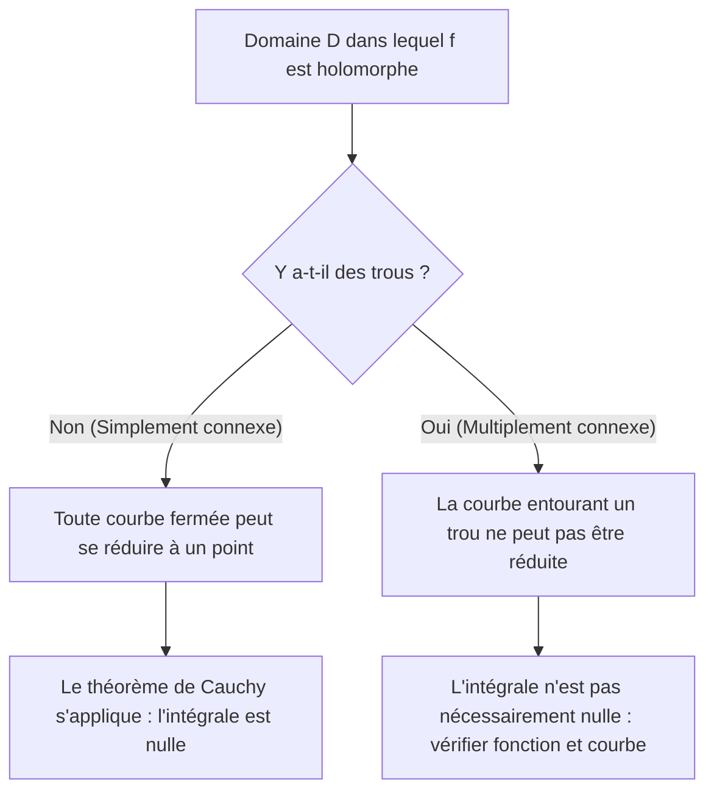

## 1. Introduction

Dans le domaine des mathématiques connu sous le nom d'analyse complexe, l'un des théorèmes les plus beaux et les plus puissants est le **théorème intégral de [Cauchy](https://kenji.blog/fr/p/cauchy/)**. Ce théorème affirme ce qui, à première vue, semble être un fait très surprenant : "L'intégration d'une fonction complexe qui satisfait à certaines conditions le long d'un contour fermé donnera toujours exactement zéro."

L'intégration des fonctions réelles peut représenter une aire algébrique ou une accumulation le long d'un chemin. En analyse complexe, les fonctions holomorphes possèdent une forte propriété de compensation : si une fonction est holomorphe dans un domaine simplement connexe, ses intégrales le long de chemins de classe $C^1$ par morceaux dans ce domaine ne dépendent que des extrémités. L'holomorphie seule ne garantit pas cette indépendance globale dans un domaine troué.

Dans cet article, nous expliquerons le théorème intégral de [Cauchy](https://kenji.blog/fr/p/cauchy/) de manière très détaillée, en partant des définitions fondamentales du plan complexe et des fonctions holomorphes, en passant par la signification intuitive du théorème, son interprétation physique et une esquisse de sa preuve classique à l'aide du théorème de Green. De plus, nous aborderons la façon dont ce théorème se connecte à des sujets plus avancés de l'analyse complexe, tels que la formule intégrale de [Cauchy](https://kenji.blog/fr/p/cauchy/) et le [théorème des résidus](/fr/p/residue-theorem/). Apprécions la profondeur insondable de ce théorème tant du point de vue de la rigueur mathématique que de l'imagerie intuitive.

## 2. Fondements du Plan Complexe et des Fonctions Holomorphes

Pour bien comprendre le théorème intégral de [Cauchy](https://kenji.blog/fr/p/cauchy/), nous devons d'abord consolider notre compréhension des bases du plan complexe et de la dérivation des fonctions complexes. La compréhension de ces éléments constitue une base importante pour les preuves et les interprétations des théorèmes qui suivent.

### Fonctions sur le Plan Complexe

Une fonction complexe $f(z)$ est une fonction qui associe à un nombre complexe $z = x + iy$ un autre nombre complexe $w = u + iv$. Ici, $x, y$ sont des nombres réels, $i$ est l'unité imaginaire ($i^2 = -1$), et $u, v$ sont des fonctions à valeurs réelles dépendant respectivement de $x, y$. Par conséquent, une fonction complexe peut être représentée comme une combinaison de deux fonctions à valeurs réelles de deux variables réelles comme suit :

$$
f(z) = u(x, y) + i v(x, y)
$$

Par exemple, pour la fonction $f(z) = z^2$, remplacer $z = x + iy$ et développer donne $z^2 = (x + iy)^2 = x^2 - y^2 + 2ixy$. Ainsi, dans ce cas, nous pouvons voir qu'elle est composée des fonctions à valeurs réelles $u(x, y) = x^2 - y^2$ et $v(x, y) = 2xy$.

### Dérivation Complexe et les Équations de [Cauchy](https://kenji.blog/fr/p/cauchy/)-[Riemann](https://kenji.blog/fr/p/riemann/)

Une fonction complexe $f(z)$ est dite **dérivable** en un point $z_0$ si la limite suivante existe :

$$
f'(z_0) = \lim_{\Delta z \to 0} \frac{f(z_0 + \Delta z) - f(z_0)}{\Delta z}
$$

L'exigence essentielle est que la limite soit la même quelle que soit la façon dont $\Delta z$ tend vers zéro dans le plan complexe. Cela comprend les approches suivant des chemins courbes, et pas seulement les directions rectilignes. La dérivabilité complexe est donc plus contraignante que la dérivabilité réelle.

Une fonction $f(z)$ est **holomorphe** dans un domaine ouvert si elle est dérivable au sens complexe en chaque point de ce domaine. L'holomorphie implique que les parties réelle $u$ et imaginaire $v$ satisfont aux conditions nécessaires suivantes, appelées **équations de Cauchy–Riemann** :

$$
\frac{\partial u}{\partial x} = \frac{\partial v}{\partial y}, \quad \frac{\partial u}{\partial y} = -\frac{\partial v}{\partial x}
$$

Réciproquement, si $u$ et $v$ ont des dérivées partielles premières continues dans un domaine ouvert et y vérifient ces équations, alors $f=u+iv$ est holomorphe. Sans hypothèse appropriée de régularité, les équations seules ne constituent pas un critère suffisant inconditionnel d'holomorphie.

## 3. Définition et Propriétés de l'Intégration Complexe

Ensuite, nous définissons l'intégration curviligne sur le plan complexe. Le théorème intégral de [Cauchy](https://kenji.blog/fr/p/cauchy/) étant un théorème sur l'intégration le long d'une "courbe" sur le plan complexe, il est essentiel de clarifier la définition de cette intégration.

Soit $C$ une courbe de classe $C^1$ par morceaux du plan complexe, paramétrée par $z(t)=x(t)+iy(t)$ pour $t\in[a,b]$. Pour une fonction $f$ continue le long de la courbe, l'intégrale curviligne est définie par la formule suivante ; on additionne les intégrales sur les différents morceaux si nécessaire.

$$
\int_C f(z) dz = \int_a^b f(z(t)) z'(t) dt
$$

Ici, $z'(t) = \frac{dx}{dt} + i \frac{dy}{dt}$, et en effectuant la substitution formelle $dz = dx + i dy$, le calcul peut finalement être réduit à l'intégration de variables réelles.

L'intégration complexe possède des propriétés fondamentales similaires à l'intégration curviligne des fonctions réelles, telles que :

1. **Linéarité** : Pour toutes constantes complexes $\alpha, \beta$, on a $\int_C (\alpha f(z) + \beta g(z)) dz = \alpha \int_C f(z) dz + \beta \int_C g(z) dz$.
2. **Inversion de Trajet** : Si la direction de la courbe $C$ (le sens de progression du point de départ au point d'arrivée) est inversée et notée $-C$, alors $\int_{-C} f(z) dz = -\int_C f(z) dz$. Parcourir le chemin d'intégration en sens inverse change le signe.
3. **Division et Combinaison de Trajets** : Lorsqu'une courbe $C$ peut être divisée en un point intermédiaire en $C_1$ et $C_2$, l'intégrale globale est exprimée comme la somme des intégrales partielles. C'est-à-dire, $\int_C f(z) dz = \int_{C_1} f(z) dz + \int_{C_2} f(z) dz$.

Ces propriétés, bien qu'apparemment évidentes, deviennent des outils très puissants lorsque nous avancerons plus tard nos arguments en déformant les chemins de diverses manières.

## 4. Formulation du Théorème Intégral de [Cauchy](https://kenji.blog/fr/p/cauchy/)

Maintenant que nos préparatifs sont terminés, nous énonçons enfin la formulation exacte de notre sujet principal, le théorème intégral de [Cauchy](https://kenji.blog/fr/p/cauchy/).

**Théorème (Théorème Intégral de [Cauchy](https://kenji.blog/fr/p/cauchy/))**
Soit $D$ un domaine ouvert simplement connexe et soit $f$ holomorphe dans $D$. Pour toute courbe fermée $C$ de classe $C^1$ par morceaux contenue dans $D$, même si elle se recoupe, on a :

$$
\oint_C f(z) dz = 0
$$

Complétons ceci par quelques termes importants qui apparaissent comme conditions préalables au théorème.

- **Domaine simplement connexe** : Intuitivement parlant, cela fait référence à un domaine "sans trous". Exprimé avec rigueur mathématique, il fait référence à un domaine où toute courbe fermée en son sein peut être déformée de façon continue et rétrécie en un seul point sans jamais quitter le domaine.
- **Courbe fermée de classe $C^1$ par morceaux** : Ses extrémités coïncident et elle est composée d'un nombre fini de morceaux de classe $C^1$. Le théorème ci-dessus ne suppose pas qu'elle soit simple. Une courbe fermée simple ne se recoupe pas et sépare le plan en un intérieur et un extérieur ; c'est ce type de courbe que nous utiliserons dans la preuve par le théorème de Green.

Le diagramme ci-dessous montre visuellement la différence de comportement des courbes fermées dans les domaines simplement connexes par rapport aux domaines multiplement connexes (domaines avec des trous).

## 5. Compréhension Intuitive et Interprétation Physique du Théorème

Pourquoi l'intégrale s'annule-t-elle sous les hypothèses du théorème ? Pour en développer l'intuition, séparons-la en parties réelle et imaginaire. Dans cette interprétation, nous supposons $u,v$ de classe $C^1$ et considérons une courbe dans un domaine simplement connexe.

Soit $f(z) = u + iv$ et $dz = dx + i dy$. L'intégrale peut alors être développée comme suit :

$$
\oint_C f(z) dz = \oint_C (u + iv)(dx + idy) = \oint_C (u dx - v dy) + i \oint_C (v dx + u dy)
$$

Remarquez le côté droit de cette équation. Deux intégrales réelles sont apparues, et elles ont exactement la même forme que les intégrales curvilignes de champs vectoriels sur un plan 2D. Plus précisément, la partie réelle peut être interprétée comme l'intégrale curviligne d'un champ vectoriel $\vec{F}_1 = (u, -v)$, et la partie imaginaire comme l'intégrale curviligne d'un champ vectoriel $\vec{F}_2 = (v, u)$.

En physique, l'intégrale curviligne d'un champ de vecteurs le long d'une courbe fermée représente sa circulation. Pour un champ de classe $C^1$ dans un domaine simplement connexe, un rotationnel nul implique une circulation nulle sur toute courbe fermée de classe $C^1$ par morceaux. Dans un domaine troué, cette condition locale sur le rotationnel ne suffit pas à annuler toutes les circulations.

Les rotationnels scalaires de $\vec{F}_1=(u,-v)$ et $\vec{F}_2=(v,u)$ sont respectivement $-v_x-u_y$ et $u_x-v_y$. L'équation de Cauchy–Riemann $u_y=-v_x$ annule le premier, tandis que $u_x=v_y$ annule le second. Les mêmes équations donnent aussi des divergences nulles : $\operatorname{div}\vec{F}_1=u_x-v_y=0$ et $\operatorname{div}\vec{F}_2=v_x+u_y=0$.

L'holomorphie produit ainsi deux champs irrotationnels et de divergence nulle. Pour expliquer la circulation nulle, ce sont le rotationnel nul et l'hypothèse sur le domaine qui comptent ; la divergence nulle est une propriété distincte. Cette distinction éclaire la compensation dans le théorème intégral de Cauchy.

## 6. Esquisse d'une Preuve Rigoureuse à l'aide du Théorème de Green

Pour cette preuve classique, supposons en plus que $u,v$ ont des dérivées partielles premières continues dans un ouvert contenant une courbe fermée simple $C$ ainsi que son intérieur $D'$. La courbe est de classe $C^1$ par morceaux et orientée positivement, dans le sens inverse des aiguilles d'une montre. Le calcul suivant démontre ce cas ; le passage aux courbes fermées générales demande une étape supplémentaire.

Le théorème de Green transforme l'intégrale curviligne sur $C=\partial D'$ en une intégrale double sur l'intérieur $D'$. Dans l'énoncé ci-dessous, $P,Q$ ont des dérivées partielles premières continues dans un voisinage ouvert de l'adhérence de $D'$, et le bord est orienté positivement.

**Théorème de Green**
$$
\oint_{\partial D'} (P dx + Q dy) = \iint_{D'} \left( \frac{\partial Q}{\partial x} - \frac{\partial P}{\partial y} \right) dx dy
$$

Appliquons ce théorème de Green à la partie réelle de l'intégrale complexe décomposée plus tôt. Ici, nous posons $P = u, Q = -v$.

$$
\oint_C (u dx - v dy) = \iint_{D'} \left( \frac{\partial (-v)}{\partial x} - \frac{\partial u}{\partial y} \right) dx dy
$$

Maintenant, nous substituons l'équation de [Cauchy](https://kenji.blog/fr/p/cauchy/)-[Riemann](https://kenji.blog/fr/p/riemann/) $\frac{\partial u}{\partial y} = -\frac{\partial v}{\partial x}$, qui est une propriété des fonctions holomorphes. Ensuite, l'intégrande devient le suivant :

$$
-\frac{\partial v}{\partial x} - \left( -\frac{\partial v}{\partial x} \right) = 0
$$

Puisque l'intégrande devient $0$ en tous les points à l'intérieur du domaine, l'intégrale double entière devient nulle, prouvant que l'intégrale curviligne de la partie réelle est nulle.

Par une procédure complètement identique, nous appliquons le théorème de Green à la partie imaginaire $i \oint_C (v dx + u dy)$. Ici $P = v, Q = u$.

$$
\oint_C (v dx + u dy) = \iint_{D'} \left( \frac{\partial u}{\partial x} - \frac{\partial v}{\partial y} \right) dx dy
$$

À nouveau, en substituant l'autre équation de [Cauchy](https://kenji.blog/fr/p/cauchy/)-[Riemann](https://kenji.blog/fr/p/riemann/) $\frac{\partial u}{\partial x} = \frac{\partial v}{\partial y}$, l'intégrande devient $\frac{\partial v}{\partial y} - \frac{\partial v}{\partial y} = 0$, et l'intégrale de la partie imaginaire devient également nulle.

En conclusion, puisque les parties réelle et imaginaire deviennent toutes deux nulles, ce qui suit est vérifié :

$$
\oint_C f(z) dz = 0 + i0 = 0
$$

Ceci est le squelette de la preuve du théorème intégral de [Cauchy](https://kenji.blog/fr/p/cauchy/). Nous pouvons voir qu'en combinant magnifiquement les équations de Cauchy-[Riemann](https://kenji.blog/fr/p/riemann/) et le théorème de Green, la preuve peut être accomplie de manière étonnamment simple.

## 7. Le Théorème de Goursat : Suppression de l'Hypothèse de Dérivabilité Continue

La preuve précédente suppose explicitement la continuité des dérivées partielles premières de $u,v$ pour appliquer le théorème de Green. Le théorème de Goursat supprime la nécessité d'imposer cette continuité séparément.

L'hypothèse essentielle est que $f$ soit dérivable au sens complexe en chaque point d'un domaine ouvert. Aucune hypothèse supplémentaire de continuité de $f'$ n'est nécessaire. Avec les conditions appropriées sur le domaine et la courbe, on obtient le résultat appelé théorème de Cauchy–Goursat.

Une démonstration moderne consiste à subdiviser des triangles de façon répétée et à estimer les intégrales sur les triangles plus petits. La dérivabilité complexe en chaque point d'un domaine ouvert implique l'holomorphie, puis l'existence de dérivées de tous les ordres. La dérivabilité en un seul point ne suffit pas. Par exemple, $f(z)=|z|^2$ est dérivable au sens complexe en $0$, mais n'est holomorphe dans aucun voisinage de $0$.

## 8. Déformation du Chemin et Indépendance du Chemin

L'une des conséquences extrêmement importantes du théorème intégral de [Cauchy](https://kenji.blog/fr/p/cauchy/) est l'**indépendance des intégrales par rapport au chemin**.

Soient $A,B$ deux points d'un domaine ouvert simplement connexe $D$ et soient $C_1,C_2$ deux chemins de classe $C^1$ par morceaux dans $D$, allant de $A$ à $B$. Si $f$ est holomorphe dans $D$, alors :

$$
\int_{C_1} f(z) dz = \int_{C_2} f(z) dz
$$

La preuve est très simple. Considérez un chemin qui va vers $B$ via $C_1$, et retourne à $A$ via le chemin inverse $-C_2$. Cela forme une seule courbe fermée $C = C_1 + (-C_2)$. Par le théorème intégral de [Cauchy](https://kenji.blog/fr/p/cauchy/), l'intégrale le long de cette courbe fermée est nulle.

$$
\oint_C f(z) dz = \int_{C_1} f(z) dz + \int_{-C_2} f(z) dz = \int_{C_1} f(z) dz - \int_{C_2} f(z) dz = 0
$$

En transposant ceci, nous obtenons $\int_{C_1} f(z) dz = \int_{C_2} f(z) dz$.

Sous ces hypothèses, l'intégrale ne dépend que des extrémités. En fixant un point de base, on définit une primitive $F$ dans $D$, unique à une constante additive près, telle que $F'=f$. C'est la version complexe du théorème fondamental de l'analyse.

## 9. Application : Formule Intégrale de [Cauchy](https://kenji.blog/fr/p/cauchy/) et Extension aux Domaines Multiplement Connexes

Le théorème intégral de [Cauchy](https://kenji.blog/fr/p/cauchy/) est un théorème magnifique en soi, mais il sert de base puissante pour dériver successivement d'autres théorèmes importants en analyse complexe.

### Formule Intégrale de [Cauchy](https://kenji.blog/fr/p/cauchy/)

Une conséquence importante est la **formule intégrale de Cauchy**. Soit $C$ une courbe fermée simple, de classe $C^1$ par morceaux et orientée positivement (dans le sens inverse des aiguilles d'une montre). Si $f$ est holomorphe dans un ouvert contenant $C$ et son intérieur, et si $a$ est à l'intérieur de $C$, alors :

$$
f(a) = \frac{1}{2\pi i} \oint_C \frac{f(z)}{z - a} dz
$$

La formule illustre la rigidité des fonctions holomorphes : connaître les valeurs de $f$ sur le contour $C$ détermine les valeurs en chaque point à l'intérieur de $C$. La formule seule ne détermine pas directement les valeurs à l'extérieur de cette courbe.

### Domaines Multiplement Connexes et [Théorème des Résidus](https://kenji.blog/fr/p/residue-theorem/)

Dans un domaine troué, la version du théorème pour les domaines simplement connexes ne s'applique pas directement ; il faut examiner la fonction et la courbe. Par exemple, $f(z)=1/z$ est holomorphe hors de $0$, mais son intégrale sur le cercle unité parcouru dans le sens inverse des aiguilles d'une montre vaut $2\pi i$. En revanche, l'intégrale de $1/z^2$ sur ce même cercle est $0$. Un trou n'impose pas une intégrale non nulle.

La déformation des chemins et le théorème intégral de Cauchy permettent de développer des méthodes d'évaluation des intégrales autour des trous. Cela conduit au **[théorème des résidus](/fr/p/residue-theorem/)**, un outil central de l'analyse complexe. Sous les hypothèses appropriées, il permet de calculer certaines intégrales définies et impropres de fonctions réelles à l'aide de résidus dans le plan complexe.

## 10. Conclusion

À première vue, le théorème intégral de [Cauchy](https://kenji.blog/fr/p/cauchy/) pourrait ressembler à un modeste théorème qui dit simplement que "l'intégrale devient nulle". Cependant, caché derrière lui se trouve une symétrie profonde et magnifique apportée par la condition apparemment simple d'"holomorphie" des fonctions complexes.

Le théorème intégral de Cauchy soutient la formule intégrale, l'existence de dérivées de tous les ordres, les développements locaux de Taylor, les développements de Laurent dans des couronnes appropriées et le théorème des résidus. Ensemble, ces résultats forment une base de l'analyse complexe.

Nous encourageons les lecteurs à prendre une feuille et un stylo et à retracer de leurs propres mains la preuve utilisant le théorème de Green. Vous devriez alors pouvoir certainement ressentir le monde harmonieux du plan complexe qui se déploie derrière les formules mathématiques.

## Références

- [MIT 18.04: Complex integration and Cauchy theory](https://ocw.mit.edu/courses/18-04-complex-variables-with-applications-spring-2018/1968cab6de7c96ead1c83001459a007b_MIT18_04S18_topic3.pdf)
- [MIT 18.112: Cauchy theorem and integral formula](https://ocw.mit.edu/courses/18-112-functions-of-a-complex-variable-fall-2008/8793d412fa0da2a4183539f5d8f7e3fd_lecture13.pdf)
- [NIST DLMF §1.9: Calculus of a Complex Variable](https://dlmf.nist.gov/1.9)
