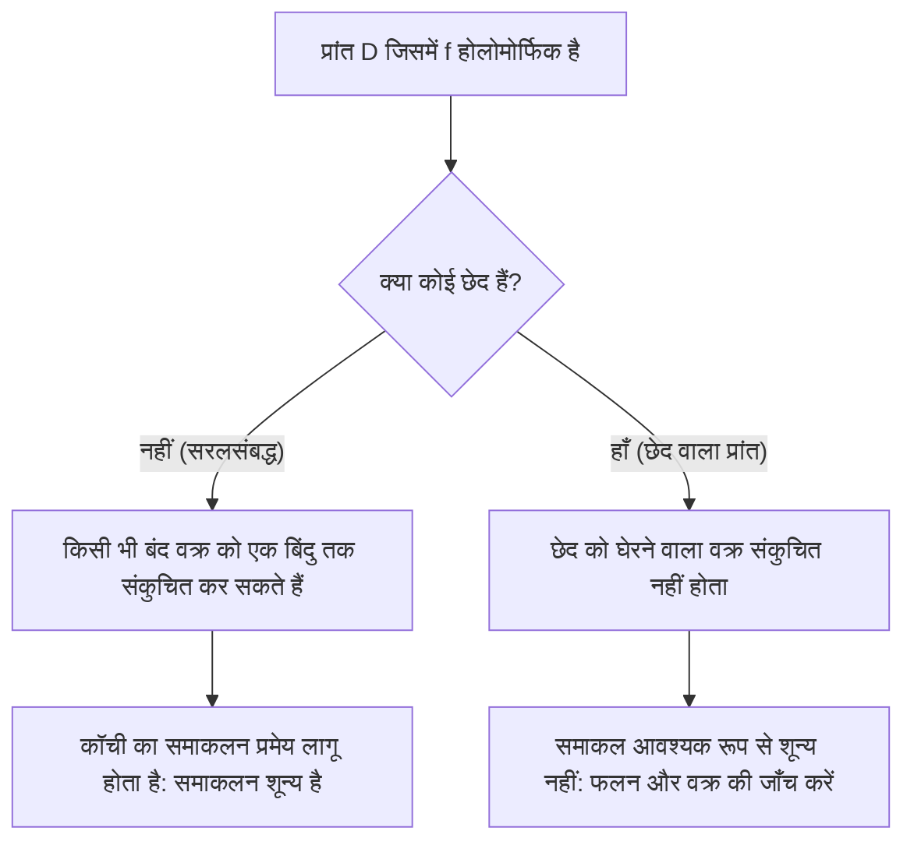

## 1. प्रस्तावना

गणित के उस क्षेत्र में जिसे सम्मिश्र विश्लेषण (complex analysis) के रूप में जाना जाता है, सबसे सुंदर और शक्तिशाली प्रमेयों में से एक **कॉची का समाकलन प्रमेय** ([Cauchy](https://kenji.blog/hi/p/cauchy/)'s integral theorem) है। यह प्रमेय उस बात की पुष्टि करता है जो पहली नज़र में एक अत्यधिक आश्चर्यजनक तथ्य प्रतीत होता है: "एक बंद समोच्च (closed contour) के साथ कुछ शर्तों को पूरा करने वाले एक सम्मिश्र फलन (complex function) का समाकलन करने पर हमेशा ठीक शून्य प्राप्त होगा।"

वास्तविक फलन का समाकल चिह्न सहित क्षेत्रफल या पथ के साथ संचय को दर्शा सकता है। सम्मिश्र विश्लेषण में होलोमोर्फिक फलनों के योगदानों में एक प्रबल निरसन-गुण होता है: यदि फलन सरलसंबद्ध (simply connected) प्रांत में होलोमोर्फिक है, तो उस प्रांत के भीतर खंडशः चिकने पथों पर उसका समाकल केवल आरंभिक और अंतिम बिंदुओं पर निर्भर करता है। छेद वाले प्रांत में केवल होलोमोर्फिक होना ऐसी वैश्विक पथ-स्वतंत्रता की गारंटी नहीं है।

इस लेख में, हम सम्मिश्र तल और होलोमोर्फिक फलनों की मूलभूत परिभाषाओं से शुरू करके, प्रमेय के सहज अर्थ, इसकी भौतिक व्याख्या, और ग्रीन के प्रमेय का उपयोग करके इसके शास्त्रीय प्रमाण की रूपरेखा तक, कॉची के समाकलन प्रमेय की विस्तार से व्याख्या करेंगे। इसके अलावा, हम इस बात पर भी चर्चा करेंगे कि यह प्रमेय सम्मिश्र विश्लेषण में अधिक उन्नत विषयों से कैसे जुड़ता है, जैसे कि कॉची का समाकलन सूत्र और [अवशेष प्रमेय](/hi/p/residue-theorem/)। आइए गणितीय कठोरता और सहज कल्पना दोनों के दृष्टिकोण से इस प्रमेय की गहन गहराई की सराहना करें।

## 2. सम्मिश्र तल और होलोमोर्फिक फलनों की नींव

कॉची के समाकलन प्रमेय को गहराई से समझने के लिए, हमें सबसे पहले सम्मिश्र तल की मूल बातों और सम्मिश्र फलनों के अवकलन के बारे में अपनी समझ को मजबूत करना चाहिए। यहाँ की समझ उन प्रमेयों के प्रमाणों और व्याख्याओं के लिए एक महत्वपूर्ण आधार बनाती है जो अनुसरण करते हैं।

### सम्मिश्र तल पर फलन

एक सम्मिश्र फलन $f(z)$ एक ऐसा फलन है जो एक सम्मिश्र संख्या $z = x + iy$ को दूसरी सम्मिश्र संख्या $w = u + iv$ पर मैप करता है। यहाँ, $x, y$ वास्तविक संख्याएँ हैं, $i$ काल्पनिक इकाई ($i^2 = -1$) है, और $u, v$ क्रमशः $x, y$ पर निर्भर करने वाले वास्तविक-मूल्यवान फलन हैं। इसलिए, एक सम्मिश्र फलन को दो वास्तविक चरों के दो वास्तविक-मूल्यवान फलनों के संयोजन के रूप में इस प्रकार दर्शाया जा सकता है:

$$
f(z) = u(x, y) + i v(x, y)
$$

उदाहरण के लिए, फलन $f(z) = z^2$ के लिए, $z = x + iy$ को प्रतिस्थापित करने और विस्तारित करने पर $z^2 = (x + iy)^2 = x^2 - y^2 + 2ixy$ मिलता है। इस प्रकार, इस मामले में, हम देख सकते हैं कि यह वास्तविक-मूल्यवान फलनों $u(x, y) = x^2 - y^2$ और $v(x, y) = 2xy$ से बना है।

### सम्मिश्र अवकलन और कॉची-रीमैन समीकरण

एक सम्मिश्र फलन $f(z)$ को एक बिंदु $z_0$ पर **अवकलनीय** (differentiable) कहा जाता है यदि निम्नलिखित सीमा मौजूद है:

$$
f'(z_0) = \lim_{\Delta z \to 0} \frac{f(z_0 + \Delta z) - f(z_0)}{\Delta z}
$$

मुख्य शर्त यह है कि $\Delta z$ सम्मिश्र तल में किसी भी तरीके से शून्य की ओर जाए, तो सीमा का मान समान हो। इसमें वक्र पथों से निकट जाना भी शामिल है, केवल सीधी रेखाओं की दिशाएँ नहीं। इस अर्थ में सम्मिश्र अवकलनीयता, वास्तविक अवकलनीयता से अधिक प्रबल शर्त है।

फलन $f(z)$ किसी प्रांत, अर्थात संबद्ध खुले समुच्चय, में **होलोमोर्फिक** कहलाता है यदि वह उस प्रांत के प्रत्येक बिंदु पर सम्मिश्र अर्थ में अवकलनीय हो। इससे वास्तविक भाग $u$ और काल्पनिक भाग $v$ के लिए निम्न आवश्यक शर्तें मिलती हैं, जिन्हें **कॉची–रीमैन समीकरण** कहते हैं:

$$
\frac{\partial u}{\partial x} = \frac{\partial v}{\partial y}, \quad \frac{\partial u}{\partial y} = -\frac{\partial v}{\partial x}
$$

इसके विपरीत, यदि $u,v$ के प्रथम कोटि के आंशिक अवकलज प्रांत में सतत हैं और वे हर बिंदु पर इन समीकरणों को संतुष्ट करते हैं, तो $f=u+iv$ होलोमोर्फिक है। उपयुक्त नियमितता की अतिरिक्त धारणा के बिना केवल समीकरणों कासंतुष्ट होना पर्याप्त नहीं माना जा सकता।

## 3. सम्मिश्र समाकलन की परिभाषा और गुण

इसके बाद, हम सम्मिश्र तल पर रेखा समाकलन (line integration) को परिभाषित करते हैं। चूँकि कॉची का समाकलन प्रमेय सम्मिश्र तल पर एक "वक्र" के साथ समाकलन के बारे में एक प्रमेय है, इसलिए इस समाकलन की परिभाषा को स्पष्ट करना आवश्यक है।

मान लें कि $C$ सम्मिश्र तल का खंडशः $C^1$ वक्र है, जिसका प्राचलीकरण $t\in[a,b]$ के लिए $z(t)=x(t)+iy(t)$ है। वक्र पर सतत फलन $f$ का रेखा समाकल नीचे दिया गया है; कई खंड होने पर प्रत्येक खंड का समाकल लेकर जोड़ते हैं:

$$
\int_C f(z) dz = \int_a^b f(z(t)) z'(t) dt
$$

यहाँ, $z'(t) = \frac{dx}{dt} + i \frac{dy}{dt}$, और औपचारिक प्रतिस्थापन $dz = dx + i dy$ करने से, गणना को अंततः वास्तविक चरों के समाकलन में कम किया जा सकता है।

सम्मिश्र समाकलन में वास्तविक फलनों के रेखा समाकलन के समान मूलभूत गुण होते हैं, जैसे:

1. **रैखिकता** (Linearity) : किन्हीं भी सम्मिश्र स्थिरांकों $\alpha, \beta$ के लिए, यह मानता है कि $\int_C (\alpha f(z) + \beta g(z)) dz = \alpha \int_C f(z) dz + \beta \int_C g(z) dz$।
2. **पथ का उलटाव** (Path Reversal) : यदि वक्र $C$ की दिशा (प्रारंभ बिंदु से अंत बिंदु तक प्रगति की दिशा) उलट जाती है और इसे $-C$ के रूप में दर्शाया जाता है, तो $\int_{-C} f(z) dz = -\int_C f(z) dz$। समाकलन पथ को उल्टे क्रम में चलाने से चिह्न उलट जाता है।
3. **पथों को विभाजित करना और जोड़ना** : जब एक वक्र $C$ को मध्यवर्ती बिंदु पर $C_1$ और $C_2$ में विभाजित किया जा सकता है, तो समग्र समाकलन को आंशिक समाकलनों के योग के रूप में व्यक्त किया जाता है। अर्थात, $\int_C f(z) dz = \int_{C_1} f(z) dz + \int_{C_2} f(z) dz$।

ये गुण, जो स्पष्ट रूप से स्पष्ट लगते हैं, बहुत शक्तिशाली उपकरण बन जाते हैं जब हम बाद में पथों को विभिन्न तरीकों से विकृत करके अपने तर्कों को आगे बढ़ाते हैं।

## 4. कॉची के समाकलन प्रमेय का निरूपण

अब जब हमारी तैयारियाँ पूरी हो गई हैं, तो हम अंततः मुख्य विषय, कॉची के समाकलन प्रमेय के सटीक निरूपण का उल्लेख करते हैं।

**प्रमेय (कॉची का समाकलन प्रमेय)**
मान लें कि $D$ एक सरलसंबद्ध प्रांत है और $f$ उसमें होलोमोर्फिक है। तब $D$ के भीतर स्थित किसी भी खंडशः $C^1$ बंद वक्र $C$ के लिए निम्न समानता सत्य है। वक्र स्वयं को काट सकता है।

$$
\oint_C f(z) dz = 0
$$

आइए हम इसे कुछ महत्वपूर्ण शब्दावली के साथ पूरक करें जो प्रमेय की पूर्व-आवश्यक शर्तों के रूप में दिखाई देते हैं।

- **सरलसंबद्ध प्रांत** (Simply connected domain): सहज रूप से यह बिना छेद वाला प्रांत है। अधिक सटीक रूप में, इसके भीतर किसी भी बंद वक्र को प्रांत से बाहर निकले बिना सतत रूप से एक बिंदु तक संकुचित किया जा सकता है।
- **खंडशः $C^1$ बंद वक्र**: आरंभिक और अंतिम बिंदु समान होते हैं और वक्र सतत प्रथम अवकलज वाले सीमित संख्या के खंडों से बना होता है। ऊपर के प्रमेय में वक्र का सरल होना आवश्यक नहीं है। सरल बंद वक्र स्वयं को नहीं काटता और तल को अंदर तथा बाहर के भागों में बाँटता है; ग्रीन के प्रमेय वाले प्रमाण में हम इसी प्रकार का वक्र लेंगे।

नीचे का आरेख सरलसंबद्ध प्रांत और छेद वाले प्रांत में बंद वक्रों के व्यवहार की तुलना करता है।

## 5. प्रमेय की सहज समझ और भौतिक व्याख्या

प्रमेय की धारणाओं के अंतर्गत समाकल शून्य क्यों होता है? सहज समझ के लिए इसे वास्तविक और काल्पनिक भागों में बाँटते हैं। इस व्याख्या में $u,v$ को $C^1$ वर्ग का मानते हैं और वक्र को सरलसंबद्ध प्रांत के भीतर लेते हैं।

मान लीजिए कि $f(z) = u + iv$ और $dz = dx + i dy$ है। समाकलन को तब निम्नानुसार विस्तारित किया जा सकता है:

$$
\oint_C f(z) dz = \oint_C (u + iv)(dx + idy) = \oint_C (u dx - v dy) + i \oint_C (v dx + u dy)
$$

इस समीकरण के दाहिने भाग पर ध्यान दें। दो वास्तविक समाकलन प्रकट हुए हैं, और उनका बिल्कुल वही रूप है जो 2D तल पर सदिश क्षेत्रों (vector fields) के रेखा समाकलनों का होता है। विशेष रूप से, वास्तविक भाग की व्याख्या एक सदिश क्षेत्र $\vec{F}_1 = (u, -v)$ के रेखा समाकलन के रूप में की जा सकती है, और काल्पनिक भाग की व्याख्या एक सदिश क्षेत्र $\vec{F}_2 = (v, u)$ के रेखा समाकलन के रूप में की जा सकती है।

भौतिकी में बंद वक्र पर सदिश क्षेत्र का रेखा समाकल उसका परिसंचरण कहलाता है। सरलसंबद्ध प्रांत में सतत अवकलनीय क्षेत्र का कर्ल (curl) शून्य हो, तो प्रत्येक खंडशः $C^1$ बंद वक्र पर परिसंचरण शून्य होता है। छेद वाले प्रांत में केवल स्थानीय रूप से कर्ल शून्य होना इस वैश्विक निष्कर्ष के लिए पर्याप्त नहीं है।

सदिश क्षेत्रों $\vec{F}_1=(u,-v)$ और $\vec{F}_2=(v,u)$ के अदिश कर्ल क्रमशः $-v_x-u_y$ और $u_x-v_y$ हैं। कॉची–रीमैन समीकरण $u_y=-v_x$ पहले को और $u_x=v_y$ दूसरे को शून्य करता है। इन्हीं समीकरणों से अपसरण (divergence) भी शून्य मिलता है: $\operatorname{div}\vec{F}_1=u_x-v_y=0$ और $\operatorname{div}\vec{F}_2=v_x+u_y=0$।

इस प्रकार होलोमोर्फिकता से दो ऐसे क्षेत्र मिलते हैं जिनके कर्ल और अपसरण दोनों शून्य हैं। परिसंचरण के तर्क में मुख्य बातें कर्ल का शून्य होना और प्रांत की सरलसंबद्धता हैं; अपसरण का शून्य होना एक अलग गुण है। यह भेद समाकल में योगदानों के निरसन को समझाता है।

## 6. ग्रीन के प्रमेय का उपयोग करते हुए कठोर प्रमाण की रूपरेखा

इस शास्त्रीय प्रमाण में अतिरिक्त धारणा रखते हैं कि $u,v$ के प्रथम कोटि के आंशिक अवकलज ऐसे खुले समुच्चय में सतत हैं जो वक्र $C$ और उसके आंतरिक भाग $D'$ को समाहित करता है। $C$ सरल बंद खंडशः $C^1$ वक्र है और उसका अभिविन्यास धनात्मक, अर्थात वामावर्त (घड़ी की सुइयों की दिशा के विपरीत), है। नीचे की गणना इसी स्थिति का प्रमाण देती है; सामान्य बंद वक्रों तक विस्तार के लिए एक अतिरिक्त चरण चाहिए।

ग्रीन का प्रमेय $C=\partial D'$ पर रेखा समाकल को आंतरिक भाग $D'$ के द्विसमाकल में बदलता है। नीचे के कथन में $P,Q$ के प्रथम कोटि के आंशिक अवकलज $D'$ के संवरण को समाहित करने वाले खुले प्रतिवेश में सतत हैं और सीमा का अभिविन्यास धनात्मक है।

**ग्रीन का प्रमेय**
$$
\oint_{\partial D'} (P dx + Q dy) = \iint_{D'} \left( \frac{\partial Q}{\partial x} - \frac{\partial P}{\partial y} \right) dx dy
$$

आइए इस ग्रीन के प्रमेय को पहले वाले विघटित सम्मिश्र समाकलन के वास्तविक भाग पर लागू करें। यहाँ हम $P = u, Q = -v$ मानते हैं।

$$
\oint_C (u dx - v dy) = \iint_{D'} \left( \frac{\partial (-v)}{\partial x} - \frac{\partial u}{\partial y} \right) dx dy
$$

अब, हम कॉची-रीमैन समीकरण $\frac{\partial u}{\partial y} = -\frac{\partial v}{\partial x}$ को प्रतिस्थापित करते हैं, जो होलोमोर्फिक फलनों का एक गुण है। फिर, समाकल्य (integrand) निम्नानुसार हो जाता है:

$$
-\frac{\partial v}{\partial x} - \left( -\frac{\partial v}{\partial x} \right) = 0
$$

चूँकि समाकल्य प्रांत के भीतर सभी बिंदुओं पर $0$ हो जाता है, संपूर्ण दोहरा समाकलन शून्य हो जाता है, जिससे यह सिद्ध होता है कि वास्तविक भाग का रेखा समाकलन शून्य है।

बिल्कुल समान प्रक्रिया के माध्यम से, हम ग्रीन के प्रमेय को काल्पनिक भाग $i \oint_C (v dx + u dy)$ पर लागू करते हैं। यहाँ $P = v, Q = u$ है।

$$
\oint_C (v dx + u dy) = \iint_{D'} \left( \frac{\partial u}{\partial x} - \frac{\partial v}{\partial y} \right) dx dy
$$

फिर से, दूसरे कॉची-रीमैन समीकरण $\frac{\partial u}{\partial x} = \frac{\partial v}{\partial y}$ को प्रतिस्थापित करने पर, समाकल्य $\frac{\partial v}{\partial y} - \frac{\partial v}{\partial y} = 0$ हो जाता है, और काल्पनिक भाग का समाकलन भी शून्य हो जाता है।

निष्कर्ष में, चूँकि वास्तविक और काल्पनिक दोनों भाग शून्य हो जाते हैं, निम्नलिखित सत्य है:

$$
\oint_C f(z) dz = 0 + i0 = 0
$$

यह कॉची के समाकलन प्रमेय के प्रमाण का कंकाल है। हम देख सकते हैं कि कॉची-रीमैन समीकरणों और ग्रीन के प्रमेय के खूबसूरती से एक साथ जुड़ने से, प्रमाण आश्चर्यजनक रूप से सरलता से पूरा किया जा सकता है।

## 7. गूर्सा का प्रमेय: सतत अवकलनीयता की अतिरिक्त धारणा हटाना

ऊपर के प्रमाण में ग्रीन का प्रमेय लगाने के लिए $u,v$ के प्रथम कोटि के आंशिक अवकलजों की सततता स्पष्ट रूप से मानी गई है। गूर्सा (Édouard Goursat) का प्रमेय बताता है कि इस सततता को अलग से मानने की आवश्यकता नहीं है।

मुख्य धारणा यह है कि $f$ किसी प्रांत के प्रत्येक बिंदु पर सम्मिश्र अर्थ में अवकलनीय हो। $f'$ की सततता की अलग धारणा आवश्यक नहीं है। प्रांत और वक्र की उपयुक्त शर्तों के साथ इसे कॉची–गूर्सा प्रमेय कहा जाता है।

एक आधुनिक प्रमाण-विधि में त्रिभुजों को बार-बार छोटे त्रिभुजों में विभाजित करके उनकी सीमाओं पर समाकलों का आकलन किया जाता है। प्रांत के प्रत्येक बिंदु पर सम्मिश्र अवकलनीयता का अर्थ होलोमोर्फिकता है और इससे हर कोटि के अवकलजों का अस्तित्व निकलता है। केवल एक बिंदु पर अवकलनीय होना पर्याप्त नहीं है। उदाहरण के लिए, $f(z)=|z|^2$ बिंदु $0$ पर सम्मिश्र अर्थ में अवकलनीय है, लेकिन $0$ के किसी भी प्रतिवेश में होलोमोर्फिक नहीं है।

## 8. पथ विरूपण और पथ स्वतंत्रता

कॉची के समाकलन प्रमेय के अत्यंत महत्वपूर्ण परिणामों में से एक **समाकलनों की पथ स्वतंत्रता** (path independence of integrals) है।

मान लें कि $A,B$ सरलसंबद्ध प्रांत $D$ के दो बिंदु हैं और $C_1,C_2$, $D$ के भीतर $A$ से $B$ तक जाने वाले खंडशः $C^1$ पथ हैं। यदि $f$, $D$ में होलोमोर्फिक है, तो:

$$
\int_{C_1} f(z) dz = \int_{C_2} f(z) dz
$$

प्रमाण बहुत सरल है। एक ऐसे पथ पर विचार करें जो $C_1$ के माध्यम से $B$ तक जाता है, और विपरीत पथ $-C_2$ के माध्यम से $A$ पर लौटता है। यह एक एकल बंद वक्र $C = C_1 + (-C_2)$ बनाता है। कॉची के समाकलन प्रमेय के अनुसार, इस बंद वक्र के साथ समाकलन शून्य है।

$$
\oint_C f(z) dz = \int_{C_1} f(z) dz + \int_{-C_2} f(z) dz = \int_{C_1} f(z) dz - \int_{C_2} f(z) dz = 0
$$

इसे पक्षांतरित करके, हम $\int_{C_1} f(z) dz = \int_{C_2} f(z) dz$ प्राप्त करते हैं।

इन धारणाओं के अंतर्गत समाकल केवल आरंभिक और अंतिम बिंदुओं पर निर्भर करता है। एक आधार-बिंदु तय करके $D$ पर प्रतिअवकलज $F$ परिभाषित कर सकते हैं। वह एक योगात्मक स्थिरांक के अंतर तक अद्वितीय है और $F'=f$ को संतुष्ट करता है। यह कलन के मूल प्रमेय का सम्मिश्र रूप है।

## 9. अनुप्रयोग: कॉची का समाकलन सूत्र और छेद वाले प्रांत

कॉची का समाकलन प्रमेय अपने आप में एक सुंदर प्रमेय है, लेकिन यह सम्मिश्र विश्लेषण में अन्य महत्वपूर्ण प्रमेयों को क्रमिक रूप से प्राप्त करने के लिए एक शक्तिशाली आधार के रूप में कार्य करता है।

### कॉची का समाकलन सूत्र

एक महत्वपूर्ण परिणाम **कॉची का समाकलन सूत्र** है। मान लें कि $C$ एक सरल बंद खंडशः $C^1$ वक्र है, जिसका अभिविन्यास धनात्मक (वामावर्त) है। यदि $f$ ऐसे खुले समुच्चय में होलोमोर्फिक है जो $C$ और उसके आंतरिक भाग को समाहित करता है, और $a$ वक्र $C$ के भीतर है, तो:

$$
f(a) = \frac{1}{2\pi i} \oint_C \frac{f(z)}{z - a} dz
$$

यह सूत्र होलोमोर्फिक फलनों के मानों की प्रबल निर्धारितता दिखाता है: वक्र $C$ पर फलन के मान जानने से $C$ के भीतर प्रत्येक बिंदु पर उसका मान निर्धारित होता है। केवल इस सूत्र से वक्र के बाहर के मान सीधे निर्धारित नहीं होते।

### छेद वाले प्रांत और अवशेष प्रमेय

छेद वाले प्रांत में सरलसंबद्ध प्रांतों वाला प्रमेय सीधे नहीं लगाया जा सकता; फलन और वक्र की जाँच आवश्यक है। उदाहरण के लिए, $f(z)=1/z$ बिंदु $0$ के बाहर होलोमोर्फिक है, लेकिन मूल बिंदु पर केंद्रित इकाई वृत्त को वामावर्त घूमते हुए लिया गया उसका समाकल $2\pi i$ है। इसके विपरीत, उसी वक्र पर $1/z^2$ का समाकल $0$ है। छेद होने से समाकल का अशून्य होना अनिवार्य नहीं है।

पथ-विरूपण और कॉची का समाकलन प्रमेय छेदों के चारों ओर समाकलों की गणना के व्यवस्थित तरीके देते हैं। इससे **[अवशेष प्रमेय](/hi/p/residue-theorem/)** मिलता है, जो सम्मिश्र विश्लेषण का महत्वपूर्ण उपकरण है। उपयुक्त धारणाओं के अंतर्गत इससे वास्तविक फलनों के कुछ निश्चित तथा अनुचित समाकलों (improper integrals) की गणना सम्मिश्र तल के अवशेषों के माध्यम से की जा सकती है।

## 10. निष्कर्ष

पहली नज़र में, कॉची का समाकलन प्रमेय एक मामूली प्रमेय की तरह लग सकता है जो केवल यह कहता है कि "समाकलन शून्य हो जाता है।" हालाँकि, इसके पीछे सम्मिश्र फलनों के "होलोमॉर्फी" की प्रतीत होने वाली सरल स्थिति से लाई गई एक गहरी और सुंदर समरूपता छिपी हुई है।

कॉची का समाकलन प्रमेय समाकलन सूत्र, हर कोटि के अवकलजों के अस्तित्व, स्थानीय टेलर श्रेणियों, उपयुक्त वलयाकार प्रांतों में लॉरेंट श्रेणियों और अवशेष प्रमेय का आधार है। ये परिणाम मिलकर सम्मिश्र विश्लेषण की नींव बनाते हैं।

हम पाठकों को प्रोत्साहित करते हैं कि वे एक कागज और पेन लें और ग्रीन के प्रमेय का उपयोग करके प्रमाण को अपने हाथों से ट्रेस करें। तब आप निश्चित रूप से सम्मिश्र तल की उस खूबसूरती से सामंजस्यपूर्ण दुनिया को महसूस कर पाएंगे जो गणितीय सूत्रों के पीछे फैली हुई है।

## संदर्भ

- [MIT 18.04: Complex integration and Cauchy theory](https://ocw.mit.edu/courses/18-04-complex-variables-with-applications-spring-2018/1968cab6de7c96ead1c83001459a007b_MIT18_04S18_topic3.pdf)
- [MIT 18.112: Cauchy theorem and integral formula](https://ocw.mit.edu/courses/18-112-functions-of-a-complex-variable-fall-2008/8793d412fa0da2a4183539f5d8f7e3fd_lecture13.pdf)
- [NIST DLMF §1.9: Calculus of a Complex Variable](https://dlmf.nist.gov/1.9)
