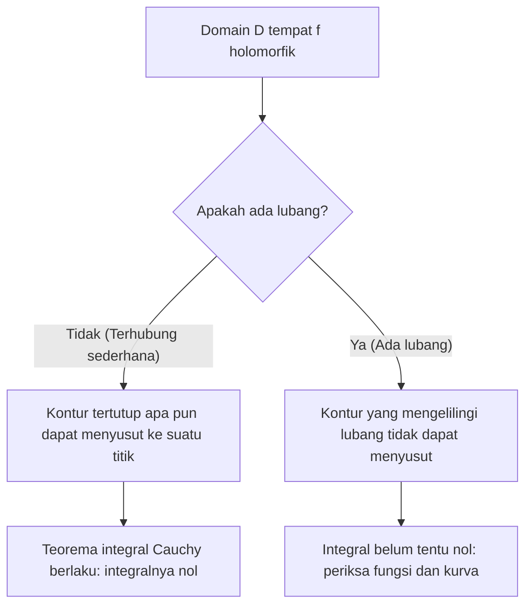

## 1. Pengantar

Di bidang matematika yang dikenal sebagai analisis kompleks, salah satu teorema yang paling indah dan kuat adalah **Teorema integral [Cauchy](https://kenji.blog/id/p/cauchy/)**. Teorema ini menegaskan apa yang pada pandangan pertama tampaknya merupakan fakta yang sangat mengejutkan: "Mengintegralkan fungsi kompleks yang memenuhi kondisi tertentu di sepanjang kontur tertutup akan selalu menghasilkan tepat nol."

Integral fungsi real dapat menyatakan luas bertanda atau akumulasi sepanjang lintasan. Dalam analisis kompleks, fungsi holomorfik memiliki sifat saling meniadakan yang kuat: jika suatu fungsi holomorfik pada domain terhubung sederhana, integralnya sepanjang lintasan mulus sepotong-sepotong dalam domain itu hanya bergantung pada titik awal dan akhir. Holomorfisitas saja tidak menjamin ketakbergantungan lintasan secara global pada domain yang berlubang.

Dalam artikel ini, kami akan menjelaskan teorema integral [Cauchy](https://kenji.blog/id/p/cauchy/) dengan sangat rinci, mulai dari definisi dasar bidang kompleks dan fungsi holomorfik, beranjak pada makna intuitif dari teorema, interpretasi fisiknya, dan sketsa pembuktian klasiknya menggunakan teorema Green. Lebih jauh lagi, kami akan menyentuh bagaimana teorema ini terhubung dengan topik yang lebih maju dalam analisis kompleks, seperti rumus integral Cauchy dan [Teorema Residu](https://kenji.blog/id/p/residue-theorem/). Mari kita hargai kedalaman mendalam dari teorema ini baik dari perspektif ketelitian matematika maupun gambaran intuitif.

## 2. Fondasi Bidang Kompleks dan Fungsi Holomorfik

Untuk memahami secara mendalam teorema integral [Cauchy](https://kenji.blog/id/p/cauchy/), pertama-tama kita harus memantapkan pemahaman kita tentang dasar-dasar bidang kompleks dan diferensiasi fungsi kompleks. Pemahaman di sini membentuk dasar yang penting untuk pembuktian dan interpretasi teorema yang mengikutinya.

### Fungsi pada Bidang Kompleks

Fungsi kompleks $f(z)$ adalah fungsi yang memetakan bilangan kompleks $z = x + iy$ ke bilangan kompleks lain $w = u + iv$. Di sini, $x, y$ adalah bilangan real, $i$ adalah unit imajiner ($i^2 = -1$), dan $u, v$ adalah fungsi bernilai real yang masing-masing bergantung pada $x, y$. Oleh karena itu, fungsi kompleks dapat direpresentasikan sebagai kombinasi dari dua fungsi bernilai real dari dua variabel real sebagai berikut:

$$
f(z) = u(x, y) + i v(x, y)
$$

Misalnya, untuk fungsi $f(z) = z^2$, mensubstitusi $z = x + iy$ dan memperluasnya memberikan $z^2 = (x + iy)^2 = x^2 - y^2 + 2ixy$. Jadi, dalam hal ini, kita dapat melihat bahwa ia terdiri dari fungsi bernilai real $u(x, y) = x^2 - y^2$ dan $v(x, y) = 2xy$.

### Diferensiasi Kompleks dan Persamaan [Cauchy](https://kenji.blog/id/p/cauchy/)-[Riemann](https://kenji.blog/id/p/riemann/)

Fungsi kompleks $f(z)$ dikatakan **terdiferensialkan secara kompleks** di titik $z_0$ jika limit berikut ada:

$$
f'(z_0) = \lim_{\Delta z \to 0} \frac{f(z_0 + \Delta z) - f(z_0)}{\Delta z}
$$

Syarat pentingnya adalah limit tersebut harus sama untuk setiap cara $\Delta z$ mendekati nol dalam bidang kompleks. Ini mencakup pendekatan melalui lintasan melengkung, bukan hanya dari berbagai arah garis lurus. Karena itu, diferensiabilitas kompleks lebih kuat daripada diferensiabilitas real.

Fungsi $f(z)$ disebut **holomorfik** pada suatu domain terbuka jika terdiferensialkan secara kompleks di setiap titik domain tersebut. Holomorfisitas mengharuskan bagian real $u$ dan bagian imajiner $v$ memenuhi syarat perlu berikut, yang disebut **persamaan Cauchy–Riemann**:

$$
\frac{\partial u}{\partial x} = \frac{\partial v}{\partial y}, \quad \frac{\partial u}{\partial y} = -\frac{\partial v}{\partial x}
$$

Sebaliknya, jika $u,v$ memiliki turunan parsial pertama yang kontinu pada suatu domain terbuka dan memenuhi persamaan tersebut di seluruh domain, maka $f=u+iv$ holomorfik. Tanpa asumsi keteraturan yang sesuai, persamaan itu saja bukan syarat cukup yang berlaku tanpa pembatasan.

## 3. Definisi dan Sifat Integrasi Kompleks

Selanjutnya, kita mendefinisikan integrasi garis pada bidang kompleks. Karena teorema integral [Cauchy](https://kenji.blog/id/p/cauchy/) adalah teorema tentang integrasi di sepanjang "kurva" pada bidang kompleks, sangat penting untuk memperjelas definisi integrasi ini.

Misalkan $C$ adalah kurva mulus sepotong-sepotong dalam bidang kompleks, dengan parameter $z(t)=x(t)+iy(t)$ untuk $t\in[a,b]$. Untuk fungsi $f$ yang kontinu sepanjang kurva, integral garisnya didefinisikan sebagai berikut; jika ada beberapa potongan, integral tiap potongan dijumlahkan:

$$
\int_C f(z) dz = \int_a^b f(z(t)) z'(t) dt
$$

Di sini, $z'(t) = \frac{dx}{dt} + i \frac{dy}{dt}$, dan dengan melakukan substitusi formal $dz = dx + i dy$, perhitungan pada akhirnya dapat direduksi menjadi integrasi variabel real.

Integrasi kompleks memiliki sifat dasar yang mirip dengan integrasi garis fungsi real, seperti:

1. **Linearitas** : Untuk konstanta kompleks apa pun $\alpha, \beta$, berlaku bahwa $\int_C (\alpha f(z) + \beta g(z)) dz = \alpha \int_C f(z) dz + \beta \int_C g(z) dz$.
2. **Pembalikan Jalur** : Jika arah kurva $C$ (arah kemajuan dari titik awal ke titik akhir) dibalik dan dilambangkan sebagai $-C$, maka $\int_{-C} f(z) dz = -\int_C f(z) dz$. Menjalankan jalur integrasi secara terbalik membalikkan tanda.
3. **Pemisahan dan Penggabungan Jalur** : Ketika kurva $C$ dapat dibagi pada titik tengah menjadi $C_1$ dan $C_2$, integral keseluruhan dinyatakan sebagai jumlah integral parsial. Yaitu, $\int_C f(z) dz = \int_{C_1} f(z) dz + \int_{C_2} f(z) dz$.

Sifat-sifat ini, meskipun tampaknya jelas, menjadi alat yang sangat kuat ketika kita kemudian memajukan argumen kita dengan mendistorsi jalur dengan berbagai cara.

## 4. Formulasi Teorema Integral [Cauchy](https://kenji.blog/id/p/cauchy/)

Sekarang setelah persiapan kita selesai, kita akhirnya menyatakan formulasi yang tepat dari subjek utama, teorema integral [Cauchy](https://kenji.blog/id/p/cauchy/).

**Teorema (Teorema Integral [Cauchy](https://kenji.blog/id/p/cauchy/))**
Misalkan $D$ adalah domain terbuka yang terhubung sederhana dan $f$ holomorfik pada $D$. Untuk setiap kurva tertutup $C$ yang mulus sepotong-sepotong dan terletak dalam $D$, bahkan jika kurva itu berpotongan dengan dirinya sendiri, berlaku:

$$
\oint_C f(z) dz = 0
$$

Mari kita lengkapi ini dengan beberapa terminologi penting yang muncul sebagai kondisi prasyarat dari teorema tersebut.

- **Domain terhubung sederhana**: Secara intuitif, domain ini tidak memiliki lubang. Lebih tepatnya, setiap kurva tertutup di dalamnya dapat dideformasi secara kontinu menjadi satu titik tanpa keluar dari domain.
- **Kurva tertutup yang mulus sepotong-sepotong**: Titik awal dan akhirnya sama, dan kurva terdiri atas sejumlah berhingga potongan mulus. Teorema di atas tidak mensyaratkan kurva sederhana. Kurva tertutup sederhana tidak berpotongan dengan dirinya sendiri dan membagi bidang menjadi bagian dalam dan luar; kurva jenis ini digunakan dalam pembuktian dengan teorema Green di bawah.

Diagram berikut membandingkan kurva tertutup dalam domain terhubung sederhana dan dalam domain berlubang.

## 5. Pemahaman Intuitif dan Interpretasi Fisik dari Teorema

Mengapa integralnya nol di bawah asumsi teorema ini? Untuk membangun intuisi, mari kita pisahkan integral menjadi bagian real dan imajiner. Dalam penafsiran ini, kita mengasumsikan $u,v$ berkelas $C^1$ dan kurva berada dalam domain terhubung sederhana.

Misalkan $f(z)=u+iv$ dan $dz=dx+i\,dy$. Integral dapat diuraikan sebagai berikut:

$$
\oint_C f(z) dz = \oint_C (u + iv)(dx + idy) = \oint_C (u dx - v dy) + i \oint_C (v dx + u dy)
$$

Perhatikan sisi kanan persamaan ini. Dua integral real telah muncul, dan mereka memiliki bentuk yang sama persis dengan integral garis dari medan vektor pada bidang 2D. Secara khusus, bagian real dapat diinterpretasikan sebagai integral garis dari medan vektor $\vec{F}_1 = (u, -v)$, dan bagian imajiner sebagai integral garis dari medan vektor $\vec{F}_2 = (v, u)$.

Dalam fisika, integral garis medan vektor sepanjang kurva tertutup menyatakan sirkulasinya. Untuk medan yang terdiferensialkan secara kontinu pada domain terhubung sederhana, curl nol mengakibatkan sirkulasi nol sepanjang setiap kurva tertutup yang mulus sepotong-sepotong. Pada domain berlubang, kondisi lokal curl nol saja tidak cukup untuk menyimpulkan semua sirkulasi bernilai nol.

Curl skalar dari $\vec{F}_1=(u,-v)$ dan $\vec{F}_2=(v,u)$ masing-masing adalah $-v_x-u_y$ dan $u_x-v_y$. Persamaan Cauchy–Riemann $u_y=-v_x$ meniadakan yang pertama, sedangkan $u_x=v_y$ meniadakan yang kedua. Persamaan yang sama juga memberikan divergensi nol: $\operatorname{div}\vec{F}_1=u_x-v_y=0$ dan $\operatorname{div}\vec{F}_2=v_x+u_y=0$.

Jadi holomorfisitas menghasilkan dua medan yang curl dan divergensinya nol. Untuk argumen tentang sirkulasi, yang menentukan adalah curl nol bersama asumsi tentang domain; divergensi nol merupakan sifat yang berbeda. Pembedaan ini menjelaskan mekanisme saling meniadakan dalam teorema integral Cauchy.

## 6. Sketsa Pembuktian Ketat Menggunakan Teorema Green

Untuk pembuktian klasik ini, kita menambahkan asumsi bahwa $u,v$ memiliki turunan parsial pertama yang kontinu pada himpunan terbuka yang memuat kurva $C$ beserta bagian dalamnya $D'$. Kurva $C$ tertutup sederhana, mulus sepotong-sepotong, dan berorientasi positif, yaitu berlawanan arah jarum jam. Perhitungan berikut membuktikan kasus tersebut; perlu langkah tambahan untuk memperluasnya ke kurva tertutup umum.

Teorema Green mengubah integral garis pada $C=\partial D'$ menjadi integral ganda pada bagian dalam $D'$. Dalam pernyataan berikut, $P,Q$ memiliki turunan parsial pertama yang kontinu pada lingkungan terbuka dari penutupan $D'$, dan batasnya berorientasi positif.

**Teorema Green**
$$
\oint_{\partial D'} (P dx + Q dy) = \iint_{D'} \left( \frac{\partial Q}{\partial x} - \frac{\partial P}{\partial y} \right) dx dy
$$

Mari kita terapkan teorema Green ini pada bagian real dari integral kompleks yang telah diuraikan sebelumnya. Di sini kita membiarkan $P = u, Q = -v$.

$$
\oint_C (u dx - v dy) = \iint_{D'} \left( \frac{\partial (-v)}{\partial x} - \frac{\partial u}{\partial y} \right) dx dy
$$

Sekarang, kita mensubstitusikan persamaan [Cauchy](https://kenji.blog/id/p/cauchy/)-[Riemann](https://kenji.blog/id/p/riemann/) $\frac{\partial u}{\partial y} = -\frac{\partial v}{\partial x}$, yang merupakan sifat fungsi holomorfik. Kemudian, integrand menjadi sebagai berikut:

$$
-\frac{\partial v}{\partial x} - \left( -\frac{\partial v}{\partial x} \right) = 0
$$

Karena integrand menjadi $0$ pada semua titik di dalam domain, seluruh integral ganda menjadi nol, membuktikan bahwa integral garis bagian real adalah nol.

Melalui prosedur yang sepenuhnya sama, kita menerapkan teorema Green pada bagian imajiner $i \oint_C (v dx + u dy)$. Di sini $P = v, Q = u$.

$$
\oint_C (v dx + u dy) = \iint_{D'} \left( \frac{\partial u}{\partial x} - \frac{\partial v}{\partial y} \right) dx dy
$$

Sekali lagi, dengan mensubstitusi persamaan [Cauchy](https://kenji.blog/id/p/cauchy/)-[Riemann](https://kenji.blog/id/p/riemann/) lainnya $\frac{\partial u}{\partial x} = \frac{\partial v}{\partial y}$, integrand menjadi $\frac{\partial v}{\partial y} - \frac{\partial v}{\partial y} = 0$, dan integral bagian imajiner juga menjadi nol.

Kesimpulannya, karena bagian real maupun imajinernya menjadi nol, hal berikut berlaku:

$$
\oint_C f(z) dz = 0 + i0 = 0
$$

Ini adalah kerangka pembuktian untuk teorema integral [Cauchy](https://kenji.blog/id/p/cauchy/). Kita dapat melihat bahwa melalui persamaan Cauchy-[Riemann](https://kenji.blog/id/p/riemann/) dan teorema Green yang menyatu dengan indah, pembuktian dapat diselesaikan secara mengejutkan sederhana.

## 7. Teorema Goursat: Menghapus Asumsi Diferensiabilitas Kontinu

Pembuktian di atas secara eksplisit mengasumsikan kontinuitas turunan parsial pertama $u,v$ agar teorema Green dapat digunakan. Teorema Goursat menghilangkan kebutuhan untuk mengasumsikan kontinuitas ini secara terpisah.

Asumsi utamanya adalah $f$ terdiferensialkan secara kompleks di setiap titik suatu domain terbuka. Tidak diperlukan asumsi tambahan bahwa $f'$ kontinu. Dengan syarat yang sesuai pada domain dan kurva, diperoleh hasil yang dikenal sebagai teorema Cauchy–Goursat.

Salah satu pembuktian modern membagi segitiga secara berulang menjadi segitiga yang lebih kecil dan mengestimasi integral pada batas-batasnya. Diferensiabilitas kompleks di setiap titik suatu domain terbuka berarti holomorfisitas dan selanjutnya menjamin turunan dari setiap orde. Diferensiabilitas hanya di satu titik tidak cukup. Misalnya, $f(z)=|z|^2$ terdiferensialkan secara kompleks di $0$, tetapi tidak holomorfik pada lingkungan mana pun dari $0$.

## 8. Deformasi Jalur dan Independensi Jalur

Salah satu konsekuensi yang sangat penting dari teorema integral [Cauchy](https://kenji.blog/id/p/cauchy/) adalah **independensi jalur dari integral**.

Misalkan $A,B$ berada dalam domain terbuka terhubung sederhana $D$, dan $C_1,C_2$ adalah dua lintasan mulus sepotong-sepotong dalam $D$ dari $A$ ke $B$. Jika $f$ holomorfik pada $D$, maka:

$$
\int_{C_1} f(z) dz = \int_{C_2} f(z) dz
$$

Pembuktiannya sangat sederhana. Perhatikan suatu jalur yang menuju ke $B$ via $C_1$, dan kembali ke $A$ via jalur sebaliknya $-C_2$. Ini membentuk satu kurva tertutup $C = C_1 + (-C_2)$. Berdasarkan teorema integral [Cauchy](https://kenji.blog/id/p/cauchy/), integral sepanjang kurva tertutup ini adalah nol.

$$
\oint_C f(z) dz = \int_{C_1} f(z) dz + \int_{-C_2} f(z) dz = \int_{C_1} f(z) dz - \int_{C_2} f(z) dz = 0
$$

Dengan mentransposisi ini, kita mendapatkan $\int_{C_1} f(z) dz = \int_{C_2} f(z) dz$.

Di bawah asumsi tersebut, integral hanya bergantung pada titik awal dan akhir. Dengan menetapkan titik pangkal, kita dapat mendefinisikan antiturunan $F$ pada $D$, unik hingga penambahan konstanta, dengan $F'=f$. Inilah versi kompleks dari teorema dasar kalkulus.

## 9. Aplikasi: rumus integral Cauchy dan perluasan ke domain berlubang

Teorema integral [Cauchy](https://kenji.blog/id/p/cauchy/) adalah teorema yang indah dengan sendirinya, tetapi ini berfungsi sebagai fondasi yang kuat untuk secara berurutan menurunkan teorema-teorema penting lainnya dalam analisis kompleks.

### Rumus Integral [Cauchy](https://kenji.blog/id/p/cauchy/)

Salah satu konsekuensi penting adalah **rumus integral Cauchy**. Misalkan $C$ adalah kurva tertutup sederhana, mulus sepotong-sepotong, dan berorientasi positif (berlawanan arah jarum jam). Jika $f$ holomorfik pada himpunan terbuka yang memuat $C$ beserta bagian dalamnya, dan $a$ berada di dalam $C$, maka:

$$
f(a) = \frac{1}{2\pi i} \oint_C \frac{f(z)}{z - a} dz
$$

Rumus ini menunjukkan kuatnya penentuan nilai fungsi holomorfik: nilai-nilai $f$ pada kontur $C$ menentukan nilai di setiap titik di dalam $C$. Rumus tersebut, dengan sendirinya, tidak langsung menentukan nilai di luar kurva itu.

### Domain berlubang dan teorema residu

Pada domain berlubang, versi teorema untuk domain terhubung sederhana tidak dapat langsung diterapkan; fungsi dan kurvanya perlu diperiksa. Sebagai contoh, $f(z)=1/z$ holomorfik di luar $0$, tetapi integralnya pada lingkaran satuan berpusat di titik asal dan berorientasi berlawanan arah jarum jam adalah $2\pi i$. Sebaliknya, integral $1/z^2$ pada kurva yang sama adalah $0$. Adanya lubang tidak memaksa integral bernilai bukan nol.

Deformasi lintasan dan teorema integral Cauchy memungkinkan metode sistematis untuk menghitung integral di sekitar lubang. Hal ini mengarah pada **[teorema residu](/id/p/residue-theorem/)**, alat penting dalam analisis kompleks. Dengan asumsi yang sesuai, beberapa integral tentu dan integral tak wajar dari fungsi real dapat dihitung melalui residu pada bidang kompleks.

## 10. Kesimpulan

Sepintas, teorema integral [Cauchy](https://kenji.blog/id/p/cauchy/) mungkin terlihat seperti teorema sederhana yang sekadar mengatakan "integral menjadi nol." Namun, tersembunyi di baliknya adalah simetri mendalam dan indah yang dihasilkan oleh kondisi "holomorfi" yang tampak sederhana dari fungsi kompleks.

Teorema integral Cauchy mendasari rumus integral, keberadaan turunan dari setiap orde, deret Taylor lokal, deret Laurent pada daerah cincin yang sesuai, dan teorema residu. Hasil-hasil ini bersama-sama membentuk fondasi analisis kompleks.

Kami mendorong para pembaca untuk mengambil kertas dan pena dan menelusuri pembuktian menggunakan teorema Green dengan tangan Anda sendiri. Anda kemudian pasti akan dapat merasakan dunia bidang kompleks yang selaras dengan indah yang terbentang di balik rumus-rumus matematika.

## Referensi

- [MIT 18.04: Complex integration and Cauchy theory](https://ocw.mit.edu/courses/18-04-complex-variables-with-applications-spring-2018/1968cab6de7c96ead1c83001459a007b_MIT18_04S18_topic3.pdf)
- [MIT 18.112: Cauchy theorem and integral formula](https://ocw.mit.edu/courses/18-112-functions-of-a-complex-variable-fall-2008/8793d412fa0da2a4183539f5d8f7e3fd_lecture13.pdf)
- [NIST DLMF §1.9: Calculus of a Complex Variable](https://dlmf.nist.gov/1.9)
