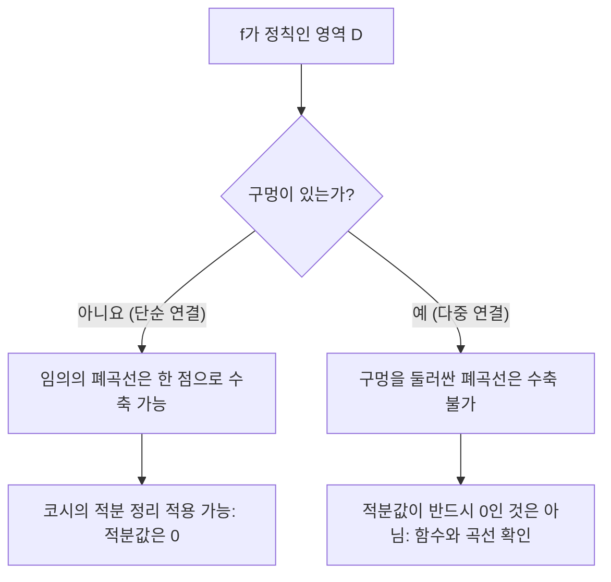

## 1. 머리말

복소해석학이라는 수학 분야에서 가장 아름답고, 그리고 가장 강력한 정리 중 하나로 알려진 것이 **코시의 적분 정리** ([Cauchy](https://kenji.blog/ko/p/cauchy/)'s integral theorem)입니다. 이 정리는 "어떤 조건을 만족하는 복소함수를 닫힌 경로로 적분하면 그 값은 반드시 0이 된다"는, 언뜻 보면 매우 놀라운 사실을 주장하고 있습니다.

실수 함수의 적분은 부호가 있는 넓이나 경로를 따른 누적을 나타낼 수 있습니다. 복소해석학에서는 정칙 함수가 강한 상쇄 성질을 가집니다. 함수가 단순 연결 영역에서 정칙이면, 그 영역 안의 구간별로 매끄러운 경로를 따른 적분은 시점과 종점에만 의존합니다. 구멍이 있는 영역에서는 정칙성만으로 이러한 전역적인 경로 독립성을 보장할 수 없습니다.

본 글에서는 이 코시의 적분 정리에 대해, 그 기초가 되는 복소평면과 정칙 함수의 정의에서 출발하여, 정리의 직관적인 의미, 물리적인 해석, 그리고 그린 정리를 이용한 고전적인 증명 스케치까지 매우 상세하게 해설합니다. 나아가 이 정리가 어떻게 코시의 적분 공식이나 [유수 정리](https://kenji.blog/ko/p/residue-theorem/)와 같은 더 고도의 복소해석학 주제로 이어지는지에 대해서도 다룰 것입니다. 수학적인 엄밀함과 직관적인 이미지 양쪽 측면에서 이 정리의 깊이를 음미해 봅시다.

## 2. 복소평면과 정칙 함수의 기초

코시의 적분 정리를 깊이 이해하기 위해서는 먼저 복소평면과 복소함수의 미분에 대한 기본 사항을 확실히 해 둘 필요가 있습니다. 여기서의 이해가 이후의 증명이나 정리의 해석에 있어 중요한 토대가 됩니다.

### 복소평면 상의 함수

복소함수 $f(z)$는 복소수 $z = x + iy$를 다른 복소수 $w = u + iv$로 사상하는 함수입니다. 여기서 $x, y$는 실수, $i$는 허수 단위($i^2 = -1$)이며, $u, v$는 각각 $x, y$에 의존하는 실숫값 함수입니다. 따라서 복소함수는 다음과 같이 두 실변수의 실숫값 함수의 조합으로 나타낼 수 있습니다.

$$
f(z) = u(x, y) + i v(x, y)
$$

예를 들어, $f(z) = z^2$이라는 함수의 경우, $z = x + iy$를 대입하여 전개하면 $z^2 = (x + iy)^2 = x^2 - y^2 + 2ixy$가 됩니다. 따라서 이 경우에는 실숫값 함수 $u(x, y) = x^2 - y^2$와 $v(x, y) = 2xy$에 의해 구성되어 있음을 알 수 있습니다.

### 복소 미분과 코시-리만 방정식

복소함수 $f(z)$가 어떤 점 $z_0$에서 **미분 가능**하다는 것은 다음의 극한이 존재함을 의미합니다.

$$
f'(z_0) = \lim_{\Delta z \to 0} \frac{f(z_0 + \Delta z) - f(z_0)}{\Delta z}
$$

중요한 점은 $\Delta z$가 복소평면에서 어떤 방식으로 0에 접근하더라도 극한값이 같아야 한다는 것입니다. 이는 직선의 방향뿐 아니라 곡선을 따라 접근하는 경우도 포함합니다. 이런 의미의 복소 미분 가능성은 실수 미분 가능성보다 강한 조건입니다.

함수 $f(z)$가 열린 영역의 모든 점에서 복소 미분 가능하면 그 영역에서 **정칙**이라고 합니다. 정칙성은 실수부 $u$와 허수부 $v$가 다음 필요조건을 만족함을 뜻합니다. 이를 **코시–리만 방정식**이라고 합니다.

$$
\frac{\partial u}{\partial x} = \frac{\partial v}{\partial y}, \quad \frac{\partial u}{\partial y} = -\frac{\partial v}{\partial x}
$$

반대로 $u$와 $v$가 열린 영역에서 연속인 1계 편도함수를 가지고 코시–리만 방정식을 만족하면 $f=u+iv$는 그 영역에서 정칙입니다. 적절한 정칙성 가정 없이 방정식의 성립만을 무조건적인 충분조건으로 삼을 수는 없습니다.

## 3. 복소 적분의 정의와 성질

다음으로, 복소평면 상에서의 선적분을 정의합니다. 코시의 적분 정리는 복소평면 상의 "곡선"을 따라가는 적분에 관한 정리이므로, 적분의 정의를 명확히 해 두는 것이 필수적입니다.

복소평면의 구간별로 매끄러운 곡선 $C$가 실수 매개변수 $t\in[a,b]$에 대해 $z(t)=x(t)+iy(t)$로 표현된다고 합시다. 곡선을 따라 연속인 함수 $f$의 선적분은 다음과 같이 정의하며, 여러 구간으로 나뉘면 각 구간의 적분을 더합니다.

$$
\int_C f(z) dz = \int_a^b f(z(t)) z'(t) dt
$$

여기서 $z'(t) = \frac{dx}{dt} + i \frac{dy}{dt}$이며, $dz = dx + i dy$라는 형식적인 치환을 수행함으로써 최종적으로는 실변수의 적분으로 귀착시켜 계산할 수 있습니다.

복소 적분은 실함수의 선적분과 마찬가지로 다음과 같은 기본적인 성질을 가지고 있습니다.

1. **선형성** : 임의의 복소 상수 $\alpha, \beta$에 대하여 $\int_C (\alpha f(z) + \beta g(z)) dz = \alpha \int_C f(z) dz + \beta \int_C g(z) dz$가 성립합니다.
2. **경로의 반전** : 곡선 $C$의 방향(시점에서 종점으로의 진행 방향)을 역으로 한 것을 $-C$로 표기하면, $\int_{-C} f(z) dz = -\int_C f(z) dz$가 됩니다. 적분 경로를 역주행하면 부호가 반전됩니다.
3. **경로의 분할과 결합** : 곡선 $C$를 도중의 점에서 $C_1$과 $C_2$로 분할할 수 있을 때, 전체의 적분은 부분 적분의 합으로 표현됩니다. 즉, $\int_C f(z) dz = \int_{C_1} f(z) dz + \int_{C_2} f(z) dz$가 됩니다.

이러한 성질들은 당연해 보이지만, 나중에 경로를 여러 가지로 변형하여 논의를 진행하는 데 있어 매우 강력한 도구가 됩니다.

## 4. 코시의 적분 정리의 정식화

여기까지 준비가 갖추어졌으니, 드디어 본론인 코시의 적분 정리의 정확한 주장을 서술합니다.

**정리 (코시의 적분 정리)**
단순 연결인 열린 영역 $D$에서 $f$가 정칙이라고 하자. 그러면 $D$ 안의 임의의 구간별로 매끄러운 폐곡선 $C$에 대하여 다음이 성립한다. 폐곡선은 자기 자신과 교차해도 된다.

$$
\oint_C f(z) dz = 0
$$

여기서 정리의 전제 조건으로 등장하는 몇 가지 중요한 용어를 보충해 두겠습니다.

- **단순 연결 영역** (Simply connected domain) : 직관적으로 말하면 "구멍이 없는" 영역을 뜻합니다. 수학적으로 엄밀하게 표현하면, 영역 내의 임의의 폐곡선을 영역을 벗어나지 않고 연속적으로 변형하여 한 점으로 수축시킬 수 있는 영역을 가리킵니다.
- **구간별로 매끄러운 폐곡선**: 시점과 종점이 같고 유한 개의 매끄러운 곡선 조각으로 이루어진 곡선입니다. 위 정리는 곡선이 단순할 것을 요구하지 않습니다. 자기 자신과 교차하지 않는 폐곡선을 단순 폐곡선이라 하며, 이는 평면을 내부와 외부로 나눕니다. 아래의 그린 정리를 이용한 증명에서는 단순 폐곡선을 사용합니다.

아래 그림은 단순 연결 영역과 다중 연결(구멍이 있는) 영역에서 폐곡선의 행동 차이를 시각적으로 보여줍니다.

## 5. 정리의 직관적인 이해와 물리적 해석

정리의 가정 아래에서 적분이 0이 되는 이유를 알아보기 위해, 복소 적분을 실수부와 허수부로 나누어 봅시다. 이 직관적 설명에서는 $u,v$가 $C^1$급이고 곡선이 단순 연결 영역 안에 있다고 가정합니다.

$f(z) = u + iv$로 두고, $dz = dx + i dy$라 하면, 적분은 다음과 같이 전개할 수 있습니다.

$$
\oint_C f(z) dz = \oint_C (u + iv)(dx + idy) = \oint_C (u dx - v dy) + i \oint_C (v dx + u dy)
$$

이 식의 우변을 주목해 보십시오. 두 개의 실수 적분이 나타났는데, 이는 2차원 평면 상의 벡터장의 선적분과 완전히 같은 형태를 띠고 있습니다. 구체적으로 실수부는 $\vec{F}_1 = (u, -v)$라는 벡터장의 선적분으로, 허수부는 $\vec{F}_2 = (v, u)$라는 벡터장의 선적분으로 해석할 수 있습니다.

물리학에서 벡터장의 폐곡선 상 선적분은 그 장의 순환을 나타냅니다. 단순 연결 영역에서 연속 미분 가능한 벡터장의 회전이 0이면, 구간별로 매끄러운 모든 폐곡선 상의 순환도 0입니다. 구멍이 있는 영역에서는 국소적으로 회전이 0이라는 사실만으로 모든 순환이 0이라고 결론 내릴 수 없습니다.

벡터장 $\vec{F}_1=(u,-v)$와 $\vec{F}_2=(v,u)$의 스칼라 회전은 각각 $-v_x-u_y$와 $u_x-v_y$입니다. 코시–리만 방정식 $u_y=-v_x$는 첫 번째를, $u_x=v_y$는 두 번째를 0으로 만듭니다. 또한 같은 방정식으로부터 $\operatorname{div}\vec{F}_1=u_x-v_y=0$, $\operatorname{div}\vec{F}_2=v_x+u_y=0$이므로 두 장의 발산도 0입니다.

따라서 정칙성은 회전과 발산이 모두 0인 두 벡터장을 만듭니다. 순환이 0임을 설명할 때 핵심은 회전이 0이라는 조건과 영역의 단순 연결성이며, 발산이 0이라는 성질은 이와 구별해야 합니다. 이를 통해 복소 적분에서 일어나는 상쇄를 이해할 수 있습니다.

## 6. 그린 정리를 이용한 엄밀한 증명 스케치

이 고전적인 증명에서는 $u,v$가 곡선 $C$와 그 내부 $D'$를 포함하는 열린 집합에서 연속인 1계 편도함수를 가진다는 추가 가정을 둡니다. $C$는 양의 방향, 즉 반시계 방향으로 도는 구간별로 매끄러운 단순 폐곡선이라고 합시다. 다음 계산은 이 경우를 증명하며, 일반적인 폐곡선으로의 확장은 별도로 이끌어 내야 합니다.

그린 정리는 $C=\partial D'$를 따르는 선적분을 내부 $D'$의 이중 적분으로 바꿉니다. 아래 식에서 $P,Q$는 $D'$의 폐포를 포함하는 열린 근방에서 연속인 1계 편도함수를 가지며, 경계는 양의 방향으로 돕니다.

**그린 정리**
$$
\oint_{\partial D'} (P dx + Q dy) = \iint_{D'} \left( \frac{\partial Q}{\partial x} - \frac{\partial P}{\partial y} \right) dx dy
$$

앞서 분해한 복소 적분의 실수부에 이 그린 정리를 적용해 봅시다. 여기서는 $P = u, Q = -v$로 둡니다.

$$
\oint_C (u dx - v dy) = \iint_{D'} \left( \frac{\partial (-v)}{\partial x} - \frac{\partial u}{\partial y} \right) dx dy
$$

여기서 정칙 함수의 성질인 코시-리만 방정식 $\frac{\partial u}{\partial y} = -\frac{\partial v}{\partial x}$를 대입합니다. 그러면 피적분 함수는 다음과 같이 됩니다.

$$
-\frac{\partial v}{\partial x} - \left( -\frac{\partial v}{\partial x} \right) = 0
$$

피적분 함수가 영역 내의 모든 점에서 $0$이 되므로, 이중 적분 전체가 0이 되어 실수부의 선적분이 0임이 증명되었습니다.

완전히 동일한 절차로 허수부 $i \oint_C (v dx + u dy)$에 대해서도 그린 정리를 적용합니다. 여기서는 $P = v, Q = u$로 둡니다.

$$
\oint_C (v dx + u dy) = \iint_{D'} \left( \frac{\partial u}{\partial x} - \frac{\partial v}{\partial y} \right) dx dy
$$

여기서도 또 하나의 코시-리만 방정식 $\frac{\partial u}{\partial x} = \frac{\partial v}{\partial y}$를 대입하면 피적분 함수는 $\frac{\partial v}{\partial y} - \frac{\partial v}{\partial y} = 0$이 되어 허수부의 적분 또한 0이 됩니다.

결론적으로 실수부도 허수부도 0이 되므로 다음이 성립합니다.

$$
\oint_C f(z) dz = 0 + i0 = 0
$$

이것이 코시의 적분 정리 증명의 골격입니다. 코시-리만 방정식과 그린 정리가 훌륭하게 맞물림으로써 놀라울 정도로 간결하게 증명이 가능함을 알 수 있습니다.

## 7. 구르사 정리: 연속적 미분 가능성의 가정을 제거하다

위 증명에서는 그린 정리를 적용하기 위해 $u,v$의 1계 편도함수의 연속성을 명시적으로 가정했습니다. 구르사 정리는 이 연속성을 별도로 가정할 필요가 없음을 보여 줍니다.

핵심 가정은 함수 $f$가 열린 영역의 모든 점에서 복소 미분 가능하다는 것입니다. $f'$가 연속이라는 가정을 추가할 필요는 없습니다. 적절한 영역과 곡선의 조건을 함께 사용하면 코시–구르사 정리를 얻습니다.

현대적인 증명 방법 중 하나는 삼각형을 반복해서 세분하고 작은 삼각형들의 적분을 추정하는 것입니다. 열린 영역의 모든 점에서 복소 미분 가능하다는 조건은 정칙성을 뜻하며, 나아가 모든 차수의 도함수가 존재함을 이끌어 냅니다. 단 한 점에서만 복소 미분 가능한 것으로는 충분하지 않습니다. 예를 들어 $f(z)=|z|^2$는 $0$에서 복소 미분 가능하지만, $0$의 어떤 근방에서도 정칙이 아닙니다.

## 8. 경로의 변형과 경로 독립성

코시의 적분 정리의 극히 중요한 귀결 중 하나로 **적분의 경로 독립성**이 있습니다.

단순 연결인 열린 영역 $D$의 두 점 $A,B$와, $D$ 안에서 $A$에서 $B$로 가는 구간별로 매끄러운 두 경로 $C_1,C_2$를 생각합시다. $f$가 $D$에서 정칙이면 다음이 성립합니다.

$$
\int_{C_1} f(z) dz = \int_{C_2} f(z) dz
$$

증명은 매우 간단합니다. $C_1$을 통과하여 $B$로 가고, 역방향 경로 $-C_2$를 통과하여 $A$로 돌아오는 경로를 생각합니다. 이는 하나의 폐곡선 $C = C_1 + (-C_2)$가 됩니다. 코시의 적분 정리에 의해 이 폐곡선을 따르는 적분은 0이 됩니다.

$$
\oint_C f(z) dz = \int_{C_1} f(z) dz + \int_{-C_2} f(z) dz = \int_{C_1} f(z) dz - \int_{C_2} f(z) dz = 0
$$

이를 이항하면 $\int_{C_1} f(z) dz = \int_{C_2} f(z) dz$를 얻습니다.

이 가정 아래에서 적분은 시점과 종점에만 의존합니다. 기준점을 고정하면 $D$ 위의 원시함수 $F$를 정의할 수 있으며, $F$는 덧셈 상수의 차이를 제외하고 유일하고 $F'=f$를 만족합니다. 이것이 미적분학의 기본 정리의 복소수 버전입니다.

## 9. 응용: 코시의 적분 공식과 다중 연결 영역으로의 확장

코시의 적분 정리는 단독으로도 아름다운 정리이지만, 복소해석학의 다른 중요한 정리들을 차례로 이끌어내기 위한 강력한 기반이 됩니다.

### 코시의 적분 공식

중요한 귀결은 **코시의 적분 공식**입니다. $C$가 양의 방향(반시계 방향)의 구간별로 매끄러운 단순 폐곡선이고, $f$가 $C$와 그 내부를 포함하는 열린 집합에서 정칙이며, $a$가 $C$의 내부에 있으면 다음이 성립합니다.

$$
f(a) = \frac{1}{2\pi i} \oint_C \frac{f(z)}{z - a} dz
$$

이 공식은 정칙 함수의 강한 결정성을 보여 줍니다. 곡선 $C$ 위의 함수값을 알면 $C$ 내부의 모든 점에서 함수값이 결정됩니다. 이 공식만으로 곡선 바깥의 값까지 직접 결정되는 것은 아닙니다.

### 다중 연결 영역과 [유수 정리](https://kenji.blog/ko/p/residue-theorem/)

영역에 구멍이 있으면 단순 연결 영역에 대한 정리를 그대로 적용할 수 없으며, 함수와 곡선을 살펴야 합니다. 예를 들어 $f(z)=1/z$는 $0$을 제외한 곳에서 정칙이지만, 반시계 방향의 단위원을 따른 적분은 $2\pi i$입니다. 반면 같은 곡선에서 $1/z^2$의 적분은 $0$입니다. 구멍이 있다고 해서 적분이 반드시 0이 아닌 것은 아닙니다.

하지만 코시의 적분 정리를 교묘하게 응용하여 적분 경로를 변형함으로써, 구멍 주위의 적분을 체계적으로 평가하는 수법이 확립되었습니다. 이것이 현대 복소해석학에서 가장 실용적인 도구 중 하나인 **[유수 정리](https://kenji.blog/ko/p/residue-theorem/)** (Residue theorem)로 이어집니다. [유수 정리](https://kenji.blog/ko/p/residue-theorem/)를 이용하면, 실함수의 복잡한 정적분이나 이상적분을 복소평면 상의 대수적인 계산으로 선명하게 치환하여 풀 수 있게 됩니다.

## 10. 맺음말

코시의 적분 정리는 언뜻 보면 단순한 "적분이 0이 된다"라는 평범한 정리로 보일지도 모릅니다. 그러나 그 배후에는 복소함수의 "정칙성"이라는 일견 심플한 조건이 가져오는 심오하고 아름다운 대칭성이 숨겨져 있습니다.

코시의 적분 정리는 적분 공식, 모든 차수의 도함수의 존재, 국소적인 테일러 전개, 적절한 원환 영역에서의 로랑 전개, 유수 정리를 뒷받침합니다. 이 결과들은 함께 복소해석학의 토대를 이룹니다.

독자 여러분도 꼭 종이와 펜을 들고 그린 정리를 이용한 증명을 직접 손으로 따라가 보시길 바랍니다. 수식의 이면에 펼쳐지는, 아름답고 조화로운 복소평면의 세계를 확실하게 느낄 수 있을 것입니다.

## 참고 자료

- [MIT 18.04: Complex integration and Cauchy theory](https://ocw.mit.edu/courses/18-04-complex-variables-with-applications-spring-2018/1968cab6de7c96ead1c83001459a007b_MIT18_04S18_topic3.pdf)
- [MIT 18.112: Cauchy theorem and integral formula](https://ocw.mit.edu/courses/18-112-functions-of-a-complex-variable-fall-2008/8793d412fa0da2a4183539f5d8f7e3fd_lecture13.pdf)
- [NIST DLMF §1.9: Calculus of a Complex Variable](https://dlmf.nist.gov/1.9)
