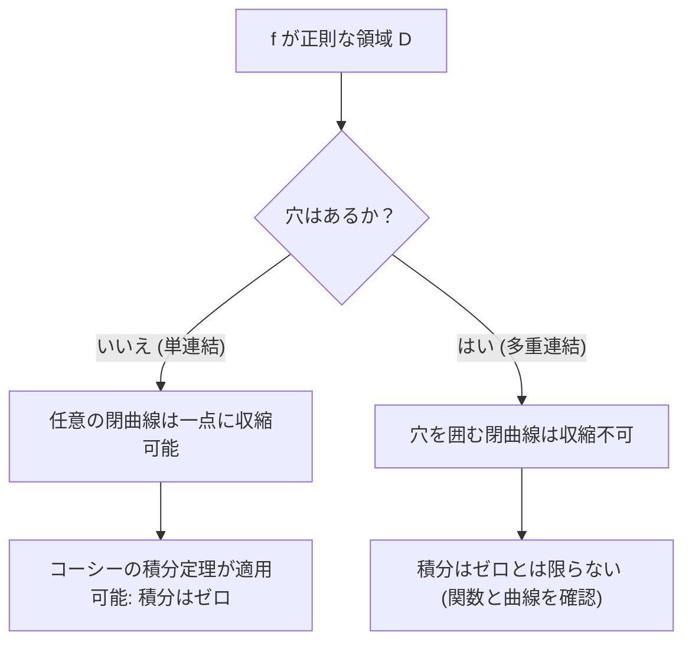

## 1. はじめに

複素解析という数学の分野において、最も美しく、そして最も強力な定理の一つとして知られているのが **コーシーの積分定理** ([Cauchy](https://kenji.blog/p/cauchy/)'s integral theorem) です。この定理は、「ある条件を満たす複素関数を閉じた経路で積分すると、その値は必ずゼロになる」という、一見すると非常に驚くべき事実を主張しています。

実関数の積分は、符号付きの面積や経路に沿う量の蓄積として理解できます。複素積分にも同じような見方ができますが、正則性と領域の形に強い制約を置くと、閉曲線上の積分が0になります。特に単連結な領域で正則なら、積分は経路によらず始点と終点だけで決まります。正則性だけで、穴のある領域全体の経路非依存性まで保証されるわけではありません。

本記事では、このコーシーの積分定理について、その基礎となる複素平面と正則関数の定義から出発し、定理の直感的な意味、物理的な解釈、そしてグリーンの定理を用いた古典的な証明のスケッチまでを、非常に詳細に解説していきます。さらに、この定理がどのようにしてコーシーの積分公式や[留数定理](https://kenji.blog/p/residue-theorem/)といった、より高度な複素解析のトピックへと繋がっていくのかについても触れていきます。数学的な厳密さと直感的なイメージの双方から、この定理の奥深さを味わってみましょう。

## 2. 複素平面と正則関数の基礎

コーシーの積分定理を深く理解するためには、まず複素平面と複素関数の微分についての基本事項を確実にしておく必要があります。ここでの理解が、後の証明や定理の解釈における重要な土台となります。

### 複素平面上の関数

複素関数 $f(z)$ は、複素数 $z = x + iy$ を別の複素数 $w = u + iv$ に写像する関数です。ここで $x, y$ は実数、$i$ は虚数単位 ($i^2 = -1$) であり、$u, v$ はそれぞれ $x, y$ に依存する実数値関数です。したがって、複素関数は次のように2つの実変数の実数値関数の組み合わせとして表すことができます。

$$
f(z) = u(x, y) + i v(x, y)
$$

例えば、$f(z) = z^2$ という関数の場合、$z = x + iy$ を代入して展開すると、$z^2 = (x + iy)^2 = x^2 - y^2 + 2ixy$ となります。したがって、この場合は $u(x, y) = x^2 - y^2$、$v(x, y) = 2xy$ という実数値関数によって構成されていることがわかります。

### 複素微分と[コーシー](https://kenji.blog/p/cauchy/)・[リーマン](https://kenji.blog/p/riemann/)の方程式

複素関数 $f(z)$ がある点 $z_0$ において **微分可能** であるとは、次の極限が存在することを意味します。

$$
f'(z_0) = \lim_{\Delta z \to 0} \frac{f(z_0 + \Delta z) - f(z_0)}{\Delta z}
$$

重要なのは、$\Delta z$ が複素平面内でどのように0へ近づいても同じ極限になることです。直線の方向を変えたときだけではなく、任意の経路に沿った近づき方も含みます。この意味での複素微分可能性が、強い結論を導きます。

関数 $f$ が領域（連結な開集合）$D$ の各点で複素微分可能なら、$D$ で正則と呼びます。複素微分可能であるための必要条件として、実部 $u$ と虚部 $v$ は次のコーシー・リーマン方程式を満たします。偏微分方程式の成立だけを、追加の滑らかさを確認せず十分条件とすることはできません。

$$
\frac{\partial u}{\partial x} = \frac{\partial v}{\partial y}, \quad \frac{\partial u}{\partial y} = -\frac{\partial v}{\partial x}
$$

例えば、$u,v$ が領域上で連続な1階偏導関数を持つ（$C^1$ 級である）と仮定すれば、コーシー・リーマン方程式は正則性の十分条件にもなります。後のグリーンの定理による証明では、この滑らかさを明示的に仮定します。

## 3. 複素積分の定義と性質

次に、複素平面上での線積分を定義します。コーシーの積分定理は、複素平面上の「曲線」に沿った積分に関する定理ですので、積分の定義を明確にしておくことが不可欠です。

複素平面上の滑らかな曲線 $C$ が、実変数 $t \in [a, b]$ を用いて $z(t) = x(t) + i y(t)$ とパラメータ表示されているとします。この曲線 $C$ に沿った複素関数 $f(z)$ の線積分は、次のように定義されます。

$$
\int_C f(z) dz = \int_a^b f(z(t)) z'(t) dt
$$

ここで、$z'(t) = \frac{dx}{dt} + i \frac{dy}{dt}$ であり、$dz = dx + i dy$ という形式的な置き換えを行うことで、最終的には実変数の積分に帰着させて計算することができます。

複素積分は、実関数の線積分と同様に次のような基本的な性質を持っています。

1. **線形性** : 任意の複素定数 $\alpha, \beta$ に対して、$\int_C (\alpha f(z) + \beta g(z)) dz = \alpha \int_C f(z) dz + \beta \int_C g(z) dz$ が成り立ちます。
2. **経路の反転** : 曲線 $C$ の向き（始点から終点への進行方向）を逆にしたものを $-C$ と表記すると、$\int_{-C} f(z) dz = -\int_C f(z) dz$ となります。積分経路を逆走すると符号が反転します。
3. **経路の分割と結合** : 曲線 $C$ を途中の点で $C_1$ と $C_2$ に分割できるとき、全体の積分は部分の積分の和として表されます。すなわち、$\int_C f(z) dz = \int_{C_1} f(z) dz + \int_{C_2} f(z) dz$ となります。

これらの性質は、後で経路を様々に変形して議論を進める上で、当たり前のようですが非常に強力な道具となります。

## 4. コーシーの積分定理の定式化

ここまでの準備が整ったところで、いよいよ本題であるコーシーの積分定理の正確な主張を述べます。

**定理 (コーシーの積分定理)**
単連結な領域 $D$ 上で正則な関数 $f$ と、$D$ 内の任意の区分的に滑らかな閉曲線 $C$ について、次の等式が成り立つ。閉曲線は単純でなくてもよい。

$$
\oint_C f(z) dz = 0
$$

ここで、定理の前提条件として登場するいくつかの重要な用語を補足しておきましょう。

- **単連結な領域** (Simply connected domain) : 直感的に言えば「穴の空いていない」領域のことです。数学的に厳密に表現すると、領域内の任意の閉曲線を、領域をはみ出すことなく連続的に変形して一点に収縮させることができる領域を指します。
- **単純閉曲線** (Simple closed contour) : 始点と終点が一致しており（閉曲線）、途中で自分自身と交差しない（単純）曲線のことです。「ジョルダン閉曲線」とも呼ばれ、平面を「内側」と「外側」の2つに分割することが知られています（ジョルダンの閉曲線定理）。

以下の図は、単連結な領域と多重連結（穴のある）領域における閉曲線の振る舞いの違いを視覚的に示しています。

## 5. 定理の直感的な理解と物理的解釈

定理の仮定の下で積分が0になる理由を、実部と虚部に分けて考えます。この節では直感を得るため、$u,v$ は $C^1$ 級とし、単連結な領域内で曲線を考えます。

$f(z) = u + iv$ とし、$dz = dx + i dy$ とすると、積分は次のように展開できます。

$$
\oint_C f(z) dz = \oint_C (u + iv)(dx + idy) = \oint_C (u dx - v dy) + i \oint_C (v dx + u dy)
$$

この式の右辺に注目してください。2つの実積分が現れましたが、これは2次元平面上のベクトル場の線積分と全く同じ形をしています。具体的には、実部は $\vec{F}_1 = (u, -v)$ というベクトル場の線積分として、虚部は $\vec{F}_2 = (v, u)$ というベクトル場の線積分として解釈できます。

平面の $C^1$ 級ベクトル場 $F=(P,Q)$ に対し、閉曲線上の線積分は循環と解釈できます。単連結な領域で回転 $Q_x-P_y$ が0なら、区分的に滑らかな閉曲線上の循環も0です。回転が0という局所条件だけでは、穴を囲む曲線の循環までは決まりません。

ここで $F_1=(u,-v)$ の回転は $-v_x-u_y$、$F_2=(v,u)$ の回転は $u_x-v_y$ です。前者はコーシー・リーマン方程式の $u_y=-v_x$、後者は $u_x=v_y$ によって0になります。二つの式をそれぞれ対応する場へ用いることが重要です。

また、発散は $\operatorname{div}F_1=u_x-v_y$、$\operatorname{div}F_2=v_x+u_y$ なので、同じ二つの方程式からいずれも0になります。ただし、循環が0であることの説明には回転と領域の形が中心であり、発散が0であることとは区別します。こうして複素積分の実部・虚部を、回転のない場の循環として理解できます。

## 6. グリーンの定理を用いた厳密な証明のスケッチ

ここでは $u,v$ が曲線とその内部を含む開集合で $C^1$ 級であるという追加仮定を置き、グリーンの定理で証明します。$C$ は正向き（反時計回り）の区分的に滑らかな単純閉曲線、その内部を $D'$ とします。一般の閉曲線への拡張は、この単純閉曲線の場合から別に導きます。

グリーンの定理では、$C=\partial D'$ を正向きにたどり、$P,Q$ は $\overline{D'}$ を含む開集合で連続な1階偏導関数を持つとします。このとき線積分と二重積分は次のように結び付きます。

**グリーンの定理**
$$
\oint_{\partial D'} (P dx + Q dy) = \iint_{D'} \left( \frac{\partial Q}{\partial x} - \frac{\partial P}{\partial y} \right) dx dy
$$

先ほど分解した複素積分の実部に、このグリーンの定理を適用してみましょう。ここでは $P = u, Q = -v$ とします。

$$
\oint_C (u dx - v dy) = \iint_{D'} \left( \frac{\partial (-v)}{\partial x} - \frac{\partial u}{\partial y} \right) dx dy
$$

ここで、正則関数の性質である[コーシー](https://kenji.blog/p/cauchy/)・[リーマン](https://kenji.blog/p/riemann/)の方程式 $\frac{\partial u}{\partial y} = -\frac{\partial v}{\partial x}$ を代入します。すると、被積分関数は次のようになります。

$$
-\frac{\partial v}{\partial x} - \left( -\frac{\partial v}{\partial x} \right) = 0
$$

被積分関数が領域内のすべての点で $0$ になるため、二重積分全体がゼロとなり、実部の線積分がゼロであることが証明されました。

全く同様の手順で、虚部 $i \oint_C (v dx + u dy)$ についてもグリーンの定理を適用します。ここでは $P = v, Q = u$ とします。

$$
\oint_C (v dx + u dy) = \iint_{D'} \left( \frac{\partial u}{\partial x} - \frac{\partial v}{\partial y} \right) dx dy
$$

ここでもう一つの[コーシー](https://kenji.blog/p/cauchy/)・[リーマン](https://kenji.blog/p/riemann/)の方程式 $\frac{\partial u}{\partial x} = \frac{\partial v}{\partial y}$ を代入すると、被積分関数は $\frac{\partial v}{\partial y} - \frac{\partial v}{\partial y} = 0$ となり、虚部の積分もまたゼロになります。

結論として、実部も虚部もゼロになるため、次が成り立ちます。

$$
\oint_C f(z) dz = 0 + i0 = 0
$$

これがコーシーの積分定理の証明の骨格です。コーシー・[リーマン](https://kenji.blog/p/riemann/)の方程式とグリーンの定理が見事に噛み合うことで、驚くほど簡潔に証明ができることがわかります。

## 7. グルサの定理：連続的微分可能性の仮定を外す

前節の証明は $u,v$ が $C^1$ 級であることを追加仮定としました。グルサの定理では、この滑らかさを独立の仮定として置かずに、複素微分可能性から積分が0になることを導きます。

ここで必要なのは、領域の各点で複素導関数が存在するという正則性です。一つの点だけで微分可能という意味ではありません。例えば $f(z)=|z|^2$ は原点では複素微分可能ですが、原点の近傍で正則ではありません。

現代の証明の一つでは三角形を細分化し、各点での複素微分可能性を使って三角形の周上の積分が0であることを示します。この結果を領域内の曲線へ拡張することで、導関数の連続性を先に仮定する必要がなくなります。正則関数は結果として無限回微分可能になりますが、その結論には開集合の各点での複素微分可能性が必要です。

## 8. 経路の変形と経路非依存性

コーシーの積分定理の極めて重要な帰結の一つに、 **積分の経路非依存性** があります。

単連結領域 $D$ 内の2点 $A,B$ を結ぶ区分的に滑らかな経路 $C_1,C_2$ を考えます。$f$ が $D$ で正則なら、次が成り立ちます。

$$
\int_{C_1} f(z) dz = \int_{C_2} f(z) dz
$$

証明は非常に簡単です。$C_1$ を通って $B$ に行き、逆向きの経路 $-C_2$ を通って $A$ に戻る経路を考えます。これは一つの閉曲線 $C = C_1 + (-C_2)$ になります。コーシーの積分定理により、この閉曲線に沿った積分はゼロになります。

$$
\oint_C f(z) dz = \int_{C_1} f(z) dz + \int_{-C_2} f(z) dz = \int_{C_1} f(z) dz - \int_{C_2} f(z) dz = 0
$$

これを移項すれば、$\int_{C_1} f(z) dz = \int_{C_2} f(z) dz$ が得られます。

この性質により、正則関数の積分は「どのような道筋を辿ったか」には依存せず、「始点と終点だけで決まる」ことになります。これにより、複素平面上でも原始関数（不定積分） $F(z)$ を一意に（積分定数の違いを除いて）定義することが可能になり、実関数の「微積分学の基本定理」が複素平面上でも美しく成り立つことが保証されるのです。

## 9. 応用：[コーシー](https://kenji.blog/p/cauchy/)の積分公式と多重連結領域への拡張

コーシーの積分定理は、単独でも美しい定理ですが、複素解析の他の重要な定理を次々と導き出すための強力な基盤となります。

### [コーシー](https://kenji.blog/p/cauchy/)の積分公式

さらに、$C$ が正向き（反時計回り）の区分的に滑らかな単純閉曲線で、$f$ が $C$ とその内部を含む開集合で正則、$a$ が $C$ の内部の点なら、コーシーの積分公式は次のようになります。

$$
f(a) = \frac{1}{2\pi i} \oint_C \frac{f(z)}{z - a} dz
$$

この公式は、曲線 $C$ 上の関数値から、$C$ が囲む内部の各点での値が決まることを示します。任意に選んだ曲線の外側や、正則性が失われる点まで同じ式で値が決まるという意味ではありません。

### 多重連結領域と[留数定理](https://kenji.blog/p/residue-theorem/)

領域が単連結でない場合でも、すべての閉曲線の積分が非零になるわけではありません。例えば $f(z)=1/z$ は $\mathbb{C}\setminus\{0\}$ で正則ですが、原点を反時計回りに一周する単位円上の積分は $2\pi i$ です。一方、$1/z^2$ の同じ円上の積分は0です。穴の存在だけで積分値は決まらず、関数と曲線の両方を確認する必要があります。

しかし、コーシーの積分定理を巧妙に応用し、積分経路を変形させることで、穴の周りの積分を系統的に評価する手法が確立されました。これが、現代の複素解析において最も実用的なツールの一つである **留数定理** (Residue theorem) へと繋がっていきます。[留数定理](https://kenji.blog/p/residue-theorem/)を用いれば、実関数の複雑な定積分や無限積分を、複素平面上の代数的な計算へと鮮やかに置き換えて解くことができるようになります。

## 10. おわりに

コーシーの積分定理は、一見すると単なる「積分がゼロになる」という地味な定理に見えるかもしれません。しかし、その背後には、複素関数の「正則性」という一見シンプルな条件がもたらす、深遠で美しい対称性が隠されています。

この定理を出発点として、[コーシー](https://kenji.blog/p/cauchy/)の積分公式、関数が無限回微分可能であることの証明（[テイラー展開](/p/taylor-and-maclaurin-series/)やローラン展開の保証）、そして留数定理といった、複素解析の華やかな成果が次々と導き出されていきます。コーシーの積分定理は、まさに複素解析という壮大な数学的建造物を根底から支える、最も堅牢で美しい土台であると言えるでしょう。

読者の皆様も、ぜひ紙とペンを手に取り、グリーンの定理を用いた証明を自らの手で追ってみてください。数式の背後に広がる、美しく調和のとれた複素平面の世界を確かに感じることができるはずです。

## 参考資料

- [MIT 18.04: Line integrals and Cauchy’s theorem](https://ocw.mit.edu/courses/18-04-complex-variables-with-applications-spring-2018/1968cab6de7c96ead1c83001459a007b_MIT18_04S18_topic3.pdf)
- [MIT 18.112: The General Cauchy Theorem](https://ocw.mit.edu/courses/18-112-functions-of-a-complex-variable-fall-2008/8793d412fa0da2a4183539f5d8f7e3fd_lecture13.pdf)
- [NIST DLMF: Calculus of a Complex Variable](https://dlmf.nist.gov/1.9)
