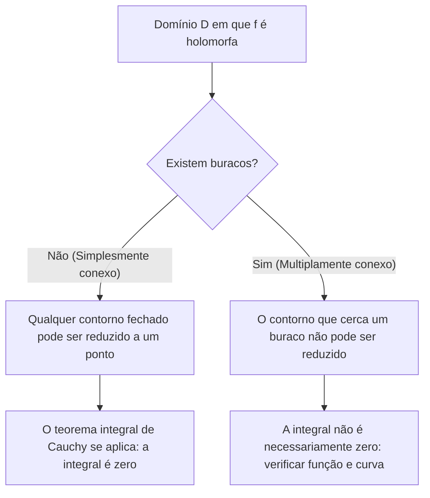

## 1. Introdução

No campo da matemática conhecido como análise complexa, um dos teoremas mais belos e poderosos é o **Teorema integral de [Cauchy](https://kenji.blog/pt/p/cauchy/)**. Este teorema afirma o que à primeira vista parece ser um fato altamente surpreendente: "Integrar uma função complexa que satisfaz certas condições ao longo de um contorno fechado sempre resultará em exatamente zero."

A integração de funções reais pode representar uma área com sinal ou uma acumulação ao longo de um caminho. Na análise complexa, as funções holomorfas têm uma forte propriedade de cancelamento: se uma função é holomorfa em um domínio simplesmente conexo, suas integrais ao longo de caminhos suaves por partes nesse domínio dependem apenas dos extremos. A holomorfia, por si só, não garante essa independência global do caminho em um domínio com buracos.

Neste artigo, explicamos o teorema integral de Cauchy a partir das definições do plano complexo e das funções holomorfas. Examinamos sua interpretação intuitiva e física, uma demonstração pelo teorema de Green e suas relações com a fórmula integral e o teorema dos resíduos.

## 2. Fundamentos do plano complexo e das funções holomorfas

Para entender profundamente o teorema integral de [Cauchy](https://kenji.blog/pt/p/cauchy/), devemos primeiro consolidar nossa compreensão dos fundamentos do plano complexo e da diferenciação de funções complexas. O entendimento aqui forma uma base importante para as provas e interpretações dos teoremas que se seguem.

### Funções no Plano Complexo

Uma função complexa $f(z)$ é uma função que mapeia um número complexo $z = x + iy$ para outro número complexo $w = u + iv$. Aqui, $x, y$ são números reais, $i$ é a unidade imaginária ($i^2 = -1$), e $u, v$ são funções de valor real que dependem de $x, y$, respectivamente. Portanto, uma função complexa pode ser representada como uma combinação de duas funções de valor real de duas variáveis reais da seguinte forma:

$$
f(z) = u(x, y) + i v(x, y)
$$

Por exemplo, para a função $f(z) = z^2$, substituir $z = x + iy$ e expandir dá $z^2 = (x + iy)^2 = x^2 - y^2 + 2ixy$. Assim, neste caso, podemos ver que é composto pelas funções de valor real $u(x, y) = x^2 - y^2$ e $v(x, y) = 2xy$.

### Diferenciação Complexa e as Equações de [Cauchy](https://kenji.blog/pt/p/cauchy/)-[Riemann](https://kenji.blog/pt/p/riemann/)

Diz-se que uma função complexa $f(z)$ é **diferenciável** em um ponto $z_0$ se existir o seguinte limite:

$$
f'(z_0) = \lim_{\Delta z \to 0} \frac{f(z_0 + \Delta z) - f(z_0)}{\Delta z}
$$

O requisito essencial é que o limite tenha o mesmo valor para qualquer maneira pela qual $\Delta z$ tenda a zero no plano complexo, incluindo trajetórias curvas, e não apenas direções retilíneas. Essa condição é mais restritiva do que a diferenciabilidade real.

Uma função $f(z)$ é **holomorfa** em um domínio aberto se é diferenciável no sentido complexo em cada ponto desse domínio. A holomorfia implica que as partes real $u$ e imaginária $v$ satisfaçam as seguintes condições necessárias, chamadas **equações de Cauchy–Riemann**:

$$
\frac{\partial u}{\partial x} = \frac{\partial v}{\partial y}, \quad \frac{\partial u}{\partial y} = -\frac{\partial v}{\partial x}
$$

Reciprocamente, se $u$ e $v$ têm derivadas parciais de primeira ordem contínuas em um domínio aberto e satisfazem essas equações em todo o domínio, então $f=u+iv$ é holomorfa. Sem uma hipótese adequada de regularidade, as equações, isoladamente, não constituem um critério incondicional de holomorfia.

## 3. Definição e Propriedades da Integração Complexa

A seguir, definimos a integral de linha no plano complexo. Uma vez que o teorema integral de [Cauchy](https://kenji.blog/pt/p/cauchy/) é um teorema sobre a integração ao longo de uma "curva" no plano complexo, é essencial esclarecer a definição desta integração.

Seja $C$ uma curva suave por partes no plano complexo, parametrizada por $z(t)=x(t)+iy(t)$, com $t\in[a,b]$. Para uma função $f$ contínua ao longo da curva, a integral de linha é definida a seguir; se houver vários trechos, integramos cada um e somamos os resultados:

$$
\int_C f(z) dz = \int_a^b f(z(t)) z'(t) dt
$$

Aqui, $z'(t) = \frac{dx}{dt} + i \frac{dy}{dt}$, e ao realizar a substituição formal $dz = dx + i dy$, o cálculo pode, em última análise, ser reduzido à integração de variáveis reais.

A integração complexa possui propriedades fundamentais semelhantes à integral de linha de funções reais, tais como:

1. **Linearidade** : Para quaisquer constantes complexas $\alpha, \beta$, é válido que $\int_C (\alpha f(z) + \beta g(z)) dz = \alpha \int_C f(z) dz + \beta \int_C g(z) dz$.
2. **Reversão do Caminho** : Se a direção da curva $C$ (a direção do progresso do ponto de partida para o ponto de chegada) for invertida e denotada como $-C$, então $\int_{-C} f(z) dz = -\int_C f(z) dz$. Percorrer o caminho de integração ao inverso inverte o sinal.
3. **Divisão e Combinação de Caminhos** : Quando uma curva $C$ puder ser dividida em um ponto intermediário em $C_1$ e $C_2$, a integral geral é expressa como a soma das integrais parciais. Ou seja, $\int_C f(z) dz = \int_{C_1} f(z) dz + \int_{C_2} f(z) dz$.

Essas propriedades, embora aparentemente óbvias, tornam-se ferramentas muito poderosas quando mais tarde avançamos em nossos argumentos, distorcendo os caminhos de várias maneiras.

## 4. Formulação do Teorema Integral de [Cauchy](https://kenji.blog/pt/p/cauchy/)

Agora que nossos preparativos estão completos, finalmente declaramos a formulação exata do assunto principal, o teorema integral de [Cauchy](https://kenji.blog/pt/p/cauchy/).

**Teorema (Teorema Integral de [Cauchy](https://kenji.blog/pt/p/cauchy/))**
Seja $D$ um domínio aberto simplesmente conexo e seja $f$ holomorfa em $D$. Para qualquer curva fechada $C$, suave por partes e contida em $D$, mesmo que tenha autointerseções, vale:

$$
\oint_C f(z) dz = 0
$$

Vamos complementar isso com algumas terminologias importantes que aparecem como condições prévias do teorema.

- **Domínio simplesmente conexo**: Intuitivamente, é um domínio sem buracos. Mais precisamente, toda curva fechada nele pode ser continuamente deformada até um único ponto sem sair do domínio.
- **Curva fechada suave por partes**: Tem o mesmo ponto inicial e final e consiste em um número finito de trechos suaves. O teorema acima não exige que a curva seja simples. Uma curva fechada simples não tem autointerseções e separa o plano em interior e exterior; usaremos esse tipo de curva na demonstração pelo teorema de Green.

O diagrama abaixo mostra visualmente a diferença no comportamento das curvas fechadas em domínios simplesmente conexos versus domínios multiplamente conexos (domínios com buracos).

## 5. Compreensão Intuitiva e Interpretação Física do Teorema

Por que a integral se anula sob as hipóteses do teorema? Para desenvolver a intuição, vamos separá-la em partes real e imaginária. Nesta interpretação, supomos que $u,v$ são de classe $C^1$ e que a curva está em um domínio simplesmente conexo.

Seja $f(z) = u + iv$ e $dz = dx + i dy$. A integral pode então ser expandida da seguinte forma:

$$
\oint_C f(z) dz = \oint_C (u + iv)(dx + idy) = \oint_C (u dx - v dy) + i \oint_C (v dx + u dy)
$$

Observe o lado direito dessa equação. Duas integrais reais apareceram, e elas têm exatamente a mesma forma que as integrais de linha de campos vetoriais em um plano 2D. Especificamente, a parte real pode ser interpretada como a integral de linha de um campo vetorial $\vec{F}_1 = (u, -v)$, e a parte imaginária como a integral de linha de um campo vetorial $\vec{F}_2 = (v, u)$.

Na física, a integral de linha de um campo vetorial ao longo de uma curva fechada representa sua circulação. Se um campo é continuamente diferenciável em um domínio simplesmente conexo e tem rotacional nulo, sua circulação sobre qualquer curva fechada suave por partes é zero. Em um domínio com buracos, a anulação local do rotacional não basta para concluir que toda circulação é zero.

Os rotacionais escalares de $\vec{F}_1=(u,-v)$ e $\vec{F}_2=(v,u)$ são, respectivamente, $-v_x-u_y$ e $u_x-v_y$. A equação de Cauchy–Riemann $u_y=-v_x$ anula o primeiro, e $u_x=v_y$ anula o segundo. As mesmas equações também dão divergência nula: $\operatorname{div}\vec{F}_1=u_x-v_y=0$ e $\operatorname{div}\vec{F}_2=v_x+u_y=0$.

Assim, a holomorfia produz dois campos irrotacionais e de divergência nula. Para o argumento sobre a circulação, o essencial é o rotacional nulo junto com a hipótese sobre o domínio; a divergência nula é uma propriedade distinta. Essa distinção ajuda a compreender o cancelamento no teorema integral de Cauchy.

## 6. Esboço de uma Prova Rigorosa Usando o Teorema de Green

Para esta demonstração clássica, supomos adicionalmente que $u,v$ têm derivadas parciais de primeira ordem contínuas em um aberto que contém uma curva fechada simples $C$ e seu interior $D'$. A curva é suave por partes e tem orientação positiva (sentido anti-horário). O cálculo abaixo demonstra esse caso; a extensão a curvas fechadas gerais exige uma etapa adicional.

O teorema de Green transforma a integral de linha sobre $C=\partial D'$ em uma integral dupla no interior $D'$. No enunciado abaixo, $P,Q$ têm derivadas parciais de primeira ordem contínuas em uma vizinhança aberta do fecho de $D'$, e a fronteira tem orientação positiva.

**Teorema de Green**
$$
\oint_{\partial D'} (P dx + Q dy) = \iint_{D'} \left( \frac{\partial Q}{\partial x} - \frac{\partial P}{\partial y} \right) dx dy
$$

Apliquemos este teorema de Green à parte real da integral complexa decomposta de antes. Aqui deixamos $P = u, Q = -v$.

$$
\oint_C (u dx - v dy) = \iint_{D'} \left( \frac{\partial (-v)}{\partial x} - \frac{\partial u}{\partial y} \right) dx dy
$$

Agora, substituímos a equação de [Cauchy](https://kenji.blog/pt/p/cauchy/)-[Riemann](https://kenji.blog/pt/p/riemann/) $\frac{\partial u}{\partial y} = -\frac{\partial v}{\partial x}$, que é uma propriedade de funções holomorfas. Então, o integrando se torna o seguinte:

$$
-\frac{\partial v}{\partial x} - \left( -\frac{\partial v}{\partial x} \right) = 0
$$

Uma vez que o integrando se torna $0$ em todos os pontos dentro do domínio, toda a integral dupla se torna zero, provando que a integral de linha da parte real é zero.

Pelo mesmo procedimento, aplicamos o teorema de Green à parte imaginária $i \oint_C (v dx + u dy)$. Aqui $P = v, Q = u$.

$$
\oint_C (v dx + u dy) = \iint_{D'} \left( \frac{\partial u}{\partial x} - \frac{\partial v}{\partial y} \right) dx dy
$$

Novamente, substituindo a outra equação de [Cauchy](https://kenji.blog/pt/p/cauchy/)-[Riemann](https://kenji.blog/pt/p/riemann/) $\frac{\partial u}{\partial x} = \frac{\partial v}{\partial y}$, o integrando se torna $\frac{\partial v}{\partial y} - \frac{\partial v}{\partial y} = 0$, e a integral da parte imaginária também se torna zero.

Em conclusão, como as partes real e imaginária se tornam zero, o seguinte é válido:

$$
\oint_C f(z) dz = 0 + i0 = 0
$$

Este é o esqueleto da prova do teorema integral de [Cauchy](https://kenji.blog/pt/p/cauchy/). Podemos ver que ao unir perfeitamente as equações de Cauchy-[Riemann](https://kenji.blog/pt/p/riemann/) e o teorema de Green, a prova pode ser realizada de uma forma surpreendentemente simples.

## 7. O Teorema de Goursat: Removendo a Suposição de Diferenciabilidade Contínua

A demonstração acima supõe explicitamente a continuidade das derivadas parciais de primeira ordem de $u,v$ para aplicar o teorema de Green. O teorema de Goursat mostra que não é preciso assumir essa continuidade separadamente.

A hipótese essencial é que $f$ seja diferenciável no sentido complexo em cada ponto de um domínio aberto. Não é necessária uma hipótese adicional de continuidade de $f'$. Com as condições adequadas sobre o domínio e a curva, obtemos o resultado conhecido como teorema de Cauchy–Goursat.

Uma demonstração moderna consiste em subdividir repetidamente triângulos e estimar as integrais nos triângulos menores. A diferenciabilidade complexa em cada ponto de um domínio aberto é uma condição forte: implica holomorfia e, posteriormente, derivadas de todas as ordens. Ser diferenciável em apenas um ponto não basta. Por exemplo, $f(z)=|z|^2$ é diferenciável no sentido complexo em $0$, mas não é holomorfa em nenhuma vizinhança de $0$.

## 8. Deformação do Caminho e Independência do Caminho

Uma das consequências extremamente importantes do teorema integral de [Cauchy](https://kenji.blog/pt/p/cauchy/) é a **independência do caminho das integrais**.

Sejam $A,B$ dois pontos de um domínio aberto simplesmente conexo $D$ e sejam $C_1,C_2$ dois caminhos suaves por partes em $D$, de $A$ a $B$. Se $f$ é holomorfa em $D$, então:

$$
\int_{C_1} f(z) dz = \int_{C_2} f(z) dz
$$

A prova é muito simples. Considere um caminho que vai para $B$ através de $C_1$ e retorna para $A$ através do caminho reverso $-C_2$. Isto forma uma única curva fechada $C = C_1 + (-C_2)$. Pelo teorema integral de [Cauchy](https://kenji.blog/pt/p/cauchy/), a integral ao longo dessa curva fechada é zero.

$$
\oint_C f(z) dz = \int_{C_1} f(z) dz + \int_{-C_2} f(z) dz = \int_{C_1} f(z) dz - \int_{C_2} f(z) dz = 0
$$

Transpondo isso, obtemos $\int_{C_1} f(z) dz = \int_{C_2} f(z) dz$.

Sob essas hipóteses, a integral depende apenas dos extremos. Fixando um ponto base, podemos definir uma primitiva $F$ em $D$, única a menos de uma constante aditiva, com $F'=f$. Essa é a versão complexa do teorema fundamental do cálculo.

## 9. Aplicação: A Fórmula Integral de [Cauchy](https://kenji.blog/pt/p/cauchy/) e a Extensão para Domínios Multiplamente Conexos

O teorema integral de [Cauchy](https://kenji.blog/pt/p/cauchy/) é um teorema belo por si só, mas serve como um fundamento poderoso para a derivação sucessiva de outros teoremas importantes na análise complexa.

### Fórmula Integral de [Cauchy](https://kenji.blog/pt/p/cauchy/)

Uma consequência importante é a **fórmula integral de Cauchy**. Seja $C$ uma curva fechada simples, suave por partes, com orientação positiva (sentido anti-horário). Se $f$ é holomorfa em um aberto que contém $C$ e seu interior, e $a$ está dentro de $C$, então:

$$
f(a) = \frac{1}{2\pi i} \oint_C \frac{f(z)}{z - a} dz
$$

A fórmula mostra a rigidez das funções holomorfas: conhecer os valores de $f$ sobre o contorno $C$ determina o valor em cada ponto do interior de $C$. A fórmula, por si só, não determina diretamente os valores fora dessa curva.

### Domínios multiplamente conexos e o teorema dos resíduos

Em um domínio com buracos, não se pode aplicar diretamente a versão do teorema para domínios simplesmente conexos; é preciso examinar a função e a curva. Por exemplo, $f(z)=1/z$ é holomorfa fora de $0$, mas sua integral sobre a circunferência unitária centrada na origem, percorrida no sentido anti-horário, é $2\pi i$. Já a integral de $1/z^2$ sobre a mesma curva é $0$. Um buraco não obriga a integral a ser diferente de zero.

A deformação de caminhos e o teorema integral de Cauchy permitem desenvolver métodos para avaliar integrais ao redor de buracos. Isso conduz ao **[teorema dos resíduos](https://kenji.blog/pt/p/residue-theorem/)**, uma ferramenta central da análise complexa. Sob as hipóteses apropriadas, ele permite calcular algumas integrais definidas e impróprias de funções reais por meio de resíduos no plano complexo.

## 10. Conclusão

À primeira vista, o teorema integral de [Cauchy](https://kenji.blog/pt/p/cauchy/) pode parecer um modesto teorema que simplesmente afirma "a integral se torna zero". Contudo, oculto por trás disso, há uma simetria profunda e bela trazida pela condição aparentemente simples da "holomorfia" das funções complexas.

O teorema integral de Cauchy sustenta a fórmula integral, a existência de derivadas de todas as ordens, as expansões locais de Taylor, as expansões de Laurent em anéis adequados e o teorema dos resíduos. Esses resultados formam uma base da análise complexa.

Nós incentivamos os leitores a pegar uma folha e uma caneta, e acompanhar a prova utilizando o Teorema de Green, com as suas próprias mãos. Certamente será possível sentir o harmonioso e lindo universo do plano complexo que se desdobra por trás das fórmulas matemáticas.

## Referências

- [MIT 18.04: Complex integration and Cauchy theory](https://ocw.mit.edu/courses/18-04-complex-variables-with-applications-spring-2018/1968cab6de7c96ead1c83001459a007b_MIT18_04S18_topic3.pdf)
- [MIT 18.112: Cauchy theorem and integral formula](https://ocw.mit.edu/courses/18-112-functions-of-a-complex-variable-fall-2008/8793d412fa0da2a4183539f5d8f7e3fd_lecture13.pdf)
- [NIST DLMF §1.9: Calculus of a Complex Variable](https://dlmf.nist.gov/1.9)
