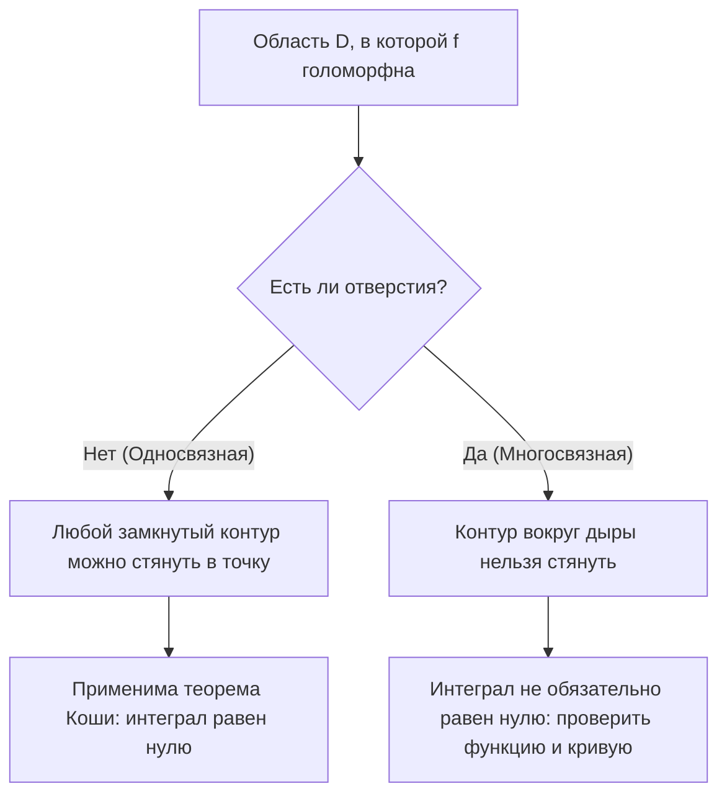

## 1. Введение

В области математики, известной как комплексный анализ, одной из самых красивых и мощных теорем является **интегральная теорема Коши**. Эта теорема утверждает то, что на первый взгляд кажется весьма удивительным фактом: «Интегрирование комплексной функции, удовлетворяющей определенным условиям, по замкнутому контуру всегда дает ровно ноль».

Интеграл действительной функции может выражать ориентированную площадь или накопление вдоль пути. В комплексном анализе голоморфные функции обладают сильным свойством взаимного сокращения вкладов: если функция голоморфна в односвязной области, её интегралы по кусочно-гладким путям в этой области зависят только от концов пути. Одна лишь голоморфность не гарантирует такой глобальной независимости от пути в области с отверстиями.

В этой статье мы очень подробно объясним интегральную теорему Коши, начиная с фундаментальных определений комплексной плоскости и голоморфных функций, переходя к интуитивному смыслу теоремы, ее физической интерпретации и наброску ее классического доказательства с использованием теоремы Грина. Более того, мы коснемся того, как эта теорема связана с более продвинутыми темами комплексного анализа, такими как интегральная формула Коши и [теорема о вычетах](/ru/p/residue-theorem/). Давайте оценим невероятную глубину этой теоремы как с точки зрения математической строгости, так и с точки зрения интуитивного представления.

## 2. Основы комплексной плоскости и голоморфных функций

Чтобы глубоко понять интегральную теорему Коши, мы должны сначала закрепить наше понимание основ комплексной плоскости и дифференцирования комплексных функций. Понимание этого вопроса формирует важную основу для доказательств и интерпретаций последующих теорем.

### Функции на комплексной плоскости

Комплексная функция $f(z)$ — это функция, которая отображает комплексное число $z = x + iy$ в другое комплексное число $w = u + iv$. Здесь $x, y$ — действительные числа, $i$ — мнимая единица ($i^2 = -1$), а $u, v$ — действительные функции, зависящие от $x, y$ соответственно. Следовательно, комплексная функция может быть представлена как комбинация двух действительных функций двух действительных переменных следующим образом:

$$
f(z) = u(x, y) + i v(x, y)
$$

Например, для функции $f(z) = z^2$ подстановка $z = x + iy$ и раскрытие скобок дает $z^2 = (x + iy)^2 = x^2 - y^2 + 2ixy$. Таким образом, в этом случае мы видим, что она состоит из действительных функций $u(x, y) = x^2 - y^2$ и $v(x, y) = 2xy$.

### Комплексное дифференцирование и условия Коши-Римана

Говорят, что комплексная функция $f(z)$ **дифференцируема** в точке $z_0$, если существует следующий предел:

$$
f'(z_0) = \lim_{\Delta z \to 0} \frac{f(z_0 + \Delta z) - f(z_0)}{\Delta z}
$$

Существенно, что предел должен быть одним и тем же при любом способе приближения $\Delta z$ к нулю в комплексной плоскости. Это включает приближение по кривым, а не только вдоль прямолинейных направлений. В этом смысле комплексная дифференцируемость сильнее действительной.

Функция $f(z)$ называется **голоморфной** в области — связном открытом множестве, — если она комплексно дифференцируема в каждой её точке. Из голоморфности следуют необходимые условия для действительной части $u$ и мнимой части $v$, называемые **условиями Коши–Римана**:

$$
\frac{\partial u}{\partial x} = \frac{\partial v}{\partial y}, \quad \frac{\partial u}{\partial y} = -\frac{\partial v}{\partial x}
$$

Обратно, если $u,v$ имеют непрерывные частные производные первого порядка в области и удовлетворяют этим уравнениям, то $f=u+iv$ голоморфна. Без подходящего предположения о регулярности одни только уравнения не являются безусловно достаточным критерием голоморфности.

## 3. Определение и свойства комплексного интегрирования

Далее мы определяем криволинейный интеграл на комплексной плоскости. Поскольку интегральная теорема Коши — это теорема об интегрировании вдоль «кривой» на комплексной плоскости, необходимо прояснить определение этого интегрирования.

Пусть $C$ — кусочно-гладкая кривая на комплексной плоскости, заданная параметризацией $z(t)=x(t)+iy(t)$ при $t\in[a,b]$. Для непрерывной вдоль кривой функции $f$ криволинейный интеграл определяется следующей формулой; при наличии нескольких гладких частей их интегралы складываются:

$$
\int_C f(z) dz = \int_a^b f(z(t)) z'(t) dt
$$

Здесь $z'(t) = \frac{dx}{dt} + i \frac{dy}{dt}$, и путем формальной замены $dz = dx + i dy$ расчет в конечном итоге может быть сведен к интегрированию действительных переменных.

Комплексное интегрирование обладает фундаментальными свойствами, сходными с криволинейным интегрированием действительных функций, такими как:

1. **Линейность** : Для любых комплексных констант $\alpha, \beta$ выполняется $\int_C (\alpha f(z) + \beta g(z)) dz = \alpha \int_C f(z) dz + \beta \int_C g(z) dz$.
2. **Обращение пути** : Если направление кривой $C$ (направление движения от начальной точки к конечной) изменить на противоположное и обозначить как $-C$, то $\int_{-C} f(z) dz = -\int_C f(z) dz$. Прохождение пути интегрирования в обратном направлении меняет знак на противоположный.
3. **Разделение и объединение путей** : Когда кривая $C$ может быть разделена в промежуточной точке на $C_1$ и $C_2$, общий интеграл выражается как сумма частичных интегралов. То есть, $\int_C f(z) dz = \int_{C_1} f(z) dz + \int_{C_2} f(z) dz$.

Эти свойства, хотя и кажутся очевидными, становятся очень мощными инструментами, когда мы позже будем развивать наши аргументы, по-разному деформируя пути.

## 4. Формулировка интегральной теоремы Коши

Теперь, когда наша подготовка завершена, мы, наконец, излагаем точную формулировку главного предмета — интегральной теоремы Коши.

**Теорема (Интегральная теорема Коши)**
Пусть $D$ — односвязная область, а $f$ голоморфна в $D$. Тогда для любой кусочно-гладкой замкнутой кривой $C$, лежащей в $D$, справедливо следующее равенство. Самопересечения кривой допускаются.

$$
\oint_C f(z) dz = 0
$$

Давайте дополним это несколькими важными терминами, которые выступают в качестве предварительных условий теоремы.

- **Односвязная область** : Интуитивно говоря, это относится к области «без дыр». Выражаясь со строгой математической точностью, это относится к области, где любая замкнутая кривая внутри нее может быть непрерывно деформирована и стянута в одну точку, никогда не покидая область.
- **Кусочно-гладкая замкнутая кривая**: Её начальная и конечная точки совпадают, а сама кривая состоит из конечного числа гладких частей. В теореме выше не требуется простота кривой. Простая замкнутая кривая не имеет самопересечений и разделяет плоскость на внутреннюю и внешнюю части; именно такие кривые используются ниже в доказательстве по теореме Грина.

Приведенная ниже диаграмма наглядно демонстрирует разницу в поведении замкнутых кривых в односвязных областях по сравнению с многосвязными областями (областями с дырами).

## 5. Интуитивное понимание и физическая интерпретация теоремы

Почему при выполнении условий теоремы интеграл равен нулю? Для наглядности разделим его на действительную и мнимую части. В этой интерпретации предполагаем, что $u,v$ имеют класс $C^1$, а кривая находится в односвязной области.

Пусть $f(z) = u + iv$ и $dz = dx + i dy$. Тогда интеграл можно разложить следующим образом:

$$
\oint_C f(z) dz = \oint_C (u + iv)(dx + idy) = \oint_C (u dx - v dy) + i \oint_C (v dx + u dy)
$$

Обратите внимание на правую часть этого уравнения. Появились два действительных интеграла, и они имеют точно такую же форму, как криволинейные интегралы векторных полей на 2D плоскости. В частности, действительную часть можно интерпретировать как криволинейный интеграл векторного поля $\vec{F}_1 = (u, -v)$, а мнимую часть как криволинейный интеграл векторного поля $\vec{F}_2 = (v, u)$.

В физике криволинейный интеграл векторного поля по замкнутой кривой описывает его циркуляцию. Для непрерывно дифференцируемого поля в односвязной области нулевой ротор означает нулевую циркуляцию по любой кусочно-гладкой замкнутой кривой. В области с отверстиями локального условия нулевого ротора для этого недостаточно.

Скалярные роторы плоских полей $\vec{F}_1=(u,-v)$ и $\vec{F}_2=(v,u)$ равны соответственно $-v_x-u_y$ и $u_x-v_y$. Условие Коши–Римана $u_y=-v_x$ обращает в ноль первый, а $u_x=v_y$ — второй. Те же уравнения дают нулевые дивергенции: $\operatorname{div}\vec{F}_1=u_x-v_y=0$ и $\operatorname{div}\vec{F}_2=v_x+u_y=0$.

Таким образом, голоморфность даёт два безвихревых поля с нулевой дивергенцией. Для вывода о циркуляции существенны нулевой ротор и условие на область; нулевая дивергенция — отдельное свойство. Это различие помогает понять сокращение вкладов в интегральной теореме Коши.

## 6. Набросок строгого доказательства с использованием теоремы Грина

В этом классическом доказательстве дополнительно предполагаем, что $u,v$ имеют непрерывные частные производные первого порядка на открытом множестве, содержащем кривую $C$ вместе с её внутренностью $D'$. Кривая $C$ простая, замкнутая, кусочно-гладкая и положительно ориентированная, то есть обходится против часовой стрелки. Следующее вычисление доказывает этот случай; переход к общим замкнутым кривым требует дополнительного шага.

Теорема Грина переводит криволинейный интеграл по $C=\partial D'$ в двойной интеграл по внутренности $D'$. В следующем утверждении $P,Q$ имеют непрерывные частные производные первого порядка в открытой окрестности замыкания $D'$, а граница ориентирована положительно.

**Теорема Грина**
$$
\oint_{\partial D'} (P dx + Q dy) = \iint_{D'} \left( \frac{\partial Q}{\partial x} - \frac{\partial P}{\partial y} \right) dx dy
$$

Давайте применим эту теорему Грина к действительной части разложенного ранее комплексного интеграла. Здесь мы полагаем $P = u, Q = -v$.

$$
\oint_C (u dx - v dy) = \iint_{D'} \left( \frac{\partial (-v)}{\partial x} - \frac{\partial u}{\partial y} \right) dx dy
$$

Теперь мы подставляем условие Коши-Римана $\frac{\partial u}{\partial y} = -\frac{\partial v}{\partial x}$, которое является свойством голоморфных функций. Тогда подынтегральное выражение принимает следующий вид:

$$
-\frac{\partial v}{\partial x} - \left( -\frac{\partial v}{\partial x} \right) = 0
$$

Поскольку подынтегральное выражение становится равным $0$ во всех точках внутри области, весь двойной интеграл становится равным нулю, доказывая, что криволинейный интеграл действительной части равен нулю.

Совершенно аналогичным образом мы применяем теорему Грина к мнимой части $i \oint_C (v dx + u dy)$. Здесь $P = v, Q = u$.

$$
\oint_C (v dx + u dy) = \iint_{D'} \left( \frac{\partial u}{\partial x} - \frac{\partial v}{\partial y} \right) dx dy
$$

Опять же, подставляя другое условие Коши-Римана $\frac{\partial u}{\partial x} = \frac{\partial v}{\partial y}$, подынтегральное выражение становится $\frac{\partial v}{\partial y} - \frac{\partial v}{\partial y} = 0$, и интеграл мнимой части также становится равным нулю.

В заключение, поскольку и действительная, и мнимая части становятся равными нулю, выполняется следующее:

$$
\oint_C f(z) dz = 0 + i0 = 0
$$

Это остов доказательства интегральной теоремы Коши. Мы видим, что благодаря прекрасному сочетанию условий Коши-Римана и теоремы Грина доказательство может быть выполнено удивительно просто.

## 7. Теорема Гурса: отказ от предположения о непрерывной дифференцируемости

В приведённом доказательстве непрерывность частных производных первого порядка $u,v$ предполагалась явно для применения теоремы Грина. Теорема Гурса устраняет необходимость отдельно предполагать эту непрерывность.

Существенное условие состоит в комплексной дифференцируемости $f$ в каждой точке области. Дополнительное предположение о непрерывности $f'$ не требуется. Вместе с соответствующими условиями на область и кривую это даёт результат, известный как теорема Коши–Гурса.

Один из современных способов доказательства состоит в последовательном разбиении треугольников и оценке интегралов по границам всё меньших треугольников. Комплексная дифференцируемость в каждой точке области означает голоморфность и влечёт существование производных всех порядков. Дифференцируемости только в одной точке недостаточно. Например, $f(z)=|z|^2$ комплексно дифференцируема в $0$, но не голоморфна ни в одной окрестности $0$.

## 8. Деформация пути и независимость от пути

Одним из чрезвычайно важных следствий интегральной теоремы Коши является **независимость интегралов от пути**.

Пусть $A,B$ — две точки односвязной области $D$, а $C_1,C_2$ — кусочно-гладкие пути в $D$ из $A$ в $B$. Если $f$ голоморфна в $D$, то:

$$
\int_{C_1} f(z) dz = \int_{C_2} f(z) dz
$$

Рассмотрим путь из $A$ в $B$ по $C_1$ и обратно из $B$ в $A$ по $-C_2$. Получается замкнутый путь $C=C_1+(-C_2)$, который может иметь самопересечения. Согласно интегральной теореме Коши в приведённой выше общей форме, интеграл по нему равен нулю.

$$
\oint_C f(z) dz = \int_{C_1} f(z) dz + \int_{-C_2} f(z) dz = \int_{C_1} f(z) dz - \int_{C_2} f(z) dz = 0
$$

Перенося это, мы получаем $\int_{C_1} f(z) dz = \int_{C_2} f(z) dz$.

При этих условиях интеграл зависит только от концов пути. Фиксируя начальную точку, можно определить первообразную $F$ на $D$, единственную с точностью до аддитивной постоянной и удовлетворяющую $F'=f$. Это комплексный вариант основной теоремы анализа.

## 9. Применение: Интегральная формула Коши и расширение на многосвязные области

Интегральная теорема Коши — красивая теорема сама по себе, но она служит мощной основой для последовательного вывода других важных теорем комплексного анализа.

### Интегральная формула Коши

Важное следствие — **интегральная формула Коши**. Пусть $C$ — простая замкнутая кусочно-гладкая кривая с положительной ориентацией (против часовой стрелки). Если $f$ голоморфна на открытом множестве, содержащем $C$ и её внутренность, а $a$ находится внутри $C$, то:

$$
f(a) = \frac{1}{2\pi i} \oint_C \frac{f(z)}{z - a} dz
$$

Формула показывает жёсткость голоморфных функций: значения $f$ на контуре $C$ определяют значения в каждой точке внутри $C$. Сама по себе формула не определяет непосредственно значения вне этой кривой.

### Многосвязные области и теорема о вычетах

В области с отверстиями нельзя напрямую применять версию теоремы для односвязных областей: нужно исследовать функцию и кривую. Например, $f(z)=1/z$ голоморфна вне $0$, но её интеграл по единичной окружности с центром в начале координат при обходе против часовой стрелки равен $2\pi i$. Напротив, интеграл от $1/z^2$ по той же кривой равен $0$. Отверстие само по себе не заставляет интеграл быть ненулевым.

Деформация путей и интегральная теорема Коши позволяют строить систематические способы вычисления интегралов вокруг отверстий. Это приводит к **[теореме о вычетах](/ru/p/residue-theorem/)**, важному инструменту комплексного анализа. При подходящих условиях она позволяет вычислять некоторые определённые и несобственные интегралы действительных функций через вычеты на комплексной плоскости.

## 10. Заключение

На первый взгляд интегральная теорема Коши может показаться скромной теоремой, которая просто гласит: «интеграл равен нулю». Однако за этим скрывается глубокая и прекрасная симметрия, вызванная на первый взгляд простым условием «голоморфности» комплексных функций.

Интегральная теорема Коши лежит в основе интегральной формулы, существования производных всех порядков, локальных разложений Тейлора, разложений Лорана в подходящих кольцевых областях и теоремы о вычетах. Вместе эти результаты составляют основу комплексного анализа.

Мы призываем читателей взять в руки лист бумаги и ручку и проследить доказательство с использованием теоремы Грина своими собственными руками. Тогда вы наверняка сможете почувствовать прекрасно гармоничный мир комплексной плоскости, который раскинулся за математическими формулами.

## Источники

- [MIT 18.04: Complex integration and Cauchy theory](https://ocw.mit.edu/courses/18-04-complex-variables-with-applications-spring-2018/1968cab6de7c96ead1c83001459a007b_MIT18_04S18_topic3.pdf)
- [MIT 18.112: Cauchy theorem and integral formula](https://ocw.mit.edu/courses/18-112-functions-of-a-complex-variable-fall-2008/8793d412fa0da2a4183539f5d8f7e3fd_lecture13.pdf)
- [NIST DLMF §1.9: Calculus of a Complex Variable](https://dlmf.nist.gov/1.9)
