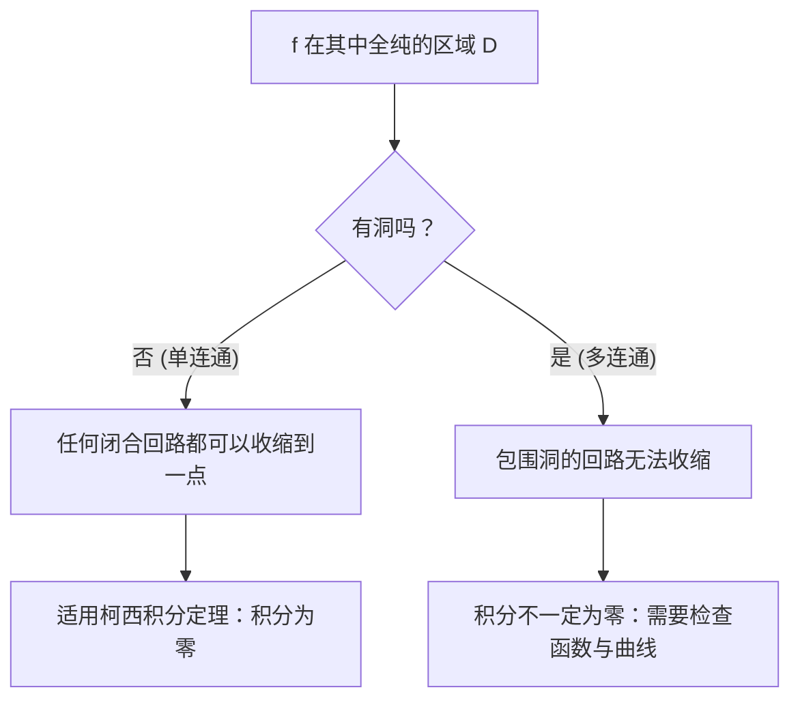

## 1. 引言

在被称为复分析的数学领域中，最美丽且最强大的定理之一便是 **柯西积分定理** ([Cauchy](https://kenji.blog/zh-cn/p/cauchy/)'s integral theorem)。该定理断言了一个乍看之下非常令人惊讶的事实：“沿着闭合路径对满足特定条件的复变函数进行积分，其结果将总是等于零。”

实函数的积分可以表示带符号的面积或沿路径的累积。在复分析中，全纯函数具有很强的抵消性质：如果函数在单连通区域内全纯，那么它沿该区域内分段光滑路径的积分只取决于起点和终点。仅有全纯性，并不能保证在有洞的区域内也具有全局的路径无关性。

在本文中，我们将非常详细地解释柯西积分定理，从复平面和全纯函数的基础定义出发，探讨该定理的直观含义、物理诠释，以及使用格林定理进行经典证明的草图。此外，我们还将涉及该定理如何与复分析中更高级的主题（如柯西积分公式和[留数定理](https://kenji.blog/zh-cn/p/residue-theorem/)）相联系。让我们从数学的严谨性和直观的想象力这两个角度，共同体会这一定理的深邃之处。

## 2. 复平面与全纯函数的基础

为了深刻理解柯西积分定理，我们必须首先巩固对复平面基础知识和复变函数微分的理解。这里的理解构成了后续定理证明和诠释的重要基石。

### 复平面上的函数

复变函数 $f(z)$ 是一个将复数 $z = x + iy$ 映射到另一个复数 $w = u + iv$ 的函数。这里，$x, y$ 是实数，$i$ 是虚数单位（$i^2 = -1$），而 $u, v$ 分别是依赖于 $x, y$ 的实值函数。因此，复变函数可以表示为两个实变量的两个实值函数的组合，如下所示：

$$
f(z) = u(x, y) + i v(x, y)
$$

例如，对于函数 $f(z) = z^2$，代入 $z = x + iy$ 并展开得到 $z^2 = (x + iy)^2 = x^2 - y^2 + 2ixy$。因此，在这种情况下，我们可以看到它是由实值函数 $u(x, y) = x^2 - y^2$ 和 $v(x, y) = 2xy$ 组成的。

### 复微分与柯西-黎曼方程

如果以下极限存在，则称复变函数 $f(z)$ 在某一点 $z_0$ 处是 **可微的**：

$$
f'(z_0) = \lim_{\Delta z \to 0} \frac{f(z_0 + \Delta z) - f(z_0)}{\Delta z}
$$

关键在于，无论 $\Delta z$ 以何种方式在复平面内趋于零，极限都必须相同；这包括沿曲线趋近，而不只是沿各条直线的方向趋近。因此，复可微性比实可微性施加了更强的约束。

如果函数 $f(z)$ 在某个开区域的每一点都复可微，就称它在该区域内**全纯**。全纯性意味着实部 $u$ 和虚部 $v$ 满足以下必要条件，称为**柯西–黎曼方程**：

$$
\frac{\partial u}{\partial x} = \frac{\partial v}{\partial y}, \quad \frac{\partial u}{\partial y} = -\frac{\partial v}{\partial x}
$$

反过来，如果 $u$ 和 $v$ 在开区域内具有连续的一阶偏导数，并且处处满足上述方程，则 $f=u+iv$ 在该区域内全纯。缺少适当的正则性假设时，不能把这些方程直接当作全纯性的无条件充要判据。

## 3. 复积分的定义与性质

接下来，我们定义复平面上的线积分。由于柯西积分定理是一个关于沿着复平面上“曲线”积分的定理，因此弄清这个积分的定义是必不可少的。

设复平面上的分段光滑曲线 $C$ 用实参数 $t\in[a,b]$ 表示为 $z(t)=x(t)+iy(t)$。对于沿曲线连续的函数 $f$，其线积分定义如下；遇到分段时，分别积分后相加：

$$
\int_C f(z) dz = \int_a^b f(z(t)) z'(t) dt
$$

这里，$z'(t) = \frac{dx}{dt} + i \frac{dy}{dt}$，并且通过执行形式上的替换 $dz = dx + i dy$，计算最终可以归结为对实变量的积分。

复积分具有类似于实函数线积分的基本性质，例如：

1. **线性**：对于任意复常数 $\alpha, \beta$，均有 $\int_C (\alpha f(z) + \beta g(z)) dz = \alpha \int_C f(z) dz + \beta \int_C g(z) dz$ 成立。
2. **路径反转**：如果曲线 $C$ 的方向（从起点到终点的行进方向）被反转并记为 $-C$，则 $\int_{-C} f(z) dz = -\int_C f(z) dz$。反向运行积分路径会使符号翻转。
3. **路径的分割与结合**：当一条曲线 $C$ 可以在中间某个点被分割为 $C_1$ 和 $C_2$ 时，整体的积分表示为部分积分的和。即，$\int_C f(z) dz = \int_{C_1} f(z) dz + \int_{C_2} f(z) dz$。

这些性质虽然看似显而易见，但当我们稍后通过各种方式使路径变形来推进论证时，它们将成为非常强大的工具。

## 4. 柯西积分定理的表述

至此我们的准备工作已经完成，终于可以陈述主题——柯西积分定理的精确表述了。

**定理（柯西积分定理）**
设 $D$ 为单连通开区域，$f$ 在 $D$ 内全纯。对于完全位于 $D$ 内的任意分段光滑闭曲线 $C$（允许自交），均有：

$$
\oint_C f(z) dz = 0
$$

让我们补充一些作为该定理先决条件出现的重要术语。

- **单连通区域** (Simply connected domain)：直观地说，这是指“没有洞”的区域。用数学的严谨性来表达，它是指这样一个区域：其内部的任何闭曲线都可以连续地变形并收缩到一个单一的点，而绝不会离开该区域。
- **分段光滑闭曲线**：起点与终点重合，且由有限段光滑曲线组成。上述定理不要求曲线无自交。没有自交的闭曲线称为简单闭曲线，它将平面分为内部和外部；下文使用格林定理的证明将采用这种曲线。

下面的图表直观地展示了单连通区域与多连通区域（有洞的区域）中闭曲线行为的差异。

## 5. 定理的直观理解与物理诠释

为什么在定理的假设下，闭曲线积分会为零？为了建立直观理解，我们将复积分分解为实部和虚部。

令 $f(z) = u + iv$ 且 $dz = dx + i dy$。那么积分可以展开如下：

$$
\oint_C f(z) dz = \oint_C (u + iv)(dx + idy) = \oint_C (u dx - v dy) + i \oint_C (v dx + u dy)
$$

请注意这个方程的右侧。出现了两个实积分，它们与二维平面上向量场的线积分具有完全相同的形式。具体来说，实部可以解释为向量场 $\vec{F}_1 = (u, -v)$ 的线积分，而虚部可以解释为向量场 $\vec{F}_2 = (v, u)$ 的线积分。

在物理学中，向量场沿闭曲线的线积分称为环量。对于单连通区域内连续可微的向量场，无旋意味着沿任意分段光滑闭曲线的环量为零。如果区域有洞，仅有局部无旋并不能保证全局的环量为零。

向量场 $\vec{F}_1=(u,-v)$ 和 $\vec{F}_2=(v,u)$ 的标量旋度分别是 $-v_x-u_y$ 和 $u_x-v_y$。柯西–黎曼方程 $u_y=-v_x$ 使第一个为零，$u_x=v_y$ 使第二个为零。同样，这两个方程还给出 $\operatorname{div}\vec{F}_1=u_x-v_y=0$ 和 $\operatorname{div}\vec{F}_2=v_x+u_y=0$，即两个场的散度也都为零。

因此，全纯性使这两个向量场既无旋又无源。对于环量为零的论证，关键是无旋条件与区域的单连通性；散度为零则是另一项性质。这一区分有助于理解柯西积分定理中的抵消机制。

## 6. 使用格林定理的严谨证明草图

在这个经典证明中，额外假设 $u$ 和 $v$ 在包含曲线 $C$ 及其内部 $D'$ 的开集上具有连续的一阶偏导数，并假设 $C$ 为正向（逆时针）的分段光滑简单闭曲线。下述计算先证明这种曲线的情形，推广到一般闭曲线还需要进一步论证。

格林定理把沿 $C=\partial D'$ 的线积分转化为内部 $D'$ 上的二重积分。在下面的表述中，$P$ 和 $Q$ 在 $D'$ 的闭包的开邻域上具有连续的一阶偏导数，边界取正向。

**格林定理**
$$
\oint_{\partial D'} (P dx + Q dy) = \iint_{D'} \left( \frac{\partial Q}{\partial x} - \frac{\partial P}{\partial y} \right) dx dy
$$

让我们将这个格林定理应用到前面分解出的复积分的实部。在这里，我们令 $P = u, Q = -v$。

$$
\oint_C (u dx - v dy) = \iint_{D'} \left( \frac{\partial (-v)}{\partial x} - \frac{\partial u}{\partial y} \right) dx dy
$$

现在，我们代入柯西-黎曼方程 $\frac{\partial u}{\partial y} = -\frac{\partial v}{\partial x}$，这是全纯函数的一个性质。于是，被积函数变为如下形式：

$$
-\frac{\partial v}{\partial x} - \left( -\frac{\partial v}{\partial x} \right) = 0
$$

由于被积函数在区域内的所有点都变为 $0$，整个二重积分变为零，这就证明了实部的线积分为零。

通过完全相同的过程，我们将格林定理应用于虚部 $i \oint_C (v dx + u dy)$。这里 $P = v, Q = u$。

$$
\oint_C (v dx + u dy) = \iint_{D'} \left( \frac{\partial u}{\partial x} - \frac{\partial v}{\partial y} \right) dx dy
$$

同样地，代入另一个柯西-黎曼方程 $\frac{\partial u}{\partial x} = \frac{\partial v}{\partial y}$，被积函数变为 $\frac{\partial v}{\partial y} - \frac{\partial v}{\partial y} = 0$，虚部的积分也变为零。

综上所述，由于实部和虚部都变为零，以下等式成立：

$$
\oint_C f(z) dz = 0 + i0 = 0
$$

这就是柯西积分定理证明的骨架。我们可以看到，通过柯西-黎曼方程和格林定理的美妙结合，证明可以令人惊讶地简单完成。

## 7. 古尔萨定理：移除连续可微性的假设

上面的证明明确假设 $u$ 和 $v$ 的一阶偏导数连续，以便使用格林定理。古尔萨定理说明，无须另行假设这种连续性。

关键假设是 $f$ 在一个开区域的每一点都复可微，不需要再单独要求 $f'$ 连续。结合相应的区域和曲线条件，这便得到通常称为柯西–古尔萨定理的结果。

现代证明的一种方法是反复细分三角形，并估计小三角形上的积分。在开区域的每一点都复可微，是一个很强的条件：它意味着全纯性，并进而推出任意阶导数的存在。但仅在一个点复可微并不够。例如，$f(z)=|z|^2$ 在 $0$ 处复可微，却不在 $0$ 的任何邻域内全纯。

## 8. 路径变形与路径无关性

柯西积分定理一个极其重要的推论是 **积分的路径无关性**。

设 $A$、$B$ 位于单连通开区域 $D$ 中，$C_1$ 和 $C_2$ 是 $D$ 内从 $A$ 到 $B$ 的两条分段光滑路径。如果 $f$ 在 $D$ 内全纯，则：

$$
\int_{C_1} f(z) dz = \int_{C_2} f(z) dz
$$

证明非常简单。考虑一条通过 $C_1$ 到达 $B$，然后通过反向路径 $-C_2$ 返回到 $A$ 的路径。这就形成了一条单一的闭合曲线 $C = C_1 + (-C_2)$。根据柯西积分定理，沿着这条闭合曲线的积分为零。

$$
\oint_C f(z) dz = \int_{C_1} f(z) dz + \int_{-C_2} f(z) dz = \int_{C_1} f(z) dz - \int_{C_2} f(z) dz = 0
$$

通过移项，我们得到 $\int_{C_1} f(z) dz = \int_{C_2} f(z) dz$。

在这些假设下，积分只取决于起点和终点。固定一个基点，便可在 $D$ 上定义原函数 $F$；它在相差一个加法常数的意义下唯一，且满足 $F'=f$。这就是复积分中的微积分基本定理。

## 9. 应用：柯西积分公式与多连通区域的推广

柯西积分定理本身就是一个美丽的定理，但它更是作为复分析中相继推导出其他重要定理的强大基础。

### 柯西积分公式

一个重要推论是**柯西积分公式**。设 $C$ 为正向（逆时针）的分段光滑简单闭曲线，$f$ 在包含 $C$ 及其内部的开集上全纯，且 $a$ 位于 $C$ 的内部，则：

$$
f(a) = \frac{1}{2\pi i} \oint_C \frac{f(z)}{z - a} dz
$$

这个公式展示了全纯函数的刚性：知道 $C$ 上的函数值，就能确定 $C$ 内部每一点的函数值。仅凭这个公式，并不能直接确定曲线外部的函数值。

### 多连通区域与[留数定理](https://kenji.blog/zh-cn/p/residue-theorem/)

如果区域有洞，单连通版本的定理不能直接套用，积分值需要结合函数与曲线判断。例如，$f(z)=1/z$ 在原点之外全纯，但沿逆时针单位圆的积分为 $2\pi i$。相比之下，$1/z^2$ 沿同一圆周的积分为 $0$。区域有洞并不意味着积分必然非零。

然而，通过巧妙地应用柯西积分定理并使积分路径变形，建立了一种系统的方法来评估洞周围的积分。这引出了 **[留数定理](https://kenji.blog/zh-cn/p/residue-theorem/)** (Residue theorem)，它是现代复分析中最实用的工具之一。利用[留数定理](https://kenji.blog/zh-cn/p/residue-theorem/)，实函数的复杂定积分和反常积分可以被精彩地替换为复平面上的代数计算并得到解决。

## 10. 结语

乍一看，柯西积分定理可能像是一个普通的定理，仅仅说“积分变为零”。然而，隐藏在其背后的是由复变函数“全纯性”这一看似简单的条件所带来的深邃而美丽的对称性。

柯西积分定理支撑着积分公式、任意阶导数的存在、局部泰勒展开、适当圆环域内的洛朗展开以及留数定理。这些结果共同构成了复分析的基础。

我们鼓励读者拿起纸和笔，亲手走一遍使用格林定理的证明过程。这样你必定能够真切地感受到，在数学公式的背后展开的那片和谐而美丽的复平面世界。

## 参考资料

- [MIT 18.04：复积分、柯西定理与积分公式](https://ocw.mit.edu/courses/18-04-complex-variables-with-applications-spring-2018/1968cab6de7c96ead1c83001459a007b_MIT18_04S18_topic3.pdf)
- [MIT 18.112：柯西定理与积分公式](https://ocw.mit.edu/courses/18-112-functions-of-a-complex-variable-fall-2008/8793d412fa0da2a4183539f5d8f7e3fd_lecture13.pdf)
- [NIST DLMF §1.9：复变量微积分](https://dlmf.nist.gov/1.9)
