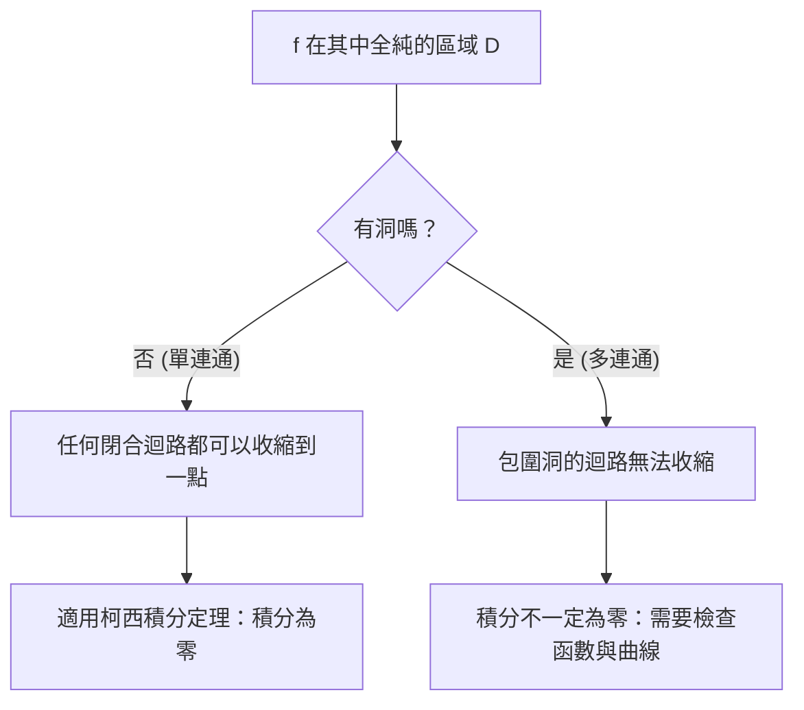

## 1. 引言

在被稱為複變分析的數學領域中，最美麗且最強大的定理之一便是 **柯西積分定理** ([Cauchy](https://kenji.blog/zh-tw/p/cauchy/)'s integral theorem)。該定理斷言了一個乍看之下非常令人驚訝的事實：「沿著閉合路徑對滿足特定條件的複變函數進行積分，其結果將總是等於零。」

實函數的積分可以表示帶符號的面積或沿路徑的累積。在複變分析中，全純函數具有很強的抵消性質：如果函數在單連通區域內全純，那麼它沿該區域內分段光滑路徑的積分只取決於起點和終點。僅有全純性，並不能保證在有洞的區域內也具有全域的路徑無關性。

在本文中，我們將非常詳細地解釋柯西積分定理，從複數平面和全純函數的基礎定義出發，探討該定理的直觀含義、物理詮釋，以及使用格林定理進行經典證明的草圖。此外，我們還將涉及該定理如何與複變分析中更高級的主題（如柯西積分公式和[留數定理](https://kenji.blog/zh-tw/p/residue-theorem/)）相聯繫。讓我們從數學的嚴謹性和直觀的想像力這兩個角度，共同體會這一定理的深邃之處。

## 2. 複數平面與全純函數的基礎

為了深刻理解柯西積分定理，我們必須首先鞏固對複數平面基礎知識和複變函數微分的理解。這裡的理解構成了後續定理證明和詮釋的重要基石。

### 複數平面上的函數

複變函數 $f(z)$ 是一個將複數 $z = x + iy$ 映射到另一個複數 $w = u + iv$ 的函數。這裡，$x, y$ 是實數，$i$ 是虛數單位（$i^2 = -1$），而 $u, v$ 分別是依賴於 $x, y$ 的實值函數。因此，複變函數可以表示為兩個實變數的兩個實值函數的組合，如下所示：

$$
f(z) = u(x, y) + i v(x, y)
$$

例如，對於函數 $f(z) = z^2$，代入 $z = x + iy$ 並展開得到 $z^2 = (x + iy)^2 = x^2 - y^2 + 2ixy$。因此，在這種情況下，我們可以看到它是由實值函數 $u(x, y) = x^2 - y^2$ 和 $v(x, y) = 2xy$ 組成的。

### 複微分與柯西-黎曼方程式

如果以下極限存在，則稱複變函數 $f(z)$ 在某一點 $z_0$ 處是 **可微的**：

$$
f'(z_0) = \lim_{\Delta z \to 0} \frac{f(z_0 + \Delta z) - f(z_0)}{\Delta z}
$$

關鍵在於，無論 $\Delta z$ 以何種方式在複數平面內趨於零，極限都必須相同；這包括沿曲線趨近，而不只是沿各條直線的方向趨近。因此，複可微性比實可微性施加了更強的約束。

如果函數 $f(z)$ 在某個開區域的每一點都複可微，就稱它在該區域內**全純**。全純性意味著實部 $u$ 和虛部 $v$ 滿足以下必要條件，稱為**柯西–黎曼方程式**：

$$
\frac{\partial u}{\partial x} = \frac{\partial v}{\partial y}, \quad \frac{\partial u}{\partial y} = -\frac{\partial v}{\partial x}
$$

反過來，如果 $u$ 和 $v$ 在開區域內具有連續的一階偏導數，並且處處滿足上述方程式，則 $f=u+iv$ 在該區域內全純。缺少適當的正則性假設時，不能把這些方程式直接當作全純性的無條件充要判準。

## 3. 複積分的定義與性質

接下來，我們定義複數平面上的線積分。由於柯西積分定理是一個關於沿著複數平面上「曲線」積分的定理，因此弄清這個積分的定義是必不可少的。

設複數平面上的分段光滑曲線 $C$ 用實參數 $t\in[a,b]$ 表示為 $z(t)=x(t)+iy(t)$。對於沿曲線連續的函數 $f$，其線積分定義如下；遇到分段時，分別積分後相加：

$$
\int_C f(z) dz = \int_a^b f(z(t)) z'(t) dt
$$

這裡，$z'(t) = \frac{dx}{dt} + i \frac{dy}{dt}$，並且通過執行形式上的替換 $dz = dx + i dy$，計算最終可以歸結為對實變數的積分。

複積分具有類似於實函數線積分的基本性質，例如：

1. **線性**：對於任意複數常數 $\alpha, \beta$，均有 $\int_C (\alpha f(z) + \beta g(z)) dz = \alpha \int_C f(z) dz + \beta \int_C g(z) dz$ 成立。
2. **路徑反轉**：如果曲線 $C$ 的方向（從起點到終點的行進方向）被反轉並記為 $-C$，則 $\int_{-C} f(z) dz = -\int_C f(z) dz$。反向運行積分路徑會使符號翻轉。
3. **路徑的分割與結合**：當一條曲線 $C$ 可以在中間某個點被分割為 $C_1$ 和 $C_2$ 時，整體的積分表示為部分積分的和。即，$\int_C f(z) dz = \int_{C_1} f(z) dz + \int_{C_2} f(z) dz$。

這些性質雖然看似顯而易見，但當我們稍後通過各種方式使路徑變形來推進論證時，它們將成為非常強大的工具。

## 4. 柯西積分定理的表述

至此我們的準備工作已經完成，終於可以陳述主題——柯西積分定理的精確表述了。

**定理（柯西積分定理）**
設 $D$ 為單連通開區域，$f$ 在 $D$ 內全純。對於完全位於 $D$ 內的任意分段光滑閉曲線 $C$（允許自交），均有：

$$
\oint_C f(z) dz = 0
$$

讓我們補充一些作為該定理先決條件出現的重要術語。

- **單連通區域** (Simply connected domain)：直觀地說，這是指「沒有洞」的區域。用數學的嚴謹性來表達，它是指這樣一個區域：其內部的任何閉曲線都可以連續地變形並收縮到一個單一的點，而絕不會離開該區域。
- **分段光滑閉曲線**：起點與終點重合，且由有限段光滑曲線組成。上述定理不要求曲線無自交。沒有自交的閉曲線稱為簡單閉曲線，它將平面分為內部和外部；下文使用格林定理的證明將採用這種曲線。

下面的圖表直觀地展示了單連通區域與多連通區域（有洞的區域）中閉曲線行為的差異。

## 5. 定理的直觀理解與物理詮釋

為什麼在定理的假設下，閉曲線積分會為零？為了建立直觀理解，我們將複積分分解為實部和虛部。

令 $f(z) = u + iv$ 且 $dz = dx + i dy$。那麼積分可以展開如下：

$$
\oint_C f(z) dz = \oint_C (u + iv)(dx + idy) = \oint_C (u dx - v dy) + i \oint_C (v dx + u dy)
$$

請注意這個方程式的右側。出現了兩個實積分，它們與二維平面上向量場的線積分具有完全相同的形式。具體來說，實部可以解釋為向量場 $\vec{F}_1 = (u, -v)$ 的線積分，而虛部可以解釋為向量場 $\vec{F}_2 = (v, u)$ 的線積分。

在物理學中，向量場沿閉曲線的線積分稱為環量。對於單連通區域內連續可微的向量場，無旋意味著沿任意分段光滑閉曲線的環量為零。如果區域有洞，僅有局部無旋並不能保證全域的環量為零。

向量場 $\vec{F}_1=(u,-v)$ 和 $\vec{F}_2=(v,u)$ 的純量旋度分別是 $-v_x-u_y$ 和 $u_x-v_y$。柯西–黎曼方程式 $u_y=-v_x$ 使第一個為零，$u_x=v_y$ 使第二個為零。同樣，這兩個方程式還給出 $\operatorname{div}\vec{F}_1=u_x-v_y=0$ 和 $\operatorname{div}\vec{F}_2=v_x+u_y=0$，即兩個場的散度也都為零。

因此，全純性使這兩個向量場既無旋又無源。對於環量為零的論證，關鍵是無旋條件與區域的單連通性；散度為零則是另一項性質。這一區分有助於理解柯西積分定理中的抵消機制。

## 6. 使用格林定理的嚴謹證明草圖

在這個經典證明中，額外假設 $u$ 和 $v$ 在包含曲線 $C$ 及其內部 $D'$ 的開集上具有連續的一階偏導數，並假設 $C$ 為正向（逆時針）的分段光滑簡單閉曲線。下述計算先證明這種曲線的情形，推廣到一般閉曲線還需要進一步論證。

格林定理把沿 $C=\partial D'$ 的線積分轉化為內部 $D'$ 上的二重積分。在下面的表述中，$P$ 和 $Q$ 在 $D'$ 的閉包的開鄰域上具有連續的一階偏導數，邊界取正向。

**格林定理**
$$
\oint_{\partial D'} (P dx + Q dy) = \iint_{D'} \left( \frac{\partial Q}{\partial x} - \frac{\partial P}{\partial y} \right) dx dy
$$

讓我們將這個格林定理應用到前面分解出的複積分的實部。在這裡，我們令 $P = u, Q = -v$。

$$
\oint_C (u dx - v dy) = \iint_{D'} \left( \frac{\partial (-v)}{\partial x} - \frac{\partial u}{\partial y} \right) dx dy
$$

現在，我們代入柯西-黎曼方程式 $\frac{\partial u}{\partial y} = -\frac{\partial v}{\partial x}$，這是全純函數的一個性質。於是，被積函數變為如下形式：

$$
-\frac{\partial v}{\partial x} - \left( -\frac{\partial v}{\partial x} \right) = 0
$$

由於被積函數在區域內的所有點都變為 $0$，整個二重積分變為零，這就證明了實部的線積分為零。

通過完全相同的過程，我們將格林定理應用於虛部 $i \oint_C (v dx + u dy)$。這裡 $P = v, Q = u$。

$$
\oint_C (v dx + u dy) = \iint_{D'} \left( \frac{\partial u}{\partial x} - \frac{\partial v}{\partial y} \right) dx dy
$$

同樣地，代入另一個柯西-黎曼方程式 $\frac{\partial u}{\partial x} = \frac{\partial v}{\partial y}$，被積函數變為 $\frac{\partial v}{\partial y} - \frac{\partial v}{\partial y} = 0$，虛部的積分也變為零。

綜上所述，由於實部和虛部都變為零，以下等式成立：

$$
\oint_C f(z) dz = 0 + i0 = 0
$$

這就是柯西積分定理證明的骨架。我們可以看到，通過柯西-黎曼方程式和格林定理的美妙結合，證明可以令人驚訝地簡單完成。

## 7. 古爾薩定理：移除連續可微性的假設

上面的證明明確假設 $u$ 和 $v$ 的一階偏導數連續，以便使用格林定理。古爾薩定理說明，無須另行假設這種連續性。

關鍵假設是 $f$ 在一個開區域的每一點都複可微，不需要再單獨要求 $f'$ 連續。結合相應的區域和曲線條件，這便得到通常稱為柯西–古爾薩定理的結果。

現代證明的一種方法是反覆細分三角形，並估計小三角形上的積分。在開區域的每一點都複可微，是一個很強的條件：它意味著全純性，並進而推出任意階導數的存在。但僅在一個點複可微並不夠。例如，$f(z)=|z|^2$ 在 $0$ 處複可微，卻不在 $0$ 的任何鄰域內全純。

## 8. 路徑變形與路徑無關性

柯西積分定理一個極其重要的推論是 **積分的路徑無關性**。

設 $A$、$B$ 位於單連通開區域 $D$ 中，$C_1$ 和 $C_2$ 是 $D$ 內從 $A$ 到 $B$ 的兩條分段光滑路徑。如果 $f$ 在 $D$ 內全純，則：

$$
\int_{C_1} f(z) dz = \int_{C_2} f(z) dz
$$

證明非常簡單。考慮一條通過 $C_1$ 到達 $B$，然後通過反向路徑 $-C_2$ 返回到 $A$ 的路徑。這就形成了一條單一的閉合曲線 $C = C_1 + (-C_2)$。根據柯西積分定理，沿著這條閉合曲線的積分為零。

$$
\oint_C f(z) dz = \int_{C_1} f(z) dz + \int_{-C_2} f(z) dz = \int_{C_1} f(z) dz - \int_{C_2} f(z) dz = 0
$$

通過移項，我們得到 $\int_{C_1} f(z) dz = \int_{C_2} f(z) dz$。

在這些假設下，積分只取決於起點和終點。固定一個基點，便可在 $D$ 上定義反導函數 $F$；它在相差一個加法常數的意義下唯一，且滿足 $F'=f$。這就是複積分中的微積分基本定理。

## 9. 應用：柯西積分公式與多連通區域的推廣

柯西積分定理本身就是一個美麗的定理，但它更是作為複變分析中相繼推導出其他重要定理的強大基礎。

### 柯西積分公式

一個重要推論是**柯西積分公式**。設 $C$ 為正向（逆時針）的分段光滑簡單閉曲線，$f$ 在包含 $C$ 及其內部的開集上全純，且 $a$ 位於 $C$ 的內部，則：

$$
f(a) = \frac{1}{2\pi i} \oint_C \frac{f(z)}{z - a} dz
$$

這個公式展示了全純函數的剛性：知道 $C$ 上的函數值，就能確定 $C$ 內部每一點的函數值。僅憑這個公式，並不能直接確定曲線外部的函數值。

### 多連通區域與[留數定理](https://kenji.blog/zh-tw/p/residue-theorem/)

如果區域有洞，單連通版本的定理不能直接套用，積分值需要結合函數與曲線判斷。例如，$f(z)=1/z$ 在原點之外全純，但沿逆時針單位圓的積分為 $2\pi i$。相比之下，$1/z^2$ 沿同一圓周的積分為 $0$。區域有洞並不意味著積分必然非零。

然而，通過巧妙地應用柯西積分定理並使積分路徑變形，建立了一種系統的方法來評估洞周圍的積分。這引出了 **[留數定理](https://kenji.blog/zh-tw/p/residue-theorem/)** (Residue theorem)，它是現代複變分析中最實用的工具之一。利用[留數定理](https://kenji.blog/zh-tw/p/residue-theorem/)，實函數的複雜定積分和瑕積分可以被精彩地替換為複數平面上的代數計算並得到解決。

## 10. 結語

乍看之下，柯西積分定理可能像是一個普通的定理，僅僅說「積分變為零」。然而，隱藏在其背後的是由複變函數「全純性」這一看似簡單的條件所帶來的深邃而美麗的對稱性。

柯西積分定理支撐著積分公式、任意階導數的存在、局部泰勒展開、適當圓環域內的羅朗展開以及留數定理。這些結果共同構成了複變分析的基礎。

我們鼓勵讀者拿起紙和筆，親手走一遍使用格林定理的證明過程。這樣你必定能夠真切地感受到，在數學公式的背後展開的那片和諧而美麗的複數平面世界。

## 參考資料

- [MIT 18.04：複積分、柯西定理與積分公式](https://ocw.mit.edu/courses/18-04-complex-variables-with-applications-spring-2018/1968cab6de7c96ead1c83001459a007b_MIT18_04S18_topic3.pdf)
- [MIT 18.112：柯西定理與積分公式](https://ocw.mit.edu/courses/18-112-functions-of-a-complex-variable-fall-2008/8793d412fa0da2a4183539f5d8f7e3fd_lecture13.pdf)
- [NIST DLMF §1.9：複變數微積分](https://dlmf.nist.gov/1.9)
