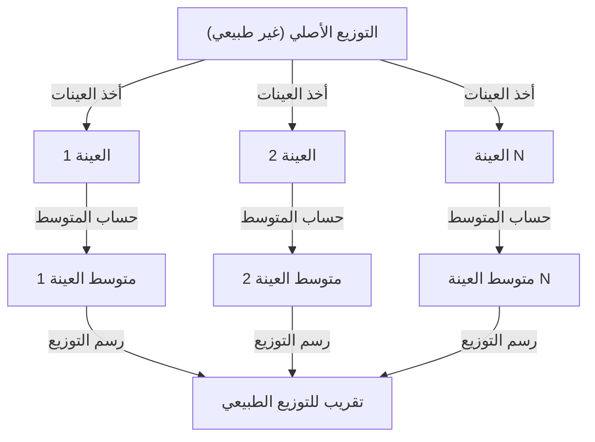

## 1. مقدمة

تصف نظرية النهاية المركزية (CLT) تقارب المجموع أو متوسط العينة بعد التوحيد إلى التوزيع الطبيعي القياسي، عندما تكون المتغيرات مستقلة وموزعة بشكل متطابق ولها متوسط محدود وتباين موجب محدود. لا يتغير توزيع المشاهدات الأصلية عند زيادة حجم العينة.

في هذه المقالة، سنشرح نظرية النهاية المركزية بشكل موسع، من الصورة البديهية إلى التعريف الرياضي الصارم وأمثلة التطبيق العملي.

## 2. ما هي نظرية النهاية المركزية؟

نظرية النهاية المركزية نتيجة أساسية في الاحتمالات والإحصاء. في صورتها الأساسية، تتطلب متغيرات عشوائية مستقلة وموزعة بشكل متطابق بمتوسط محدود وتباين موجب محدود. عندئذ يتقارب المجموع أو متوسط العينة بعد التوحيد في التوزيع إلى التوزيع الطبيعي القياسي. لا تشمل هذه النتيجة كل توزيع؛ فتوزيع كوشي مثلاً لا يحقق هذه الشروط.

### 2.1 الفهم البديهي

تأمل في حجر النرد. عندما ترمي حجراً واحداً، يكون توزيع النتائج توزيعاً منتظماً. ومع ذلك، عندما ترمي حجرين وتأخذ مجموعهما، يصبح التوزيع مثلثاً يبلغ ذروته عند 7 في المنتصف. وكلما قمت بزيادة عدد أحجار النرد بشكل أكبر، يقترب توزيع مجموعها من منحنى أملس على شكل جرس، أي **توزيع طبيعي**.

### 2.2 التعريف الرياضي

لنفترض أن $X_1, X_2, \dots, X_n$ متغيرات عشوائية مستقلة وموزعة بشكل متطابق (i.i.d.) بمتوسط محدود $\mu$ وتباين موجب محدود $0<\sigma^2<\infty$.

ليكن متوسط العينة $\bar{X} = \frac{1}{n} \sum_{i=1}^{n} X_i$. وفقاً لنظرية النهاية المركزية، عندما يكون $n$ كبيراً بما يكفي، يتقارب المتغير الموحد $Z$ كما هو موضح أدناه إلى التوزيع الطبيعي القياسي $\mathcal{N}(0, 1)$.


$$
Z = \frac{\bar{X} - \mu}{\frac{\sigma}{\sqrt{n}}} \xrightarrow{d} \mathcal{N}(0, 1) \text{ عندما } n \to \infty
$$


هنا، تعني $\xrightarrow{d}$ التقارب في التوزيع. يشير $\text{ عندما } n \to \infty$ إلى أن حجم العينة يقترب من اللانهاية.

## 3. تصور نظرية النهاية المركزية

لفهم كيفية عمل نظرية النهاية المركزية بصرياً، إليك مخطط عملية باستخدام Mermaid.



## 4. المحاكاة باستخدام بايثون

بدلاً من مجرد النظرية، دعنا نقوم فعلياً بتشغيل برنامج للتحقق من ذلك. سنحاكي سحب البيانات من توزيع منتظم ونرى كيف يتم توزيع متوسطها.

```python
import numpy as np
import matplotlib.pyplot as plt

# معلمات المجتمع (توزيع منتظم [0, 1])
mu = 0.5
sigma = np.sqrt(1/12)

# إعدادات المحاكاة
sample_sizes = [1, 5, 30, 100]
num_simulations = 10000

# إعدادات رسم الرسم البياني
fig, axes = plt.subplots(2, 2, figsize=(12, 8))
axes = axes.flatten()

for i, n in enumerate(sample_sizes):
    # استخرج n عينات من التوزيع المنتظم num_simulations مرات
    samples = np.random.uniform(0, 1, (num_simulations, n))
    
    # احسب متوسط العينة لكل تجربة
    sample_means = np.mean(samples, axis=1)
    
    # رسم المدرج التكراري (الهيستوجرام)
    ax = axes[i]
    ax.hist(sample_means, bins=50, density=True, alpha=0.7, color='skyblue')
    ax.set_title(f"n={n}")
    
    # إضافة المنحنى النظري للتوزيع الطبيعي
    x = np.linspace(mu - 4*sigma/np.sqrt(n), mu + 4*sigma/np.sqrt(n), 100)
    y = (1 / (np.sqrt(2 * np.pi) * (sigma/np.sqrt(n)))) * np.exp(-0.5 * ((x - mu) / (sigma/np.sqrt(n)))**2)
    ax.plot(x, y, 'r-', lw=2)

plt.tight_layout()
plt.show()
```

عندما تقوم بتشغيل هذا الكود، يمكنك التأكد من أنه عندما يكون $n=1$ فإنه توزيع منتظم، ولكن كلما كبر $n$، يقترب المدرج التكراري من التوزيع الطبيعي للخط الأحمر.

## 5. أهمية وتطبيقات نظرية النهاية المركزية

توفر نظرية النهاية المركزية أساساً للتقريب الطبيعي عند استخدام متوسط العينة في اختبار الفرضيات وبناء فترات الثقة، بشرط تحقق فرضياتها وكفاية حجم العينة. يجب تقييم دقة التقريب، خصوصاً مع العينات الصغيرة أو التوزيعات ذات الذيول الثقيلة.

### 5.1 أساس الاستدلال الإحصائي
عندما نستنتج شيئاً من البيانات، كما هو الحال في استطلاعات الرأي، ومراقبة الجودة، أو اختبار A/B، فإن الكثير من الأساس المنطقي يعتمد على نظرية النهاية المركزية.

### 5.2 تراكم الأخطاء
يمكن نمذجة بعض أخطاء القياس والضوضاء كمجموع لعوامل صغيرة مستقلة، مما قد يؤدي إلى توزيع طبيعي تقريبي تحت شروط مناسبة. هذا لا يعني أن كل أنواع الضوضاء تتبع توزيعاً طبيعياً. ويُعرف التوزيع الطبيعي أيضاً بالتوزيع الغاوسي.

## 6. التعمق: نهج الإثبات

تُستخدم الدوال المميزة وتوسع تايلور للإثبات الصارم لنظرية النهاية المركزية. إليك نظرة عامة موجزة.

باستخدام الدالة المميزة $\phi_X(t) = E[e^{itX}]$، فإن الدالة المميزة لمجموع المتغيرات العشوائية المستقلة هي حاصل ضرب دوالها المميزة كل على حدة. عندما نحسب الدالة المميزة للمتغير الموحد $Z$ ونأخذ النهاية عندما $n \to \infty$, يمكن إثبات أنها تتقارب إلى $e^{-t^2/2}$، وهي الدالة المميزة للتوزيع الطبيعي القياسي. هذا يثبت أن التوزيع نفسه يتقارب إلى توزيع طبيعي.

## 7. خاتمة

نظرية النهاية المركزية هي نظرية جميلة للغاية تظهر النظام المختبئ وراء البيانات الفوضوية. من خلال فهم هذه النظرية، ستتمكن من اكتساب رؤى أعمق في تحليل البيانات وبناء النماذج الإحصائية.


## الملحق: الخلفية الرياضية التفصيلية والتاريخ

### الملحق 1: التطور في نظرية الاحتمالات
تاريخ نظرية النهاية المركزية عميق، حيث نشأ من إثبات أبراهام دي موافر للتقريب الطبيعي للتوزيع ذي الحدين. تم توسيعه لاحقاً بواسطة بيير سيمون لابلاس، وقدم ألكسندر ليابونوف إثباتاً تحت شروط أكثر عمومية. في نظرية الاحتمالات الحديثة، هناك امتدادات مختلفة مثل شرط ليندبيرج وشرط ليابونوف. تضمن هذه الشروط أن المتغيرات العشوائية الفردية ليس لها تأثير مهيمن على المجموع الكلي. وهذا يوفر إجابة على السؤال الأساسي المتمثل في سبب إمكانية تقريب الظواهر المتنوعة في الطبيعة والعلوم الاجتماعية بواسطة توزيع طبيعي.

### الملحق 2: شروط التطبيق ومعنى النظرية

في الشكل الأساسي الذي نوقش في هذا النص، يشترط أن تكون $X_1,\ldots,X_n$ مستقلة وموزعة بشكل متطابق، بمتوسط محدود $\mu$ وتباين إيجابي ومحدود $0<\sigma^2<\infty$. يرجى فهم التفسير "أي توزيع" ضمن نطاق هذه الشروط. ما يقترب من التوزيع الطبيعي هو توزيع المجموع الموحد أو متوسط العينة، وتوزيع المشاهدات الفردية لا يتغير.

### الملحق 3: الخطأ المعياري و[قانون الأعداد الكبيرة](https://kenji.blog/ar/p/law-of-large-numbers/)

بسبب الاستقلال، تكون القيمة المتوقعة وتباين متوسط العينة كما يلي. الخطأ المعياري هو الانحراف المعياري لمتوسط العينة، وليس الانحراف المعياري للمشاهدات الفردية.

$$
E[\bar X_n]=\mu,\qquad \operatorname{Var}(\bar X_n)=\frac{\sigma^2}{n},\qquad \operatorname{SE}(\bar X_n)=\frac{\sigma}{\sqrt n}.
$$

زيادة حجم العينة إلى أربعة أمثاله يقلل الخطأ المعياري إلى النصف. ينص [قانون الأعداد الكبيرة](https://kenji.blog/ar/p/law-of-large-numbers/) على أن متوسط العينة يقترب من $\mu$، وتصف نظرية النهاية المركزية شكل التوزيع عن طريق ضرب التقلب حوله بـ $\sqrt{n}$.

### الملحق 4: إثبات إضافي باستخدام الدوال المميزة

لنفترض $Y_i=(X_i-\mu)/\sigma$ و $Z_n=n^{-1/2}\sum_{i=1}^nY_i$. نظراً لأن $E[Y_i]=0$ و $E[Y_i^2]=1$، يمكن توسيع الدالة المميزة بالقرب من نقطة الأصل على النحو التالي.

$$
\phi_Y(t)=E[e^{itY}]=1-\frac{t^2}{2}+o(t^2)\quad(t\to0).
$$

من الاستقلال، يتم الحصول على المعادلة التالية. نظراً لأن النهاية هي الدالة المميزة للتوزيع الطبيعي القياسي، فإن التقارب في التوزيع يتبع من نظرية استمرارية ليفي. الدوال المميزة والدوال المولدة للعزوم مختلفة، ووجود دالة مولدة للعزوم ليس ضرورياً لهذا الإثبات.

$$
\phi_{Z_n}(t)=\left[\phi_Y\!\left(\frac{t}{\sqrt n}\right)\right]^n
=\left[1-\frac{t^2}{2n}+o\!\left(\frac1n\right)\right]^n
\longrightarrow e^{-t^2/2}.
$$

### الملحق 5: الأمثلة غير القابلة للتطبيق ودقة التقريب

توزيع كوشي ليس له متوسط محدود ولا تباين محدود، ومتوسط العينة لمتغيرات كوشي القياسية المستقلة يظل توزيع كوشي قياسي. علاوة على ذلك، إذا كانت كل $X_i$ تساوي المتغير العشوائي غير المنحل نفسه، فلا يوجد استقلال، وأخذ المتوسط لن يقلل التشتت. لا يوجد ضمان بأن "$n\ge30$ دائماً كافية". يختلف حجم العينة المطلوب اعتماداً على الالتواء والذيول الثقيلة. للتوسع في الحالات المستقلة ولكنها غير موزعة بشكل متطابق، من الضروري التحقق من شروط إضافية مثل شروط ليندبيرج أو ليابونوف.

## المراجع

- [MIT 18.05: Central Limit Theorem and the Law of Large Numbers](https://math.mit.edu/~dav/05.dir/class6-prep.pdf)
