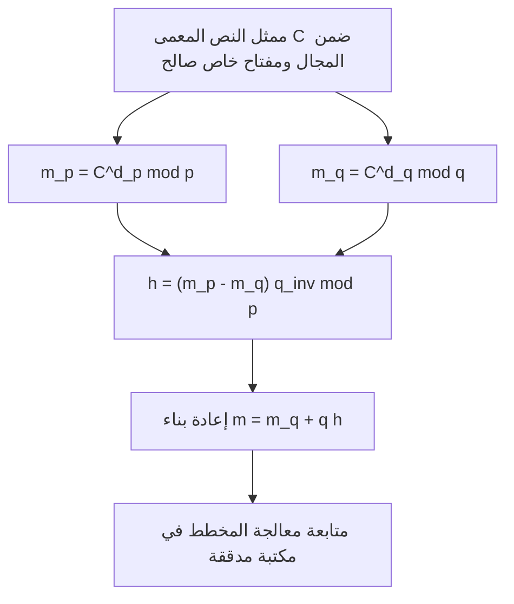

تجمع نظرية الباقي الصينية (CRT) البواقي بالنسبة إلى مقاييس مختلفة في صنف بواق واحد. وتربط مسائل الأعداد الصحيحة وعمليات RSA بالمفتاح الخاص والحلقات وكثيرات الحدود والحساب المتوازي بالبواقي. يجب توضيح شروط المقاييس ومجال إعادة البناء، والتمييز بين صحة الحساب وأمن المخطط التشفيري.

## 1. مسألة صون تزي ومجموعة الحلول

يطلب المثال المرتبط بكتاب «صون تزي سوان جينغ» عددًا يبقى منه 2 عند قسمته على 3، و3 عند قسمته على 5، و2 عند قسمته على 7. وتعيد [دراسة تاريخية عرض المسألة وطريقة الحساب](https://sgmathsociety.org/smsmedley/Vol-30-1/The%20History%20of%20the%20Chinese%20Reminder%20Theorem%20%28Law%20Huang%20lng%29.pdf).

$$ x\equiv2\pmod3,\quad x\equiv3\pmod5,\quad x\equiv2\pmod7. $$

أصغر حل غير سالب هو 23، لكن الحل في الأعداد الصحيحة ليس وحيدًا: جميع الحلول هي $x=23+105t$ حيث $t\in\mathbb Z$. فالعدد 128 يحقق الشروط أيضًا.

## 2. CRT للأعداد الصحيحة: الشروط والوحدانية

نأخذ $k\ge1$ ومقاييس $m_i>1$ أولية فيما بينها مثنى مثنى: $\gcd(m_i,m_j)=1$ عندما $i\ne j$. ولا يلزم أن يكون كل مقياس عددًا أوليًا. لأي أعداد صحيحة $a_i$ تمثل البواقي، يملك النظام

$$ x\equiv a_i\pmod{m_i}\quad(1\le i\le k) $$

حلًا واحدًا بترديد $M=\prod_{i=1}^k m_i$. ولذلك يوجد ممثل واحد يحقق $0\le x<M$. لا يكفي أن يكون القاسم المشترك الأكبر لجميع المقاييس معًا هو 1: فالأعداد 6 و10 و15 قاسمها المشترك الأكبر معًا 1، لكنها ليست أولية فيما بينها مثنى مثنى. يوضح [برهان CRT للأعداد الصحيحة](https://kconrad.math.uconn.edu/blurbs/ugradnumthy/crt.pdf) هذا الفرق.

الفرق بين أي حلين يقبل القسمة على كل مقياس. وبسبب الأولية النسبية لكل زوج، يقبل القسمة على حاصل ضرب المقاييس، وهذا يثبت الوحدانية. ويثبت البناء التالي وجود الحل.

## 3. البناء باستخدام المعكوس ومثال حسابي

لكل مقياس نستخدم خوارزمية إقليدس الموسعة لإيجاد معكوس ضربي يحقق

$$ M_i=M/m_i,\quad M_i y_i\equiv1\pmod{m_i} $$

تضمن الأولية النسبية وجود المعكوس. وبعد اختزال المجموع التالي إلى مجال المقياس نحصل على الحل:

$$ x=\left(\sum_{i=1}^k a_iM_iy_i\right)\bmod M. $$

بترديد $m_j$ تنعدم الحدود التي فيها $i\ne j$، ويكون الحد الباقي مطابقًا لـ $a_j$. وهذا يثبت الوجود.

في مثال صون تزي يكون $M=105$، وحواصل الضرب الجزئية 35 و21 و15، والمعكوسات المقابلة 2 و1 و1.

$$ 2\cdot35\cdot2+3\cdot21\cdot1+2\cdot15\cdot1=233,
\qquad233\bmod105=23. $$

يوجد تعميم منفصل للمقاييس غير الأولية فيما بينها. لمقياسين، يوجد حل إذا وفقط إذا كان القاسم المشترك الأكبر لهما يقسم الفرق بين الباقيين، ويكون الحل وحيدًا بترديد مضاعفهما المشترك الأصغر. مثلًا، يعطي المقياسان 4 و6 مع الباقيين 1 و3 الحل 9 بترديد 12، أما الباقيان 0 و1 فلا يعطيان حلًا. لا ينفذ الكود التالي هذا التعميم، بل يقبل فقط المقاييس الأولية فيما بينها مثنى مثنى.

## 4. تنفيذ Python مع فحص المدخلات

يقبل التنفيذ قيم النوع المضمن `int` فقط، ويرفض `bool` والقيم ذات الفاصلة العائمة. يجب أن يكون المدخلان كائنين قابلين للتكرار، منتهيين وغير فارغين ومتساويين في الطول. يجب أن يتجاوز كل مقياس 1 وأن تكون المقاييس أولية فيما بينها مثنى مثنى. يجوز أن تكون البواقي سالبة أو أكبر من مقاييسها. والنتيجة هي أصغر ممثل غير سالب بترديد حاصل الضرب. استبعاد المقياس 1 والنظام الفارغ هو جزء من عقد هذه الواجهة التعليمية.

```python
from math import gcd, prod


def _extended_gcd(a, b):
    # Internal helper: integer a, positive integer b.
    old_r, r = a, b
    old_s, s = 1, 0
    old_t, t = 0, 1
    while r:
        quotient = old_r // r
        old_r, r = r, old_r - quotient * r
        old_s, s = s, old_s - quotient * s
        old_t, t = t, old_t - quotient * t
    return old_r, old_s, old_t


def mod_inverse(a, modulus):
    if type(a) is not int or type(modulus) is not int:
        raise TypeError("Arguments must be built-in integers")
    if modulus <= 1:
        raise ValueError("Modulus must exceed one")
    g, x, _ = _extended_gcd(a % modulus, modulus)
    if g != 1:
        raise ValueError("Inverse does not exist")
    return x % modulus


def chinese_remainder_theorem(residues, moduli):
    residues, moduli = tuple(residues), tuple(moduli)
    if not moduli or len(residues) != len(moduli):
        raise ValueError("Provide equally sized, nonempty inputs")
    if any(type(x) is not int for x in residues + moduli):
        raise TypeError("Residues and moduli must be built-in integers")
    if any(m <= 1 for m in moduli):
        raise ValueError("Every modulus must exceed one")
    for i, m in enumerate(moduli):
        if any(gcd(m, other) != 1 for other in moduli[:i]):
            raise ValueError("Moduli must be pairwise coprime")

    combined_modulus = prod(moduli)
    result = 0
    for a, m in zip(residues, moduli):
        partial = combined_modulus // m
        inverse = mod_inverse(partial, m)
        result = (result + (a % m) * partial * inverse) % combined_modulus
    return result


if __name__ == "__main__":
    residues = [2, 3, 2]
    moduli = [3, 5, 7]
    print("Sunzi solution:", chinese_remainder_theorem(residues, moduli))
    print("Combined modulus:", prod(moduli))
```

عند التشغيل باستخدام Python 3.12 يظهر `Sunzi solution: 23` و`Combined modulus: 105`. لا تُقتطع المدخلات مختلفة الطول بصمت؛ وتُفحص المقاييس الصفرية والسالبة والأنواع والأولية النسبية. لا تتقيد أعداد Python الصحيحة بعرض ثابت من البتات، لكن الوقت والذاكرة يعتمدان على طول المدخلات وحجم الأعداد. وهذا ليس تنفيذًا تشفيريًا بزمن ثابت (constant-time).

## 5. ما الذي تعيد RSA-CRT بناءه

نفترض مفتاح RSA صالحًا بعاملين أوليين. نستخدم عددين أوليين فرديين مختلفين $p,q$ و$N=pq$ وأسًا عامًا $e$ وأسًا خاصًا $d$ يحققان $ed\equiv1\pmod{\lambda(N)}$، حيث $\lambda(N)=\operatorname{lcm}(p-1,q-1)$. يكون ممثل النص المعمى عددًا صحيحًا يحقق $0\le C<N$، والعملية المباشرة بالمفتاح الخاص هي $m=C^d\bmod N$.

نجهز معاملات CRT:

$$ d_p=d\bmod(p-1),\quad d_q=d\bmod(q-1),\quad q_{\mathrm{inv}}=q^{-1}\bmod p. $$

$$ m_p=C^{d_p}\bmod p,\quad m_q=C^{d_q}\bmod q. $$

$$ h=(m_p-m_q)q_{\mathrm{inv}}\bmod p,\qquad m=m_q+qh. $$

يملك هذا الممثل البواقي المطلوبة بالنسبة إلى العددين الأوليين، ويقع ضمن مجال المقياس الأصلي. تحدد [الفقرتان 3.2 و5.1.2 من RFC 8017](https://www.rfc-editor.org/rfc/rfc8017.html) هذا التمثيل للمفتاح الخاص وطريقة إعادة البناء. الأسّان الخاصان بـ CRT وحدهما لا يستبدلان المفتاح الخاص كله؛ فالعاملان والمعامل أيضًا من بيانات المفتاح السرية.



يعرض الرسم حساب الأعداد الصحيحة فقط، ويغفل ترميز الرسالة والتحقق من المخطط التشفيري. يستخدم التشفير والتوقيع عمليًا مخططات مختلفة. وكما يوضح [مدخل RSA](https://kenji.blog/ar/p/rsa-encryption-math-explained-for-beginners/)، ينبغي أن تنفذ مكتبة خضعت لتدقيق أمني المعالجة المناسبة للغرض.

## 6. تقدير السرعة وحدود التنفيذ

تقدم الملاحظة 14.75 في [الفصل 14 من HAC](https://cacr.uwaterloo.ca/hac/about/chap14.pdf) تقديرًا يقارب أربعة أضعاف، بافتراض تقارب حجم العددين الأوليين، وضرب تقليدي بكلفة تربيعية، وعدد من عمليات الضرب يتناسب مع طول الأس بالبتات، وإهمال كلفة إعادة البناء. تتغير النسبة بتغير خوارزمية الضرب والتنفيذ المتوازي ووسائل الحماية والأجهزة. وليس هذا قياسًا يثبت أن كود المقال أسرع بأربعة أضعاف.

إذا فسد أحد باقيي CRT المحسوبين على نحو منفصل، فقد تكشف نتيجة غير مفحوصة عاملًا سريًا. توضح [ورقة تحليل الأعطال في RSA-CRT](https://courses.csail.mit.edu/6.857/2010/handouts/faults.pdf) الشروط. لا تضمن صحة الحساب التعليمي الحماية من الأعطال أو مقاومة هجمات القنوات الجانبية. ينبغي أن تتولى مكتبة تعالج المخطط كاملًا وسائل الحماية، ومنها فحص النتائج بالمفتاح العام.

## 7. التعميم إلى الحلقات والمثاليات

لتكن $R$ حلقة إبدالية ذات عنصر محايد ضربي، ولنأخذ عددًا منتهيًا من المثاليات. نفترض لكل زوج مختلف أن $I_i+I_j=R$، أي إن مجموع كل مثاليتين مختلفتين هو الحلقة كلها. التشاكل الحلقي الطبيعي (homomorphism)

$$ \phi:R\longrightarrow\prod_{i=1}^k R/I_i,\qquad
\phi(r)=(r+I_1,\ldots,r+I_k) $$

شامل (surjective)، ونواته تقاطع المثاليات. تحت هذا الشرط يساوي التقاطع حاصل ضربها، ولذلك نحصل على التماثل (isomorphism):

$$ R/\left(\bigcap_{i=1}^k I_i\right)
\cong\prod_{i=1}^k R/I_i,\qquad
\bigcap_{i=1}^k I_i=\prod_{i=1}^k I_i. $$

تعرض [نظرية الباقي الصينية في Stacks Project](https://stacks.math.columbia.edu/tag/00DT) الشروط والبرهان. والمقاييس الصحيحة الأولية فيما بينها مثنى مثنى حالة خاصة من شرط المثاليات هذا.

## 8. كثيرات الحدود والاستيفاء

تكون كثيرتا حدود فوق حقل أوليتين فيما بينهما إذا وفقط إذا كان قاسمهما المشترك الأكبر ثابتًا غير صفري. ولا يكفي ألا يكون لهما جذر مشترك في الحقل الأصلي. مثلًا، فوق الأعداد النسبية نجعل كل واحدة من كثيرتي الحدود مساوية لـ $x^2+1$. لا تملك أي منهما جذرًا نسبيًا، لكن القاسم المشترك الأكبر هو كثيرة الحدود نفسها من الدرجة الثانية. لصياغة الشرط بالجذور المشتركة يجب العمل في إغلاق جبري.

العوامل الخطية لنقاط تقييم مختلفة $\alpha_1,\ldots,\alpha_k$ أولية فيما بينها مثنى مثنى. لذلك تكون كثيرة الحدود ذات القيم المحددة وحيدة بين كثيرات الحدود من الدرجة $<k$. هذه هي الصلة باستيفاء لاغرانج. وإذا سمحنا بدرجات أعلى زالت الوحدانية. ويرتبط التقييم وقيود الدرجة فوق الحقول المنتهية برموز ريد–سولومون أيضًا، لكن CRT وحدها لا تضمن قدرة تصحيح الأخطاء.

## 9. نظام أعداد البواقي ومجال إعادة البناء

يمثل RNS الأعداد الصحيحة بصف مرتب من البواقي بالنسبة إلى عدة مقاييس، ويسمح بالجمع والضرب مركبة بمركبة. هنا $x_i=X\bmod m_i$ و$y_i=Y\bmod m_i$. ولحاصل ضرب المقاييس $M$:

$$ (X+Y)\bmod M\longleftrightarrow
((x_i+y_i)\bmod m_i)_{i=1}^k, $$

$$ (XY)\bmod M\longleftrightarrow
((x_iy_i)\bmod m_i)_{i=1}^k. $$

لا نحتاج إلى حمل بين القنوات، لكن الحساب الثنائي داخل كل قناة قد يتضمن حملًا. تعطي إعادة البناء ممثلًا بترديد حاصل الضرب؛ ولا تحدد البواقي وحدها على نحو وحيد مجموع الأعداد الصحيحة أو حاصل ضربها خارج المجال من دون معلومات إضافية عن النطاق. تحتاج المقارنة والقسمة والتحويل إلى التمثيل المعتاد إلى عمل إضافي.

من مسألة بواق قديمة إلى التشفير والجبر والحساب المتوازي، تعيد CRT بناء بواق متوافقة تحت شروط واضحة على المقاييس والمجالات. والحفاظ على الفرق بين هذه المجالات والاستخدامات ضروري لتطبيق النظرية بصورة صحيحة.
