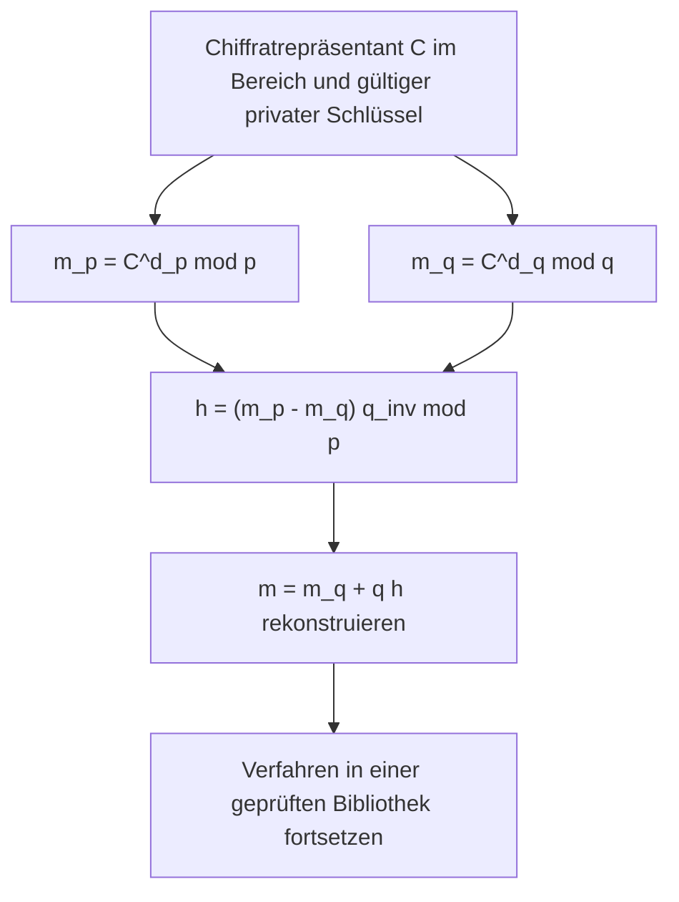

Der chinesische Restsatz (CRT) fasst Reste zu verschiedenen Moduli zu einer Restklasse zusammen. Er verbindet ganzzahlige Probleme, RSA-Operationen mit dem privaten Schlüssel, Ringe und Polynome sowie parallele Restklassenarithmetik. Dabei müssen die Voraussetzungen an die Moduli, der Rekonstruktionsbereich und der Unterschied zwischen arithmetischer Korrektheit und kryptographischer Sicherheit klar sein.

## 1. Sunzis Problem und die Lösungsmenge

Das mit dem Sunzi Suanjing verbundene Beispiel fragt nach einer Zahl, die bei Division durch 3 den Rest 2, durch 5 den Rest 3 und durch 7 den Rest 2 lässt. Eine [historische Untersuchung gibt das Problem und den Rechenweg wieder](https://sgmathsociety.org/smsmedley/Vol-30-1/The%20History%20of%20the%20Chinese%20Reminder%20Theorem%20%28Law%20Huang%20lng%29.pdf).

$$ x\equiv2\pmod3,\quad x\equiv3\pmod5,\quad x\equiv2\pmod7. $$

Die kleinste nichtnegative Lösung ist 23. Es gibt jedoch nicht nur eine ganzzahlige Lösung: Alle Lösungen lauten $x=23+105t$ mit $t\in\mathbb Z$. Beispielsweise erfüllt auch 128 die Bedingungen.

## 2. Ganzzahliger CRT: Voraussetzungen und Eindeutigkeit

Wir nehmen $k\ge1$ und Moduli $m_i>1$ an, die paarweise teilerfremd sind: $\gcd(m_i,m_j)=1$ für $i\ne j$. Die Moduli müssen selbst keine Primzahlen sein. Für beliebige ganzzahlige Reste $a_i$ besitzt das System

$$ x\equiv a_i\pmod{m_i}\quad(1\le i\le k) $$

genau eine Lösung modulo $M=\prod_{i=1}^k m_i$. Somit gibt es genau einen Repräsentanten mit $0\le x<M$. Ein gemeinsamer ggT von 1 für alle Moduli zusammen genügt nicht: 6, 10 und 15 haben insgesamt den ggT 1, sind aber nicht paarweise teilerfremd. Der [Beweis des ganzzahligen CRT](https://kconrad.math.uconn.edu/blurbs/ugradnumthy/crt.pdf) erläutert diese Unterscheidung.

Die Differenz zweier beliebiger Lösungen ist durch jeden Modul teilbar. Wegen der paarweisen Teilerfremdheit ist sie auch durch das Produkt teilbar. Das beweist die Eindeutigkeit. Die folgende Konstruktion zeigt die Existenz.

## 3. Konstruktion mit Inversen und ein Rechenbeispiel

Für jeden Modul bestimmt man mit dem erweiterten euklidischen Algorithmus ein multiplikativ inverses Element, das

$$ M_i=M/m_i,\quad M_i y_i\equiv1\pmod{m_i} $$

erfüllt. Die Teilerfremdheit garantiert die Existenz dieses Elements. Reduziert man die folgende Summe auf den Bereich des Moduls, erhält man die Lösung:

$$ x=\left(\sum_{i=1}^k a_iM_iy_i\right)\bmod M. $$

Modulo $m_j$ verschwinden die Terme mit $i\ne j$, und der verbleibende Term ist kongruent zu $a_j$. Damit ist die Existenz gezeigt.

In Sunzis Beispiel gilt $M=105$. Die Teilprodukte sind 35, 21 und 15, die zugehörigen Inversen 2, 1 und 1.

$$ 2\cdot35\cdot2+3\cdot21\cdot1+2\cdot15\cdot1=233,
\qquad233\bmod105=23. $$

Für nicht teilerfremde Moduli gibt es eine gesonderte Verallgemeinerung. Bei zwei Moduli existiert genau dann eine Lösung, wenn ihr ggT die Differenz der Reste teilt. Sie ist dann modulo dem kleinsten gemeinsamen Vielfachen eindeutig. Beispielsweise ergeben die Moduli 4 und 6 mit den Resten 1 und 3 die Lösung 9 modulo 12; mit den Resten 0 und 1 gibt es keine Lösung. Der folgende Code implementiert diese Verallgemeinerung nicht und akzeptiert nur paarweise teilerfremde Moduli.

## 4. Python-Implementierung mit Eingabeprüfung

Zulässig sind nur Werte des eingebauten Typs `int`; `bool` und Gleitkommazahlen werden abgewiesen. Die Eingaben müssen endliche, nicht leere Iterables gleicher Länge sein. Jeder Modul muss größer als 1 sein, und die Moduli müssen paarweise teilerfremd sein. Reste dürfen negativ sein oder ihren Modul überschreiten. Zurückgegeben wird der kleinste nichtnegative Repräsentant modulo dem Produkt. Der Ausschluss von Modul 1 und dem leeren System gehört zum Vertrag dieser Lehr-API.

```python
from math import gcd, prod


def _extended_gcd(a, b):
    # Internal helper: integer a, positive integer b.
    old_r, r = a, b
    old_s, s = 1, 0
    old_t, t = 0, 1
    while r:
        quotient = old_r // r
        old_r, r = r, old_r - quotient * r
        old_s, s = s, old_s - quotient * s
        old_t, t = t, old_t - quotient * t
    return old_r, old_s, old_t


def mod_inverse(a, modulus):
    if type(a) is not int or type(modulus) is not int:
        raise TypeError("Arguments must be built-in integers")
    if modulus <= 1:
        raise ValueError("Modulus must exceed one")
    g, x, _ = _extended_gcd(a % modulus, modulus)
    if g != 1:
        raise ValueError("Inverse does not exist")
    return x % modulus


def chinese_remainder_theorem(residues, moduli):
    residues, moduli = tuple(residues), tuple(moduli)
    if not moduli or len(residues) != len(moduli):
        raise ValueError("Provide equally sized, nonempty inputs")
    if any(type(x) is not int for x in residues + moduli):
        raise TypeError("Residues and moduli must be built-in integers")
    if any(m <= 1 for m in moduli):
        raise ValueError("Every modulus must exceed one")
    for i, m in enumerate(moduli):
        if any(gcd(m, other) != 1 for other in moduli[:i]):
            raise ValueError("Moduli must be pairwise coprime")

    combined_modulus = prod(moduli)
    result = 0
    for a, m in zip(residues, moduli):
        partial = combined_modulus // m
        inverse = mod_inverse(partial, m)
        result = (result + (a % m) * partial * inverse) % combined_modulus
    return result


if __name__ == "__main__":
    residues = [2, 3, 2]
    moduli = [3, 5, 7]
    print("Sunzi solution:", chinese_remainder_theorem(residues, moduli))
    print("Combined modulus:", prod(moduli))
```

Unter Python 3.12 gibt das Programm `Sunzi solution: 23` und `Combined modulus: 105` aus. Unterschiedlich lange Eingaben werden nicht stillschweigend abgeschnitten; Moduli mit Wert 0 oder negativem Wert, Typen und Teilerfremdheit werden geprüft. Python-Ganzzahlen vermeiden Überläufe fester Bitbreite, benötigen aber Zeit und Speicher entsprechend der Eingabelänge und der Größe der Zahlen. Dies ist keine kryptographische Implementierung mit konstanter Laufzeit.

## 5. Was RSA-CRT rekonstruiert

Wir setzen einen gültigen RSA-Schlüssel mit zwei Primfaktoren voraus. Verwendet werden verschiedene ungerade Primzahlen $p,q$, $N=pq$, ein öffentlicher Exponent $e$ und ein privater Exponent $d$ mit $ed\equiv1\pmod{\lambda(N)}$, wobei $\lambda(N)=\operatorname{lcm}(p-1,q-1)$. Der ganzzahlige Repräsentant des Chiffrats erfüllt $0\le C<N$; die direkte Operation mit dem privaten Schlüssel lautet $m=C^d\bmod N$.

Die CRT-Parameter werden vorbereitet:

$$ d_p=d\bmod(p-1),\quad d_q=d\bmod(q-1),\quad q_{\mathrm{inv}}=q^{-1}\bmod p. $$

$$ m_p=C^{d_p}\bmod p,\quad m_q=C^{d_q}\bmod q. $$

$$ h=(m_p-m_q)q_{\mathrm{inv}}\bmod p,\qquad m=m_q+qh. $$

Dieser Repräsentant hat für beide Primzahlen die benötigten Reste und liegt im Bereich des ursprünglichen Moduls. Die [Abschnitte 3.2 und 5.1.2 von RFC 8017](https://www.rfc-editor.org/rfc/rfc8017.html) legen diese Darstellung des privaten Schlüssels und die Rekonstruktion fest. Die beiden CRT-Exponenten allein ersetzen nicht den gesamten privaten Schlüssel: Auch Faktoren und Koeffizient sind geheimes Schlüsselmaterial.



Das Diagramm zeigt nur ganzzahlige Arithmetik und lässt Nachrichtenkodierung und Verfahrensvalidierung aus. Praktische Verschlüsselung und Signaturen verwenden unterschiedliche Verfahren. Wie in der [RSA-Einführung](https://kenji.blog/de/p/rsa-encryption-math-explained-for-beginners/) erläutert, sollte eine geprüfte Bibliothek die zum Zweck passende Verarbeitung übernehmen.

## 6. Geschwindigkeitsschätzungen und Grenzen der Implementierung

Anmerkung 14.75 in [HAC, Kapitel 14](https://cacr.uwaterloo.ca/hac/about/chap14.pdf) schätzt einen Faktor von ungefähr vier unter bestimmten Annahmen: ähnlich große Primzahlen, klassische Multiplikation mit quadratischen Kosten, eine zur Bitlänge des Exponenten proportionale Zahl von Multiplikationen und vernachlässigbare Rekonstruktionskosten. Andere Multiplikationsalgorithmen, parallele Ausführung, Schutzmaßnahmen und Geräte verändern dieses Verhältnis. Eine gemessene vierfache Beschleunigung des Codes in diesem Artikel ist damit nicht gemeint.

Wird einer der getrennt berechneten CRT-Reste verfälscht, kann ein ungeprüftes Ergebnis einen geheimen Faktor offenlegen. Die [Arbeit über Fehlerangriffe auf RSA-CRT](https://courses.csail.mit.edu/6.857/2010/handouts/faults.pdf) erläutert die Bedingungen. Korrekte Lehrbucharithmetik garantiert weder Schutz vor solchen Fehlern noch Seitenkanalresistenz. Schutzmaßnahmen, darunter Prüfungen mit dem öffentlichen Schlüssel, gehören in eine Bibliothek, die das vollständige Verfahren behandelt.

## 7. Verallgemeinerung auf Ringe und Ideale

Für einen kommutativen Ring mit Eins $R$ und endlich viele Ideale nehmen wir paarweise $I_i+I_j=R$ an. Die Ideale sind also paarweise komaximal. Der natürliche Homomorphismus

$$ \phi:R\longrightarrow\prod_{i=1}^k R/I_i,\qquad
\phi(r)=(r+I_1,\ldots,r+I_k) $$

ist surjektiv, und sein Kern ist der Schnitt der Ideale. Unter dieser Voraussetzung stimmt der Schnitt mit ihrem Produkt überein. Daher gilt:

$$ R/\left(\bigcap_{i=1}^k I_i\right)
\cong\prod_{i=1}^k R/I_i,\qquad
\bigcap_{i=1}^k I_i=\prod_{i=1}^k I_i. $$

Der [chinesische Restsatz im Stacks Project](https://stacks.math.columbia.edu/tag/00DT) nennt die Voraussetzungen und den Beweis. Paarweise teilerfremde ganzzahlige Moduli sind ein Spezialfall dieser Idealbedingung.

## 8. Polynome und Interpolation

Zwei Polynome über einem Körper sind genau dann teilerfremd, wenn ihr ggT eine von null verschiedene Konstante ist. Keine gemeinsamen Nullstellen im Ausgangskörper zu haben genügt nicht. Beispielsweise seien über den rationalen Zahlen beide Polynome gleich $x^2+1$. Keines hat eine rationale Nullstelle, aber ihr ggT ist genau dieses quadratische Polynom. Für eine Charakterisierung durch gemeinsame Nullstellen muss man in einem algebraischen Abschluss arbeiten.

Die linearen Faktoren zu verschiedenen Auswertungsstellen $\alpha_1,\ldots,\alpha_k$ sind paarweise teilerfremd. Daher gibt es unter den Polynomen vom Grad $<k$ genau eines mit den vorgegebenen Werten. Das ist der Zusammenhang mit der Lagrange-Interpolation. Werden höhere Grade zugelassen, entfällt die Eindeutigkeit. Auswertungen und Gradschranken über endlichen Körpern hängen auch mit Reed–Solomon-Codes zusammen; der CRT allein garantiert aber keine Fehlerkorrekturfähigkeit.

## 9. Restklassensysteme und Rekonstruktionsbereiche

Ein RNS stellt ganze Zahlen durch ein Tupel von Resten zu mehreren Moduli dar und ermöglicht komponentenweise Addition und Multiplikation. Hier seien $x_i=X\bmod m_i$ und $y_i=Y\bmod m_i$. Für das Produkt $M$ der Moduli gilt:

$$ (X+Y)\bmod M\longleftrightarrow
((x_i+y_i)\bmod m_i)_{i=1}^k, $$

$$ (XY)\bmod M\longleftrightarrow
((x_iy_i)\bmod m_i)_{i=1}^k. $$

Überträge zwischen den Kanälen sind nicht nötig; binäre Arithmetik innerhalb eines Kanals kann jedoch weiterhin Überträge enthalten. Die Rekonstruktion liefert einen Repräsentanten modulo dem Produkt. Eine unbeschränkte ganzzahlige Summe oder ein Produkt außerhalb dieses Bereichs lässt sich aus diesen Resten nicht eindeutig zurückgewinnen. Vergleiche, Divisionen und die Umwandlung in die gewöhnliche Darstellung erfordern zusätzliche Arbeit.

Von einem klassischen Restproblem bis zur Kryptographie, Algebra und parallelen Arithmetik rekonstruiert der CRT miteinander verträgliche Reste unter klaren Voraussetzungen an Moduli und Bereiche. Diese Bereiche und Verwendungszwecke müssen auseinandergehalten werden, um den Satz korrekt anzuwenden.
