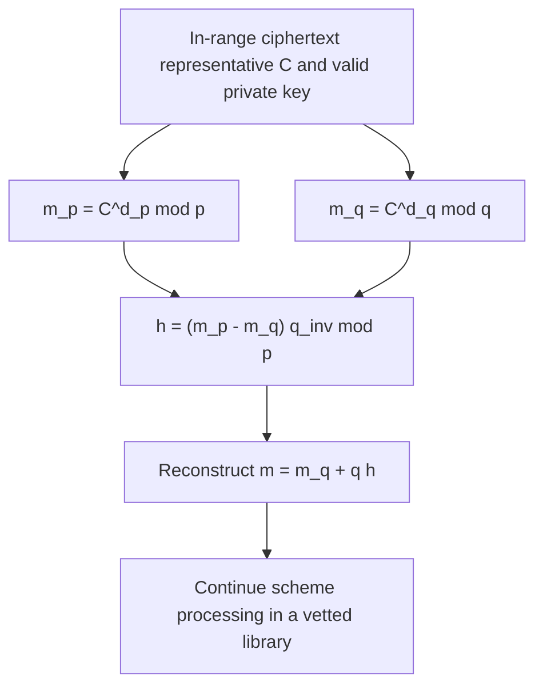

The Chinese remainder theorem (CRT) combines residues for different moduli into one residue. It connects integer problems, RSA private-key operations, rings and polynomials, and parallel residue arithmetic. The conditions on the moduli, the reconstruction range, and the difference between arithmetic correctness and cryptographic security all matter.

## 1. Sunzi's problem and the range of solutions

The example associated with the Sunzi Suanjing asks for a number leaving remainder 2 modulo 3, remainder 3 modulo 5, and remainder 2 modulo 7. A [historical research article reproduces the problem and calculation](https://sgmathsociety.org/smsmedley/Vol-30-1/The%20History%20of%20the%20Chinese%20Reminder%20Theorem%20%28Law%20Huang%20lng%29.pdf).

$$ x\equiv2\pmod3,\quad x\equiv3\pmod5,\quad x\equiv2\pmod7. $$

The least nonnegative solution is 23. There is not just one integer solution: all solutions are $x=23+105t$ with $t\in\mathbb Z$. For example, 128 also satisfies the conditions.

## 2. Integer CRT: assumptions and uniqueness

Here we take $k\ge1$ and moduli $m_i>1$ that are pairwise coprime: $\gcd(m_i,m_j)=1$ for $i\ne j$. The moduli need not be prime. For arbitrary integer residues $a_i$,

$$ x\equiv a_i\pmod{m_i}\quad(1\le i\le k) $$

has exactly one solution modulo $M=\prod_{i=1}^k m_i$. Thus there is one representative with $0\le x<M$. A gcd of 1 for all the moduli together is insufficient: 6, 10, and 15 are not pairwise coprime. The [integer CRT proof](https://kconrad.math.uconn.edu/blurbs/ugradnumthy/crt.pdf) explains this distinction.

The difference between any two solutions is divisible by every modulus. Pairwise coprimality makes it divisible by their product, proving uniqueness. The following construction proves existence.

## 3. Construction with inverses and a worked calculation

For each modulus, find an inverse satisfying

$$ M_i=M/m_i,\quad M_i y_i\equiv1\pmod{m_i} $$

using the extended Euclidean algorithm. Coprimality guarantees that the inverse exists. Reducing the following sum to the modulus range gives the solution:

$$ x=\left(\sum_{i=1}^k a_iM_iy_i\right)\bmod M. $$

Modulo one modulus $m_j$, the terms with $i\ne j$ vanish, and the remaining term is congruent to $a_j$. This establishes existence.

For Sunzi's example, $M=105$, the partial products are 35, 21, and 15, and the corresponding inverses are 2, 1, and 1.

$$ 2\cdot35\cdot2+3\cdot21\cdot1+2\cdot15\cdot1=233,
\qquad233\bmod105=23. $$

There is a separate generalization for noncoprime moduli. For two moduli, a solution exists exactly when their gcd divides the difference between the residues, and it is unique modulo their least common multiple. For example, moduli 4 and 6 with residues 1 and 3 give 9 modulo 12, while residues 0 and 1 give no solution. The code below does not implement this generalization: it accepts only pairwise coprime moduli.

## 4. Python implementation with input checks

Only built-in `int` values are accepted; `bool` and floating-point values are rejected. Inputs must be finite iterables of equal, nonzero length. Each modulus must exceed 1, and the moduli must be pairwise coprime. Residues may be negative or greater than their moduli. The result is the least nonnegative representative modulo the product. Excluding modulus 1 and the empty system is the contract of this teaching API.

```python
from math import gcd, prod


def _extended_gcd(a, b):
    # Internal helper: integer a, positive integer b.
    old_r, r = a, b
    old_s, s = 1, 0
    old_t, t = 0, 1
    while r:
        quotient = old_r // r
        old_r, r = r, old_r - quotient * r
        old_s, s = s, old_s - quotient * s
        old_t, t = t, old_t - quotient * t
    return old_r, old_s, old_t


def mod_inverse(a, modulus):
    if type(a) is not int or type(modulus) is not int:
        raise TypeError("Arguments must be built-in integers")
    if modulus <= 1:
        raise ValueError("Modulus must exceed one")
    g, x, _ = _extended_gcd(a % modulus, modulus)
    if g != 1:
        raise ValueError("Inverse does not exist")
    return x % modulus


def chinese_remainder_theorem(residues, moduli):
    residues, moduli = tuple(residues), tuple(moduli)
    if not moduli or len(residues) != len(moduli):
        raise ValueError("Provide equally sized, nonempty inputs")
    if any(type(x) is not int for x in residues + moduli):
        raise TypeError("Residues and moduli must be built-in integers")
    if any(m <= 1 for m in moduli):
        raise ValueError("Every modulus must exceed one")
    for i, m in enumerate(moduli):
        if any(gcd(m, other) != 1 for other in moduli[:i]):
            raise ValueError("Moduli must be pairwise coprime")

    combined_modulus = prod(moduli)
    result = 0
    for a, m in zip(residues, moduli):
        partial = combined_modulus // m
        inverse = mod_inverse(partial, m)
        result = (result + (a % m) * partial * inverse) % combined_modulus
    return result


if __name__ == "__main__":
    residues = [2, 3, 2]
    moduli = [3, 5, 7]
    print("Sunzi solution:", chinese_remainder_theorem(residues, moduli))
    print("Combined modulus:", prod(moduli))
```

Running this with Python 3.12 prints `Sunzi solution: 23` and `Combined modulus: 105`. Mismatched lengths are not silently truncated; zero or negative moduli, types, and coprimality are checked. Python integers avoid fixed-width overflow, but time and memory depend on the input length and integer sizes. This is not a constant-time cryptographic implementation.

## 5. What RSA-CRT reconstructs

Assume a valid two-prime RSA key. Use distinct odd primes $p,q$, $N=pq$, public exponent $e$, and private exponent $d$ satisfying $ed\equiv1\pmod{\lambda(N)}$, where $\lambda(N)=\operatorname{lcm}(p-1,q-1)$. A ciphertext representative satisfies $0\le C<N$; the direct private-key operation is $m=C^d\bmod N$.

Prepare the CRT parameters:

$$ d_p=d\bmod(p-1),\quad d_q=d\bmod(q-1),\quad q_{\mathrm{inv}}=q^{-1}\bmod p. $$

$$ m_p=C^{d_p}\bmod p,\quad m_q=C^{d_q}\bmod q. $$

$$ h=(m_p-m_q)q_{\mathrm{inv}}\bmod p,\qquad m=m_q+qh. $$

This representative has the required residues for each prime and lies within the original modulus range. [RFC 8017 Sections 3.2 and 5.1.2](https://www.rfc-editor.org/rfc/rfc8017.html) specify this private-key representation and reconstruction. The two CRT exponents alone do not replace the whole private key: the factors and coefficient are secret key material too.



This is an integer-arithmetic diagram that omits message encoding and scheme validation. Practical encryption and signatures use distinct schemes. As explained in the [RSA introduction](https://kenji.blog/en/p/rsa-encryption-math-explained-for-beginners/), an audited library must perform the processing appropriate to the purpose.

## 6. Speed estimates and implementation boundaries

Note 14.75 in [HAC Chapter 14](https://cacr.uwaterloo.ca/hac/about/chap14.pdf) gives an approximately fourfold estimate under assumptions of similarly sized primes, classical quadratic multiplication cost, multiplication counts proportional to exponent bit length, and negligible reconstruction cost. Different multiplication algorithms, parallel execution, defenses, and devices change the ratio. This is not a measured fourfold speedup of the code in this article.

If one separately computed CRT residue is corrupted, an unchecked result can expose a secret factor. The [paper on RSA-CRT fault analysis](https://courses.csail.mit.edu/6.857/2010/handouts/faults.pdf) explains the conditions. Correct teaching arithmetic alone does not guarantee fault protection or side-channel resistance. Implementation defenses, including checks using the public key, belong in a library that handles the full scheme.

## 7. Generalization to rings and ideals

For a commutative ring with identity $R$ and finitely many ideals, assume $I_i+I_j=R$ pairwise. The natural homomorphism

$$ \phi:R\longrightarrow\prod_{i=1}^k R/I_i,\qquad
\phi(r)=(r+I_1,\ldots,r+I_k) $$

is surjective, with kernel the intersection of the ideals. Under this condition, the intersection equals their product, so:

$$ R/\left(\bigcap_{i=1}^k I_i\right)
\cong\prod_{i=1}^k R/I_i,\qquad
\bigcap_{i=1}^k I_i=\prod_{i=1}^k I_i. $$

The [Stacks Project's Chinese remainder theorem](https://stacks.math.columbia.edu/tag/00DT) gives the assumptions and proof. Pairwise coprime integer moduli are a special case of this ideal condition.

## 8. Polynomials and interpolation

For polynomials over a field, coprimality means that their gcd is a nonzero constant. Having no common root in the original field is insufficient. Over the rationals, for example, take both polynomials to be $x^2+1$. Neither has a rational root, but their gcd is that quadratic polynomial. A characterization by common roots requires working in an algebraic closure.

Linear factors for distinct evaluation points $\alpha_1,\ldots,\alpha_k$ are pairwise coprime, so a polynomial taking the specified values is unique among polynomials of degree $<k$. This is the connection with Lagrange interpolation. Allowing higher degrees removes uniqueness. Evaluation and degree bounds over finite fields also connect to Reed–Solomon codes, but CRT alone does not give an error-correction guarantee.

## 9. Residue number systems and reconstruction ranges

RNS represents integers by residues for several moduli and permits componentwise addition and multiplication. Here $x_i=X\bmod m_i$ and $y_i=Y\bmod m_i$. For the product $M$ of the moduli:

$$ (X+Y)\bmod M\longleftrightarrow
((x_i+y_i)\bmod m_i)_{i=1}^k, $$

$$ (XY)\bmod M\longleftrightarrow
((x_iy_i)\bmod m_i)_{i=1}^k. $$

Carries between channels are unnecessary, but binary arithmetic inside each channel may still involve carries. Reconstruction yields a representative modulo the product; it does not uniquely recover an unrestricted integer sum or product beyond that range. Comparison, division, and conversion to ordinary representation require extra work.

From a classical remainder problem to cryptography, algebra, and parallel arithmetic, CRT reconstructs compatible residues under stated moduli and range conditions. Keeping those ranges and uses distinct is essential.
