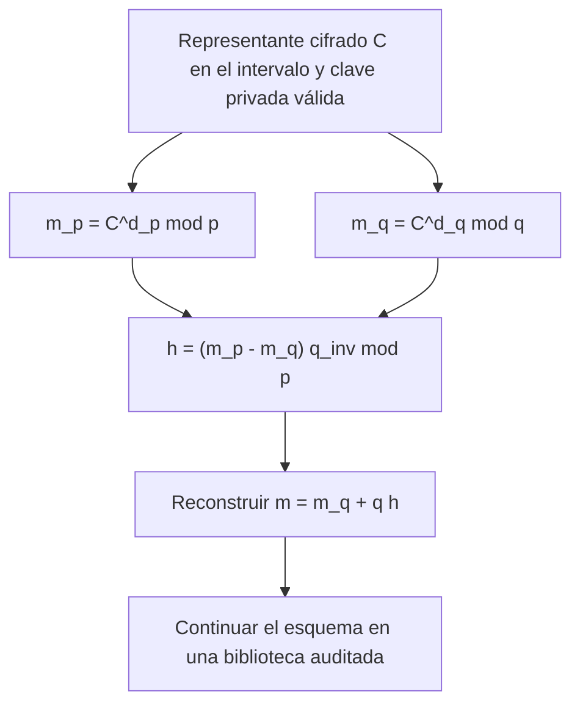

El teorema chino del resto (CRT) combina restos para distintos módulos en una clase de residuos. Conecta problemas de enteros, operaciones RSA con la clave privada, anillos y polinomios, y aritmética paralela por residuos. Son esenciales las condiciones sobre los módulos, el intervalo de reconstrucción y la distinción entre corrección aritmética y seguridad criptográfica.

## 1. El problema de Sunzi y el conjunto de soluciones

El ejemplo asociado al Sunzi Suanjing pide un número que deje resto 2 al dividirlo por 3, resto 3 al dividirlo por 5 y resto 2 al dividirlo por 7. Un [estudio histórico reproduce el problema y su cálculo](https://sgmathsociety.org/smsmedley/Vol-30-1/The%20History%20of%20the%20Chinese%20Reminder%20Theorem%20%28Law%20Huang%20lng%29.pdf).

$$ x\equiv2\pmod3,\quad x\equiv3\pmod5,\quad x\equiv2\pmod7. $$

La solución mínima no negativa es 23, pero no hay una sola solución entera: todas son $x=23+105t$, con $t\in\mathbb Z$. Por ejemplo, 128 también cumple las condiciones.

## 2. CRT para enteros: hipótesis y unicidad

Tomamos $k\ge1$ y módulos $m_i>1$ que sean coprimos dos a dos: $\gcd(m_i,m_j)=1$ cuando $i\ne j$. No es necesario que los módulos sean primos. Para cualesquiera restos enteros $a_i$,

$$ x\equiv a_i\pmod{m_i}\quad(1\le i\le k) $$

tiene exactamente una solución módulo $M=\prod_{i=1}^k m_i$. Por tanto, hay un único representante con $0\le x<M$. No basta con que el máximo común divisor del conjunto de módulos sea 1: 6, 10 y 15 no son coprimos dos a dos. La [demostración del CRT para enteros](https://kconrad.math.uconn.edu/blurbs/ugradnumthy/crt.pdf) explica esta distinción.

La diferencia entre dos soluciones cualesquiera es divisible por cada módulo. La coprimalidad dos a dos implica que es divisible por el producto, lo que demuestra la unicidad. La siguiente construcción demuestra la existencia.

## 3. Construcción con inversos y cálculo de un ejemplo

Para cada módulo, el algoritmo de Euclides extendido permite hallar un inverso que satisfaga

$$ M_i=M/m_i,\quad M_i y_i\equiv1\pmod{m_i} $$

La coprimalidad garantiza su existencia. Al reducir la siguiente suma al intervalo del módulo se obtiene la solución:

$$ x=\left(\sum_{i=1}^k a_iM_iy_i\right)\bmod M. $$

Al reducir módulo $m_j$, desaparecen los términos con $i\ne j$ y el término restante es congruente con $a_j$. Así queda demostrada la existencia.

En el ejemplo de Sunzi, $M=105$, los productos parciales son 35, 21 y 15, y los inversos correspondientes son 2, 1 y 1.

$$ 2\cdot35\cdot2+3\cdot21\cdot1+2\cdot15\cdot1=233,
\qquad233\bmod105=23. $$

Existe otra generalización para módulos no coprimos. Con dos módulos, hay solución si y solo si su máximo común divisor divide la diferencia entre los restos; la solución es única módulo su mínimo común múltiplo. Por ejemplo, los módulos 4 y 6 con restos 1 y 3 dan 9 módulo 12, mientras que con restos 0 y 1 no hay solución. El código siguiente no implementa esta generalización: solo admite módulos coprimos dos a dos.

## 4. Implementación en Python con comprobación de entradas

Solo se aceptan valores del tipo incorporado `int`; se rechazan `bool` y los valores de coma flotante. Las entradas deben ser iterables finitos, no vacíos y de la misma longitud. Cada módulo debe ser mayor que 1 y los módulos deben ser coprimos dos a dos. Los restos pueden ser negativos o superar su módulo. El resultado es el representante mínimo no negativo módulo el producto. Excluir el módulo 1 y el sistema vacío forma parte del contrato de esta API didáctica.

```python
from math import gcd, prod


def _extended_gcd(a, b):
    # Internal helper: integer a, positive integer b.
    old_r, r = a, b
    old_s, s = 1, 0
    old_t, t = 0, 1
    while r:
        quotient = old_r // r
        old_r, r = r, old_r - quotient * r
        old_s, s = s, old_s - quotient * s
        old_t, t = t, old_t - quotient * t
    return old_r, old_s, old_t


def mod_inverse(a, modulus):
    if type(a) is not int or type(modulus) is not int:
        raise TypeError("Arguments must be built-in integers")
    if modulus <= 1:
        raise ValueError("Modulus must exceed one")
    g, x, _ = _extended_gcd(a % modulus, modulus)
    if g != 1:
        raise ValueError("Inverse does not exist")
    return x % modulus


def chinese_remainder_theorem(residues, moduli):
    residues, moduli = tuple(residues), tuple(moduli)
    if not moduli or len(residues) != len(moduli):
        raise ValueError("Provide equally sized, nonempty inputs")
    if any(type(x) is not int for x in residues + moduli):
        raise TypeError("Residues and moduli must be built-in integers")
    if any(m <= 1 for m in moduli):
        raise ValueError("Every modulus must exceed one")
    for i, m in enumerate(moduli):
        if any(gcd(m, other) != 1 for other in moduli[:i]):
            raise ValueError("Moduli must be pairwise coprime")

    combined_modulus = prod(moduli)
    result = 0
    for a, m in zip(residues, moduli):
        partial = combined_modulus // m
        inverse = mod_inverse(partial, m)
        result = (result + (a % m) * partial * inverse) % combined_modulus
    return result


if __name__ == "__main__":
    residues = [2, 3, 2]
    moduli = [3, 5, 7]
    print("Sunzi solution:", chinese_remainder_theorem(residues, moduli))
    print("Combined modulus:", prod(moduli))
```

Con Python 3.12, el programa imprime `Sunzi solution: 23` y `Combined modulus: 105`. Las longitudes distintas no se truncan silenciosamente; se comprueban los módulos nulos o negativos, los tipos y la coprimalidad. Los enteros de Python evitan el desbordamiento de ancho fijo, pero el tiempo y la memoria dependen de la longitud de las entradas y del tamaño de los enteros. No es una implementación criptográfica de tiempo constante.

## 5. Qué reconstruye RSA-CRT

Supongamos una clave RSA válida de dos primos. Se usan primos impares distintos $p,q$, $N=pq$, un exponente público $e$ y un exponente privado $d$ que satisfacen $ed\equiv1\pmod{\lambda(N)}$, donde $\lambda(N)=\operatorname{lcm}(p-1,q-1)$. El representante del texto cifrado cumple $0\le C<N$; la operación directa con la clave privada es $m=C^d\bmod N$.

Se preparan los parámetros CRT:

$$ d_p=d\bmod(p-1),\quad d_q=d\bmod(q-1),\quad q_{\mathrm{inv}}=q^{-1}\bmod p. $$

$$ m_p=C^{d_p}\bmod p,\quad m_q=C^{d_q}\bmod q. $$

$$ h=(m_p-m_q)q_{\mathrm{inv}}\bmod p,\qquad m=m_q+qh. $$

El representante tiene los restos requeridos para ambos primos y pertenece al intervalo del módulo original. Las [secciones 3.2 y 5.1.2 de RFC 8017](https://www.rfc-editor.org/rfc/rfc8017.html) especifican esta representación de la clave privada y su reconstrucción. Los dos exponentes CRT no sustituyen por sí solos a toda la clave privada: los factores y el coeficiente también son material secreto de la clave.



Este diagrama describe aritmética de enteros y omite la codificación del mensaje y la validación del esquema. El cifrado y las firmas prácticos emplean esquemas distintos. Como explica la [introducción a RSA](https://kenji.blog/es/p/rsa-encryption-math-explained-for-beginners/), una biblioteca auditada debe realizar el procesamiento adecuado al propósito.

## 6. Estimaciones de velocidad y límites de la implementación

La nota 14.75 del [capítulo 14 de HAC](https://cacr.uwaterloo.ca/hac/about/chap14.pdf) estima un factor aproximado de cuatro bajo ciertas hipótesis: primos de tamaño similar, multiplicación clásica de coste cuadrático, número de multiplicaciones proporcional a la longitud del exponente en bits y coste de reconstrucción despreciable. Otros algoritmos de multiplicación, la ejecución paralela, las defensas y los dispositivos modifican la proporción. No es una aceleración por cuatro medida en el código de este artículo.

Si se altera uno de los restos CRT calculados por separado, un resultado sin verificar puede revelar un factor secreto. El [artículo sobre análisis de fallos en RSA-CRT](https://courses.csail.mit.edu/6.857/2010/handouts/faults.pdf) explica las condiciones. La corrección de una implementación didáctica de la aritmética no garantiza protección frente a fallos ni resistencia a canales laterales. Las defensas, incluidas las comprobaciones con la clave pública, corresponden a una biblioteca que gestione el esquema completo.

## 7. Generalización a anillos e ideales

Para un anillo conmutativo con unidad $R$ y un número finito de ideales, se supone que $I_i+I_j=R$ dos a dos; es decir, los ideales son comaximales dos a dos. El homomorfismo natural

$$ \phi:R\longrightarrow\prod_{i=1}^k R/I_i,\qquad
\phi(r)=(r+I_1,\ldots,r+I_k) $$

es sobreyectivo y su núcleo es la intersección de los ideales. Bajo esta condición, la intersección coincide con su producto, por lo que:

$$ R/\left(\bigcap_{i=1}^k I_i\right)
\cong\prod_{i=1}^k R/I_i,\qquad
\bigcap_{i=1}^k I_i=\prod_{i=1}^k I_i. $$

El [teorema chino del resto de Stacks Project](https://stacks.math.columbia.edu/tag/00DT) presenta las hipótesis y la demostración. Los módulos enteros coprimos dos a dos son un caso particular de esta condición sobre ideales.

## 8. Polinomios e interpolación

Para polinomios sobre un cuerpo, la coprimalidad significa que su máximo común divisor es una constante no nula. No basta con que no compartan raíces en el cuerpo original. Por ejemplo, sobre los racionales, tomemos ambos polinomios iguales a $x^2+1$. Ninguno tiene una raíz racional, pero su máximo común divisor es ese mismo polinomio cuadrático. Para caracterizar la coprimalidad mediante raíces comunes hay que trabajar en una clausura algebraica.

Los factores lineales correspondientes a puntos de evaluación distintos $\alpha_1,\ldots,\alpha_k$ son coprimos dos a dos. Por ello, el polinomio con los valores indicados es único entre los de grado $<k$. Esta es la relación con la interpolación de Lagrange. Si se permiten grados superiores, se pierde la unicidad. La evaluación y las cotas de grado sobre cuerpos finitos también están relacionadas con los códigos Reed–Solomon, pero el CRT por sí solo no garantiza la capacidad de corrección de errores.

## 9. Sistemas de numeración por residuos e intervalos de reconstrucción

Un RNS representa enteros mediante sus restos para varios módulos y permite sumar y multiplicar por componentes. Aquí $x_i=X\bmod m_i$ y $y_i=Y\bmod m_i$. Para el producto $M$ de los módulos:

$$ (X+Y)\bmod M\longleftrightarrow
((x_i+y_i)\bmod m_i)_{i=1}^k, $$

$$ (XY)\bmod M\longleftrightarrow
((x_iy_i)\bmod m_i)_{i=1}^k. $$

No hace falta propagar acarreos entre canales, pero la aritmética binaria dentro de cada canal todavía puede producirlos. La reconstrucción da un representante módulo el producto; no recupera de forma única una suma o un producto de enteros sin restricciones que exceda ese intervalo. La comparación, la división y la conversión a la representación ordinaria requieren trabajo adicional.

Desde un problema clásico de restos hasta la criptografía, el álgebra y la aritmética paralela, el CRT reconstruye restos compatibles bajo condiciones explícitas sobre los módulos y los intervalos. Distinguir esos intervalos y usos es esencial para aplicarlo correctamente.
