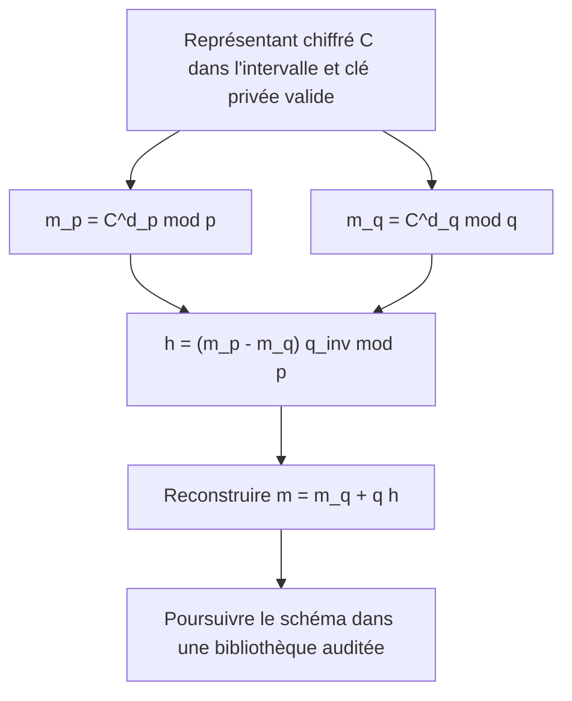

Le théorème des restes chinois (TRC, ou CRT en anglais) réunit des restes relatifs à différents modules en une classe de résidus. Il relie les problèmes sur les entiers, les opérations RSA avec la clé privée, les anneaux et polynômes, et le calcul parallèle par résidus. Les conditions sur les modules, l'intervalle de reconstruction et la distinction entre correction arithmétique et sécurité cryptographique sont essentiels.

## 1. Le problème de Sunzi et l'ensemble des solutions

L'exemple associé au Sunzi Suanjing demande un nombre qui donne un reste de 2 modulo 3, de 3 modulo 5 et de 2 modulo 7. Une [étude historique reproduit le problème et le calcul](https://sgmathsociety.org/smsmedley/Vol-30-1/The%20History%20of%20the%20Chinese%20Reminder%20Theorem%20%28Law%20Huang%20lng%29.pdf).

$$ x\equiv2\pmod3,\quad x\equiv3\pmod5,\quad x\equiv2\pmod7. $$

La plus petite solution positive ou nulle est 23. Ce n'est pas l'unique solution entière : toutes les solutions sont $x=23+105t$, avec $t\in\mathbb Z$. Par exemple, 128 satisfait aussi les conditions.

## 2. TRC sur les entiers : hypothèses et unicité

On prend $k\ge1$ et des modules $m_i>1$ premiers entre eux deux à deux : $\gcd(m_i,m_j)=1$ pour $i\ne j$. Les modules eux-mêmes n'ont pas besoin d'être premiers. Pour des restes entiers arbitraires $a_i$, le système

$$ x\equiv a_i\pmod{m_i}\quad(1\le i\le k) $$

possède exactement une solution modulo $M=\prod_{i=1}^k m_i$. Il existe donc un unique représentant avec $0\le x<M$. Un PGCD égal à 1 pour l'ensemble des modules ne suffit pas : 6, 10 et 15 ont un PGCD global égal à 1, mais ne sont pas premiers entre eux deux à deux. La [preuve du TRC sur les entiers](https://kconrad.math.uconn.edu/blurbs/ugradnumthy/crt.pdf) explique cette distinction.

La différence de deux solutions quelconques est divisible par chaque module. Les modules étant premiers entre eux deux à deux, cette différence est divisible par leur produit, ce qui prouve l'unicité. La construction suivante prouve l'existence.

## 3. Construction par les inverses et exemple de calcul

Pour chaque module, l'algorithme d'Euclide étendu permet de trouver un inverse satisfaisant

$$ M_i=M/m_i,\quad M_i y_i\equiv1\pmod{m_i} $$

La coprimalité garantit l'existence de l'inverse. En réduisant la somme suivante dans l'intervalle du module, on obtient la solution :

$$ x=\left(\sum_{i=1}^k a_iM_iy_i\right)\bmod M. $$

Modulo $m_j$, les termes avec $i\ne j$ s'annulent et le terme restant est congru à $a_j$. Cela établit l'existence.

Dans l'exemple de Sunzi, $M=105$, les produits partiels sont 35, 21 et 15, et les inverses correspondants sont 2, 1 et 1.

$$ 2\cdot35\cdot2+3\cdot21\cdot1+2\cdot15\cdot1=233,
\qquad233\bmod105=23. $$

Il existe une généralisation distincte aux modules non premiers entre eux. Avec deux modules, une solution existe si et seulement si leur PGCD divise la différence des restes ; elle est alors unique modulo leur plus petit commun multiple. Par exemple, les modules 4 et 6 avec les restes 1 et 3 donnent 9 modulo 12, tandis que les restes 0 et 1 ne donnent aucune solution. Le code ci-dessous n'implémente pas cette généralisation : il accepte seulement des modules premiers entre eux deux à deux.

## 4. Implémentation Python avec validation des entrées

Seules les valeurs du type natif `int` sont acceptées ; `bool` et les nombres à virgule flottante sont refusés. Les entrées doivent être des itérables finis, non vides et de même longueur. Chaque module doit dépasser 1 et les modules doivent être premiers entre eux deux à deux. Les restes peuvent être négatifs ou dépasser leur module. Le résultat est le plus petit représentant positif ou nul modulo le produit. L'exclusion du module 1 et du système vide relève du contrat de cette API pédagogique.

```python
from math import gcd, prod


def _extended_gcd(a, b):
    # Internal helper: integer a, positive integer b.
    old_r, r = a, b
    old_s, s = 1, 0
    old_t, t = 0, 1
    while r:
        quotient = old_r // r
        old_r, r = r, old_r - quotient * r
        old_s, s = s, old_s - quotient * s
        old_t, t = t, old_t - quotient * t
    return old_r, old_s, old_t


def mod_inverse(a, modulus):
    if type(a) is not int or type(modulus) is not int:
        raise TypeError("Arguments must be built-in integers")
    if modulus <= 1:
        raise ValueError("Modulus must exceed one")
    g, x, _ = _extended_gcd(a % modulus, modulus)
    if g != 1:
        raise ValueError("Inverse does not exist")
    return x % modulus


def chinese_remainder_theorem(residues, moduli):
    residues, moduli = tuple(residues), tuple(moduli)
    if not moduli or len(residues) != len(moduli):
        raise ValueError("Provide equally sized, nonempty inputs")
    if any(type(x) is not int for x in residues + moduli):
        raise TypeError("Residues and moduli must be built-in integers")
    if any(m <= 1 for m in moduli):
        raise ValueError("Every modulus must exceed one")
    for i, m in enumerate(moduli):
        if any(gcd(m, other) != 1 for other in moduli[:i]):
            raise ValueError("Moduli must be pairwise coprime")

    combined_modulus = prod(moduli)
    result = 0
    for a, m in zip(residues, moduli):
        partial = combined_modulus // m
        inverse = mod_inverse(partial, m)
        result = (result + (a % m) * partial * inverse) % combined_modulus
    return result


if __name__ == "__main__":
    residues = [2, 3, 2]
    moduli = [3, 5, 7]
    print("Sunzi solution:", chinese_remainder_theorem(residues, moduli))
    print("Combined modulus:", prod(moduli))
```

Sous Python 3.12, le programme affiche `Sunzi solution: 23` et `Combined modulus: 105`. Il ne tronque pas silencieusement des entrées de longueurs différentes ; il vérifie les modules nuls ou négatifs, les types et la coprimalité. Les entiers Python évitent le débordement de largeur fixe, mais le temps et la mémoire dépendent de la longueur des entrées et de la taille des entiers. Ce n'est pas une implémentation cryptographique en temps constant.

## 5. Ce que RSA-CRT reconstruit

On suppose une clé RSA valide à deux facteurs premiers. On utilise des nombres premiers impairs distincts $p,q$, $N=pq$, un exposant public $e$ et un exposant privé $d$ satisfaisant $ed\equiv1\pmod{\lambda(N)}$, où $\lambda(N)=\operatorname{lcm}(p-1,q-1)$. Le représentant du texte chiffré satisfait $0\le C<N$ ; l'opération directe avec la clé privée est $m=C^d\bmod N$.

On prépare les paramètres CRT :

$$ d_p=d\bmod(p-1),\quad d_q=d\bmod(q-1),\quad q_{\mathrm{inv}}=q^{-1}\bmod p. $$

$$ m_p=C^{d_p}\bmod p,\quad m_q=C^{d_q}\bmod q. $$

$$ h=(m_p-m_q)q_{\mathrm{inv}}\bmod p,\qquad m=m_q+qh. $$

Ce représentant possède les restes requis pour chaque nombre premier et appartient à l'intervalle du module initial. Les [sections 3.2 et 5.1.2 de la RFC 8017](https://www.rfc-editor.org/rfc/rfc8017.html) définissent cette représentation de la clé privée et la reconstruction. Les deux exposants CRT ne remplacent pas à eux seuls toute la clé privée : les facteurs et le coefficient sont également des éléments secrets de la clé.



Ce diagramme décrit uniquement l'arithmétique des entiers et omet l'encodage du message ainsi que la validation du schéma. Le chiffrement et les signatures en pratique utilisent des schémas distincts. Comme l'explique l'[introduction à RSA](https://kenji.blog/fr/p/rsa-encryption-math-explained-for-beginners/), une bibliothèque auditée doit effectuer le traitement adapté à l'usage.

## 6. Estimations de vitesse et limites de l'implémentation

La note 14.75 du [chapitre 14 du HAC](https://cacr.uwaterloo.ca/hac/about/chap14.pdf) donne une estimation d'un facteur d'environ quatre sous certaines hypothèses : nombres premiers de tailles voisines, multiplication classique de coût quadratique, nombre de multiplications proportionnel à la longueur en bits de l'exposant et coût de reconstruction négligeable. D'autres algorithmes de multiplication, l'exécution parallèle, les protections et le matériel modifient ce rapport. Il ne s'agit pas d'une accélération par quatre mesurée sur le code de cet article.

Si l'un des restes CRT calculés séparément est corrompu, un résultat non vérifié peut révéler un facteur secret. L'[article sur l'analyse de fautes de RSA-CRT](https://courses.csail.mit.edu/6.857/2010/handouts/faults.pdf) explique les conditions. La correction de l'arithmétique pédagogique ne garantit ni protection contre les fautes ni résistance aux canaux auxiliaires. Les défenses, dont la vérification avec la clé publique, doivent être prises en charge par une bibliothèque qui traite le schéma complet.

## 7. Généralisation aux anneaux et aux idéaux

Pour un anneau commutatif unitaire $R$ et un nombre fini d'idéaux, on suppose $I_i+I_j=R$ deux à deux : les idéaux sont comaximaux deux à deux. L'homomorphisme naturel

$$ \phi:R\longrightarrow\prod_{i=1}^k R/I_i,\qquad
\phi(r)=(r+I_1,\ldots,r+I_k) $$

est surjectif et son noyau est l'intersection des idéaux. Sous cette condition, leur intersection est égale à leur produit, d'où :

$$ R/\left(\bigcap_{i=1}^k I_i\right)
\cong\prod_{i=1}^k R/I_i,\qquad
\bigcap_{i=1}^k I_i=\prod_{i=1}^k I_i. $$

Le [théorème des restes chinois du Stacks Project](https://stacks.math.columbia.edu/tag/00DT) présente les hypothèses et la preuve. Les modules entiers premiers entre eux deux à deux constituent un cas particulier de cette condition sur les idéaux.

## 8. Polynômes et interpolation

Deux polynômes sur un corps sont premiers entre eux lorsque leur PGCD est une constante non nulle. L'absence de racine commune dans le corps initial ne suffit pas. Sur les rationnels, prenons par exemple les deux polynômes égaux à $x^2+1$. Aucun n'a de racine rationnelle, mais leur PGCD est ce même polynôme du second degré. Une caractérisation par les racines communes exige de travailler dans une clôture algébrique.

Les facteurs linéaires correspondant à des points d'évaluation distincts $\alpha_1,\ldots,\alpha_k$ sont premiers entre eux deux à deux. Le polynôme prenant les valeurs prescrites est donc unique parmi ceux de degré $<k$. C'est le lien avec l'interpolation de Lagrange. Si l'on autorise des degrés supérieurs, l'unicité disparaît. L'évaluation et les bornes sur le degré sur les corps finis sont aussi liées aux codes de Reed–Solomon, mais le TRC seul ne garantit pas une capacité de correction d'erreurs.

## 9. Numération résiduelle et intervalles de reconstruction

Un RNS représente les entiers par un tuple de restes pour plusieurs modules et permet l'addition et la multiplication composante par composante. Ici, $x_i=X\bmod m_i$ et $y_i=Y\bmod m_i$. Pour le produit $M$ des modules :

$$ (X+Y)\bmod M\longleftrightarrow
((x_i+y_i)\bmod m_i)_{i=1}^k, $$

$$ (XY)\bmod M\longleftrightarrow
((x_iy_i)\bmod m_i)_{i=1}^k. $$

Les retenues entre canaux sont inutiles, mais l'arithmétique binaire à l'intérieur de chaque canal peut encore comporter des retenues. La reconstruction donne un représentant modulo le produit ; elle ne restitue pas de façon unique une somme ou un produit d'entiers sans restriction qui dépasse cet intervalle. La comparaison, la division et la conversion vers la représentation habituelle nécessitent un travail supplémentaire.

D'un problème classique de restes à la cryptographie, à l'algèbre et au calcul parallèle, le TRC reconstruit des restes compatibles sous des conditions explicites sur les modules et les intervalles. Distinguer ces intervalles et ces usages permet de l'appliquer correctement.
