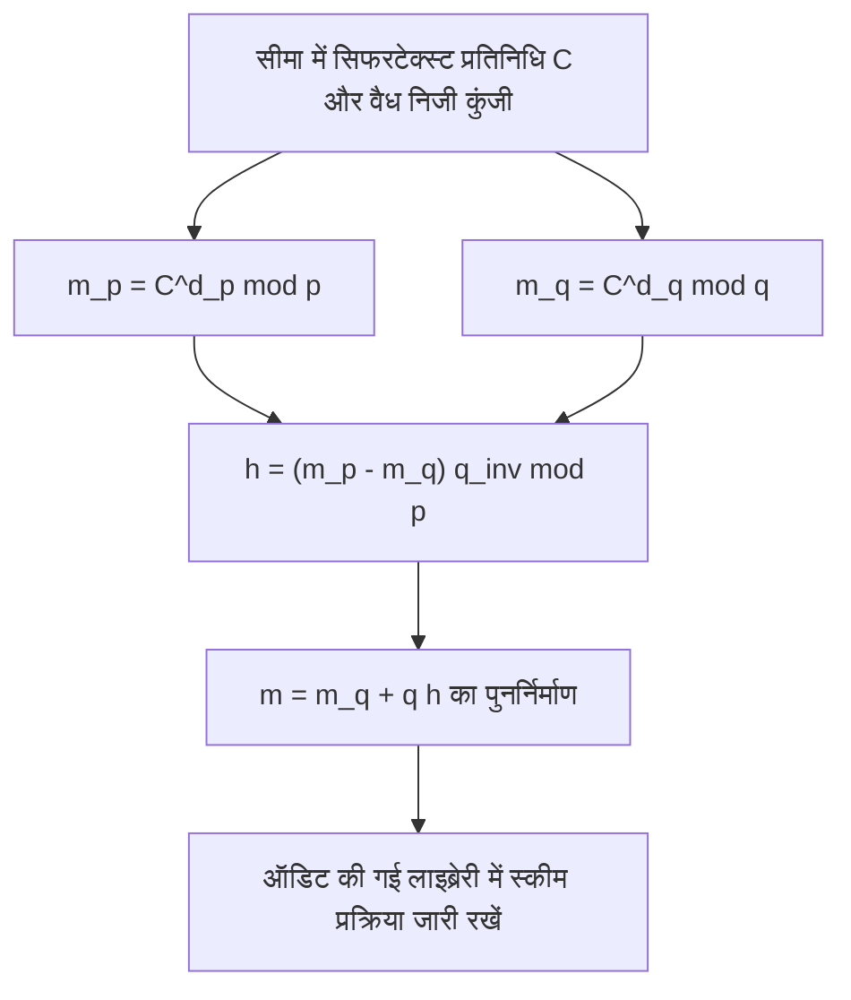

चीनी शेषफल प्रमेय (CRT) अलग-अलग मापांकों के शेषफलों को एक शेष वर्ग में जोड़ता है। यह पूर्णांकों की समस्याओं, RSA की निजी कुंजी वाली संक्रियाओं, वलयों और बहुपदों, तथा समानांतर शेषफल गणना को जोड़ता है। मापांकों की शर्तें, पुनर्निर्माण की सीमा, और गणितीय शुद्धता तथा क्रिप्टोग्राफ़िक सुरक्षा का अंतर स्पष्ट रखना आवश्यक है।

## 1. सुनजी की समस्या और हलों का समुच्चय

सुनजी सुआनजिंग से जुड़ा प्रसिद्ध उदाहरण ऐसी संख्या पूछता है जिसे 3 से भाग देने पर 2, 5 से भाग देने पर 3, और 7 से भाग देने पर 2 शेष बचे। एक [ऐतिहासिक शोधपत्र में समस्या और उसकी गणना दोहराई गई है](https://sgmathsociety.org/smsmedley/Vol-30-1/The%20History%20of%20the%20Chinese%20Reminder%20Theorem%20%28Law%20Huang%20lng%29.pdf)।

$$ x\equiv2\pmod3,\quad x\equiv3\pmod5,\quad x\equiv2\pmod7. $$

न्यूनतम अऋणात्मक हल 23 है। लेकिन पूर्णांक हल केवल एक नहीं है: सभी हल $x=23+105t$ हैं, जहाँ $t\in\mathbb Z$ है। उदाहरण के लिए, 128 भी शर्तें पूरी करता है।

## 2. पूर्णांकों के लिए CRT: शर्तें और एकमात्रता

मान लें कि $k\ge1$ और प्रत्येक मापांक $m_i>1$ है। हर अलग जोड़े के मापांक परस्पर अभाज्य हों: $i\ne j$ के लिए $\gcd(m_i,m_j)=1$। मापांकों का स्वयं अभाज्य संख्या होना आवश्यक नहीं है। किसी भी पूर्णांक शेषफल $a_i$ के लिए समशेषताओं का तंत्र

$$ x\equiv a_i\pmod{m_i}\quad(1\le i\le k) $$

मापांक $M=\prod_{i=1}^k m_i$ के सापेक्ष एकमात्र हल रखता है। इसलिए $0\le x<M$ वाला ठीक एक प्रतिनिधि मिलता है। सभी मापांकों का एक साथ महत्तम समापवर्तक 1 होना पर्याप्त नहीं है: 6, 10 और 15 का सामूहिक महत्तम समापवर्तक 1 है, लेकिन वे हर जोड़े में परस्पर अभाज्य नहीं हैं। [पूर्णांक CRT का प्रमाण](https://kconrad.math.uconn.edu/blurbs/ugradnumthy/crt.pdf) यह अंतर स्पष्ट करता है।

किन्हीं दो हलों का अंतर हर मापांक से विभाज्य होता है। हर जोड़े के परस्पर अभाज्य होने से वह अंतर उनके गुणनफल से भी विभाज्य होता है। इससे एकमात्रता सिद्ध होती है। अगली निर्माण विधि हल का अस्तित्व सिद्ध करती है।

## 3. व्युत्क्रम से निर्माण और गणना का उदाहरण

प्रत्येक मापांक के लिए विस्तारित यूक्लिड एल्गोरिदम से ऐसा गुणनात्मक व्युत्क्रम खोजें जो

$$ M_i=M/m_i,\quad M_i y_i\equiv1\pmod{m_i} $$

पूरा करता हो। परस्पर अभाज्य होने की शर्त इस व्युत्क्रम का अस्तित्व सुनिश्चित करती है। निम्न योग को मापांक की सीमा में घटाने पर हल मिलता है:

$$ x=\left(\sum_{i=1}^k a_iM_iy_i\right)\bmod M. $$

मापांक $m_j$ के सापेक्ष, $i\ne j$ वाले पद शून्य हो जाते हैं और बचा पद $a_j$ के समशेष होता है। इससे अस्तित्व सिद्ध होता है।

सुनजी के उदाहरण में $M=105$ है। आंशिक गुणनफल 35, 21 और 15 हैं, और उनके व्युत्क्रम क्रमशः 2, 1 और 1 हैं।

$$ 2\cdot35\cdot2+3\cdot21\cdot1+2\cdot15\cdot1=233,
\qquad233\bmod105=23. $$

परस्पर अभाज्य न होने वाले मापांकों के लिए अलग सामान्यीकरण है। दो मापांकों में हल तभी और केवल तभी मौजूद होता है जब उनका महत्तम समापवर्तक शेषफलों के अंतर को विभाजित करे। तब हल उनके लघुत्तम समापवर्त्य के सापेक्ष एकमात्र होता है। उदाहरण के लिए, मापांक 4 और 6 तथा शेषफल 1 और 3 से मापांक 12 का हल 9 मिलता है; शेषफल 0 और 1 पर कोई हल नहीं मिलता। नीचे का कोड यह सामान्यीकरण लागू नहीं करता और केवल हर जोड़े में परस्पर अभाज्य मापांक स्वीकार करता है।

## 4. इनपुट जाँच के साथ Python कार्यान्वयन

केवल Python के अंतर्निर्मित `int` प्रकार के मान स्वीकार किए जाते हैं; `bool` और floating-point मान अस्वीकार होते हैं। दोनों इनपुट सीमित संख्या में तत्व रखने वाले iterable होने चाहिए, खाली नहीं होने चाहिए और उनकी लंबाई समान होनी चाहिए। हर मापांक 1 से बड़ा तथा हर दूसरे मापांक के साथ परस्पर अभाज्य होना चाहिए। शेषफल ऋणात्मक या अपने मापांक से बड़े भी हो सकते हैं। परिणाम मापांकों के गुणनफल के सापेक्ष न्यूनतम अऋणात्मक प्रतिनिधि है। मापांक 1 और खाली तंत्र को स्वीकार न करना इस शिक्षण API का स्पष्ट अनुबंध है।

```python
from math import gcd, prod


def _extended_gcd(a, b):
    # Internal helper: integer a, positive integer b.
    old_r, r = a, b
    old_s, s = 1, 0
    old_t, t = 0, 1
    while r:
        quotient = old_r // r
        old_r, r = r, old_r - quotient * r
        old_s, s = s, old_s - quotient * s
        old_t, t = t, old_t - quotient * t
    return old_r, old_s, old_t


def mod_inverse(a, modulus):
    if type(a) is not int or type(modulus) is not int:
        raise TypeError("Arguments must be built-in integers")
    if modulus <= 1:
        raise ValueError("Modulus must exceed one")
    g, x, _ = _extended_gcd(a % modulus, modulus)
    if g != 1:
        raise ValueError("Inverse does not exist")
    return x % modulus


def chinese_remainder_theorem(residues, moduli):
    residues, moduli = tuple(residues), tuple(moduli)
    if not moduli or len(residues) != len(moduli):
        raise ValueError("Provide equally sized, nonempty inputs")
    if any(type(x) is not int for x in residues + moduli):
        raise TypeError("Residues and moduli must be built-in integers")
    if any(m <= 1 for m in moduli):
        raise ValueError("Every modulus must exceed one")
    for i, m in enumerate(moduli):
        if any(gcd(m, other) != 1 for other in moduli[:i]):
            raise ValueError("Moduli must be pairwise coprime")

    combined_modulus = prod(moduli)
    result = 0
    for a, m in zip(residues, moduli):
        partial = combined_modulus // m
        inverse = mod_inverse(partial, m)
        result = (result + (a % m) * partial * inverse) % combined_modulus
    return result


if __name__ == "__main__":
    residues = [2, 3, 2]
    moduli = [3, 5, 7]
    print("Sunzi solution:", chinese_remainder_theorem(residues, moduli))
    print("Combined modulus:", prod(moduli))
```

Python 3.12 पर चलाने से `Sunzi solution: 23` और `Combined modulus: 105` छपते हैं। अलग लंबाई के इनपुट चुपचाप काटे नहीं जाते; शून्य या ऋणात्मक मापांक, प्रकार और परस्पर अभाज्यता की जाँच होती है। Python के पूर्णांक निश्चित बिट चौड़ाई वाले पूर्णांकों की तरह overflow नहीं करते, लेकिन समय और स्मृति इनपुट की लंबाई तथा संख्याओं के आकार पर निर्भर हैं। यह क्रिप्टोग्राफ़ी के लिए स्थिर समय (constant-time) कार्यान्वयन नहीं है।

## 5. RSA-CRT किसका पुनर्निर्माण करता है

दो अभाज्य गुणनखंडों वाली वैध RSA कुंजी मानें। अलग-अलग विषम अभाज्य संख्याएँ $p,q$, $N=pq$, सार्वजनिक घातांक $e$ और निजी घातांक $d$ लें, जहाँ $ed\equiv1\pmod{\lambda(N)}$ और $\lambda(N)=\operatorname{lcm}(p-1,q-1)$ है। सिफरटेक्स्ट का पूर्णांक प्रतिनिधि $0\le C<N$ को पूरा करता है; सीधी निजी कुंजी संक्रिया $m=C^d\bmod N$ है।

CRT के पैरामीटर तैयार करें:

$$ d_p=d\bmod(p-1),\quad d_q=d\bmod(q-1),\quad q_{\mathrm{inv}}=q^{-1}\bmod p. $$

$$ m_p=C^{d_p}\bmod p,\quad m_q=C^{d_q}\bmod q. $$

$$ h=(m_p-m_q)q_{\mathrm{inv}}\bmod p,\qquad m=m_q+qh. $$

दोनों अभाज्य मापांकों के सापेक्ष इस प्रतिनिधि के शेषफल आवश्यक मानों के बराबर हैं और यह मूल मापांक की सीमा में है। [RFC 8017 के खंड 3.2 और 5.1.2](https://www.rfc-editor.org/rfc/rfc8017.html) निजी कुंजी के इस निरूपण और पुनर्निर्माण को बताते हैं। केवल दो CRT घातांक पूरी निजी कुंजी की जगह नहीं लेते: गुणनखंड और गुणांक भी गुप्त कुंजी सामग्री हैं।



यह चित्र केवल पूर्णांक गणना दिखाता है; संदेश की एन्कोडिंग और स्कीम का सत्यापन इसमें नहीं दिखाए गए हैं। व्यावहारिक एन्क्रिप्शन और हस्ताक्षर अलग-अलग स्कीम इस्तेमाल करते हैं। [RSA परिचय](https://kenji.blog/hi/p/rsa-encryption-math-explained-for-beginners/) के अनुसार, सुरक्षा ऑडिट से गुज़री लाइब्रेरी को उपयोग के उद्देश्य के अनुरूप पूरी प्रक्रिया करनी चाहिए।

## 6. गति का अनुमान और कार्यान्वयन की सीमाएँ

[HAC के अध्याय 14](https://cacr.uwaterloo.ca/hac/about/chap14.pdf) की टिप्पणी 14.75 कुछ धारणाओं के अंतर्गत लगभग चार गुना गति का अनुमान देती है: दोनों अभाज्य संख्याओं का आकार लगभग समान हो, गुणा की पारंपरिक द्विघाती लागत हो, गुणा की संख्या घातांक की बिट लंबाई के अनुपात में हो और पुनर्निर्माण की लागत नगण्य हो। दूसरे गुणा एल्गोरिदम, समानांतर निष्पादन, सुरक्षा उपाय और उपकरण इस अनुपात को बदलते हैं। यह लेख के कोड को मापकर चार गुना तेज पाने का दावा नहीं है।

अलग-अलग गणना किए गए CRT शेषफलों में से किसी एक में गड़बड़ी होने पर, बिना जाँचा परिणाम गुप्त गुणनखंड खोल सकता है। [RSA-CRT में fault के विश्लेषण का शोधपत्र](https://courses.csail.mit.edu/6.857/2010/handouts/faults.pdf) इसकी शर्तें बताता है। शिक्षण की सही अंकगणित से दोषों के विरुद्ध सुरक्षा या साइड चैनल हमलों का प्रतिरोध सुनिश्चित नहीं होता। सार्वजनिक कुंजी से परिणाम की जाँच जैसे उपाय पूरी स्कीम सँभालने वाली लाइब्रेरी में होने चाहिए।

## 7. वलय और आदर्शों के लिए सामान्यीकरण

मान लें कि $R$ गुणनात्मक तत्समक वाला क्रमविनिमेय वलय है और उसमें सीमित संख्या में आदर्श लिए गए हैं। हर अलग जोड़े के लिए $I_i+I_j=R$ मानें। प्राकृतिक वलय होमोमॉर्फिज़्म (ring homomorphism)

$$ \phi:R\longrightarrow\prod_{i=1}^k R/I_i,\qquad
\phi(r)=(r+I_1,\ldots,r+I_k) $$

आच्छादक है और उसका कर्नेल आदर्शों का प्रतिच्छेदन है। इस शर्त में प्रतिच्छेदन उनके गुणनफल के बराबर है, इसलिए निम्न आइसोमॉर्फिज़्म (isomorphism) मिलता है:

$$ R/\left(\bigcap_{i=1}^k I_i\right)
\cong\prod_{i=1}^k R/I_i,\qquad
\bigcap_{i=1}^k I_i=\prod_{i=1}^k I_i. $$

[Stacks Project का चीनी शेषफल प्रमेय](https://stacks.math.columbia.edu/tag/00DT) शर्तें और प्रमाण देता है। हर जोड़े में परस्पर अभाज्य पूर्णांक मापांक इस आदर्श संबंधी शर्त का विशेष मामला हैं।

## 8. बहुपद और अंतर्वेशन

किसी क्षेत्र पर दो बहुपद तभी और केवल तभी परस्पर अभाज्य हैं जब उनका महत्तम समापवर्तक अशून्य स्थिरांक हो। केवल मूल क्षेत्र में कोई साझा मूल न होना पर्याप्त नहीं है। उदाहरण के लिए, परिमेय संख्याओं पर दोनों बहुपद $x^2+1$ लें। किसी का परिमेय मूल नहीं है, लेकिन उनका महत्तम समापवर्तक वही द्विघाती बहुपद है। साझा मूलों से यह शर्त बताने के लिए मूल क्षेत्र की algebraic closure में काम करना पड़ता है।

अलग-अलग मूल्यांकन बिंदुओं $\alpha_1,\ldots,\alpha_k$ के रैखिक गुणनखंड हर जोड़े में परस्पर अभाज्य हैं। इसलिए निर्धारित मान लेने वाला बहुपद घात $<k$ वाले बहुपदों के बीच एकमात्र है। यही लैग्रेंज अंतर्वेशन से संबंध है। अधिक घात की अनुमति देने पर एकमात्रता नहीं रहती। परिमित क्षेत्रों पर मूल्यांकन और घात की सीमाएँ रीड–सोलोमन कोड से भी जुड़ी हैं, लेकिन केवल CRT त्रुटि सुधार क्षमता की गारंटी नहीं देता।

## 9. अवशेष संख्या प्रणाली और पुनर्निर्माण की सीमा

RNS पूर्णांकों को अलग-अलग मापांकों के शेषफलों के tuple के रूप में दर्शाता है और घटकवार जोड़ तथा गुणा करने देता है। यहाँ $x_i=X\bmod m_i$ और $y_i=Y\bmod m_i$ हैं। मापांकों का गुणनफल $M$ होने पर:

$$ (X+Y)\bmod M\longleftrightarrow
((x_i+y_i)\bmod m_i)_{i=1}^k, $$

$$ (XY)\bmod M\longleftrightarrow
((x_iy_i)\bmod m_i)_{i=1}^k. $$

चैनलों के बीच कैरी (हासिल) भेजने की जरूरत नहीं होती, लेकिन हर चैनल के अंदर बाइनरी गणना में कैरी आ सकता है। पुनर्निर्माण गुणनफल के सापेक्ष एक प्रतिनिधि देता है; उस सीमा से बाहर के अप्रतिबंधित पूर्णांक योग या गुणनफल को केवल इन शेषफलों से एकमात्र रूप में वापस नहीं पाया जा सकता। तुलना, भाग और सामान्य निरूपण में बदलने के लिए अतिरिक्त काम आवश्यक है।

शेषफलों की प्राचीन समस्या से लेकर क्रिप्टोग्राफ़ी, बीजगणित और समानांतर गणना तक, CRT स्पष्ट मापांक और सीमा संबंधी शर्तों के अंतर्गत संगत शेषफलों का पुनर्निर्माण करता है। इन सीमाओं और उपयोगों का अंतर समझकर ही इसे सही ढंग से लागू किया जा सकता है।
