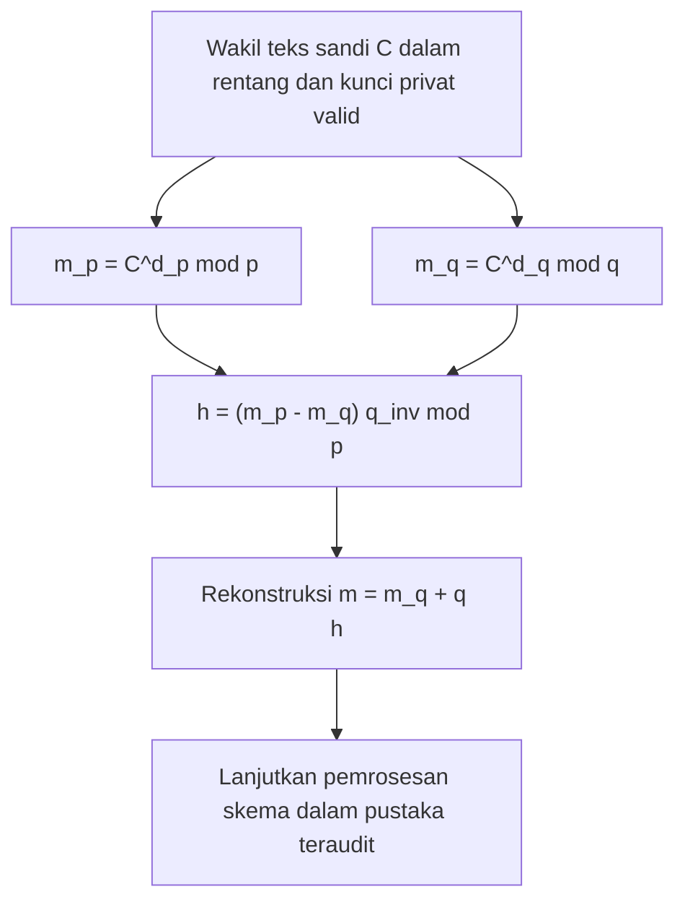

Teorema sisa Tiongkok (CRT) menggabungkan sisa untuk beberapa modulus menjadi satu kelas residu. Teorema ini menghubungkan masalah bilangan bulat, operasi RSA dengan kunci privat, gelanggang dan polinomial, serta aritmatika residu paralel. Syarat modulus, rentang rekonstruksi, serta perbedaan antara kebenaran aritmatika dan keamanan kriptografi perlu dinyatakan dengan jelas.

## 1. Masalah Sunzi dan himpunan solusi

Contoh yang dikaitkan dengan Sunzi Suanjing meminta bilangan yang bersisa 2 jika dibagi 3, bersisa 3 jika dibagi 5, dan bersisa 2 jika dibagi 7. Sebuah [penelitian sejarah memuat kembali masalah dan perhitungannya](https://sgmathsociety.org/smsmedley/Vol-30-1/The%20History%20of%20the%20Chinese%20Reminder%20Theorem%20%28Law%20Huang%20lng%29.pdf).

$$ x\equiv2\pmod3,\quad x\equiv3\pmod5,\quad x\equiv2\pmod7. $$

Solusi nonnegatif terkecil adalah 23. Namun, solusi bilangan bulatnya tidak hanya satu: semua solusi berbentuk $x=23+105t$ dengan $t\in\mathbb Z$. Sebagai contoh, 128 juga memenuhi syarat.

## 2. CRT bilangan bulat: syarat dan keunikan

Ambil $k\ge1$ dan modulus $m_i>1$ yang saling prima untuk setiap pasangan: $\gcd(m_i,m_j)=1$ jika $i\ne j$. Modulus itu sendiri tidak harus berupa bilangan prima. Untuk sembarang sisa bilangan bulat $a_i$, sistem

$$ x\equiv a_i\pmod{m_i}\quad(1\le i\le k) $$

memiliki tepat satu solusi modulo $M=\prod_{i=1}^k m_i$. Jadi, ada tepat satu wakil dengan $0\le x<M$. Syarat bahwa faktor persekutuan terbesar (FPB) seluruh modulus adalah 1 belum cukup: 6, 10, dan 15 memiliki FPB keseluruhan 1, tetapi tidak saling prima untuk setiap pasangan. [Bukti CRT bilangan bulat](https://kconrad.math.uconn.edu/blurbs/ugradnumthy/crt.pdf) menjelaskan perbedaan ini.

Selisih dua solusi mana pun habis dibagi setiap modulus. Karena modulus saling prima berpasangan, selisih itu juga habis dibagi hasil kalinya. Inilah bukti keunikan. Konstruksi berikut membuktikan keberadaan solusi.

## 3. Konstruksi dengan invers dan contoh perhitungan

Untuk setiap modulus, gunakan algoritma Euclid diperluas untuk memperoleh invers perkalian yang memenuhi

$$ M_i=M/m_i,\quad M_i y_i\equiv1\pmod{m_i} $$

Syarat saling prima menjamin invers tersebut ada. Mereduksi jumlah berikut ke rentang modulus memberikan solusi:

$$ x=\left(\sum_{i=1}^k a_iM_iy_i\right)\bmod M. $$

Modulo $m_j$, suku-suku dengan $i\ne j$ menjadi nol, sedangkan suku yang tersisa kongruen dengan $a_j$. Ini membuktikan keberadaan solusi.

Dalam contoh Sunzi, $M=105$, hasil kali parsialnya 35, 21, dan 15, dengan invers masing-masing 2, 1, dan 1.

$$ 2\cdot35\cdot2+3\cdot21\cdot1+2\cdot15\cdot1=233,
\qquad233\bmod105=23. $$

Ada generalisasi terpisah untuk modulus yang tidak saling prima. Untuk dua modulus, solusi ada jika dan hanya jika FPB keduanya membagi selisih sisa, dan solusi unik modulo kelipatan persekutuan terkecil (KPK). Contohnya, modulus 4 dan 6 dengan sisa 1 dan 3 memberikan 9 modulo 12; sisa 0 dan 1 tidak memberikan solusi. Kode di bawah tidak menerapkan generalisasi ini dan hanya menerima modulus yang saling prima berpasangan.

## 4. Implementasi Python dengan pemeriksaan masukan

Hanya nilai bertipe bawaan `int` yang diterima; `bool` dan nilai floating-point ditolak. Kedua masukan harus berupa objek iterable berhingga, tidak kosong, dan sama panjang. Setiap modulus harus lebih besar dari 1 dan saling prima dengan setiap modulus lainnya. Sisa boleh negatif atau melebihi modulusnya. Hasilnya adalah wakil nonnegatif terkecil modulo hasil kali modulus. Pengecualian modulus 1 dan sistem kosong merupakan kontrak API pembelajaran ini.

```python
from math import gcd, prod


def _extended_gcd(a, b):
    # Internal helper: integer a, positive integer b.
    old_r, r = a, b
    old_s, s = 1, 0
    old_t, t = 0, 1
    while r:
        quotient = old_r // r
        old_r, r = r, old_r - quotient * r
        old_s, s = s, old_s - quotient * s
        old_t, t = t, old_t - quotient * t
    return old_r, old_s, old_t


def mod_inverse(a, modulus):
    if type(a) is not int or type(modulus) is not int:
        raise TypeError("Arguments must be built-in integers")
    if modulus <= 1:
        raise ValueError("Modulus must exceed one")
    g, x, _ = _extended_gcd(a % modulus, modulus)
    if g != 1:
        raise ValueError("Inverse does not exist")
    return x % modulus


def chinese_remainder_theorem(residues, moduli):
    residues, moduli = tuple(residues), tuple(moduli)
    if not moduli or len(residues) != len(moduli):
        raise ValueError("Provide equally sized, nonempty inputs")
    if any(type(x) is not int for x in residues + moduli):
        raise TypeError("Residues and moduli must be built-in integers")
    if any(m <= 1 for m in moduli):
        raise ValueError("Every modulus must exceed one")
    for i, m in enumerate(moduli):
        if any(gcd(m, other) != 1 for other in moduli[:i]):
            raise ValueError("Moduli must be pairwise coprime")

    combined_modulus = prod(moduli)
    result = 0
    for a, m in zip(residues, moduli):
        partial = combined_modulus // m
        inverse = mod_inverse(partial, m)
        result = (result + (a % m) * partial * inverse) % combined_modulus
    return result


if __name__ == "__main__":
    residues = [2, 3, 2]
    moduli = [3, 5, 7]
    print("Sunzi solution:", chinese_remainder_theorem(residues, moduli))
    print("Combined modulus:", prod(moduli))
```

Pada Python 3.12, program mencetak `Sunzi solution: 23` dan `Combined modulus: 105`. Masukan yang berbeda panjang tidak dipotong diam-diam; modulus nol atau negatif, tipe, dan syarat saling prima diperiksa. Bilangan bulat Python menghindari overflow berlebar tetap, tetapi waktu dan memori bergantung pada panjang masukan serta ukuran bilangan. Ini bukan implementasi kriptografi dengan waktu konstan.

## 5. Nilai yang direkonstruksi RSA-CRT

Asumsikan kunci RSA yang valid dengan dua faktor prima. Gunakan bilangan prima ganjil berbeda $p,q$, $N=pq$, eksponen publik $e$, dan eksponen privat $d$ yang memenuhi $ed\equiv1\pmod{\lambda(N)}$, dengan $\lambda(N)=\operatorname{lcm}(p-1,q-1)$. Wakil bilangan bulat dari teks sandi memenuhi $0\le C<N$; operasi langsung dengan kunci privat adalah $m=C^d\bmod N$.

Siapkan parameter CRT:

$$ d_p=d\bmod(p-1),\quad d_q=d\bmod(q-1),\quad q_{\mathrm{inv}}=q^{-1}\bmod p. $$

$$ m_p=C^{d_p}\bmod p,\quad m_q=C^{d_q}\bmod q. $$

$$ h=(m_p-m_q)q_{\mathrm{inv}}\bmod p,\qquad m=m_q+qh. $$

Wakil ini memiliki sisa yang diperlukan untuk kedua bilangan prima dan berada dalam rentang modulus semula. [RFC 8017 bagian 3.2 dan 5.1.2](https://www.rfc-editor.org/rfc/rfc8017.html) menetapkan representasi kunci privat dan rekonstruksi ini. Dua eksponen CRT saja tidak menggantikan seluruh kunci privat: faktor-faktor dan koefisien juga merupakan material kunci rahasia.



Diagram ini hanya menggambarkan aritmatika bilangan bulat, tanpa pengodean pesan dan validasi skema. Enkripsi dan tanda tangan dalam praktik menggunakan skema berbeda. Seperti dijelaskan dalam [pengantar RSA](https://kenji.blog/id/p/rsa-encryption-math-explained-for-beginners/), pustaka yang telah diaudit harus melakukan pemrosesan yang sesuai dengan tujuan penggunaan.

## 6. Perkiraan kecepatan dan batas implementasi

Catatan 14.75 pada [HAC bab 14](https://cacr.uwaterloo.ca/hac/about/chap14.pdf) memberikan perkiraan faktor sekitar empat dengan sejumlah asumsi: ukuran kedua bilangan prima serupa, perkalian klasik berbiaya kuadratik, jumlah perkalian sebanding dengan panjang bit eksponen, dan biaya rekonstruksi dapat diabaikan. Algoritma perkalian lain, eksekusi paralel, perlindungan, serta perangkat berbeda akan mengubah perbandingan ini. Ini bukan hasil pengukuran bahwa kode artikel ini empat kali lebih cepat.

Jika salah satu sisa CRT yang dihitung terpisah rusak, hasil yang tidak diperiksa dapat membocorkan faktor rahasia. [Makalah analisis gangguan pada RSA-CRT](https://courses.csail.mit.edu/6.857/2010/handouts/faults.pdf) menjelaskan syaratnya. Aritmatika pembelajaran yang benar tidak menjamin perlindungan terhadap gangguan ataupun ketahanan terhadap serangan kanal samping. Perlindungan, termasuk pemeriksaan dengan kunci publik, perlu ditangani pustaka yang memproses skema lengkap.

## 7. Generalisasi ke gelanggang dan ideal

Misalkan $R$ adalah gelanggang komutatif dengan identitas perkalian, dan pilih sejumlah berhingga ideal di dalamnya. Asumsikan $I_i+I_j=R$ untuk setiap pasangan ideal berbeda. Homomorfisma alami

$$ \phi:R\longrightarrow\prod_{i=1}^k R/I_i,\qquad
\phi(r)=(r+I_1,\ldots,r+I_k) $$

bersifat surjektif dan intinya adalah irisan ideal-ideal tersebut. Dengan syarat ini, irisan sama dengan hasil kali ideal, sehingga:

$$ R/\left(\bigcap_{i=1}^k I_i\right)
\cong\prod_{i=1}^k R/I_i,\qquad
\bigcap_{i=1}^k I_i=\prod_{i=1}^k I_i. $$

[Teorema sisa Tiongkok pada Stacks Project](https://stacks.math.columbia.edu/tag/00DT) memberikan syarat dan buktinya. Modulus bilangan bulat yang saling prima berpasangan merupakan kasus khusus dari syarat ideal ini.

## 8. Polinomial dan interpolasi

Dua polinomial atas suatu lapangan saling prima jika dan hanya jika FPB-nya berupa konstanta tak nol. Tidak adanya akar bersama di lapangan asal saja belum cukup. Sebagai contoh, di atas bilangan rasional, ambil kedua polinomial sama dengan $x^2+1$. Keduanya tidak memiliki akar rasional, tetapi FPB-nya justru polinomial berderajat dua tersebut. Untuk menyatakan syarat saling prima melalui akar bersama, kita harus bekerja pada penutupan aljabar (algebraic closure).

Faktor linear untuk titik evaluasi berbeda $\alpha_1,\ldots,\alpha_k$ saling prima berpasangan. Karena itu, polinomial dengan nilai yang ditentukan unik di antara polinomial berderajat $<k$. Inilah hubungannya dengan interpolasi Lagrange. Jika derajat lebih tinggi diizinkan, keunikan tidak berlaku lagi. Evaluasi dan batas derajat atas lapangan berhingga juga berkaitan dengan kode Reed–Solomon, tetapi CRT saja tidak menjamin kemampuan koreksi kesalahan.

## 9. Sistem bilangan residu dan rentang rekonstruksi

RNS merepresentasikan bilangan bulat sebagai tuple sisa untuk beberapa modulus serta memungkinkan penjumlahan dan perkalian per komponen. Di sini $x_i=X\bmod m_i$ dan $y_i=Y\bmod m_i$. Untuk hasil kali modulus $M$:

$$ (X+Y)\bmod M\longleftrightarrow
((x_i+y_i)\bmod m_i)_{i=1}^k, $$

$$ (XY)\bmod M\longleftrightarrow
((x_iy_i)\bmod m_i)_{i=1}^k. $$

Carry adalah nilai yang diteruskan ke posisi digit berikutnya. Carry antarkanal tidak diperlukan, tetapi aritmatika biner di dalam setiap kanal masih dapat melibatkan carry. Rekonstruksi menghasilkan wakil modulo hasil kali modulus; tanpa informasi rentang tambahan, sisa-sisa itu tidak menentukan secara unik hasil penjumlahan atau perkalian bilangan bulat yang melampaui rentang tersebut. Perbandingan, pembagian, dan konversi ke representasi biasa memerlukan pemrosesan tambahan.

Dari masalah sisa klasik hingga kriptografi, aljabar, dan aritmatika paralel, CRT merekonstruksi sisa yang kompatibel di bawah syarat modulus dan rentang yang dinyatakan. Membedakan rentang serta kegunaannya penting untuk menerapkan teorema ini dengan benar.
