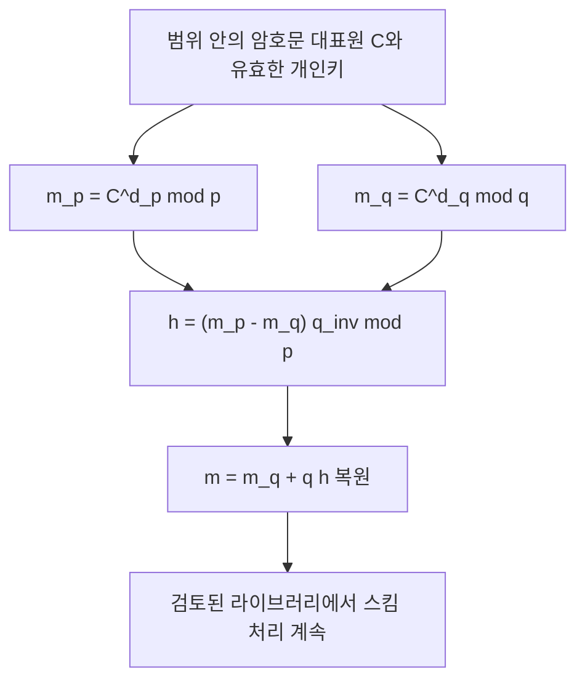

중국인의 나머지 정리(CRT)는 서로 다른 법에 대한 나머지를 하나의 나머지류로 결합합니다. 정수 문제, RSA 개인키 연산, 환과 다항식, 나머지를 이용한 병렬 연산을 연결하는 정리입니다. 법의 조건과 복원 범위를 명시하고, 산술적 정확성과 암호학적 안전성을 구분해야 합니다.

## 1. 손자의 문제와 해의 범위

『손자산경』의 유명한 예는 3으로 나누면 2, 5로 나누면 3, 7로 나누면 2가 남는 수를 묻습니다. [역사 연구 논문에서 문제와 계산법을 확인할 수 있습니다](https://sgmathsociety.org/smsmedley/Vol-30-1/The%20History%20of%20the%20Chinese%20Reminder%20Theorem%20%28Law%20Huang%20lng%29.pdf).

$$ x\equiv2\pmod3,\quad x\equiv3\pmod5,\quad x\equiv2\pmod7. $$

최소의 음이 아닌 해는 23입니다. 그러나 정수 해가 하나뿐인 것은 아닙니다. 모든 해는 $x=23+105t$이며 $t\in\mathbb Z$입니다. 예를 들어 128도 조건을 만족합니다.

## 2. 정수 CRT의 조건과 유일성

여기서는 $k\ge1$이고 각 법이 $m_i>1$이며, 쌍마다 서로소라고 가정합니다. 즉 $i\ne j$일 때 $\gcd(m_i,m_j)=1$입니다. 법 자체가 소수일 필요는 없습니다. 임의의 정수 나머지 $a_i$에 대해

$$ x\equiv a_i\pmod{m_i}\quad(1\le i\le k) $$

은 법 $M=\prod_{i=1}^k m_i$에 대해 유일한 해를 가집니다. 따라서 $0\le x<M$인 대표원이 정확히 하나 존재합니다. 모든 법을 한꺼번에 취한 최대공약수가 1인 것만으로는 부족합니다. 6, 10, 15는 전체 최대공약수가 1이지만 쌍마다 서로소는 아닙니다. [정수 CRT의 증명](https://kconrad.math.uconn.edu/blurbs/ugradnumthy/crt.pdf)에서 이 차이를 설명합니다.

임의의 두 해의 차이는 각 법으로 나누어떨어집니다. 법들이 쌍마다 서로소이므로 그 곱으로도 나누어떨어지며, 이것이 유일성을 증명합니다. 다음 구성은 존재성을 증명합니다.

## 3. 역원을 이용한 구성과 계산 예

각 법에 대해 확장 유클리드 알고리즘으로 다음 조건을 만족하는 곱셈 역원을 구합니다.

$$ M_i=M/m_i,\quad M_i y_i\equiv1\pmod{m_i} $$

서로소 조건이 역원의 존재를 보장합니다. 다음 합을 법에 따른 범위로 줄이면 해를 얻습니다.

$$ x=\left(\sum_{i=1}^k a_iM_iy_i\right)\bmod M. $$

$m_j$를 법으로 계산하면 $i\ne j$인 항들은 사라지고, 남은 항은 $a_j$와 합동입니다. 따라서 해가 존재합니다.

손자의 예에서는 $M=105$이고 부분 곱은 35, 21, 15, 이에 대응하는 역원은 2, 1, 1입니다.

$$ 2\cdot35\cdot2+3\cdot21\cdot1+2\cdot15\cdot1=233,
\qquad233\bmod105=23. $$

서로소가 아닌 법에 대해서는 별도의 일반화가 있습니다. 두 법의 경우, 최대공약수가 두 나머지의 차이를 나눌 때 그리고 그때에만 해가 존재하며, 해는 최소공배수를 법으로 유일합니다. 예를 들어 법 4, 6과 나머지 1, 3은 법 12의 해 9를 주지만, 나머지 0, 1이면 해가 없습니다. 아래 코드는 이 일반화를 구현하지 않고 쌍마다 서로소인 법만 받습니다.

## 4. 입력을 검사하는 Python 구현

Python 내장 `int`만 허용하며 `bool`과 부동소수점 값은 거부합니다. 두 입력은 길이가 같고 비어 있지 않은 유한 이터러블이어야 합니다. 각 법은 1보다 커야 하며 법들은 쌍마다 서로소여야 합니다. 나머지는 음수이거나 해당 법보다 커도 됩니다. 반환값은 법들의 곱에 대한 최소의 음이 아닌 대표원입니다. 법 1과 빈 연립식을 제외하는 것은 이 교육용 API의 명시적인 계약입니다.

```python
from math import gcd, prod


def _extended_gcd(a, b):
    # Internal helper: integer a, positive integer b.
    old_r, r = a, b
    old_s, s = 1, 0
    old_t, t = 0, 1
    while r:
        quotient = old_r // r
        old_r, r = r, old_r - quotient * r
        old_s, s = s, old_s - quotient * s
        old_t, t = t, old_t - quotient * t
    return old_r, old_s, old_t


def mod_inverse(a, modulus):
    if type(a) is not int or type(modulus) is not int:
        raise TypeError("Arguments must be built-in integers")
    if modulus <= 1:
        raise ValueError("Modulus must exceed one")
    g, x, _ = _extended_gcd(a % modulus, modulus)
    if g != 1:
        raise ValueError("Inverse does not exist")
    return x % modulus


def chinese_remainder_theorem(residues, moduli):
    residues, moduli = tuple(residues), tuple(moduli)
    if not moduli or len(residues) != len(moduli):
        raise ValueError("Provide equally sized, nonempty inputs")
    if any(type(x) is not int for x in residues + moduli):
        raise TypeError("Residues and moduli must be built-in integers")
    if any(m <= 1 for m in moduli):
        raise ValueError("Every modulus must exceed one")
    for i, m in enumerate(moduli):
        if any(gcd(m, other) != 1 for other in moduli[:i]):
            raise ValueError("Moduli must be pairwise coprime")

    combined_modulus = prod(moduli)
    result = 0
    for a, m in zip(residues, moduli):
        partial = combined_modulus // m
        inverse = mod_inverse(partial, m)
        result = (result + (a % m) * partial * inverse) % combined_modulus
    return result


if __name__ == "__main__":
    residues = [2, 3, 2]
    moduli = [3, 5, 7]
    print("Sunzi solution:", chinese_remainder_theorem(residues, moduli))
    print("Combined modulus:", prod(moduli))
```

Python 3.12로 실행하면 `Sunzi solution: 23`과 `Combined modulus: 105`를 출력합니다. 길이가 다를 때 조용히 잘라내지 않으며, 0이나 음수인 법, 자료형, 서로소 조건을 검사합니다. Python 정수는 고정 비트 폭의 오버플로를 피하지만 시간과 메모리는 입력 길이와 정수 크기에 따라 달라집니다. 상수 시간 암호 구현은 아닙니다.

## 5. RSA-CRT가 복원하는 값

두 소수를 사용하는 유효한 RSA 키를 가정합니다. 서로 다른 홀수 소수 $p,q$, $N=pq$, 공개 지수 $e$, 비밀 지수 $d$를 사용하며 $ed\equiv1\pmod{\lambda(N)}$을 만족해야 합니다. 여기서 $\lambda(N)=\operatorname{lcm}(p-1,q-1)$입니다. 암호문 대표원은 $0\le C<N$을 만족하고, 직접적인 개인키 연산은 $m=C^d\bmod N$입니다.

CRT 매개변수를 준비합니다.

$$ d_p=d\bmod(p-1),\quad d_q=d\bmod(q-1),\quad q_{\mathrm{inv}}=q^{-1}\bmod p. $$

$$ m_p=C^{d_p}\bmod p,\quad m_q=C^{d_q}\bmod q. $$

$$ h=(m_p-m_q)q_{\mathrm{inv}}\bmod p,\qquad m=m_q+qh. $$

이 대표원은 두 소수 각각에 대해 필요한 나머지를 가지며 원래 법의 범위 안에 있습니다. [RFC 8017의 3.2절과 5.1.2절](https://www.rfc-editor.org/rfc/rfc8017.html)은 이 개인키 표현과 복원법을 명시합니다. 두 CRT 지수만으로 개인키 전체를 대체할 수는 없습니다. 인수와 계수도 비밀 키 재료입니다.



이 그림은 정수 연산만 나타내며 메시지 인코딩과 스킴 검증을 생략합니다. 실제 암호화와 서명은 서로 다른 스킴을 사용합니다. [RSA 입문 글](https://kenji.blog/ko/p/rsa-encryption-math-explained-for-beginners/)에서 설명하듯이, 보안 검토를 거친 라이브러리가 목적에 맞는 처리를 수행해야 합니다.

## 6. 속도 추정과 구현의 경계

[HAC 14장](https://cacr.uwaterloo.ca/hac/about/chap14.pdf)의 Note 14.75는 두 소수의 크기가 비슷하고, 고전적인 이차 비용의 곱셈을 사용하며, 곱셈 횟수가 지수의 비트 길이에 비례하고, 복원 비용을 무시할 수 있다는 가정 아래 약 4배라는 추정치를 제시합니다. 곱셈 알고리즘, 병렬 실행, 방어 기법, 기기에 따라 비율은 달라집니다. 이 글의 코드를 실측해 4배 빨라졌다는 뜻이 아닙니다.

따로 계산한 두 CRT 나머지 중 하나에만 오류가 생겼을 때, 결과를 검사하지 않으면 비밀 인수가 드러날 수 있습니다. [RSA-CRT 오류 분석 논문](https://courses.csail.mit.edu/6.857/2010/handouts/faults.pdf)에서 그 조건을 설명합니다. 교육용 산술이 정확하다고 해서 오류 방어나 부채널 저항성까지 보장되는 것은 아닙니다. 공개키를 이용한 검사 등을 포함한 방어는 전체 스킴을 처리하는 라이브러리에서 구현해야 합니다.

## 7. 환과 아이디얼로의 일반화

곱셈 항등원을 가진 가환환 $R$의 유한 개 아이디얼이 쌍마다 $I_i+I_j=R$을 만족한다고 가정합니다. 자연스러운 준동형

$$ \phi:R\longrightarrow\prod_{i=1}^k R/I_i,\qquad
\phi(r)=(r+I_1,\ldots,r+I_k) $$

은 전사이고 그 핵은 아이디얼들의 교집합입니다. 이 조건 아래에서는 교집합이 아이디얼들의 곱과 같으므로 다음이 성립합니다.

$$ R/\left(\bigcap_{i=1}^k I_i\right)
\cong\prod_{i=1}^k R/I_i,\qquad
\bigcap_{i=1}^k I_i=\prod_{i=1}^k I_i. $$

[Stacks Project의 중국인의 나머지 정리](https://stacks.math.columbia.edu/tag/00DT)에 조건과 증명이 나옵니다. 정수 법들이 쌍마다 서로소인 경우는 이 아이디얼 조건의 특수한 경우입니다.

## 8. 다항식과 보간

체 위의 다항식이 서로소라는 것은 최대공약다항식이 0이 아닌 상수라는 뜻입니다. 원래의 체에서 공통근이 없다는 것만으로는 부족합니다. 예를 들어 유리수체에서 두 다항식을 모두 $x^2+1$로 잡으면, 둘 다 유리근이 없지만 최대공약다항식은 바로 그 이차다항식입니다. 공통근으로 서로소 조건을 설명하려면 대수적 폐포에서 생각해야 합니다.

서로 다른 평가점 $\alpha_1,\ldots,\alpha_k$에 대응하는 일차 인수들은 쌍마다 서로소입니다. 따라서 주어진 값을 갖는 다항식은 차수가 $<k$인 다항식들 중에서 유일합니다. 이것이 라그랑주 보간과의 연결입니다. 더 높은 차수를 허용하면 유일하지 않습니다. 유한체 위의 값 평가와 차수 제한은 리드–솔로몬 부호와도 연결되지만, CRT만으로 오류 정정 능력이 보장되지는 않습니다.

## 9. 잉여 수 체계와 복원 범위

RNS는 여러 법에 대한 나머지의 튜플로 정수를 표현하고, 성분별 덧셈과 곱셈을 허용합니다. 여기서 $x_i=X\bmod m_i$, $y_i=Y\bmod m_i$로 둡니다. 법들의 곱이 $M$이면 다음과 같습니다.

$$ (X+Y)\bmod M\longleftrightarrow
((x_i+y_i)\bmod m_i)_{i=1}^k, $$

$$ (XY)\bmod M\longleftrightarrow
((x_iy_i)\bmod m_i)_{i=1}^k. $$

채널 사이의 자리올림 전파는 필요 없지만, 각 채널 안의 이진 연산에는 여전히 자리올림이 생길 수 있습니다. 복원 결과는 법들의 곱에 대한 대표원입니다. 범위를 벗어난 제한 없는 정수의 합이나 곱을 이 나머지들만으로 유일하게 복원하지는 못합니다. 비교, 나눗셈, 일반적인 표현으로의 변환에는 추가 작업이 필요합니다.

고전적인 나머지 문제부터 암호학, 대수학, 병렬 연산까지 CRT는 법과 범위에 관한 조건 아래 서로 맞는 나머지들을 복원합니다. 그 범위와 용도를 구분해야 올바르게 적용할 수 있습니다.
