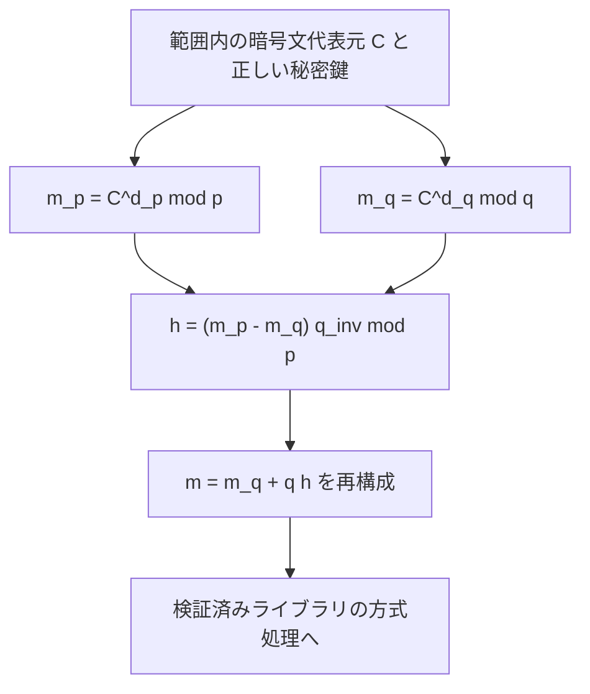

中国剰余定理（CRT）は、異なる法の剰余を一つの剰余へまとめる定理です。整数の問題、RSAの秘密鍵演算、環や多項式、並列的な剰余計算につながります。ただし、法の条件、復元できる範囲、計算の正当性と暗号方式の安全性を区別する必要があります。

## 1. 孫子の問題と解の範囲

『孫子算経』の例として知られる問題は、3で割ると2、5で割ると3、7で割ると2余る数を求めるものです。[歴史研究論文に再掲された問題と計算](https://sgmathsociety.org/smsmedley/Vol-30-1/The%20History%20of%20the%20Chinese%20Reminder%20Theorem%20%28Law%20Huang%20lng%29.pdf)を参照できます。

$$ x\equiv2\pmod3,\quad x\equiv3\pmod5,\quad x\equiv2\pmod7. $$

最小非負解は23です。整数解が一つという意味ではなく、すべての解は $x=23+105t$（$t\in\mathbb Z$）です。例えば128も条件を満たします。

## 2. 整数CRTの条件と一意性

以下では $k\ge1$、各法 $m_i>1$ とし、法が対ごとに互いに素、すなわち $\gcd(m_i,m_j)=1$（$i\ne j$）とします。法は素数でなくても構いません。任意の整数剰余 $a_i$ に対して、

$$ x\equiv a_i\pmod{m_i}\quad(1\le i\le k) $$

は、$M=\prod_{i=1}^k m_i$ を法としてただ一つの解を持ちます。従って $0\le x<M$ の代表元が一つに決まります。「全部の最大公約数が1」だけでは足りず、例えば6・10・15は対ごとには互いに素ではありません。[整数CRTの証明](https://kconrad.math.uconn.edu/blurbs/ugradnumthy/crt.pdf)もこの区別を説明しています。

二つの解の差はすべての法の倍数です。法が対ごとに互いに素なら、その差は積の倍数にもなるため、一意性が従います。存在は次の構成で示せます。

## 3. 逆元による構成と具体的な計算

各法について、

$$ M_i=M/m_i,\quad M_i y_i\equiv1\pmod{m_i} $$

を満たす逆元を拡張ユークリッドの互除法で求めます。互いに素の条件から、この逆元が存在します。解は次の和を法の範囲に正規化して得られます。

$$ x=\left(\sum_{i=1}^k a_iM_iy_i\right)\bmod M. $$

一つの法 $m_j$ で見ると、$i\ne j$ の項は0に合同で、残った項は $a_j$ に合同です。これで存在も示せます。

孫子の例では $M=105$、部分積は35・21・15、対応する逆元は2・1・1です。

$$ 2\cdot35\cdot2+3\cdot21\cdot1+2\cdot15\cdot1=233,
\qquad233\bmod105=23. $$

互いに素でない法にも別の一般化があります。二つの法なら、剰余の差が法の最大公約数で割り切れるときに限って解が存在し、最小公倍数を法として一意です。例えば法4・6、剰余1・3なら解は9を法12で考えたものですが、剰余0・1なら解はありません。以下のコードはこの一般化を実装せず、対ごとに互いに素な法だけを受け付けます。

## 4. 入力条件を確認するPython実装

組み込みの `int` のみを受け付け、`bool` や浮動小数点数は拒否します。入力は有限の反復可能な列とし、剰余と法は同じ長さで空ではなく、各法は1より大きく、対ごとに互いに素とします。剰余は負でも法以上でも構いません。返す値は法の積に対する最小非負代表元です。法1や空の系を除外するのは、この教材APIの契約です。

```python
from math import gcd, prod


def _extended_gcd(a, b):
    # Internal helper: integer a, positive integer b.
    old_r, r = a, b
    old_s, s = 1, 0
    old_t, t = 0, 1
    while r:
        quotient = old_r // r
        old_r, r = r, old_r - quotient * r
        old_s, s = s, old_s - quotient * s
        old_t, t = t, old_t - quotient * t
    return old_r, old_s, old_t


def mod_inverse(a, modulus):
    if type(a) is not int or type(modulus) is not int:
        raise TypeError("Arguments must be built-in integers")
    if modulus <= 1:
        raise ValueError("Modulus must exceed one")
    g, x, _ = _extended_gcd(a % modulus, modulus)
    if g != 1:
        raise ValueError("Inverse does not exist")
    return x % modulus


def chinese_remainder_theorem(residues, moduli):
    residues, moduli = tuple(residues), tuple(moduli)
    if not moduli or len(residues) != len(moduli):
        raise ValueError("Provide equally sized, nonempty inputs")
    if any(type(x) is not int for x in residues + moduli):
        raise TypeError("Residues and moduli must be built-in integers")
    if any(m <= 1 for m in moduli):
        raise ValueError("Every modulus must exceed one")
    for i, m in enumerate(moduli):
        if any(gcd(m, other) != 1 for other in moduli[:i]):
            raise ValueError("Moduli must be pairwise coprime")

    combined_modulus = prod(moduli)
    result = 0
    for a, m in zip(residues, moduli):
        partial = combined_modulus // m
        inverse = mod_inverse(partial, m)
        result = (result + (a % m) * partial * inverse) % combined_modulus
    return result


if __name__ == "__main__":
    residues = [2, 3, 2]
    moduli = [3, 5, 7]
    print("Sunzi solution:", chinese_remainder_theorem(residues, moduli))
    print("Combined modulus:", prod(moduli))
```

Python 3.12で実行すると `Sunzi solution: 23` と `Combined modulus: 105` を表示します。長さが違う入力を黙って切り捨てず、法0・負の法・型・互いに素の条件も検査します。Python整数に固定幅の桁あふれはありませんが、入力の長さと整数サイズに応じて時間とメモリを消費します。これは暗号用の定数時間実装ではありません。

## 5. RSA-CRTは何を再構成するのか

正しい2素数RSA鍵を仮定します。相異なる奇素数 $p,q$ と $N=pq$、公開指数 $e$、秘密指数 $d$ を用い、$ed\equiv1\pmod{\lambda(N)}$ とします。ここで $\lambda(N)=\operatorname{lcm}(p-1,q-1)$ です。暗号文代表元は $0\le C<N$ で、直接の秘密鍵演算は $m=C^d\bmod N$ です。

CRT用には次を準備します。

$$ d_p=d\bmod(p-1),\quad d_q=d\bmod(q-1),\quad q_{\mathrm{inv}}=q^{-1}\bmod p. $$

$$ m_p=C^{d_p}\bmod p,\quad m_q=C^{d_q}\bmod q. $$

$$ h=(m_p-m_q)q_{\mathrm{inv}}\bmod p,\qquad m=m_q+qh. $$

この代表元は各素数で必要な剰余を持ち、元の法の範囲内にあります。[RFC8017 Section3.2と5.1.2](https://www.rfc-editor.org/rfc/rfc8017.html)は、この秘密鍵表現と再構成を規定しています。二つのCRT指数だけで秘密鍵全体を置き換えるのではなく、素因数と係数も秘密の鍵材料です。



これは整数演算の図で、メッセージの符号化・方式の検証を省いています。実用の暗号化と署名は別の方式であり、[RSAの解説](https://kenji.blog/p/rsa-encryption-math-explained-for-beginners/)のように、監査されたライブラリで目的に合う処理を行う必要があります。

## 6. 速度の見積もりと実装上の境界

[HAC第14章](https://cacr.uwaterloo.ca/hac/about/chap14.pdf)のNote14.75では、同程度の大きさの素数、古典的な2次の乗算費用、指数ビット長に比例する乗算回数、再構成費用を無視できるという仮定のもとで、約4倍という見積もりを示します。異なる乗算アルゴリズム、並列実行、防御処理、機器では倍率は変わります。この記事のコードを計測して4倍を確認したという意味ではありません。

CRTで別々に計算した剰余の片方が壊れると、未検証の結果が秘密因数の漏えいにつながる場合があります。[RSA-CRTの故障解析の論文](https://courses.csail.mit.edu/6.857/2010/handouts/faults.pdf)で、その条件が説明されています。教材の正しい算術だけでは、故障対策やサイドチャネル耐性まで保証できません。公開鍵による結果の照合などを含む実装上の対策は、方式全体を扱うライブラリに委ねます。

## 7. 環とイデアルへの一般化

単位元を持つ可換環 $R$ と有限個のイデアルについて、対ごとに $I_i+I_j=R$ とします。自然な準同型

$$ \phi:R\longrightarrow\prod_{i=1}^k R/I_i,\qquad
\phi(r)=(r+I_1,\ldots,r+I_k) $$

は全射で、核はイデアルの交わりです。この条件では交わりと積が等しいので、

$$ R/\left(\bigcap_{i=1}^k I_i\right)
\cong\prod_{i=1}^k R/I_i,\qquad
\bigcap_{i=1}^k I_i=\prod_{i=1}^k I_i. $$

[Stacks Projectの中国剰余定理](https://stacks.math.columbia.edu/tag/00DT)に、条件と証明があります。整数の対ごとに互いに素な法は、このイデアル条件の特別な場合です。

## 8. 多項式と補間

体上の多項式では、互いに素とはgcdが非零定数という意味です。「元の体の中に共通の根がない」だけでは足りません。例えば有理数体で両方を $x^2+1$ とすると、有理根はありませんが多項式同士のgcdはその2次式です。共通根で言い換えるなら代数閉包で考えます。

異なる評価点 $\alpha_1,\ldots,\alpha_k$ の一次因子は対ごとに互いに素なので、指定した値を取る多項式が次数 $<k$ の範囲で一意に決まります。これがラグランジュ補間との対応です。より高い次数まで許せば一意ではありません。有限体での評価と次数の制約は、リード・ソロモン符号にもつながりますが、誤り訂正能力までCRTだけで得られるわけではありません。

## 9. 剰余数系と復元の範囲

RNSは整数を複数の法の剰余で表し、成分ごとに加算・乗算できます。ここで $x_i=X\bmod m_i$、$y_i=Y\bmod m_i$ とします。法の積 $M$ に対して、

$$ (X+Y)\bmod M\longleftrightarrow
((x_i+y_i)\bmod m_i)_{i=1}^k, $$

$$ (XY)\bmod M\longleftrightarrow
((x_iy_i)\bmod m_i)_{i=1}^k. $$

チャンネル間の桁上がりは不要ですが、各チャンネル内の2進演算には桁上がりがあり得ます。復元結果は法の積に対する代表元であり、範囲を超えた整数の和や積をそのまま一意に取り戻すものではありません。比較・除算・通常表現への変換には追加処理が必要です。

古典的な余りの問題から暗号・代数・並列計算まで、CRTの役割は「条件を満たす複数の剰余を、指定した法と範囲で再構成すること」です。この範囲と用途の違いを保って理解することが大切です。
