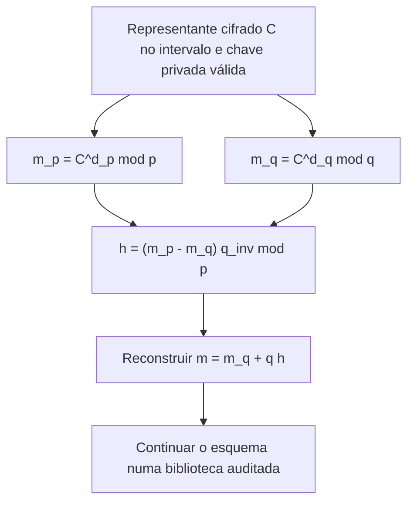

O teorema chinês do resto (CRT) combina restos relativos a módulos diferentes numa classe de resíduos. Liga problemas com inteiros, operações RSA com a chave privada, anéis e polinómios, e aritmética paralela por resíduos. Importa explicitar as condições sobre os módulos, o intervalo de reconstrução e a diferença entre correção aritmética e segurança criptográfica.

## 1. O problema de Sunzi e o conjunto das soluções

O exemplo associado ao Sunzi Suanjing pede um número que deixe resto 2 na divisão por 3, resto 3 na divisão por 5 e resto 2 na divisão por 7. Um [estudo histórico reproduz o problema e o cálculo](https://sgmathsociety.org/smsmedley/Vol-30-1/The%20History%20of%20the%20Chinese%20Reminder%20Theorem%20%28Law%20Huang%20lng%29.pdf).

$$ x\equiv2\pmod3,\quad x\equiv3\pmod5,\quad x\equiv2\pmod7. $$

A menor solução não negativa é 23. Não existe apenas uma solução inteira: todas são $x=23+105t$, com $t\in\mathbb Z$. Por exemplo, 128 também satisfaz as condições.

## 2. CRT para inteiros: hipóteses e unicidade

Tomamos $k\ge1$ e módulos $m_i>1$ coprimos dois a dois: $\gcd(m_i,m_j)=1$ quando $i\ne j$. Os próprios módulos não têm de ser primos. Para quaisquer restos inteiros $a_i$, o sistema

$$ x\equiv a_i\pmod{m_i}\quad(1\le i\le k) $$

tem exatamente uma solução módulo $M=\prod_{i=1}^k m_i$. Assim, existe um único representante com $0\le x<M$. Não basta que o máximo divisor comum de todos os módulos em conjunto seja 1: 6, 10 e 15 têm máximo divisor comum global igual a 1, mas não são coprimos dois a dois. A [demonstração do CRT para inteiros](https://kconrad.math.uconn.edu/blurbs/ugradnumthy/crt.pdf) explica esta distinção.

A diferença entre duas soluções quaisquer é divisível por cada módulo. Como os módulos são coprimos dois a dois, essa diferença é divisível pelo produto, o que prova a unicidade. A construção seguinte prova a existência.

## 3. Construção com inversos e exemplo de cálculo

Para cada módulo, o algoritmo de Euclides estendido permite encontrar um inverso que satisfaça

$$ M_i=M/m_i,\quad M_i y_i\equiv1\pmod{m_i} $$

A coprimalidade garante a existência do inverso. Reduzindo a soma seguinte ao intervalo do módulo, obtemos a solução:

$$ x=\left(\sum_{i=1}^k a_iM_iy_i\right)\bmod M. $$

Ao reduzir módulo $m_j$, os termos com $i\ne j$ desaparecem e o termo restante é congruente com $a_j$. Isto demonstra a existência.

No exemplo de Sunzi, $M=105$, os produtos parciais são 35, 21 e 15, e os inversos correspondentes são 2, 1 e 1.

$$ 2\cdot35\cdot2+3\cdot21\cdot1+2\cdot15\cdot1=233,
\qquad233\bmod105=23. $$

Há uma generalização separada para módulos não coprimos. Com dois módulos, existe solução se e só se o máximo divisor comum dividir a diferença entre os restos; a solução é única módulo o mínimo múltiplo comum. Por exemplo, os módulos 4 e 6 com restos 1 e 3 dão 9 módulo 12, mas com restos 0 e 1 não existe solução. O código abaixo não implementa esta generalização: aceita apenas módulos coprimos dois a dois.

## 4. Implementação em Python com validação das entradas

Apenas são aceites valores do tipo incorporado `int`; `bool` e valores de vírgula flutuante são rejeitados. As entradas devem ser iteráveis finitos, não vazios e com o mesmo comprimento. Cada módulo deve ser maior que 1 e os módulos devem ser coprimos dois a dois. Os restos podem ser negativos ou exceder o respetivo módulo. O resultado é o menor representante não negativo módulo o produto. Excluir o módulo 1 e o sistema vazio faz parte do contrato desta API didática.

```python
from math import gcd, prod


def _extended_gcd(a, b):
    # Internal helper: integer a, positive integer b.
    old_r, r = a, b
    old_s, s = 1, 0
    old_t, t = 0, 1
    while r:
        quotient = old_r // r
        old_r, r = r, old_r - quotient * r
        old_s, s = s, old_s - quotient * s
        old_t, t = t, old_t - quotient * t
    return old_r, old_s, old_t


def mod_inverse(a, modulus):
    if type(a) is not int or type(modulus) is not int:
        raise TypeError("Arguments must be built-in integers")
    if modulus <= 1:
        raise ValueError("Modulus must exceed one")
    g, x, _ = _extended_gcd(a % modulus, modulus)
    if g != 1:
        raise ValueError("Inverse does not exist")
    return x % modulus


def chinese_remainder_theorem(residues, moduli):
    residues, moduli = tuple(residues), tuple(moduli)
    if not moduli or len(residues) != len(moduli):
        raise ValueError("Provide equally sized, nonempty inputs")
    if any(type(x) is not int for x in residues + moduli):
        raise TypeError("Residues and moduli must be built-in integers")
    if any(m <= 1 for m in moduli):
        raise ValueError("Every modulus must exceed one")
    for i, m in enumerate(moduli):
        if any(gcd(m, other) != 1 for other in moduli[:i]):
            raise ValueError("Moduli must be pairwise coprime")

    combined_modulus = prod(moduli)
    result = 0
    for a, m in zip(residues, moduli):
        partial = combined_modulus // m
        inverse = mod_inverse(partial, m)
        result = (result + (a % m) * partial * inverse) % combined_modulus
    return result


if __name__ == "__main__":
    residues = [2, 3, 2]
    moduli = [3, 5, 7]
    print("Sunzi solution:", chinese_remainder_theorem(residues, moduli))
    print("Combined modulus:", prod(moduli))
```

Com Python 3.12, o programa imprime `Sunzi solution: 23` e `Combined modulus: 105`. Comprimentos diferentes não são truncados silenciosamente; verificam-se os módulos nulos ou negativos, os tipos e a coprimalidade. Os inteiros de Python evitam o transbordo de largura fixa, mas o tempo e a memória dependem do comprimento das entradas e do tamanho dos inteiros. Esta não é uma implementação criptográfica de tempo constante.

## 5. O que o RSA-CRT reconstrói

Suponhamos uma chave RSA válida de dois primos. Usam-se primos ímpares distintos $p,q$, $N=pq$, um expoente público $e$ e um expoente privado $d$ que satisfazem $ed\equiv1\pmod{\lambda(N)}$, onde $\lambda(N)=\operatorname{lcm}(p-1,q-1)$. O representante do texto cifrado satisfaz $0\le C<N$; a operação direta com a chave privada é $m=C^d\bmod N$.

Preparam-se os parâmetros CRT:

$$ d_p=d\bmod(p-1),\quad d_q=d\bmod(q-1),\quad q_{\mathrm{inv}}=q^{-1}\bmod p. $$

$$ m_p=C^{d_p}\bmod p,\quad m_q=C^{d_q}\bmod q. $$

$$ h=(m_p-m_q)q_{\mathrm{inv}}\bmod p,\qquad m=m_q+qh. $$

Este representante tem os restos necessários para os dois primos e pertence ao intervalo do módulo original. As [secções 3.2 e 5.1.2 do RFC 8017](https://www.rfc-editor.org/rfc/rfc8017.html) especificam esta representação da chave privada e a reconstrução. Os dois expoentes CRT não substituem, por si só, a chave privada completa: os fatores e o coeficiente também são material secreto da chave.



O diagrama descreve aritmética de inteiros e omite a codificação da mensagem e a validação do esquema. A cifragem e as assinaturas usadas na prática empregam esquemas distintos. Como explica a [introdução ao RSA](https://kenji.blog/pt/p/rsa-encryption-math-explained-for-beginners/), uma biblioteca auditada deve realizar o processamento adequado à finalidade.

## 6. Estimativas de velocidade e limites da implementação

A nota 14.75 do [capítulo 14 do HAC](https://cacr.uwaterloo.ca/hac/about/chap14.pdf) estima um fator de aproximadamente quatro sob certas hipóteses: primos de dimensões semelhantes, multiplicação clássica de custo quadrático, número de multiplicações proporcional ao comprimento do expoente em bits e custo de reconstrução desprezável. Outros algoritmos de multiplicação, a execução paralela, as defesas e os dispositivos alteram essa proporção. Não se trata de uma aceleração por quatro medida no código deste artigo.

Se um dos restos CRT calculados separadamente for corrompido, um resultado não verificado pode revelar um fator secreto. O [artigo sobre análise de falhas no RSA-CRT](https://courses.csail.mit.edu/6.857/2010/handouts/faults.pdf) explica as condições. A correção da aritmética didática não garante proteção contra falhas nem resistência a canais laterais. As defesas, incluindo verificações com a chave pública, pertencem a uma biblioteca que trate o esquema completo.

## 7. Generalização a anéis e ideais

Para um anel comutativo com unidade $R$ e um número finito de ideais, suponhamos que $I_i+I_j=R$ dois a dois, isto é, que os ideais são comaximais dois a dois. O homomorfismo natural

$$ \phi:R\longrightarrow\prod_{i=1}^k R/I_i,\qquad
\phi(r)=(r+I_1,\ldots,r+I_k) $$

é sobrejetivo e o seu núcleo é a interseção dos ideais. Sob esta condição, a interseção coincide com o produto, pelo que:

$$ R/\left(\bigcap_{i=1}^k I_i\right)
\cong\prod_{i=1}^k R/I_i,\qquad
\bigcap_{i=1}^k I_i=\prod_{i=1}^k I_i. $$

O [teorema chinês do resto do Stacks Project](https://stacks.math.columbia.edu/tag/00DT) apresenta as hipóteses e a demonstração. Os módulos inteiros coprimos dois a dois são um caso particular desta condição sobre ideais.

## 8. Polinómios e interpolação

Dois polinómios sobre um corpo são coprimos quando o seu máximo divisor comum é uma constante não nula. Não basta não terem raízes comuns no corpo original. Por exemplo, sobre os racionais, tomemos ambos os polinómios iguais a $x^2+1$. Nenhum tem raízes racionais, mas o máximo divisor comum é esse mesmo polinómio quadrático. Uma caracterização por raízes comuns exige trabalhar num fecho algébrico.

Os fatores lineares correspondentes a pontos de avaliação distintos $\alpha_1,\ldots,\alpha_k$ são coprimos dois a dois. Por isso, o polinómio com os valores indicados é único entre os de grau $<k$. Esta é a ligação à interpolação de Lagrange. Se permitirmos graus superiores, perdemos a unicidade. A avaliação e os limites de grau sobre corpos finitos também se relacionam com os códigos de Reed–Solomon, mas o CRT, por si só, não garante a capacidade de correção de erros.

## 9. Sistemas de numeração por resíduos e intervalos de reconstrução

Um RNS representa inteiros por um tuplo de restos relativos a vários módulos e permite somar e multiplicar por componentes. Aqui $x_i=X\bmod m_i$ e $y_i=Y\bmod m_i$. Para o produto $M$ dos módulos:

$$ (X+Y)\bmod M\longleftrightarrow
((x_i+y_i)\bmod m_i)_{i=1}^k, $$

$$ (XY)\bmod M\longleftrightarrow
((x_iy_i)\bmod m_i)_{i=1}^k. $$

Não é necessário propagar transportes entre canais, mas a aritmética binária dentro de cada canal ainda pode envolver transportes. A reconstrução dá um representante módulo o produto; não recupera de forma única uma soma ou um produto de inteiros sem restrições que exceda esse intervalo. A comparação, a divisão e a conversão para a representação habitual exigem trabalho adicional.

De um problema clássico de restos à criptografia, à álgebra e à aritmética paralela, o CRT reconstrói restos compatíveis sob condições explícitas sobre os módulos e os intervalos. Distinguir esses intervalos e utilizações é essencial para o aplicar corretamente.
